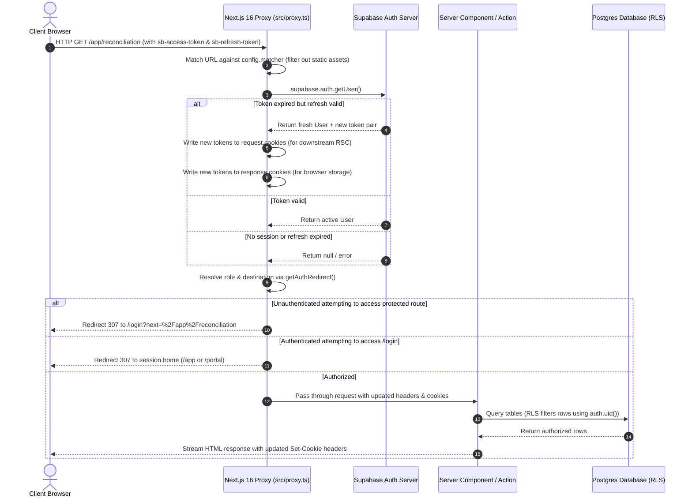
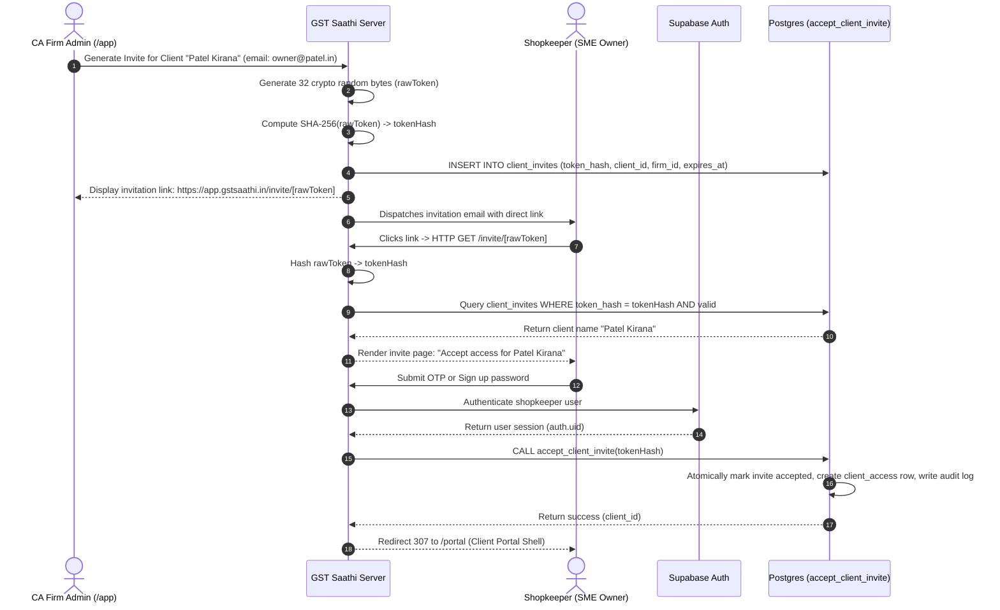

# Authentication, Access Control & Session Lifecycle

This document provides the definitive architectural specification, route access matrix, session lifecycle, cryptographic protocol, and security guarantees for **GST Saathi**.

---

## 1. Architecture Overview

GST Saathi employs a multi-tenant, role-segregated architecture tailored to the Indian tax ecosystem. It balances high-security compliance for Chartered Accountants (CAs) with ultra-low-friction document submission for retail shop owners (SMEs).

```
+-----------------------------------------------------------------------------------+
|                                 Client Browser                                    |
+-----------------------------------------------------------------------------------+
                                         │
                                         ▼ (HTTP Request)
+-----------------------------------------------------------------------------------+
|               Next.js 16 Edge / Node Proxy Layer (`src/proxy.ts`)                 |
|  - Request matching (bypasses static assets, images, favicon)                     |
|  - Session cookie refresh via `@supabase/ssr` `createServerClient`               |
|  - Synchronized cookie writeback to `request.cookies` and `response.cookies`       |
|  - Pre-render auth routing via `getAuthRedirect(pathname, session)`               |
+-----------------------------------------------------------------------------------+
                                         │
                     ┌───────────────────┴───────────────────┐
                     ▼ (Redirect 307)                        ▼ (Pass-through 200)
+─────────────────────────────────────────+  +──────────────────────────────────────+
|        Redirect Targets                 |  |       Next.js 16 App Router          |
|  - Unauthenticated -> `/login?next=...` |  |                                      |
|  - Firm Member -> `/app`                |  |  +--------------------------------+  |
|  - Client Owner -> `/portal`            |  |  | Server Components / Layouts    |  |
|  - Unassigned User -> `/no-access`      |  |  |  - `requireUser()`             |  |
+─────────────────────────────────────────+  |  |  - `requireFirmRole('admin')`  |  |
                                             |  |  - `requireClientAccess(id)`   |  |
                                             |  +--------------------------------+  |
                                             |  | Server Actions / Mutations     |  |
                                             |  |  - `loginWithPassword()`       |  |
                                             |  |  - `sendLoginOtp()`            |  |
                                             |  |  - `verifyLoginOtp()`          |  |
                                             |  +--------------------------------+  |
                                             +──────────────────┬───────────────────+
                                                                │
                                                                ▼ (Supabase Postgres Client)
+-----------------------------------------------------------------------------------+
|               Supabase Database & Storage (AWS Mumbai `ap-south-1`)              |
|  - Supabase Auth Service (`auth.users`, JWT verification)                         |
|  - Row-Level Security (RLS) enforcement via `auth.uid()`                          |
|  - Atomic `SECURITY DEFINER` RPC helper functions (`accept_client_invite`)       |
|  - Denormalized `firm_id` tenant isolation across all transactional tables         |
+-----------------------------------------------------------------------------------+
```

### 1.1 Technology Stack & Core Components

1. **Next.js 16 App Router**:
   - Implements React Server Components (RSC) by default for zero-bundle-cost data fetching.
   - Enforces asynchronous request cookies resolution (`const cookieStore = await cookies()`).
2. **Next.js 16 Proxy Convention (`src/proxy.ts`)**:
   - Replaces the deprecated `middleware.ts` pattern with the Next.js 16 native `proxy.ts` module export.
   - Runs before every non-static route evaluation to execute Supabase session token refresh and pre-render route protection.
3. **Supabase Auth & `@supabase/ssr`**:
   - Utilizes `@supabase/ssr` for cookie-based session management across Server Components, Route Handlers, and Server Actions.
   - Avoids local storage session tokens, preventing XSS-based token theft.
4. **PostgreSQL Row-Level Security (RLS)**:
   - Kernel-level defense-in-depth: every SQL statement inherits the caller's JWT claims (`auth.uid()`).
   - Even if application-layer checks are bypassed, unauthorized rows cannot be selected or mutated.

### 1.2 Authentication Lifecycle & Cookie Synchronization

In the Next.js App Router, Server Components **cannot write HTTP response cookies** because streaming begins before component rendering completes. If an access token expires mid-request, a Server Component cannot persist the refreshed token to the browser.

The `src/proxy.ts` layer resolves this dilemma by intercepting the incoming request and performing dual-write cookie synchronization:



---

## 2. Route Map & Access Control Matrix

### 2.1 Route Classification

The platform partitions URLs into three categories:

1. **Public Marketing & Policy Routes**:
   - `/`: Marketing landing page for accountants and SME clients.
   - `/terms`: Terms of Service.
   - `/privacy`: Privacy Policy.
   - `/invite/[token]`: Dynamic SME shopkeeper invitation acceptance route.
2. **Public Authentication Routes**:
   - `/login`: Dual-tab login (Email OTP Magic Code for shopkeepers, Password for CAs).
   - `/signup`: CA firm registration and admin account provisioning.
   - `/forgot-password`: Password reset request form (zero account enumeration).
   - `/reset-password`: Set new password via Supabase cryptographic recovery token.
3. **Protected Application Shells**:
   - **Accountant Cockpit (`/app` and `/app/*`)**:
     - Exclusive to active members of a CA Firm (`firm_members` role `admin` or `staff`).
     - Core features: Multi-client dashboard, GSTR-2B reconciliation, ITC discrepancy workbench, tax computation sandbox, audit logging.
   - **Client Portal (`/portal` and `/portal/*`)**:
     - Exclusive to SME shopkeepers with client ownership access (`client_access` role `owner`).
     - Core features: Mobile-first receipt camera upload, WhatsApp-like invoice drop queue, daily cash/UPI sales register, tax payable card (PMT-06 challan status).
   - **No Access Fallback (`/no-access`)**:
     - Dedicated status shell for authenticated users who have neither an active firm membership nor any client access assignments (e.g. deactivated employees, unassigned invites).

### 2.2 Redirect Matrix

The proxy (`src/proxy.ts`) and pure redirect evaluator (`src/lib/auth/redirect.ts`) enforce the following matrix:

| User Auth State | Requested Path | Decision | Status | Target Destination |
|---|---|---|---|---|
| **Unauthenticated** | `/` | Allow | 200 | Pass-through |
| **Unauthenticated** | `/terms`, `/privacy` | Allow | 200 | Pass-through |
| **Unauthenticated** | `/login`, `/signup`, `/forgot-password` | Allow | 200 | Pass-through |
| **Unauthenticated** | `/invite/[token]` | Allow | 200 | Pass-through (renders claim flow) |
| **Unauthenticated** | `/app` or `/app/*` | Redirect | 307 | `/login?next=${encodeURIComponent(path)}` |
| **Unauthenticated** | `/portal` or `/portal/*` | Redirect | 307 | `/login?next=${encodeURIComponent(path)}` |
| **Unauthenticated** | `/no-access` | Redirect | 307 | `/login` |
| **Firm Member** (`admin` / `staff`) | `/login`, `/signup`, `/forgot-password`, `/reset-password` | Redirect | 307 | `/app` |
| **Firm Member** (`admin` / `staff`) | `/app` or `/app/*` | Allow | 200 | Pass-through |
| **Firm Member** (no client owner role) | `/portal` or `/portal/*` | Redirect | 307 | `/app` |
| **Firm Member** (with client owner role) | `/portal` or `/portal/*` | Allow | 200 | Pass-through |
| **Firm Member** | `/no-access` | Redirect | 307 | `/app` |
| **Client Owner** (`owner`) | `/login`, `/signup`, `/forgot-password`, `/reset-password` | Redirect | 307 | `/portal` |
| **Client Owner** (no firm membership) | `/app` or `/app/*` | Redirect | 307 | `/portal` |
| **Client Owner** | `/portal` or `/portal/*` | Allow | 200 | Pass-through |
| **Client Owner** | `/no-access` | Redirect | 307 | `/portal` |
| **Unaffiliated User** (no firm, no clients) | `/app` or `/app/*` | Redirect | 307 | `/no-access` |
| **Unaffiliated User** (no firm, no clients) | `/portal` or `/portal/*` | Redirect | 307 | `/no-access` |
| **Unaffiliated User** | `/no-access` | Allow | 200 | Pass-through |
| **Unaffiliated User** | `/login`, `/signup` | Redirect | 307 | `/no-access` |

---

## 3. Session Context Model & Resolution Pipeline

### 3.1 Data Contracts (`src/lib/auth/types.ts`)

Every authenticated request resolves into a strongly typed `SessionContext`:

```typescript
import type { User } from '@supabase/supabase-js';

export interface AuthFirm {
  id: string;
  name: string;
  role: 'admin' | 'staff';
}

export interface AuthClient {
  id: string;
  name: string;
  role: 'owner' | 'staff';
}

export type HomeRoute = '/app' | '/portal' | '/no-access';

export interface SessionContext {
  user: User;
  firm: AuthFirm | null;
  clients: AuthClient[];
  home: HomeRoute;
}

export type ActionResult<T = void> =
  | { ok: true; data: T }
  | { ok: false; message: string; field?: string };
```

### 3.2 Context Resolution Logic (`src/lib/auth/session.ts`)

The `getSessionContext()` function executes on the server:

1. **User Identity Verification**:
   - Calls `supabase.auth.getUser()`, which validates the cryptographic signature of the JWT against Supabase Auth servers (rather than trusting unverified local cookie claims).
2. **Parallel Tenant Resolution**:
   - Executes parallel database queries to retrieve active firm memberships and client access assignments:
   ```typescript
   const [firmMemberRes, clientAccessRes] = await Promise.all([
     supabase
       .from('firm_members')
       .select('role, firm_id, deleted_at, firms(id, name, deleted_at)')
       .eq('user_id', user.id)
       .is('deleted_at', null),
     supabase
       .from('client_access')
       .select('role, client_id, deleted_at, clients(id, legal_name, trade_name, deleted_at)')
       .eq('user_id', user.id)
       .is('deleted_at', null),
   ]);
   ```
3. **Primary Firm Resolution**:
   - Filters out records where either `firm_members.deleted_at` or `firms.deleted_at` is set.
   - Binds the user to their active firm. (Per ADR-0004, each accountant belongs to exactly one firm in MVP).
4. **Client Portfolios Resolution**:
   - Gathers all client associations where `client_access.deleted_at` and `clients.deleted_at` are null.
   - Resolves display names using trade name fallback (`trade_name || legal_name`).
5. **Computed Destination Home Route**:
   ```typescript
   let home: HomeRoute = '/no-access';
   if (firm !== null) {
     home = '/app';
   } else if (clients.some((c) => c.role === 'owner')) {
     home = '/portal';
   }
   ```

### 3.3 Authorization Guards (`src/lib/auth/roles.ts` & `require-user.ts`)

Server Components, Route Handlers, and Server Actions use three declarative guards:

#### 1. `requireUser(customClient?)`
Ensures an active authenticated session exists. Redirects unauthenticated visitors to `/login`.

```typescript
export async function requireUser(customClient?: any): Promise<SessionContext> {
  const session = await getSessionContext(customClient);
  if (!session) {
    redirect('/login');
  }
  return session;
}
```

#### 2. `requireFirmRole(requiredRole: 'admin' | 'staff' = 'staff')`
Guarantees the caller belongs to an active CA firm and possesses adequate role hierarchy (`admin` > `staff`). Redirects unauthorized requests to `session.home`.

```typescript
export async function requireFirmRole(
  requiredRole: 'admin' | 'staff' = 'staff'
): Promise<SessionContext & { firm: NonNullable<SessionContext['firm']> }> {
  const session = await requireUser();
  if (!session.firm) {
    redirect(session.home);
  }
  if (requiredRole === 'admin' && session.firm.role !== 'admin') {
    redirect(session.home);
  }
  return session as SessionContext & { firm: NonNullable<SessionContext['firm']> };
}
```

#### 3. `requireClientAccess(clientId?: string)`
Validates access to an SME client account using dual authorization paths:
- **Direct Path**: The user has an explicit record in `client_access` for `clientId`.
- **Firm Owner Path**: The user is a member of the CA Firm that owns the client (`clients.firm_id = session.firm.id`).

```typescript
export async function requireClientAccess(
  clientId?: string
): Promise<SessionContext & { currentClient?: AuthClient }> {
  const session = await requireUser();
  if (!clientId) {
    if (session.home === '/no-access') redirect(session.home);
    return { ...session, currentClient: session.clients[0] };
  }

  // 1. Direct client_access check
  let currentClient = session.clients.find((c) => c.id === clientId);

  // 2. Owning firm check
  if (!currentClient && session.firm) {
    const supabase = await createServerClient<any>();
    const { data: client, error } = await supabase
      .from('clients')
      .select('id, legal_name, trade_name, deleted_at')
      .eq('id', clientId)
      .eq('firm_id', session.firm.id)
      .is('deleted_at', null)
      .maybeSingle();

    if (!error && client && !client.deleted_at) {
      currentClient = {
        id: client.id,
        name: client.trade_name || client.legal_name || '',
        role: session.firm.role === 'admin' ? 'owner' : 'staff',
      };
    }
  }

  if (!currentClient) {
    redirect(session.home);
  }

  return { ...session, currentClient };
}
```

---

## 4. Invite Token Security Lifecycle

SME shopkeepers onboard to GST Saathi without passwords through cryptographic invitation tokens issued by their CA.

### 4.1 Cryptographic Entropy & Storage Hashing

1. **Generation (256-bit Entropy)**:
   - Generated using Node.js cryptographically secure pseudo-random number generator:
     ```typescript
     import crypto from 'node:crypto';
     const rawToken = crypto.randomBytes(32).toString('hex'); // 64 hex characters
     ```
   - Total keyspace is $2^{256} \approx 1.15 \times 10^{77}$ combinations, rendering brute-force enumeration mathematically impossible.
2. **Hash-Only Storage (SHA-256)**:
   - The raw token is **never stored** in the database.
   - Only the SHA-256 digest is persisted:
     ```typescript
     const tokenHash = crypto.createHash('sha256').update(rawToken).digest('hex');
     ```
   - If the database is compromised, attackers cannot reconstruct the active invitation URLs or claim client accounts.
3. **Strict 7-Day Expiration**:
   - Stored with `expires_at = now() + interval '7 days'`.
   - Expired tokens cannot be accepted under any circumstances.
4. **Single-Use Enforcement**:
   - The token record transitions from `accepted_at IS NULL` to `accepted_at = now()`.
   - Subsequent requests with the same token fail immediately.

### 4.2 State Transition Model

```mermaid
stateDiagram-v2
    [*] --> Generated: CA issues invite in /app/clients/[id]
    Generated --> Pending: SHA-256 hash stored in DB; Raw link dispatched via Email
    Pending --> Accepted: Shopkeeper visits /invite/[token] & claims account
    Pending --> Expired: 7-day TTL elapses (expires_at < now())
    Pending --> Revoked: CA manually cancels invite in firm cockpit
    Accepted --> [*]: Grants client_access (role 'owner')
    Expired --> [*]: Invalidation permanent
    Revoked --> [*]: Invalidation permanent
```



### 4.3 Database Schema & Atomic RPC Procedure

The `client_invites` table and `accept_client_invite` stored procedure are defined in PostgreSQL:

```sql
-- client_invites table definition
CREATE TABLE public.client_invites (
  id uuid PRIMARY KEY DEFAULT gen_random_uuid(),
  firm_id uuid NOT NULL REFERENCES public.firms(id) ON DELETE CASCADE,
  client_id uuid NOT NULL REFERENCES public.clients(id) ON DELETE CASCADE,
  email text NOT NULL,
  token_hash text NOT NULL UNIQUE,
  role text NOT NULL DEFAULT 'owner' CHECK (role IN ('owner', 'staff')),
  invited_by uuid NOT NULL REFERENCES auth.users(id),
  expires_at timestamptz NOT NULL DEFAULT (now() + interval '7 days'),
  accepted_at timestamptz,
  accepted_by uuid REFERENCES auth.users(id),
  revoked_at timestamptz,
  created_at timestamptz NOT NULL DEFAULT now(),
  updated_at timestamptz NOT NULL DEFAULT now()
);

CREATE INDEX idx_client_invites_lookup ON public.client_invites (token_hash)
  WHERE accepted_at IS NULL AND revoked_at IS NULL;
```

#### Atomic Acceptance Procedure (`accept_client_invite`)

The RPC runs with `SECURITY DEFINER` privileges to securely write to `client_access` after authenticating the caller:

```sql
CREATE OR REPLACE FUNCTION public.accept_client_invite(
  p_token_hash text
)
RETURNS jsonb
LANGUAGE plpgsql
SECURITY DEFINER
SET search_path = public, auth, pg_temp
AS $$
DECLARE
  v_user_id uuid;
  v_invite record;
  v_client record;
BEGIN
  -- 1. Ensure user is authenticated
  v_user_id := auth.uid();
  IF v_user_id IS NULL THEN
    RAISE EXCEPTION 'Authentication required to accept invite' USING ERRCODE = '42501';
  END IF;

  -- 2. Fetch and lock valid invite row
  SELECT * INTO v_invite
  FROM public.client_invites
  WHERE token_hash = p_token_hash
    AND accepted_at IS NULL
    AND revoked_at IS NULL
    AND expires_at > now()
  FOR UPDATE;

  IF NOT FOUND THEN
    RAISE EXCEPTION 'Invalid, expired, or previously accepted invitation' USING ERRCODE = 'P0002';
  END IF;

  -- 3. Verify client still exists and is active
  SELECT id, legal_name, trade_name INTO v_client
  FROM public.clients
  WHERE id = v_invite.client_id AND deleted_at IS NULL;

  IF NOT FOUND THEN
    RAISE EXCEPTION 'The associated client business record is no longer active' USING ERRCODE = 'P0002';
  END IF;

  -- 4. Mark invite as accepted
  UPDATE public.client_invites
  SET
    accepted_at = now(),
    accepted_by = v_user_id,
    updated_at = now()
  WHERE id = v_invite.id;

  -- 5. Insert or update client_access
  INSERT INTO public.client_access (
    firm_id,
    client_id,
    user_id,
    role,
    created_at,
    updated_at
  )
  VALUES (
    v_invite.firm_id,
    v_invite.client_id,
    v_user_id,
    v_invite.role,
    now(),
    now()
  )
  ON CONFLICT (client_id, user_id) DO UPDATE
  SET
    role = EXCLUDED.role,
    deleted_at = NULL,
    updated_at = now();

  -- 6. Log audit event
  INSERT INTO public.audit_events (
    firm_id,
    client_id,
    user_id,
    event_type,
    payload,
    created_at
  )
  VALUES (
    v_invite.firm_id,
    v_invite.client_id,
    v_user_id,
    'CLIENT_INVITE_ACCEPTED',
    jsonb_build_object(
      'invite_id', v_invite.id,
      'email', v_invite.email,
      'role', v_invite.role
    ),
    now()
  );

  RETURN jsonb_build_object(
    'ok', true,
    'client_id', v_client.id,
    'client_name', COALESCE(v_client.trade_name, v_client.legal_name)
  );
END;
$$;
```

### 4.4 End-to-End Invite Acceptance Flow



---

## 5. Zero Account Enumeration Guarantees

Attackers routinely abuse login forms, password reset endpoints, and invitation flows to discover registered customer identities and Chartered Accountant client lists. GST Saathi enforces strict zero-enumeration defense across all public authentication touchpoints.

### 5.1 Login Forms (Password & OTP)

- **Password Verification**:
  - If a user enters an unverified or nonexistent email, or enters an incorrect password, the system emits an identical, generic error:
    `"Incorrect email or password. Please try again."`
  - Field-level pointers (e.g. "email not found") are explicitly prohibited.
- **Email OTP / Magic Code (`sendLoginOtp`)**:
  - The OTP request always calls `supabase.auth.signInWithOtp` with `shouldCreateUser: false`.
  - Regardless of whether the email is present in `auth.users`, the server responds with:
    `"If an account exists for this email, a 6-digit code has been sent."`
  - Attackers cannot determine whether a kirana store or CA email exists on the platform.

### 5.2 Password Reset (`/forgot-password`)

- Submitting an email address returns:
  `"If an account exists with this email, a password reset link has been dispatched."`
- The application executes at constant or randomized delay bounds to neutralize side-channel timing attacks that measure database query differentials.

### 5.3 Invitation Acceptance (`/invite/[token]`)

- If a user submits an expired token, an altered hex string, a non-existent token, or an already-accepted token, the server returns an identical neutral message:
  `"This invitation link is invalid or has expired. Please contact your accountant for a new invite."`
- Under no circumstances does the system disclose the client name, firm name, or invitee email for an invalid or revoked token.

---

## 6. Service-Role Key Server Isolation (`import 'server-only'`)

The Supabase `service_role` key possesses administrative bypass capability over Row-Level Security. Accidental inclusion of this key in browser JavaScript bundles would compromise the multi-tenant isolation of the entire platform.

### 6.1 Build-Time Enforcement

In `src/lib/supabase/admin.ts`, isolation is enforced at compilation time:

```typescript
import 'server-only';

import { createClient } from '@supabase/supabase-js';
import { env } from '@/lib/env';

/**
 * Creates a Supabase admin client configured with the service role key.
 * Bypasses Row Level Security (RLS). Must ONLY be invoked on the server side.
 * The 'server-only' import guarantees build-time isolation from browser code.
 */
export function createAdminClient<Database = Record<string, unknown>>(
  options?: Parameters<typeof createClient<Database>>[2]
) {
  const serviceRoleKey =
    env.SUPABASE_SERVICE_ROLE_KEY || process.env.SUPABASE_SERVICE_ROLE_KEY;

  if (!serviceRoleKey) {
    throw new Error(
      '[admin] SUPABASE_SERVICE_ROLE_KEY is required to initialize the admin client.'
    );
  }

  return createClient<Database>(
    env.NEXT_PUBLIC_SUPABASE_URL,
    serviceRoleKey,
    {
      auth: {
        autoRefreshToken: false,
        persistSession: false,
      },
      ...options,
    }
  );
}
```

If any developer accidentally imports `createAdminClient` or `@/lib/supabase/admin` into a Client Component (marked with `'use client'`), Next.js immediately halts the build with an error:
```
Module not found: Can't resolve 'server-only' in client code
```

### 6.2 Key Governance & Usage Rules

1. **Environment Variable Naming**:
   - The service-role key is stored strictly as `SUPABASE_SERVICE_ROLE_KEY`.
   - It is never prefixed with `NEXT_PUBLIC_`.
2. **Permitted Use Cases**:
   - System cron tasks (e.g. nightly tax period closure).
   - Stripe / payment gateway webhook receivers.
   - Initial database seeding and synthetic fixture generation.
3. **Prohibited Use Cases**:
   - User-initiated queries in Server Components.
   - User-initiated Server Actions (GSTR-2B uploads, invoice mutations).
   - Any API route where a user session exists (which must use `createServerClient`).

---

## 7. Open Redirect Defenses & URL Sanitization

Authentication forms accept a `?next=` query parameter so users return to their intended page after logging in. Attackers exploit unvalidated redirect parameters to launch phishing attacks (e.g. `/login?next=https://evil.com`).

### 7.1 Sanitization Engine (`src/lib/auth/redirect.ts` & `actions.ts`)

Every redirect target is scrubbed using multi-layered validation:

```typescript
export function validateRedirectUrl(
  url: string | null | undefined,
  fallback: string = '/app'
): string {
  if (!url || typeof url !== 'string') {
    return fallback;
  }

  const trimmed = url.trim();

  // 1. Must start with '/'
  if (!trimmed.startsWith('/')) {
    return fallback;
  }

  // 2. Reject protocol-relative URLs ('//evil.com')
  if (trimmed.startsWith('//')) {
    return fallback;
  }

  // 3. Reject Windows path separator exploits ('/\evil.com')
  if (trimmed.startsWith('/\\')) {
    return fallback;
  }

  // 4. Reject inline schemes prior to first path slash ('javascript:', 'data:')
  const firstSlashIndex = trimmed.indexOf('/');
  const colonIndex = trimmed.indexOf(':');
  if (colonIndex !== -1 && (firstSlashIndex === -1 || colonIndex < firstSlashIndex)) {
    return fallback;
  }

  // 5. Reject newline and null byte control character injection
  if (/[\r\n\0]/.test(trimmed)) {
    return fallback;
  }

  // 6. Enforce same-origin relative URL via URL constructor
  try {
    const dummyOrigin = 'http://localhost';
    const parsed = new URL(trimmed, dummyOrigin);
    if (parsed.origin !== dummyOrigin) {
      return fallback;
    }
  } catch {
    return fallback;
  }

  return trimmed;
}
```

### 7.2 Validation Test Vectors

| Input `?next=` Value | Sanitized Output | Status | Reason |
|---|---|---|---|
| `/app/reconciliation?month=2026-10` | `/app/reconciliation?month=2026-10` | Passed | Valid relative path with search query |
| `/portal/upload` | `/portal/upload` | Passed | Valid relative path |
| `https://evil-phishing.com` | `/app` | Rejected | External origin / absolute URL |
| `//evil-phishing.com` | `/app` | Rejected | Protocol-relative URL bypass |
| `/\evil-phishing.com` | `/app` | Rejected | Windows separator bypass |
| `javascript:alert(document.cookie)` | `/app` | Rejected | Scheme injection |
| `data:text/html,...` | `/app` | Rejected | Scheme injection |
| `   /app/clients   ` | `/app/clients` | Passed | Whitespace stripped |
| `/app/clients\r\nSet-Cookie: evil=1` | `/app` | Rejected | CRLF HTTP header injection attempt |
| `null` / `undefined` / `""` | `/app` | Fallback | Missing parameter |

---

## 8. Local Development and Testing Guide

### 8.1 Local Environment Setup

1. **Start Local Supabase Stack**:
   ```bash
   npx supabase start
   ```
   Outputs the local credentials:
   - API URL: `http://127.0.0.1:54321`
   - InBucket Web URL: `http://127.0.0.1:54324` (Catches all outgoing verification emails and OTPs)
   - Anon key & Service role key.

2. **Configure Environment Variables (`.env.local`)**:
   ```env
   NEXT_PUBLIC_SUPABASE_URL=http://127.0.0.1:54321
   NEXT_PUBLIC_SUPABASE_ANON_KEY=eyJhbGciOiJIUzI1NiIsInR5cCI6IkpXVCJ9...
   SUPABASE_SERVICE_ROLE_KEY=eyJhbGciOiJIUzI1NiIsInR5cCI6IkpXVCJ9...
   ```

3. **Reset and Apply Database Migrations**:
   ```bash
   npx supabase db reset
   ```

### 8.2 Inspecting Emails & OTP Codes

When testing the Email OTP or Invite flows locally:
1. Trigger the OTP or invite from the web interface.
2. Open the InBucket local mailbox inspector at:
   [http://localhost:54324](http://localhost:54324)
3. Locate the incoming email addressed to your test user.
4. Extract the 6-digit verification code or click the invite link.

### 8.3 Synthetic Personas for Manual Verification

The test fixtures provision the following deterministic accounts:

| Persona | Email | Password / Auth Mode | Role | Assigned Tenant | Home Route |
|---|---|---|---|---|---|
| **CA Firm Admin** | `admin@alphatax.in` | `Pass@123456` / OTP | `admin` | Alpha Tax Consultants | `/app` |
| **CA Firm Staff** | `staff@alphatax.in` | `Pass@123456` / OTP | `staff` | Alpha Tax Consultants | `/app` |
| **SME Client Owner** | `owner@patelkirana.in` | Email OTP / Invite | `owner` | Patel Kirana Store | `/portal` |
| **SME Client Staff** | `clerk@patelkirana.in` | Email OTP | `staff` | Patel Kirana Store | `/no-access` (no owner role) |
| **Unaffiliated User** | `unassigned@example.com` | `Pass@123456` / OTP | None | None | `/no-access` |

### 8.4 Automated Test Suites

The authentication and authorization architecture is covered by automated unit and database tests:

1. **Unit & Integration Tests (Vitest)**:
   ```bash
   npm test
   ```
   Executes:
   - `src/lib/auth/__tests__/session.test.ts`: Tests `getSessionContext`, `requireUser`, `requireFirmRole`, and `requireClientAccess`.
   - `src/lib/auth/__tests__/redirect.test.ts`: 40 test cases covering route protection, matrix redirects, and open redirect defense sanitization.

2. **Database & RLS Policy Tests (pgTAP)**:
   ```bash
   npx supabase test db
   ```
   Executes pgTAP verification scripts in `supabase/tests/` verifying multi-tenant isolation, `firm_id` filtering, and security-definer helper behavior.
