# GST Saathi — Data Model & Schema Specification

**Document Version:** 1.0.0  
**Target Database:** PostgreSQL 15+ / Supabase  
**Regulatory Context:** Central Goods and Services Tax Act, 2017 (CGST Act) & Integrated Goods and Services Tax Act, 2017 (IGST Act)  
**Classification:** Core System Architecture Reference

---

## Table of Contents

1. [Architectural Overview & Multi-Tenancy](#1-architectural-overview--multi-tenancy)
   - [1.1 Tenancy Hierarchy: Firms and Clients](#11-tenancy-hierarchy-firms-and-clients)
   - [1.2 Dual-Persona Access Architecture](#12-dual-persona-access-architecture)
   - [1.3 Denormalised Tenancy & O(1) Row-Level Security](#13-denormalised-tenancy--o1-row-level-security)
   - [1.4 Custom Enumerations](#14-custom-enumerations)
2. [Entity-Relationship Diagram](#2-entity-relationship-diagram)
3. [Detailed Table Specifications](#3-detailed-table-specifications)
   - [3.1 Tenancy & Identity Subsystem](#31-tenancy--identity-subsystem)
   - [3.2 Document Storage & OCR Subsystem](#32-document-storage--ocr-subsystem)
   - [3.3 Purchase Invoicing & Accounts Payable](#33-purchase-invoicing--accounts-payable)
   - [3.4 Extraction & AI Auditing](#34-extraction--ai-auditing)
   - [3.5 GSTR-2B & Invoice Management System (IMS)](#35-gstr-2b--invoice-management-system-ims)
   - [3.6 Automated Reconciliation Engine](#36-automated-reconciliation-engine)
   - [3.7 Sales & Accounts Receivable](#37-sales--accounts-receivable)
   - [3.8 Statutory Returns & Filings](#38-statutory-returns--filings)
   - [3.9 Regulatory Tax Rules & Snapshot Engine](#39-regulatory-tax-rules--snapshot-engine)
   - [3.10 Compliance Alerts & Immutable Audit Trail](#310-compliance-alerts--immutable-audit-trail)
4. [Indexing Strategy & Performance Optimizations](#4-indexing-strategy--performance-optimizations)
5. [Statutory Compliance & Legal Governance](#5-statutory-compliance--legal-governance)
   - [5.1 GSTIN Format & Verification](#51-gstin-format--verification)
   - [5.2 CGST Act Section 35/36 & Rule 56 Immutability](#52-cgst-act-section-3536--rule-56-immutability)
   - [5.3 Rule 37 180-Day ITC Reversal Tracking](#53-rule-37-180-day-itc-reversal-tracking)
   - [5.4 Section 17(5) Blocked ITC Accounting](#54-section-175-blocked-itc-accounting)
   - [5.5 Multi-Pass Invoice Matching & Tolerance Engine](#55-multi-pass-invoice-matching--tolerance-engine)

---

## 1. Architectural Overview & Multi-Tenancy

### 1.1 Tenancy Hierarchy: Firms and Clients

GST Saathi implements a hierarchical, isolated multi-tenant architecture designed to mirror the operational reality of Indian tax compliance:

1. **Firm (Accounting Practice / CA Office)**:
   - The top-level administrative tenant representing a Chartered Accountancy firm, Tax Return Preparer (TRP) consultancy, or independent accountant office.
   - A Firm employs staff accountants (`firm_role: admin | staff`) who collectively oversee multiple commercial businesses.
2. **Client (Retail Shop / MSME / Trader)**:
   - The legal commercial entity registered under the Goods and Services Tax Network (GSTN).
   - Characterized by a distinct GSTIN (15-character alphanumeric identifier), legal entity name, trade name, tax registration scheme (`regular`, `qrmp`, `composition`, `unregistered`), and turnover bracket (`aato_band`).
   - A single Firm manages dozens or hundreds of distinct Clients.
3. **Client Access (Shopkeeper Delegation)**:
   - External end-users (shopkeepers, cashiers, accounts clerks) are linked to a single Client via `client_access` (`client_role: owner | staff`).
   - Shop owners have access only to their specific Client data and cannot inspect other clients managed by the same accounting firm.

```
+-------------------------------------------------------------------------+
|                              PLATFORM                                   |
|                        (platform_admins)                                |
+-------------------------------------------------------------------------+
                                    |
          +-------------------------+-------------------------+
          |                                                   |
          v                                                   v
+-----------------------+                           +---------------------+
|   FIRM: Mehta & Co.   |                           | FIRM: Sharma Tax CA |
|   (CA Practice A)     |                           |   (CA Practice B)   |
+-----------------------+                           +---------------------+
     |             |                                     |           |
     | Staff       | Manages                             | Staff     | Manages
     v             v                                     v           v
[firm_members]  [CLIENT: Patel Kirana]               [firm_members] [CLIENT: Apex Hardware]
                [CLIENT: Royal Stationery]                          [CLIENT: Deepak Traders]
                       |
                       | User Access
                       v
               [client_access]
               (Shopkeeper / Store Clerk)
```

### 1.2 Dual-Persona Access Architecture

The schema structurally supports two asymmetric personas:

- **The Accountant Cockpit (Desktop Power Experience)**:
  - Users with `is_firm_member(firm_id) = true`.
  - Access to portfolio-wide dashboards, cross-client return filing status, batch document processing, invoice OCR verification, multi-pass GSTR-2B reconciliation runs, and draft return approval workflows.
- **The Shopkeeper Portal (Mobile / PWA Ingestion Experience)**:
  - Users with `has_client_access(client_id) = true` and `role = 'owner' | 'staff'`.
  - Access restricted exclusively to document uploading (snapping physical bills), viewing monthly tax liability summaries, and recording daily sales registers (cash and UPI receipts).

### 1.3 Denormalised Tenancy & O(1) Row-Level Security

PostgreSQL Row-Level Security (RLS) is evaluated on **every single row** scanned during query execution. In a naive normalized schema, evaluating whether an accountant has access to a specific invoice requires traversing:
$$\text{invoices} \longrightarrow \text{clients} \longrightarrow \text{firm\_members} \longrightarrow \text{auth.users}$$

This introduces an $O(N)$ join penalty that degrades table scans, aggregate computations, and bulk insert performance.

**The Solution: Denormalised `firm_id`**:
- Every tenant-scoped operational table (`documents`, `suppliers`, `invoices`, `sales_entries`, `sales_invoices`, `return_periods`, `reconciliation_runs`, `alerts`, `audit_events`) contains a direct, foreign-keyed, and indexed `firm_id` column.
- The PostgreSQL RLS policy performs a direct, single-index lookup:
  ```sql
  create policy firm_member_isolation_policy on public.invoices
    for all
    using (
      public.is_firm_member(firm_id)
      or public.has_client_access(client_id)
      or public.is_platform_admin()
    );
  ```
- Result: **$O(1)$ RLS authorization evaluation** using primary B-tree indexes, ensuring that queries scale linearly with client record volume regardless of tenant count.
- Integrity is preserved via database triggers that automatically populate and lock `firm_id` from the parent `clients` record upon creation.

### 1.4 Custom Enumerations

The database schema defines 24 strongly typed enumeration types:

| Enum Name | Allowed Values | Domain Description |
|---|---|---|
| `firm_role` | `admin`, `staff` | Authorization tier within the CA practice. |
| `client_role` | `owner`, `staff` | Authorization tier for retail shop staff. |
| `scheme` | `regular`, `qrmp`, `composition`, `unregistered` | GST registration classification per GSTN rules. |
| `aato_band` | `below_40l`, `40l_to_1_5cr`, `1_5cr_to_5cr`, `above_5cr` | Aggregate Annual Turnover band for statutory rules. |
| `lang` | `en`, `hi`, `mr` | Preferred locale for notifications and UI (English, Hindi, Marathi). |
| `doc_kind` | `purchase_bill`, `gstr2b_file`, `sales_file`, `bank_file`, `other` | Classification of raw ingested files. |
| `doc_status` | `uploaded`, `queued`, `processing`, `needs_review`, `done`, `failed` | Ingestion and OCR processing pipeline state. |
| `inv_status` | `draft`, `needs_review`, `approved`, `rejected` | CA review and approval state of an invoice. |
| `inv_source` | `extracted`, `manual`, `imported` | Ingestion channel of the invoice record. |
| `itc_state` | `eligible`, `ineligible`, `blocked`, `pending` | Section 16 & 17(5) Input Tax Credit eligibility status. |
| `filing_status` | `unknown`, `filed`, `not_filed`, `cancelled` | Vendor GST compliance state queried from GSTN. |
| `pay_mode` | `cash`, `upi`, `bank`, `other` | Payment settlement instrument. |
| `rate_status` | `ok`, `mismatch`, `unknown` | HSN validation status against GST rate schedules. |
| `gstr2b_section` | `b2b`, `b2ba`, `cdnr`, `cdnra` | Official GSTR-2B table section. |
| `ims_action` | `none`, `accepted`, `rejected`, `pending` | Invoice Management System (IMS) response state. |
| `recon_status` | `matched`, `fuzzy_match`, `period_shift`, `missing_in_2b`, `missing_in_books`, `mismatch` | Result classification from the reconciliation algorithm. |
| `user_decision` | `none`, `accepted`, `disputed`, `ignored` | Accountant override action on a reconciliation row. |
| `sales_source` | `manual`, `csv`, `upi_statement` | Origin of sales register aggregation. |
| `sales_doc_type` | `tax_invoice`, `bill_of_supply`, `invoice_cum_bos`, `credit_note`, `debit_note` | Statutory document category under CGST Rules. |
| `return_type` | `gstr1`, `gstr3b`, `cmp08`, `gstr4` | Prescribed statutory return code. |
| `return_status` | `not_started`, `draft`, `in_review`, `approved`, `filed` | Lifecycle state of a monthly/quarterly return. |
| `alert_kind` | `deadline`, `itc_at_risk`, `threshold`, `missing_docs`, `rule_change`, `late_fee` | Categorization of statutory compliance warnings. |
| `severity` | `info`, `warn`, `urgent` | Operational priority of compliance alert. |
| `alert_status` | `open`, `dismissed`, `done` | Triage state of an alert. |

---

## 2. Entity-Relationship Diagram

```mermaid
erDiagram
    FIRMS ||--o{ FIRM_MEMBERS : "employs"
    FIRMS ||--o{ CLIENTS : "manages"
    FIRMS ||--o{ DOCUMENTS : "owns"
    FIRMS ||--o{ SUPPLIERS : "indexes"
    FIRMS ||--o{ INVOICES : "supervises"
    FIRMS ||--o{ GSTR2B_IMPORTS : "imports"
    FIRMS ||--o{ RECONCILIATION_RUNS : "runs"
    FIRMS ||--o{ SALES_ENTRIES : "records"
    FIRMS ||--o{ SALES_INVOICES : "tracks"
    FIRMS ||--o{ RETURN_PERIODS : "files"
    FIRMS ||--o{ AUDIT_EVENTS : "logs"
    FIRMS ||--o{ ALERTS : "monitors"

    CLIENTS ||--o{ CLIENT_ACCESS : "grants"
    CLIENTS ||--o{ DOCUMENTS : "stores"
    CLIENTS ||--o{ SUPPLIERS : "engages"
    CLIENTS ||--o{ INVOICES : "receives"
    CLIENTS ||--o{ GSTR2B_IMPORTS : "fetches"
    CLIENTS ||--o{ RECONCILIATION_RUNS : "audits"
    CLIENTS ||--o{ SALES_ENTRIES : "enters"
    CLIENTS ||--o{ SALES_INVOICES : "issues"
    CLIENTS ||--o{ RETURN_PERIODS : "schedules"
    CLIENTS ||--o{ ALERTS : "receives"

    DOCUMENTS ||--o| INVOICES : "extracts_to"
    DOCUMENTS ||--o{ EXTRACTION_FIELDS : "has_fields"
    DOCUMENTS ||--o{ GSTR2B_IMPORTS : "contains_raw"
    DOCUMENTS ||--o{ SALES_ENTRIES : "sources"

    SUPPLIERS ||--o{ INVOICES : "bills"

    INVOICES ||--|{ INVOICE_LINES : "contains"
    INVOICES ||--o{ INVOICE_PAYMENTS : "settles"
    INVOICES ||--o{ EXTRACTION_FIELDS : "links"
    INVOICES ||--o{ RECONCILIATION_RESULTS : "evaluated_in"

    GST_RATE_RULES ||--o{ INVOICE_LINES : "validates"

    GSTR2B_IMPORTS ||--|{ GSTR2B_RECORDS : "details"
    GSTR2B_IMPORTS ||--o{ RECONCILIATION_RUNS : "supplies_target"

    GSTR2B_RECORDS ||--o{ RECONCILIATION_RESULTS : "matched_in"

    RECONCILIATION_RUNS ||--|{ RECONCILIATION_RESULTS : "yields"

    RETURN_PERIODS ||--o{ RETURN_DRAFTS : "versions"

    RULE_SNAPSHOTS ||--o{ EXTRACTION_FIELDS : "versioned_by"
    RULE_SNAPSHOTS ||--o{ RECONCILIATION_RUNS : "guided_by"
    RULE_SNAPSHOTS ||--o{ RETURN_DRAFTS : "locked_with"

    FIRMS {
        uuid id PK
        text name
        uuid created_by
        timestamptz created_at
        timestamptz updated_at
    }

    FIRM_MEMBERS {
        uuid id PK
        uuid firm_id FK
        uuid user_id FK
        firm_role role
        timestamptz created_at
    }

    CLIENTS {
        uuid id PK
        uuid firm_id FK
        text legal_name
        text trade_name
        text gstin
        text state_code
        scheme scheme
        aato_band aato_band
        integer fy_start_month
        lang language
        boolean sells_exempt
        boolean sells_taxable
        timestamptz created_at
        timestamptz updated_at
    }

    CLIENT_ACCESS {
        uuid id PK
        uuid firm_id FK
        uuid client_id FK
        uuid user_id FK
        client_role role
        timestamptz created_at
    }

    PLATFORM_ADMINS {
        uuid user_id PK
        timestamptz created_at
    }

    DOCUMENTS {
        uuid id PK
        uuid firm_id FK
        uuid client_id FK
        doc_kind kind
        text storage_path
        text original_name
        text mime_type
        bigint size_bytes
        text sha256
        doc_status status
        uuid uploaded_by
        text period_fp
        timestamptz deleted_at
        timestamptz created_at
        timestamptz updated_at
    }

    SUPPLIERS {
        uuid id PK
        uuid firm_id FK
        uuid client_id FK
        text gstin
        text name
        filing_status filing_status
        timestamptz last_checked_at
        text notes
        timestamptz created_at
        timestamptz updated_at
    }

    INVOICES {
        uuid id PK
        uuid firm_id FK
        uuid client_id FK
        uuid supplier_id FK
        uuid document_id FK
        text invoice_no
        text invoice_no_norm
        date invoice_date
        text place_of_supply
        numeric taxable_value
        numeric cgst
        numeric sgst
        numeric igst
        numeric cess
        numeric round_off
        numeric total
        inv_status status
        inv_source source
        itc_state itc_state
        text period_fp
        timestamptz created_at
        timestamptz updated_at
    }

    INVOICE_LINES {
        uuid id PK
        uuid invoice_id FK
        integer line_no
        text description
        text hsn
        numeric qty
        text unit
        numeric unit_price
        numeric taxable_value
        numeric tax_rate
        numeric cgst
        numeric sgst
        numeric igst
        numeric cess
        uuid rate_rule_id FK
        rate_status rate_status
        timestamptz created_at
    }

    INVOICE_PAYMENTS {
        uuid id PK
        uuid invoice_id FK
        date paid_on
        numeric amount
        pay_mode mode
        text reference_no
        timestamptz created_at
    }

    EXTRACTION_FIELDS {
        uuid id PK
        uuid document_id FK
        uuid invoice_id FK
        text field_path
        text ai_initial_value
        numeric confidence
        jsonb bbox
        text final_value
        uuid modified_by
        timestamptz modified_at
        text model_version
        uuid rule_snapshot_id FK
        timestamptz created_at
    }

    GSTR2B_IMPORTS {
        uuid id PK
        uuid firm_id FK
        uuid client_id FK
        uuid document_id FK
        text return_period_fp
        date generated_on
        boolean is_recompute
        uuid imported_by
        integer record_count
        timestamptz created_at
    }

    GSTR2B_RECORDS {
        uuid id PK
        uuid import_id FK
        gstr2b_section section
        text supplier_gstin
        text supplier_name
        text doc_no
        text doc_no_norm
        date doc_date
        text doc_type
        numeric taxable_value
        numeric cgst
        numeric sgst
        numeric igst
        numeric cess
        boolean itc_available
        text itc_reason
        ims_action ims_action
        timestamptz created_at
    }

    RECONCILIATION_RUNS {
        uuid id PK
        uuid firm_id FK
        uuid client_id FK
        text period_fp
        uuid import_id FK
        text status
        timestamptz started_at
        timestamptz finished_at
        jsonb summary
        uuid rule_snapshot_id FK
        timestamptz created_at
    }

    RECONCILIATION_RESULTS {
        uuid id PK
        uuid run_id FK
        uuid invoice_id FK
        uuid gstr2b_record_id FK
        recon_status status
        smallint match_pass
        numeric diff_taxable
        numeric diff_tax
        numeric itc_at_risk
        user_decision user_decision
        uuid decided_by
        timestamptz decided_at
        timestamptz created_at
    }

    SALES_ENTRIES {
        uuid id PK
        uuid firm_id FK
        uuid client_id FK
        date entry_date
        numeric cash_total
        numeric upi_total
        numeric taxable_sales
        numeric exempt_sales
        sales_source source
        uuid document_id FK
        timestamptz created_at
        timestamptz updated_at
    }

    SALES_INVOICES {
        uuid id PK
        uuid firm_id FK
        uuid client_id FK
        text invoice_no
        date invoice_date
        text buyer_gstin
        text place_of_supply
        numeric taxable_value
        numeric cgst
        numeric sgst
        numeric igst
        numeric cess
        numeric total
        sales_doc_type doc_type
        inv_status status
        timestamptz created_at
        timestamptz updated_at
    }

    RETURN_PERIODS {
        uuid id PK
        uuid firm_id FK
        uuid client_id FK
        return_type return_type
        text fp
        date due_date
        return_status status
        timestamptz filed_on
        text ack_ref
        timestamptz created_at
        timestamptz updated_at
    }

    RETURN_DRAFTS {
        uuid id PK
        uuid return_period_id FK
        integer version
        jsonb payload
        uuid rule_snapshot_id FK
        uuid created_by
        uuid approved_by
        timestamptz created_at
    }

    RULE_SNAPSHOTS {
        uuid id PK
        text label
        text checksum
        timestamptz created_at
    }

    GST_RATE_RULES {
        uuid id PK
        text hsn_prefix
        text description_pattern
        numeric rate
        date effective_from
        date effective_to
        text source_ref
        boolean verified_by_ca
        text notes
        timestamptz created_at
    }

    RULE_PARAMS {
        uuid id PK
        text key
        jsonb value
        date effective_from
        date effective_to
        text source_ref
        boolean verified_by_ca
        timestamptz created_at
    }

    AUDIT_EVENTS {
        uuid id PK
        uuid firm_id FK
        uuid client_id FK
        uuid actor_id FK
        text action
        text entity
        uuid entity_id
        jsonb before
        jsonb after
        timestamptz created_at
    }

    ALERTS {
        uuid id PK
        uuid firm_id FK
        uuid client_id FK
        alert_kind kind
        severity severity
        text title
        text body
        date due_date
        alert_status status
        timestamptz created_at
        timestamptz updated_at
    }
```



---

## 3. Detailed Table Specifications

### 3.1 Tenancy & Identity Subsystem

#### `firms`
Represents an accounting practice, CA office, or tax consultancy tenant.

| Column | Data Type | Constraints & Defaults | Description |
|---|---|---|---|
| `id` | `uuid` | `primary key default gen_random_uuid()` | Unique firm identifier. |
| `name` | `text` | `not null check (char_length(trim(name)) > 0)` | Legal or business name of the accounting practice. |
| `created_by` | `uuid` | `not null references auth.users(id)` | User who registered the firm account. |
| `created_at` | `timestamptz` | `not null default clock_timestamp()` | Registration timestamp. |
| `updated_at` | `timestamptz` | `not null default clock_timestamp()` | Last modification timestamp. |

#### `firm_members`
Staff members and accountants associated with a Firm.

| Column | Data Type | Constraints & Defaults | Description |
|---|---|---|---|
| `id` | `uuid` | `primary key default gen_random_uuid()` | Member record identifier. |
| `firm_id` | `uuid` | `not null references firms(id) on delete cascade` | Associated firm. |
| `user_id` | `uuid` | `not null references auth.users(id) on delete cascade` | Supabase Auth user UUID. |
| `role` | `firm_role` | `not null default 'staff'` | Firm authorization tier (`admin`, `staff`). |
| `created_at` | `timestamptz` | `not null default clock_timestamp()` | Association timestamp. |

- **Unique Constraint**: `unique (firm_id, user_id)`

#### `clients`
Retail business, trader, or enterprise client managed by an accounting practice.

| Column | Data Type | Constraints & Defaults | Description |
|---|---|---|---|
| `id` | `uuid` | `primary key default gen_random_uuid()` | Unique client identifier. |
| `firm_id` | `uuid` | `not null references firms(id) on delete cascade` | Managing accounting firm. |
| `legal_name` | `text` | `not null check (char_length(trim(legal_name)) > 0)` | Legal name registered with PAN/MCA. |
| `trade_name` | `text` | `null` | Trading/DBA name (e.g., "Patel Stationery"). |
| `gstin` | `text` | `null check (gstin is null or gstin ~ '^[0-9]{2}[A-Z]{5}[0-9]{4}[A-Z]{1}[1-9A-Z]{1}Z[0-9A-Z]{1}$')` | 15-char uppercase GST identification number. |
| `state_code` | `text` | `not null check (state_code ~ '^[0-9]{2}$')` | 2-digit Indian State/UT code (e.g. '27' for MH). |
| `scheme` | `scheme` | `not null default 'regular'` | Registration scheme (`regular`, `qrmp`, `composition`, `unregistered`). |
| `aato_band` | `aato_band` | `not null default 'below_40l'` | Turnover band determining e-invoicing & HSN digits. |
| `fy_start_month` | `integer` | `not null default 4 check (fy_start_month between 1 and 12)` | Financial year commencement month (default 4 = April). |
| `language` | `lang` | `not null default 'en'` | Default communication language (`en`, `hi`, `mr`). |
| `sells_exempt` | `boolean` | `not null default false` | Indicates if business makes nil-rated/exempt supplies. |
| `sells_taxable` | `boolean` | `not null default true` | Indicates if business makes taxable forward supplies. |
| `created_at` | `timestamptz` | `not null default clock_timestamp()` | Onboarding timestamp. |
| `updated_at` | `timestamptz` | `not null default clock_timestamp()` | Metadata update timestamp. |

- **Unique Constraint**: `unique (firm_id, gstin) where gstin is not null`

#### `client_access`
Delegates specific client shopkeeper access to end-users without granting firm-wide permissions.

| Column | Data Type | Constraints & Defaults | Description |
|---|---|---|---|
| `id` | `uuid` | `primary key default gen_random_uuid()` | Access grant identifier. |
| `firm_id` | `uuid` | `not null references firms(id) on delete cascade` | Denormalized firm reference. |
| `client_id` | `uuid` | `not null references clients(id) on delete cascade` | Target client shop. |
| `user_id` | `uuid` | `not null references auth.users(id) on delete cascade` | Shopkeeper's Supabase Auth UUID. |
| `role` | `client_role` | `not null default 'owner'` | Access tier (`owner`, `staff`). |
| `created_at` | `timestamptz` | `not null default clock_timestamp()` | Grant timestamp. |

- **Unique Constraint**: `unique (client_id, user_id)`

#### `platform_admins`
System-wide operators and super-administrators.

| Column | Data Type | Constraints & Defaults | Description |
|---|---|---|---|
| `user_id` | `uuid` | `primary key references auth.users(id) on delete cascade` | Superuser identifier. |
| `created_at` | `timestamptz` | `not null default clock_timestamp()` | Elevation timestamp. |

---

### 3.2 Document Storage & OCR Subsystem

#### `documents`
Tracks all physical bills, portal downloads, Excel sheets, and banking files uploaded to object storage.

| Column | Data Type | Constraints & Defaults | Description |
|---|---|---|---|
| `id` | `uuid` | `primary key default gen_random_uuid()` | Document record ID. |
| `firm_id` | `uuid` | `not null references firms(id) on delete cascade` | Denormalised firm tenant ID for O(1) RLS. |
| `client_id` | `uuid` | `not null references clients(id) on delete cascade` | Client entity owning this document. |
| `kind` | `doc_kind` | `not null` | File type (`purchase_bill`, `gstr2b_file`, `sales_file`, `bank_file`, `other`). |
| `storage_path` | `text` | `not null check (char_length(storage_path) > 5)` | S3 / Supabase storage bucket relative path. |
| `original_name` | `text` | `not null` | Original filename as uploaded by user. |
| `mime_type` | `text` | `not null` | MIME format (e.g. `image/jpeg`, `application/pdf`). |
| `size_bytes` | `bigint` | `not null check (size_bytes > 0)` | File size in bytes. |
| `sha256` | `text` | `not null check (sha256 ~ '^[0-9a-f]{64}$')` | SHA-256 cryptographic digest for deduplication. |
| `status` | `doc_status` | `not null default 'uploaded'` | Pipeline status (`uploaded`, `queued`, `processing`, `needs_review`, `done`, `failed`). |
| `uploaded_by` | `uuid` | `not null references auth.users(id)` | Submitting user ID. |
| `period_fp` | `text` | `null check (period_fp is null or period_fp ~ '^(0[1-9]|1[0-2])[0-9]{4}$')` | Filing period string (`MMYYYY`, e.g. `102026`). |
| `deleted_at` | `timestamptz` | `null` | Soft deletion timestamp for retention audit. |
| `created_at` | `timestamptz` | `not null default clock_timestamp()` | Upload timestamp. |
| `updated_at` | `timestamptz` | `not null default clock_timestamp()` | Status update timestamp. |

- **Unique Constraint**: `unique (client_id, sha256) where deleted_at is null` (Guarantees accidental duplicate uploads are rejected immediately).

---

### 3.3 Purchase Invoicing & Accounts Payable

#### `suppliers`
Master index of third-party vendors and distributors selling goods or services to Clients.

| Column | Data Type | Constraints & Defaults | Description |
|---|---|---|---|
| `id` | `uuid` | `primary key default gen_random_uuid()` | Vendor ID. |
| `firm_id` | `uuid` | `not null references firms(id) on delete cascade` | Denormalised firm tenant ID. |
| `client_id` | `uuid` | `not null references clients(id) on delete cascade` | Client entity having relationship with vendor. |
| `gstin` | `text` | `null check (gstin is null or gstin ~ '^[0-9]{2}[A-Z]{5}[0-9]{4}[A-Z]{1}[1-9A-Z]{1}Z[0-9A-Z]{1}$')` | Vendor GSTIN (null for unregistered vendors). |
| `name` | `text` | `not null check (char_length(trim(name)) > 0)` | Vendor business or trade name. |
| `filing_status` | `filing_status` | `not null default 'unknown'` | Portal status of supplier's GSTR-1/GSTR-3B filings. |
| `last_checked_at` | `timestamptz` | `null` | Timestamp when GSTN vendor API was last polled. |
| `notes` | `text` | `null` | CA notes on supplier compliance history. |
| `created_at` | `timestamptz` | `not null default clock_timestamp()` | Registration timestamp. |
| `updated_at` | `timestamptz` | `not null default clock_timestamp()` | Modification timestamp. |

- **Unique Constraint**: `unique (client_id, gstin) where gstin is not null`

#### `invoices`
Purchase tax invoices, debit notes, and bills received by the client (Books of Accounts).

| Column | Data Type | Constraints & Defaults | Description |
|---|---|---|---|
| `id` | `uuid` | `primary key default gen_random_uuid()` | Invoice record ID. |
| `firm_id` | `uuid` | `not null references firms(id) on delete cascade` | Denormalised firm tenant ID. |
| `client_id` | `uuid` | `not null references clients(id) on delete cascade` | Client purchaser. |
| `supplier_id` | `uuid` | `not null references suppliers(id) on delete restrict` | Vendor record. |
| `document_id` | `uuid` | `null references documents(id) on delete set null` | Source scanned receipt or digital document. |
| `invoice_no` | `text` | `not null check (char_length(trim(invoice_no)) > 0)` | Invoice number as printed on bill. |
| `invoice_no_norm` | `text` | `not null check (char_length(invoice_no_norm) > 0)` | Normalized alphanumeric string for matching. |
| `invoice_date` | `date` | `not null` | Date of invoice issuance. |
| `place_of_supply` | `text` | `not null check (place_of_supply ~ '^[0-9]{2}$')` | 2-digit POS code determining CGST+SGST vs IGST. |
| `taxable_value` | `numeric(14,2)` | `not null default 0.00 check (taxable_value >= 0)` | Assessable value before taxes. |
| `cgst` | `numeric(14,2)` | `not null default 0.00 check (cgst >= 0)` | Central GST amount. |
| `sgst` | `numeric(14,2)` | `not null default 0.00 check (sgst >= 0)` | State GST amount. |
| `igst` | `numeric(14,2)` | `not null default 0.00 check (igst >= 0)` | Integrated GST amount. |
| `cess` | `numeric(14,2)` | `not null default 0.00 check (cess >= 0)` | Compensation cess amount. |
| `round_off` | `numeric(14,2)` | `not null default 0.00` | Rounding adjustment. |
| `total` | `numeric(14,2)` | `not null check (total >= 0)` | Grand total payable ($taxable + taxes \pm round$). |
| `status` | `inv_status` | `not null default 'draft'` | Review lifecycle (`draft`, `needs_review`, `approved`, `rejected`). |
| `source` | `inv_source` | `not null default 'extracted'` | Ingestion mechanism (`extracted`, `manual`, `imported`). |
| `itc_state` | `itc_state` | `not null default 'pending'` | Credit eligibility (`eligible`, `ineligible`, `blocked`, `pending`). |
| `period_fp` | `text` | `not null check (period_fp ~ '^(0[1-9]|1[0-2])[0-9]{4}$')` | Accounting tax period (`MMYYYY`, e.g. `102026`). |
| `created_at` | `timestamptz` | `not null default clock_timestamp()` | Record creation timestamp. |
| `updated_at` | `timestamptz` | `not null default clock_timestamp()` | Record modification timestamp. |

- **Unique Constraint**: `unique (client_id, supplier_id, invoice_no_norm, period_fp)`
- **Tax Consistency Check**:
  ```sql
  check (
    abs(total - (taxable_value + cgst + sgst + igst + cess + round_off)) <= 0.05
  )
  ```

#### `invoice_lines`
Itemized line entries extracted from purchase bills.

| Column | Data Type | Constraints & Defaults | Description |
|---|---|---|---|
| `id` | `uuid` | `primary key default gen_random_uuid()` | Line item ID. |
| `invoice_id` | `uuid` | `not null references invoices(id) on delete cascade` | Parent invoice. |
| `line_no` | `integer` | `not null check (line_no > 0)` | Ordinal index on invoice (1, 2, 3...). |
| `description` | `text` | `null` | Item or service description. |
| `hsn` | `text` | `null check (hsn is null or hsn ~ '^[0-9]{2,8}$')` | 2 to 8 digit Harmonized System of Nomenclature code. |
| `qty` | `numeric(12,3)` | `null check (qty is null or qty >= 0)` | Quantity purchased. |
| `unit` | `text` | `null` | Unit of measurement (e.g. `NOS`, `KGS`, `BOX`). |
| `unit_price` | `numeric(14,2)` | `null check (unit_price is null or unit_price >= 0)` | Pre-tax price per unit. |
| `taxable_value` | `numeric(14,2)` | `not null default 0.00 check (taxable_value >= 0)` | Total taxable amount for line. |
| `tax_rate` | `numeric(5,2)` | `not null default 0.00 check (tax_rate >= 0 and tax_rate <= 100)` | Applicable GST rate percentage (e.g. `18.00`). |
| `cgst` | `numeric(14,2)` | `not null default 0.00 check (cgst >= 0)` | CGST component. |
| `sgst` | `numeric(14,2)` | `not null default 0.00 check (sgst >= 0)` | SGST component. |
| `igst` | `numeric(14,2)` | `not null default 0.00 check (igst >= 0)` | IGST component. |
| `cess` | `numeric(14,2)` | `not null default 0.00 check (cess >= 0)` | Cess component. |
| `rate_rule_id` | `uuid` | `null references gst_rate_rules(id)` | Statutory rate rule matched to this line. |
| `rate_status` | `rate_status` | `not null default 'unknown'` | Rate validation status (`ok`, `mismatch`, `unknown`). |
| `created_at` | `timestamptz` | `not null default clock_timestamp()` | Creation timestamp. |

- **Unique Constraint**: `unique (invoice_id, line_no)`

#### `invoice_payments`
Payment disbursements made against purchase invoices, critical for Rule 37 180-day compliance.

| Column | Data Type | Constraints & Defaults | Description |
|---|---|---|---|
| `id` | `uuid` | `primary key default gen_random_uuid()` | Payment record ID. |
| `invoice_id` | `uuid` | `not null references invoices(id) on delete cascade` | Invoice being settled. |
| `paid_on` | `date` | `not null` | Date payment cleared / settled. |
| `amount` | `numeric(14,2)` | `not null check (amount > 0)` | Monetary amount disbursed. |
| `mode` | `pay_mode` | `not null default 'bank'` | Settlement mode (`cash`, `upi`, `bank`, `other`). |
| `reference_no` | `text` | `null` | UTR, cheque number, or bank transaction ref. |
| `created_at` | `timestamptz` | `not null default clock_timestamp()` | Record creation timestamp. |

---

### 3.4 Extraction & AI Auditing

#### `extraction_fields`
Granular bounding box coordinates and human-in-the-loop edits for every OCR-extracted invoice token.

| Column | Data Type | Constraints & Defaults | Description |
|---|---|---|---|
| `id` | `uuid` | `primary key default gen_random_uuid()` | Field record ID. |
| `document_id` | `uuid` | `not null references documents(id) on delete cascade` | Source document. |
| `invoice_id` | `uuid` | `null references invoices(id) on delete cascade` | Resulting invoice (if converted). |
| `field_path` | `text` | `not null` | JSON pointer path (e.g. `header.invoice_no`, `lines[0].hsn`). |
| `ai_initial_value` | `text` | `null` | Raw text predicted by Vision LLM / OCR model. |
| `confidence` | `numeric(4,3)` | `null check (confidence >= 0 and confidence <= 1.000)` | Model confidence score ($0.000$ to $1.000$). |
| `bbox` | `jsonb` | `null` | Bounding box coordinates `{ x, y, width, height, page }`. |
| `final_value` | `text` | `null` | Human-verified / corrected text value. |
| `modified_by` | `uuid` | `null references auth.users(id)` | CA or staff member who edited the field. |
| `modified_at` | `timestamptz` | `null` | Modification timestamp. |
| `model_version` | `text` | `not null` | Version string of extraction model (e.g. `gemini-1.5-pro-v2`). |
| `rule_snapshot_id`| `uuid` | `null references rule_snapshots(id)` | Pinned extraction schema version. |
| `created_at` | `timestamptz` | `not null default clock_timestamp()` | Extraction timestamp. |

---

### 3.5 GSTR-2B & Invoice Management System (IMS)

#### `gstr2b_imports`
Header metadata for monthly auto-drafted GSTR-2B statements imported from the GST portal.

| Column | Data Type | Constraints & Defaults | Description |
|---|---|---|---|
| `id` | `uuid` | `primary key default gen_random_uuid()` | Import run ID. |
| `firm_id` | `uuid` | `not null references firms(id) on delete cascade` | Denormalised firm tenant ID. |
| `client_id` | `uuid` | `not null references clients(id) on delete cascade` | Target client shop. |
| `document_id` | `uuid` | `null references documents(id) on delete set null` | Source JSON or Excel file stored in bucket. |
| `return_period_fp`| `text` | `not null check (return_period_fp ~ '^(0[1-9]|1[0-2])[0-9]{4}$')` | Return period (`MMYYYY`, e.g. `102026`). |
| `generated_on` | `date` | `not null` | Generation date stated on GSTN portal statement (usually 14th). |
| `is_recompute` | `boolean` | `not null default false` | Flag if statement reflects mid-period recomputation. |
| `imported_by` | `uuid` | `not null references auth.users(id)` | User who uploaded or triggered sync. |
| `record_count` | `integer` | `not null default 0 check (record_count >= 0)` | Total invoice records contained. |
| `created_at` | `timestamptz` | `not null default clock_timestamp()` | Import timestamp. |

- **Unique Constraint**: `unique (client_id, return_period_fp, generated_on, is_recompute)`

#### `gstr2b_records`
Individual line entries from the government's official GSTR-2B auto-drafted statement.

| Column | Data Type | Constraints & Defaults | Description |
|---|---|---|---|
| `id` | `uuid` | `primary key default gen_random_uuid()` | Record ID. |
| `import_id` | `uuid` | `not null references gstr2b_imports(id) on delete cascade` | Parent import batch. |
| `section` | `gstr2b_section` | `not null default 'b2b'` | Statement section (`b2b`, `b2ba`, `cdnr`, `cdnra`). |
| `supplier_gstin` | `text` | `not null check (supplier_gstin ~ '^[0-9]{2}[A-Z]{5}[0-9]{4}[A-Z]{1}[1-9A-Z]{1}Z[0-9A-Z]{1}$')` | Vendor GSTIN reported on portal. |
| `supplier_name` | `text` | `not null` | Supplier trade name on GSTN portal. |
| `doc_no` | `text` | `not null check (char_length(trim(doc_no)) > 0)` | Document/invoice number reported by vendor. |
| `doc_no_norm` | `text` | `not null check (char_length(doc_no_norm) > 0)` | Normalized alphanumeric document number. |
| `doc_date` | `date` | `not null` | Document issuance date reported by vendor. |
| `doc_type` | `text` | `not null default 'INV'` | Document type (`INV`, `CRN`, `DBN`). |
| `taxable_value` | `numeric(14,2)` | `not null default 0.00` | Taxable value declared by vendor. |
| `cgst` | `numeric(14,2)` | `not null default 0.00` | Central GST declared by vendor. |
| `sgst` | `numeric(14,2)` | `not null default 0.00` | State GST declared by vendor. |
| `igst` | `numeric(14,2)` | `not null default 0.00` | Integrated GST declared by vendor. |
| `cess` | `numeric(14,2)` | `not null default 0.00` | Cess declared by vendor. |
| `itc_available` | `boolean` | `not null default true` | Portal flag determining whether ITC is avail-eligible. |
| `itc_reason` | `text` | `null` | Statutory reason for ineligibility if flagged by GSTN. |
| `ims_action` | `ims_action` | `not null default 'none'` | Action logged in Invoice Management System (`none`, `accepted`, `rejected`, `pending`). |
| `created_at` | `timestamptz` | `not null default clock_timestamp()` | Insertion timestamp. |

- **Unique Constraint**: `unique (import_id, supplier_gstin, doc_no_norm, doc_type)`

---

### 3.6 Automated Reconciliation Engine

#### `reconciliation_runs`
Execution run of the multi-pass comparison engine matching Books of Accounts against GSTR-2B.

| Column | Data Type | Constraints & Defaults | Description |
|---|---|---|---|
| `id` | `uuid` | `primary key default gen_random_uuid()` | Run ID. |
| `firm_id` | `uuid` | `not null references firms(id) on delete cascade` | Denormalised firm tenant ID. |
| `client_id` | `uuid` | `not null references clients(id) on delete cascade` | Target client. |
| `period_fp` | `text` | `not null check (period_fp ~ '^(0[1-9]|1[0-2])[0-9]{4}$')` | Target filing period (`MMYYYY`). |
| `import_id` | `uuid` | `not null references gstr2b_imports(id) on delete cascade` | Benchmark GSTR-2B dataset. |
| `status` | `text` | `not null default 'completed' check (status in ('running', 'completed', 'failed'))` | Execution status. |
| `started_at` | `timestamptz` | `not null default clock_timestamp()` | Engine execution start timestamp. |
| `finished_at` | `timestamptz` | `null` | Engine execution finish timestamp. |
| `summary` | `jsonb` | `not null default '{}'::jsonb` | Aggregate metrics (matched count, missing in 2B, ITC at risk). |
| `rule_snapshot_id`| `uuid` | `null references rule_snapshots(id)` | Pinned tolerance rules applied. |
| `created_at` | `timestamptz` | `not null default clock_timestamp()` | Creation timestamp. |

#### `reconciliation_results`
Row-by-row matching determination between purchase invoices and GSTR-2B records.

| Column | Data Type | Constraints & Defaults | Description |
|---|---|---|---|
| `id` | `uuid` | `primary key default gen_random_uuid()` | Result row ID. |
| `run_id` | `uuid` | `not null references reconciliation_runs(id) on delete cascade` | Parent reconciliation run. |
| `invoice_id` | `uuid` | `null references invoices(id) on delete cascade` | Books of accounts invoice (if matched or in books). |
| `gstr2b_record_id`| `uuid` | `null references gstr2b_records(id) on delete cascade` | Government GSTR-2B entry (if matched or in 2B). |
| `status` | `recon_status` | `not null` | Matching classification (`matched`, `fuzzy_match`, `period_shift`, `missing_in_2b`, `missing_in_books`, `mismatch`). |
| `match_pass` | `smallint` | `not null default 1 check (match_pass between 1 and 4)` | Engine pass that found match (1=Exact, 2=Fuzzy No, 3=Period Shift, 4=Value Tolerance). |
| `diff_taxable` | `numeric(14,2)` | `not null default 0.00` | Difference: $Books_{taxable} - GSTR2B_{taxable}$. |
| `diff_tax` | `numeric(14,2)` | `not null default 0.00` | Difference: $Books_{tax} - GSTR2B_{tax}$. |
| `itc_at_risk` | `numeric(14,2)` | `not null default 0.00 check (itc_at_risk >= 0)` | Disallowed or precarious ITC amount. |
| `user_decision` | `user_decision` | `not null default 'none'` | CA override (`none`, `accepted`, `disputed`, `ignored`). |
| `decided_by` | `uuid` | `null references auth.users(id)` | Accountant making override decision. |
| `decided_at` | `timestamptz` | `null` | Decision timestamp. |
| `created_at` | `timestamptz` | `not null default clock_timestamp()` | Row creation timestamp. |

- **Integrity Check**: `check (invoice_id is not null or gstr2b_record_id is not null)`

---

### 3.7 Sales & Accounts Receivable

#### `sales_entries`
Daily consolidated sales register (cash, UPI, credit) populated by the shopkeeper.

| Column | Data Type | Constraints & Defaults | Description |
|---|---|---|---|
| `id` | `uuid` | `primary key default gen_random_uuid()` | Entry ID. |
| `firm_id` | `uuid` | `not null references firms(id) on delete cascade` | Denormalised firm tenant ID. |
| `client_id` | `uuid` | `not null references clients(id) on delete cascade` | Client retail shop. |
| `entry_date` | `date` | `not null` | Date of business sales. |
| `cash_total` | `numeric(14,2)` | `not null default 0.00 check (cash_total >= 0)` | Cash collections recorded at till. |
| `upi_total` | `numeric(14,2)` | `not null default 0.00 check (upi_total >= 0)` | Digital collections via QR code / POS soundbox. |
| `taxable_sales` | `numeric(14,2)` | `not null default 0.00 check (taxable_sales >= 0)` | Portion of sales subject to GST. |
| `exempt_sales` | `numeric(14,2)` | `not null default 0.00 check (exempt_sales >= 0)` | Portion of sales exempt or nil-rated. |
| `source` | `sales_source` | `not null default 'manual'` | Input mechanism (`manual`, `csv`, `upi_statement`). |
| `document_id` | `uuid` | `null references documents(id) on delete set null` | Source daily ledger scan or Excel file. |
| `created_at` | `timestamptz` | `not null default clock_timestamp()` | Record creation timestamp. |
| `updated_at` | `timestamptz` | `not null default clock_timestamp()` | Record update timestamp. |

#### `sales_invoices`
Formal outward supply documents issued to registered B2B buyers or high-value B2C customers.

| Column | Data Type | Constraints & Defaults | Description |
|---|---|---|---|
| `id` | `uuid` | `primary key default gen_random_uuid()` | Outward invoice ID. |
| `firm_id` | `uuid` | `not null references firms(id) on delete cascade` | Denormalised firm tenant ID. |
| `client_id` | `uuid` | `not null references clients(id) on delete cascade` | Issuing retail client. |
| `invoice_no` | `text` | `not null check (char_length(trim(invoice_no)) > 0)` | Unique sequential invoice number. |
| `invoice_date` | `date` | `not null` | Date of outward supply. |
| `buyer_gstin` | `text` | `null check (buyer_gstin is null or buyer_gstin ~ '^[0-9]{2}[A-Z]{5}[0-9]{4}[A-Z]{1}[1-9A-Z]{1}Z[0-9A-Z]{1}$')` | B2B recipient GSTIN (null for B2C). |
| `place_of_supply` | `text` | `not null check (place_of_supply ~ '^[0-9]{2}$')` | 2-digit POS code. |
| `taxable_value` | `numeric(14,2)` | `not null default 0.00 check (taxable_value >= 0)` | Assessable value before taxes. |
| `cgst` | `numeric(14,2)` | `not null default 0.00 check (cgst >= 0)` | Central GST collected. |
| `sgst` | `numeric(14,2)` | `not null default 0.00 check (sgst >= 0)` | State GST collected. |
| `igst` | `numeric(14,2)` | `not null default 0.00 check (igst >= 0)` | Integrated GST collected. |
| `cess` | `numeric(14,2)` | `not null default 0.00 check (cess >= 0)` | Compensation cess collected. |
| `total` | `numeric(14,2)` | `not null check (total >= 0)` | Final invoice amount charged to buyer. |
| `doc_type` | `sales_doc_type`| `not null default 'tax_invoice'` | Document classification (`tax_invoice`, `bill_of_supply`, `invoice_cum_bos`, `credit_note`, `debit_note`). |
| `status` | `inv_status` | `not null default 'approved'` | Review state. |
| `created_at` | `timestamptz` | `not null default clock_timestamp()` | Creation timestamp. |
| `updated_at` | `timestamptz` | `not null default clock_timestamp()` | Modification timestamp. |

- **Unique Constraint**: `unique (client_id, invoice_no)`

---

### 3.8 Statutory Returns & Filings

#### `return_periods`
Filing cadence tracker and deadline schedule for each statutory return type.

| Column | Data Type | Constraints & Defaults | Description |
|---|---|---|---|
| `id` | `uuid` | `primary key default gen_random_uuid()` | Period ID. |
| `firm_id` | `uuid` | `not null references firms(id) on delete cascade` | Denormalised firm tenant ID. |
| `client_id` | `uuid` | `not null references clients(id) on delete cascade` | Client filer. |
| `return_type` | `return_type` | `not null` | Statutory return form (`gstr1`, `gstr3b`, `cmp08`, `gstr4`). |
| `fp` | `text` | `not null check (fp ~ '^(0[1-9]|1[0-2])[0-9]{4}$')` | Filing period (`MMYYYY`, e.g. `102026`). |
| `due_date` | `date` | `not null` | Statutory filing deadline (e.g. 11th for GSTR-1, 20th for GSTR-3B). |
| `status` | `return_status` | `not null default 'not_started'` | Lifecycle state (`not_started`, `draft`, `in_review`, `approved`, `filed`). |
| `filed_on` | `timestamptz` | `null` | Exact submission timestamp on GST portal. |
| `ack_ref` | `text` | `null` | Application Reference Number (ARN) issued by GSTN. |
| `created_at` | `timestamptz` | `not null default clock_timestamp()` | Creation timestamp. |
| `updated_at` | `timestamptz` | `not null default clock_timestamp()` | Lifecycle update timestamp. |

- **Unique Constraint**: `unique (client_id, return_type, fp)`

#### `return_drafts`
Immutable versioned payloads generated for export to GSTN offline utility format or direct upload.

| Column | Data Type | Constraints & Defaults | Description |
|---|---|---|---|
| `id` | `uuid` | `primary key default gen_random_uuid()` | Draft version ID. |
| `return_period_id`| `uuid` | `not null references return_periods(id) on delete cascade` | Parent return period schedule. |
| `version` | `integer` | `not null default 1 check (version >= 1)` | Incremental version number (1, 2, 3...). |
| `payload` | `jsonb` | `not null` | Full GSTN portal-compliant JSON return payload. |
| `rule_snapshot_id`| `uuid` | `null references rule_snapshots(id)` | Pinned snapshot of tax rate rules used during computation. |
| `created_by` | `uuid` | `not null references auth.users(id)` | Staff member who generated the draft. |
| `approved_by` | `uuid` | `null references auth.users(id)` | Chartered Accountant who signed off on the draft. |
| `created_at` | `timestamptz` | `not null default clock_timestamp()` | Version creation timestamp. |

- **Unique Constraint**: `unique (return_period_id, version)`

---

### 3.9 Regulatory Tax Rules & Snapshot Engine

Rules tables are **global** (no `firm_id`), acting as the immutable legal rule repository for all tenants.

#### `rule_snapshots`
Cryptographically pinned bundles of statutory rules and threshold parameters.

| Column | Data Type | Constraints & Defaults | Description |
|---|---|---|---|
| `id` | `uuid` | `primary key default gen_random_uuid()` | Snapshot ID. |
| `label` | `text` | `not null` | Human-readable tag (e.g. `Rules-FY26-Q3-v1`). |
| `checksum` | `text` | `not null check (checksum ~ '^[0-9a-f]{64}$')` | SHA-256 digest of active rules and parameters. |
| `created_at` | `timestamptz` | `not null default clock_timestamp()` | Snapshot freezing timestamp. |

#### `gst_rate_rules`
Statutory HSN / SAC code definitions and applicable GST rate schedules per Central Tax Notifications.

| Column | Data Type | Constraints & Defaults | Description |
|---|---|---|---|
| `id` | `uuid` | `primary key default gen_random_uuid()` | Rule ID. |
| `hsn_prefix` | `text` | `not null check (hsn_prefix ~ '^[0-9]{2,8}$')` | 2, 4, 6, or 8 digit HSN prefix. |
| `description_pattern`| `text` | `null` | Regex or pattern for item description matching. |
| `rate` | `numeric(5,2)` | `not null check (rate >= 0 and rate <= 100.00)` | Statutory GST percentage (e.g. `5.00`, `12.00`, `18.00`, `28.00`). |
| `effective_from` | `date` | `not null` | Date rule comes into force. |
| `effective_to` | `date` | `null` | Date superseded by subsequent notification. |
| `source_ref` | `text` | `not null` | Legal gazette citation (e.g. "Notification 01/2017-CT(Rate)"). |
| `verified_by_ca` | `boolean` | `not null default false` | CA peer-review confirmation flag. |
| `notes` | `text` | `null` | Exclusions and conditions. |
| `created_at` | `timestamptz` | `not null default clock_timestamp()` | Insertion timestamp. |

#### `rule_params`
Global operational threshold parameters (e.g., e-invoicing limits, late fee calculations).

| Column | Data Type | Constraints & Defaults | Description |
|---|---|---|---|
| `id` | `uuid` | `primary key default gen_random_uuid()` | Parameter ID. |
| `key` | `text` | `not null unique` | Parameter identifier (e.g. `e_invoicing_threshold`, `late_fee_per_day`). |
| `value` | `jsonb` | `not null` | JSON configuration value (scalar or structured). |
| `effective_from` | `date` | `not null` | Effective start date. |
| `effective_to` | `date` | `null` | Expiration date. |
| `source_ref` | `text` | `not null` | Legal authority / notification reference. |
| `verified_by_ca` | `boolean` | `not null default false` | CA sign-off flag. |
| `created_at` | `timestamptz` | `not null default clock_timestamp()` | Creation timestamp. |

---

### 3.10 Compliance Alerts & Immutable Audit Trail

#### `alerts`
Real-time automated warnings notifying accountants and shopkeepers of impending deadlines or compliance breaches.

| Column | Data Type | Constraints & Defaults | Description |
|---|---|---|---|
| `id` | `uuid` | `primary key default gen_random_uuid()` | Alert ID. |
| `firm_id` | `uuid` | `not null references firms(id) on delete cascade` | Denormalised firm tenant ID. |
| `client_id` | `uuid` | `not null references clients(id) on delete cascade` | Target client. |
| `kind` | `alert_kind` | `not null` | Category (`deadline`, `itc_at_risk`, `threshold`, `missing_docs`, `rule_change`, `late_fee`). |
| `severity` | `severity` | `not null default 'info'` | Priority (`info`, `warn`, `urgent`). |
| `title` | `text` | `not null` | Short alert headline. |
| `body` | `text` | `not null` | Detailed description and actionable guidance. |
| `due_date` | `date` | `null` | Relevant statutory cutoff date. |
| `status` | `alert_status` | `not null default 'open'` | Status (`open`, `dismissed`, `done`). |
| `created_at` | `timestamptz` | `not null default clock_timestamp()` | Alert trigger timestamp. |
| `updated_at` | `timestamptz` | `not null default clock_timestamp()` | Triage update timestamp. |

#### `audit_events`
**Append-only immutable event log** meeting legal evidentiary standards under Sections 35 & 36 of the CGST Act.

| Column | Data Type | Constraints & Defaults | Description |
|---|---|---|---|
| `id` | `uuid` | `primary key default gen_random_uuid()` | Event log ID. |
| `firm_id` | `uuid` | `null references firms(id) on delete set null` | Tenant context. |
| `client_id` | `uuid` | `null references clients(id) on delete set null` | Client entity context. |
| `actor_id` | `uuid` | `null references auth.users(id) on delete set null` | Acting user ID (or system daemon). |
| `action` | `text` | `not null` | Action verb (e.g. `invoice.create`, `recon.override`, `draft.approve`). |
| `entity` | `text` | `not null` | Target table name (e.g. `invoices`, `reconciliation_results`). |
| `entity_id` | `uuid` | `not null` | Primary key of modified record. |
| `before` | `jsonb` | `null` | Pre-mutation JSON representation (null on insert). |
| `after` | `jsonb` | `null` | Post-mutation JSON representation (null on delete). |
| `created_at` | `timestamptz` | `not null default clock_timestamp()` | Immutable event timestamp. |

- **Security Enforcement**: Database rules and triggers explicitly revoke `UPDATE` and `DELETE` operations on this table.

---

## 4. Indexing Strategy & Performance Optimizations

To support real-time sub-second query performance across large document and invoice sets, the schema applies a three-tiered indexing strategy:

### 4.1 Tenancy & RLS Primary Indexes
Every tenant-scoped table has a dedicated single-column B-tree index on `firm_id` and `client_id`. This allows PostgreSQL to isolate tenant partitions immediately during query planning:

```sql
create index idx_documents_firm_id on public.documents(firm_id);
create index idx_documents_client_id on public.documents(client_id);

create index idx_invoices_firm_id on public.invoices(firm_id);
create index idx_invoices_client_id on public.invoices(client_id);

create index idx_reconciliation_runs_firm_id on public.reconciliation_runs(firm_id);
create index idx_reconciliation_runs_client_id on public.reconciliation_runs(client_id);

create index idx_sales_entries_firm_id on public.sales_entries(firm_id);
create index idx_sales_entries_client_id on public.sales_entries(client_id);

create index idx_sales_invoices_firm_id on public.sales_invoices(firm_id);
create index idx_sales_invoices_client_id on public.sales_invoices(client_id);

create index idx_return_periods_firm_id on public.return_periods(firm_id);
create index idx_return_periods_client_id on public.return_periods(client_id);

create index idx_alerts_firm_id on public.alerts(firm_id);
create index idx_alerts_client_id on public.alerts(client_id);

create index idx_audit_events_firm_id on public.audit_events(firm_id);
create index idx_audit_events_client_id on public.audit_events(client_id);
```

### 4.2 Composite Domain Query Indexes
Common analytical queries filter on a combination of tenant, period, and status:

```sql
-- Client invoices filtered by filing period and review status
create index idx_invoices_client_period_status
  on public.invoices(client_id, period_fp, status);

-- Temporal ordering of invoices for monthly book registers
create index idx_invoices_client_date
  on public.invoices(client_id, invoice_date desc);

-- Reconciliation result queries by run and status
create index idx_recon_results_run_status
  on public.reconciliation_results(run_id, status);

-- Fast lookup of GSTR-2B entries during reconciliation passes
create index idx_gstr2b_records_matching
  on public.gstr2b_records(import_id, supplier_gstin, doc_no_norm);

-- Outward sales aggregation for GSTR-1 preparation
create index idx_sales_entries_client_date
  on public.sales_entries(client_id, entry_date desc);

-- Active unread alerts for dashboard notification bells
create index idx_alerts_client_status_sev
  on public.alerts(client_id, status, severity)
  where status = 'open';
```

### 4.3 Unique Deduplication & Normalized Indexes
Enforces data integrity and prevents duplicate imports across distributed microservices:

```sql
-- Unique active document hash per client (excluding soft deleted)
create unique index idx_documents_client_sha256
  on public.documents(client_id, sha256)
  where deleted_at is null;

-- Normalized invoice matching uniqueness
create unique index idx_invoices_unique_bill
  on public.invoices(client_id, supplier_id, invoice_no_norm, period_fp);

-- GSTR-2B unique record per section and doc
create unique index idx_gstr2b_records_unique
  on public.gstr2b_records(import_id, supplier_gstin, doc_no_norm, doc_type);

-- Return period uniqueness per return type and period
create unique index idx_return_periods_unique
  on public.return_periods(client_id, return_type, fp);

-- Single active draft per return period version
create unique index idx_return_drafts_unique
  on public.return_drafts(return_period_id, version);
```

---

## 5. Statutory Compliance & Legal Governance

### 5.1 GSTIN Format & Verification

Every registered taxable person under GST is assigned a 15-character Goods and Services Tax Identification Number (GSTIN). The database enforces format validity at the schema level using POSIX regular expressions:

$$\underbrace{\mathtt{27}}_{\text{State Code}} \; \underbrace{\mathtt{ABCDE1234F}}_{\text{10-Digit Entity PAN}} \; \underbrace{\mathtt{1}}_{\text{Entity No.}} \; \underbrace{\mathtt{Z}}_{\text{Default}} \; \underbrace{\mathtt{5}}_{\text{Checksum}}$$

- **Positions 01–02**: 2-digit Indian State/UT code per Census 2011 (e.g. `27` for Maharashtra, `24` for Gujarat, `07` for Delhi).
- **Positions 03–12**: 10-character Permanent Account Number (PAN) issued by Income Tax Department (5 letters, 4 numerals, 1 letter).
- **Position 13**: Alphanumeric entity registration number (1–9, A–Z) representing the $n$-th registration under the same PAN within that State.
- **Position 14**: Default character `Z`.
- **Position 15**: Check digit calculated via a base-36 variant of the ISO/IEC 7064 Mod 37,36 or Luhn algorithm.

**Check Constraint Applied Across Tables**:
```sql
check (gstin ~ '^[0-9]{2}[A-Z]{5}[0-9]{4}[A-Z]{1}[1-9A-Z]{1}Z[0-9A-Z]{1}$')
```

### 5.2 CGST Act Section 35/36 & Rule 56 Immutability

Indian GST law enforces strict requirements regarding electronic accounting software:
- **Section 35(1) of CGST Act**: Requires every registered person to keep true and correct accounts of production, outward supply, inward supply, stock, input tax credit availed, and output tax payable.
- **Section 36 of CGST Act**: Mandates that every registered person retain books of accounts and records until the expiry of **72 months (6 years)** from the due date of furnishing the Annual Return (GSTR-9) for the relevant financial year.
- **Rule 56(1) & Rule 56(18) of CGST Rules**: Electronic records must be maintained in such manner that once entered, no entry can be deleted or overwritten without maintaining an explicit audit trail.

**Schema-Level Guarantees in `audit_events`**:
1. **Append-Only Table**: The database role used by application services is granted only `INSERT` and `SELECT` privileges on `audit_events`.
2. **Defensive Rule Enforcement**:
   ```sql
   create rule audit_events_no_update as
     on update to public.audit_events do instead nothing;

   create rule audit_events_no_delete as
     on delete to public.audit_events do instead nothing;
   ```
3. **Traceability**: Captures the exact `before` and `after` JSON representations of every record mutation alongside the `actor_id` and timestamp, providing full legal defensibility during GST department audits and summons under Section 70.

### 5.3 Rule 37 180-Day ITC Reversal Tracking

Under the second proviso to **Section 16(2) of the CGST Act** read with **Rule 37 of the CGST Rules**:
> If a recipient fails to pay the supplier the amount towards the value of supply along with the tax payable within **180 days** from the date of issue of the invoice, an amount equal to the Input Tax Credit availed must be paid by the recipient along with interest under Section 50.

**How the Data Model Solves This**:
1. `invoices.invoice_date` establishes the statutory 180-day countdown clock ($T_{due} = \text{invoice\_date} + 180\text{ days}$).
2. `invoice_payments` records all settlement transactions linked to the invoice.
3. A background compliance job executes the following query:
   $$\text{Unpaid Balance} = \text{invoices.total} - \sum(\text{invoice\_payments.amount})$$
4. If $\text{Unpaid Balance} > 0$ and current date is within 30 days of $T_{due}$ (day 150), the system automatically creates an `alerts` record with `kind = 'itc_at_risk'` and `severity = 'urgent'`.
5. If the 180-day threshold is breached without full payment, the invoice's `itc_state` is updated to `'ineligible'`, and an auto-reversal line is queued for Table 4(B)(2) of the next GSTR-3B draft.

### 5.4 Section 17(5) Blocked ITC Accounting

**Section 17(5) of the CGST Act** specifies supplies for which Input Tax Credit is legally barred, even if used in the course or furtherance of business:
- Motor vehicles and conveyances (with narrow exceptions).
- Food, beverages, outdoor catering, health services, and club memberships.
- Works contract services for construction of immovable property.
- Goods lost, stolen, destroyed, written off, or given as gifts/free samples.

**Data Model Representation**:
- Invoices or individual line items categorized under Section 17(5) have `itc_state` set to `'blocked'`.
- Blocked credits are segregated during reconciliation and routed to **Table 4(D)(1) (Ineligible ITC under Section 17(5))** in `return_drafts`, preventing illegal credit availing that could attract 24% interest and penalties under Section 122.

### 5.5 Multi-Pass Invoice Matching & Tolerance Engine

The reconciliation between Books of Accounts (`invoices`) and portal-drafted statements (`gstr2b_records`) is executed via a deterministic 4-pass pipeline recorded in `reconciliation_results`:

| Pass | Mechanism | Criteria | Tolerances Allowed |
|---|---|---|---|
| **Pass 1** | **Exact Match** | `supplier_gstin` + `doc_no_norm` + `invoice_date` + `taxable_value` + `tax` | Difference $\le ₹0.05$ |
| **Pass 2** | **Fuzzy Alphanumeric Match** | `supplier_gstin` + `doc_no_norm` (ignoring special chars `/`, `-`, leading zeros) | Difference $\le ₹1.00$ (Paise rounding) |
| **Pass 3** | **Period Shift Detection** | `supplier_gstin` + `doc_no_norm` matching across adjacent periods ($fp \pm 2\text{ months}$) | Catches vendor late filing into subsequent GSTR-2B |
| **Pass 4** | **Value Tolerance Match** | `supplier_gstin` + `invoice_date` ($\pm 3\text{ days}$) + tax amounts within CA threshold | $\pm ₹2.00$ round-off tolerance |

**Invoice Management System (IMS) Integration**:
- Introduced by GSTN to allow recipients to formally `accept`, `reject`, or keep `pending` invoices reported by vendors before filing GSTR-3B.
- The `gstr2b_records.ims_action` column tracks taxpayer responses directly within the reconciliation workbench, ensuring full synchronization with GST portal actions.

---

*End of Data Model Specification.*
