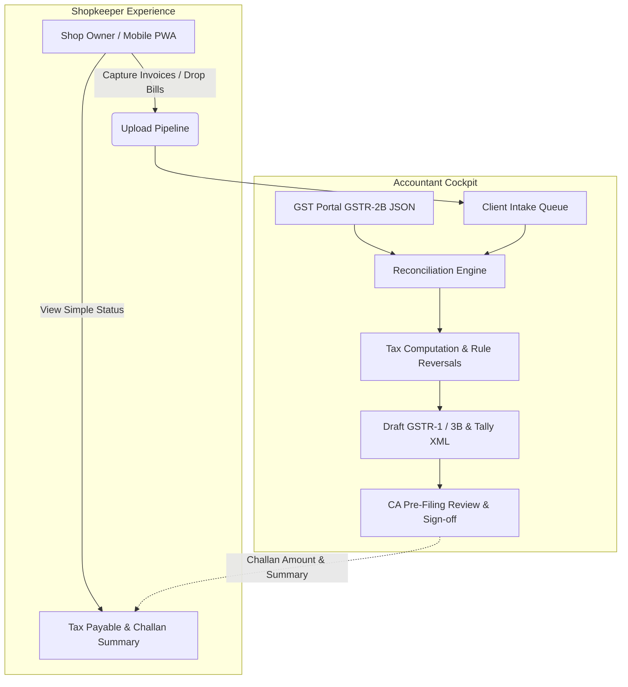
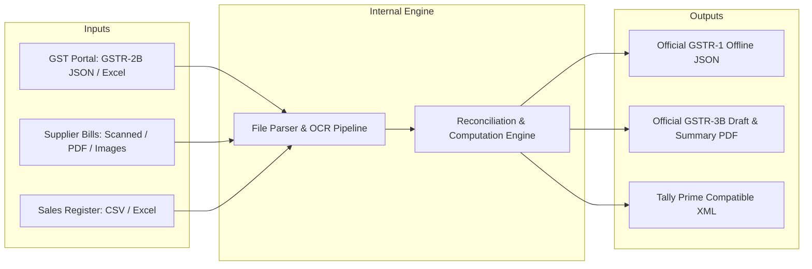
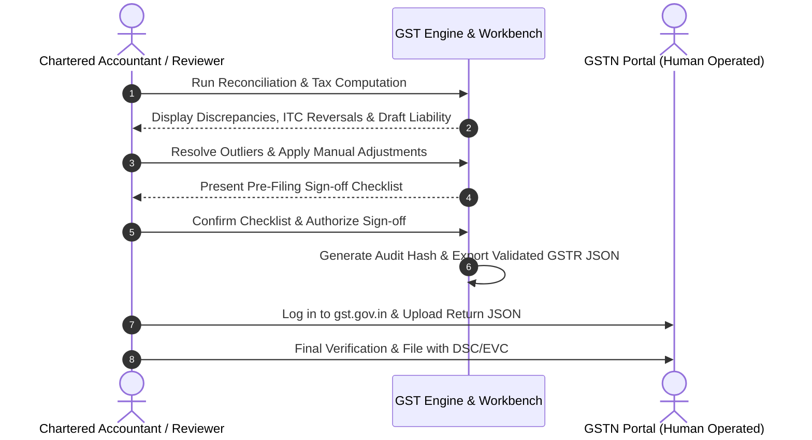

# Architecture & Product Decision Log (ADR): GST Saathi

This document records the foundational product and architectural decisions for **GST Saathi**, the GST Compliance & Reconciliation Platform. Each decision follows the Architecture Decision Record (ADR) pattern, outlining context, trade-offs, consequences, and implementation details.

---

## Decision Index

| ID | Title | Status | Date | Primary Driver |
|---|---|---|---|---|
| **ADR-001** | [Accountant-First Multi-Tenant Workflow](#adr-001-accountant-first-multi-tenant-workflow) | **Accepted** | October 2026 | User Experience & Workflow Alignment |
| **ADR-002** | [Offline File Ingestion for MVP (Zero GSP Dependency)](#adr-002-offline-file-ingestion-for-mvp-zero-gsp-dependency) | **Accepted** | October 2026 | Time-to-Market & GSP Cost/Friction Elimination |
| **ADR-003** | [Human-in-the-Loop CA Sign-off & Air-Gapped Filing](#adr-003-human-in-the-loop-ca-sign-off--air-gapped-filing) | **Accepted** | October 2026 | Legal Liability & Regulatory Compliance |

---

## ADR-001: Accountant-First Multi-Tenant Workflow

### Status
**Accepted**

### Context
In the Indian SME and micro-retail market (stationery shops, kirana stores, bookshops, hardware vendors), business owners do not prepare tax returns or understand complex GST rules like Rule 37 180-day ITC reversals, Section 17(5) blocked credits, or GSTR-2B matching tolerances. 

Typically, small business owners:
1. Collect paper purchase bills, transport biltis, thermal receipts, and digital PDFs across the month.
2. Hand them over (often in physical plastic bags or via fragmented WhatsApp photos) to a practicing Chartered Accountant (CA), Tax Practitioner (TRP), or freelance accountant right before the filing deadline (11th for GSTR-1, 20th for GSTR-3B).
3. Need to know only one figure: *"Kitna tax bharna hai?"* (How much tax do I need to pay?).

Conversely, the accountant manages 20 to 150+ client GSTINs simultaneously. They bear the actual operational burden:
- Organizing disorganized receipts.
- Digitizing line items and HSN codes.
- Downloading GSTR-2B from the GST portal and performing invoice-level reconciliation.
- Handling vendor follow-ups for unfiled invoices.
- Computing net cash liability against electronic credit ledger balances.

Designing a single generic dashboard for both personas would lead to a product that is too complex for shopkeepers and too lightweight for tax professionals.

### Decision
We adopt an **Accountant-First, Asymmetric Dual-Experience Architecture**:
1. **Accountant Cockpit (Primary Surface)**:
   - Multi-tenant client portfolio dashboard with consolidated filing statuses, calendar countdowns (GSTR-1, GSTR-3B, CMP-08), and risk flags.
   - Heavy-duty reconciliation workbench with fuzzy matching, batch operations, difference overrides, and IMS (Invoice Management System) action selectors.
   - Tax computation sandbox supporting ITC utilization waterfalls (IGST $\rightarrow$ CGST $\rightarrow$ SGST), late-fee estimators, and reversal calculators.
2. **Shopkeeper Portal / Mobile PWA (Secondary Ingestion Surface)**:
   - Ultra-streamlined, low-friction document capture interface (camera capture, WhatsApp-like upload queue, batch PDF/image drop).
   - Read-only real-time status card: "14 bills submitted, 2 pending review".
   - Clear, non-technical tax liability card with payment challan generation download (PMT-06).

### Consequences

#### Positive
- **High Retention & Viral Distribution**: Accountants who adopt the tool onboard dozens of their retail clients onto the lightweight upload portal.
- **Data Quality**: Shop owners upload source bills progressively throughout the month instead of dumping 100 receipts on the 18th of the month.
- **Persona Clarity**: Frontend components and UI workflows are cleanly separated (`/dashboard/clients/[gstin]/...` vs `/portal/[shop-token]/...`).

#### Negative & Risks
- **Two Distinct UIs**: Requires maintaining an optimized desktop layout for power users (data grids, hotkeys, split-screen PDF preview) and a touch-optimized mobile experience for shop owners.
- **Permission Boundaries**: Strict row-level data tenancy is mandatory. Shop owner A must never see Shop owner B's documents or accountant notes.

### Technical Implementation Details
- Client and tenant isolation via `clientId` / `gstin` foreign keys in data stores.
- Magic link / QR code token authentication for shopkeepers allowing bill submissions without tedious username/password friction.
- Role-Based Access Control (RBAC): `CA_ADMIN`, `STAFF_ACCOUNTANT`, `CLIENT_REVIEWER`, `SHOP_OWNER_UPLOADER`.

---

## ADR-002: Offline File Ingestion for MVP (Zero GSP Dependency)

### Status
**Accepted**

### Context
Direct integration with the GST System (GSTN) requires connecting through an authorized GST Suvidha Provider (GSP) such as Clear (formerly Cleartax), Masters India, Iris, Adaequare, or Cygnet. 

Direct GSP integration introduces significant friction for an MVP:
1. **Commercial Costs**: GSPs charge substantial upfront licensing fees (typically ₹50,000 to ₹3,00,000+ per year) plus per-call transaction API costs.
2. **Onboarding Bureaucracy**: GSP contracts require lengthy legal agreements, security audits, static IP whitelisting, and strict compliance sign-offs.
3. **Session Authentication Friction**: The GSTN API requires OTP generation sent to the primary authorized signatory’s registered mobile number every 6 hours. Retail clients are often unavailable or resistant to providing OTPs mid-day during busy shop hours.
4. **Portal Downloads are Already Familiar**: Every accountant and CA already logs into `services.gst.gov.in` to download monthly GSTR-2B JSON or Excel files and upload offline JSON utility returns.

### Decision
For the MVP and initial release phases, the platform **eliminates all GSP dependencies** and operates strictly on **Offline File Ingestion**:
1. **Inward Supplies Data Source**: Native ingestion of standard GSTR-2B JSON files (and official Excel exports) downloaded directly from the GST Portal.
2. **Purchase / Expense Source**: Direct ingestion of scanned receipts, photo snaps (JPEG/PNG), supplier PDFs, and merchant Excel/CSV inward bill registers.
3. **Outward Supplies Source**: Ingestion of sales registers via CSV/Excel or point-of-sale invoice extracts.
4. **Output Artifacts**: Exact schema-compliant official GSTR-1 and GSTR-3B offline JSON payloads ready for drag-and-drop upload onto the GST Portal, along with Tally Prime XML import files.

### Consequences

#### Positive
- **Zero Ongoing API Overhead**: No recurring GSP costs, API throttling limits, or gateway uptime dependencies.
- **Zero Client OTP Roadblocks**: Accountants do not need to disturb shop owners for SMS OTPs during late-night reconciliation runs.
- **Rapid Time to Launch**: Avoids 6-8 weeks of GSP contract negotiation and security compliance audits.
- **Portability**: Functions seamlessly in offline or local-first environments.

#### Negative & Risks
- **Manual Download Step**: The accountant or assistant must perform a one-time monthly download of GSTR-2B JSON from the GST portal (takes ~30 seconds per client).
- **Format Volatility**: GSTN occasionally updates its JSON schema or Excel column headers. The parser must have strict schema version validation and graceful fallback handling.

### Technical Implementation Details
- JSON schema validation using Zod for official GSTN GSTR-2B schema v1.0 and v1.1.
- Streaming parser for large GSTR-2B JSONs (supporting 10,000+ line items without memory exhaustion).
- Clear UI error diagnostics when an imported file does not match the expected GSTN format or client GSTIN.

---

## ADR-003: Human-in-the-Loop CA Sign-off & Air-Gapped Filing

### Status
**Accepted**

### Context
Direct automated tax filing ("one-click auto-submit to government") poses acute legal, financial, and regulatory liabilities:
1. **Statutory Penalties**: Under Section 73 and Section 74 of the CGST Act, wrongful availing or utilization of Input Tax Credit (ITC) attracts mandatory 18% or 24% annual interest plus penalties ranging from 10% to 100% of the tax evaded.
2. **Professional Disciplinary Liability**: Chartered Accountants are governed by the Institute of Chartered Accountants of India (ICAI). Certifying or filing incorrect returns due to software glitches or misparsed OCR values can result in misconduct inquiries, license suspension, and civil liability.
3. **Irreversible Portal State**: Once GSTR-3B is filed on the GST portal, it **cannot be revised**. Any error must be rectified in subsequent tax periods through amendment tables, often leading to locked working capital or department notices (Form DRC-01A / ASMT-10).
4. **Invoice Management System (IMS)**: Recent additions to the GST portal require subjective tax decisions (e.g., whether to mark an invoice as "Pending" or "Rejected" before the 14th of the month).

### Decision
The platform will strictly adhere to an **Air-Gapped, Human-in-the-Loop Verification and CA Sign-off Protocol**:
1. **No Automated Final Submission**: The system shall **never** directly file returns on the GST Portal or execute financial tax debits from the client's bank account.
2. **Preparation & Verification Engine**: The system functions as an intelligent drafting engine—performing OCR, mathematical calculations, rule-based validations, discrepancy detection, and draft JSON generation.
3. **Mandatory Pre-Filing Sign-Off Checklist**:
   - Verification of 180-day ITC reversal rules (Rule 37).
   - Ineligible / Blocked ITC validation (Section 17(5)).
   - Verification of outward tax turnover against HSN summary.
   - Cash vs Credit ledger offset check.
4. **Cryptographic Audit Trail**:
   - Each sign-off creates a tamper-evident audit record recording the timestamp, reviewer identity, client GSTIN, computed tax figures, and SHA-256 hash of the generated return JSON.
5. **Air-Gapped Upload**: The verified return is exported as a validated offline JSON file which the CA or authorized client uploads to `gst.gov.in` followed by their standard DSC (Digital Signature Certificate) or EVC (Aadhaar OTP) sign-off.

### Consequences

#### Positive
- **Zero Legal Liability for Platform**: The platform is classified as tax drafting and compliance productivity software, not a licensed fiduciary tax filer.
- **High Trust with CAs**: Chartered Accountants retain complete authority and oversight, feeling empowered rather than replaced or exposed to uncontrolled automated risks.
- **Defensibility in Department Audits**: If a tax officer issues an ASMT-10 notice, the CA has access to the platform's immutable audit log showing exact math, reconciliation timestamps, and source invoice references.

#### Negative & Risks
- **Additional Step for Users**: Users must take the exported JSON and upload it to the GST portal rather than clicking a single "File Now" button inside our app.
- **User Education Required**: Clear visual step-by-step guides ("How to upload your JSON file to GST Portal in 60 seconds") must be built into the export modal.

### Technical Implementation Details
- Audit logging schema capturing user ID, timestamp, client GSTIN, tax period, input files SHA-256, output JSON SHA-256, and checklist confirmations.
- Strict JSON schema validation against official GSTN Offline Tool schemas prior to letting the user download the file, guaranteeing 0% schema rejection rate on the portal.
