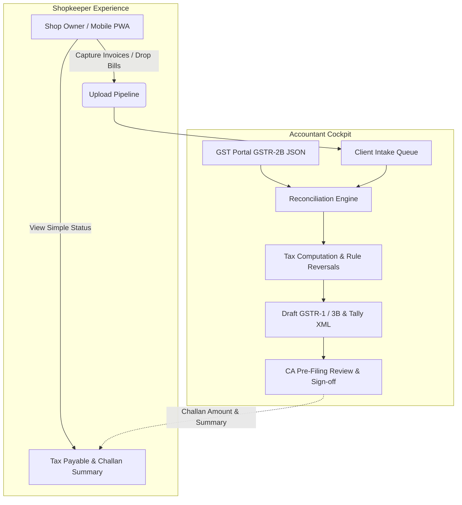
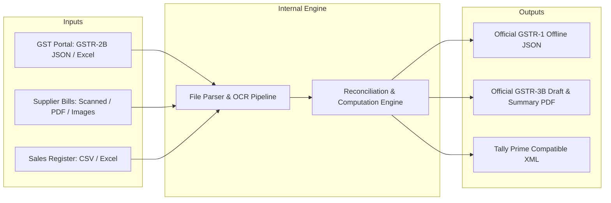
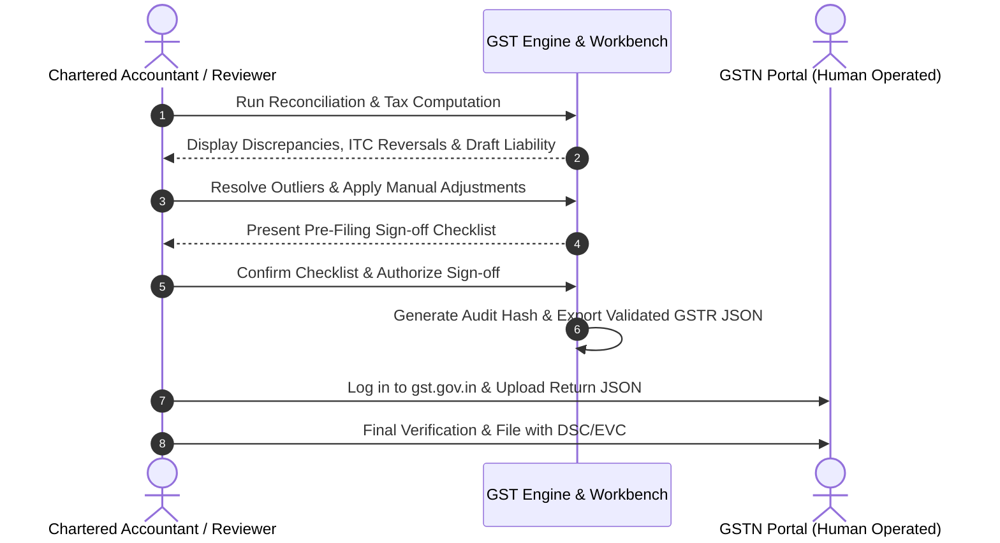
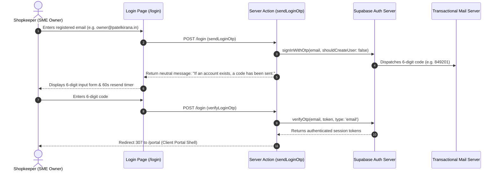
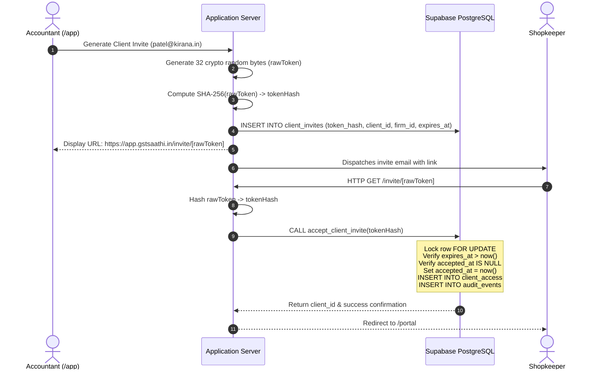
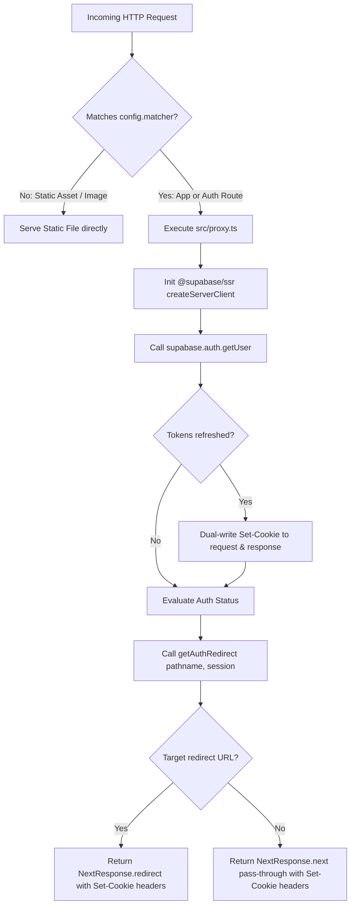

# Architecture & Product Decision Log (ADR): GST Saathi

This document records the foundational product and architectural decisions for **GST Saathi**, the GST Compliance & Reconciliation Platform. Each decision follows the Architecture Decision Record (ADR) pattern, outlining context, trade-offs, consequences, and implementation details.

---

## Decision Index

### Product & Statutory Compliance Decisions
| ID | Title | Status | Date | Primary Driver |
|---|---|---|---|---|
| **ADR-001** | [Accountant-First Multi-Tenant Workflow](#adr-001-accountant-first-multi-tenant-workflow) | **Accepted** | October 2026 | User Experience & Workflow Alignment |
| **ADR-002** | [Offline File Ingestion for MVP (Zero GSP Dependency)](#adr-002-offline-file-ingestion-for-mvp-zero-gsp-dependency) | **Accepted** | October 2026 | Time-to-Market & GSP Cost/Friction Elimination |
| **ADR-003** | [Human-in-the-Loop CA Sign-off & Air-Gapped Filing](#adr-003-human-in-the-loop-ca-sign-off--air-gapped-filing) | **Accepted** | October 2026 | Legal Liability & Regulatory Compliance |

### Technical Architecture & Authentication Decisions
| ID | Title | Status | Date | Primary Driver |
|---|---|---|---|---|
| **ADR-0001** | [Selection of Supabase Postgres & RLS](adr/0001-supabase.md) | **Accepted** | October 2026 | Kernel-Level Multi-Tenancy & Statutory Compliance |
| **ADR-0002** | [Email-Code (OTP) Authentication for Small Business Owners](#adr-0002-email-code-otp-authentication-for-small-business-owners) | **Accepted** | October 2026 | SME Adoption & Credential Friction Elimination |
| **ADR-0003** | [Phone OTP Deferred to Post-MVP](#adr-0003-phone-otp-deferred-to-post-mvp) | **Accepted** | October 2026 | DLT Bureaucracy & SMS Gateway Cost Elimination |
| **ADR-0004** | [One Firm Membership per Accountant in MVP](#adr-0004-one-firm-membership-per-accountant-in-mvp) | **Accepted** | October 2026 | Multi-Tenant Simplicity & Route Context Isolation |
| **ADR-0005** | [32-Byte Hash-Only Stored Client Invite Tokens](#adr-0005-32-byte-hash-only-stored-client-invite-tokens) | **Accepted** | October 2026 | Cryptographic Entropy & Zero Token Leakage |
| **ADR-0006** | [Next.js 16 Proxy Convention for Session Refresh and Route Protection](#adr-0006-nextjs-16-proxy-convention-for-session-refresh-and-route-protection) | **Accepted** | October 2026 | Next.js 16 Deprecation & Edge Cookie Synchronisation |

---

## ADR-001: Accountant-First Multi-Tenant Workflow

### Status
**Accepted**

### Context
In the Indian SME and micro-retail market (stationery shops, kirana stores, bookshops, hardware vendors), business owners do not prepare tax returns or understand complex GST rules like Rule 37 180-day ITC reversals, Section 17(5) blocked credits, or GSTR-2B matching tolerances. 

Typically, small business owners:
1. Collect paper purchase bills, transport biltis, thermal receipts, and digital PDFs across the month.
2. Hand them over (often in physical plastic bags or via fragmented WhatsApp photos) to a practicing Chartered Accountant (CA), Tax Practitioner (TRP), or freelance accountant right before the filing deadline (11th for GSTR-1, 20th for GSTR-3B).
3. Need to know only one figure: *"Kitna tax bharna hai?"* (How much tax do I need to pay?).

Conversely, the accountant manages 20 to 150+ client GSTINs simultaneously. They bear the actual operational burden:
- Organizing disorganized receipts.
- Digitizing line items and HSN codes.
- Downloading GSTR-2B from the GST portal and performing invoice-level reconciliation.
- Handling vendor follow-ups for unfiled invoices.
- Computing net cash liability against electronic credit ledger balances.

Designing a single generic dashboard for both personas would lead to a product that is too complex for shopkeepers and too lightweight for tax professionals.

### Decision
We adopt an **Accountant-First, Asymmetric Dual-Experience Architecture**:
1. **Accountant Cockpit (Primary Surface)**:
   - Multi-tenant client portfolio dashboard with consolidated filing statuses, calendar countdowns (GSTR-1, GSTR-3B, CMP-08), and risk flags.
   - Heavy-duty reconciliation workbench with fuzzy matching, batch operations, difference overrides, and IMS (Invoice Management System) action selectors.
   - Tax computation sandbox supporting ITC utilization waterfalls (IGST $\rightarrow$ CGST $\rightarrow$ SGST), late-fee estimators, and reversal calculators.
2. **Shopkeeper Portal / Mobile PWA (Secondary Ingestion Surface)**:
   - Ultra-streamlined, low-friction document capture interface (camera capture, WhatsApp-like upload queue, batch PDF/image drop).
   - Read-only real-time status card: "14 bills submitted, 2 pending review".
   - Clear, non-technical tax liability card with payment challan generation download (PMT-06).



### Consequences

#### Positive
- **High Retention & Viral Distribution**: Accountants who adopt the tool onboard dozens of their retail clients onto the lightweight upload portal.
- **Data Quality**: Shop owners upload source bills progressively throughout the month instead of dumping 100 receipts on the 18th of the month.
- **Persona Clarity**: Frontend components and UI workflows are cleanly separated (`/dashboard/clients/[gstin]/...` vs `/portal/[shop-token]/...`).

#### Negative & Risks
- **Two Distinct UIs**: Requires maintaining an optimized desktop layout for power users (data grids, hotkeys, split-screen PDF preview) and a touch-optimized mobile experience for shop owners.
- **Permission Boundaries**: Strict row-level data tenancy is mandatory. Shop owner A must never see Shop owner B's documents or accountant notes.

### Technical Implementation Details
- Client and tenant isolation via `clientId` / `gstin` foreign keys in data stores.
- Magic link / QR code token authentication for shopkeepers allowing bill submissions without tedious username/password friction.
- Role-Based Access Control (RBAC): `CA_ADMIN`, `STAFF_ACCOUNTANT`, `CLIENT_REVIEWER`, `SHOP_OWNER_UPLOADER`.

---

## ADR-002: Offline File Ingestion for MVP (Zero GSP Dependency)

### Status
**Accepted**

### Context
Direct integration with the GST System (GSTN) requires connecting through an authorized GST Suvidha Provider (GSP) such as Clear (formerly Cleartax), Masters India, Iris, Adaequare, or Cygnet. 

Direct GSP integration introduces significant friction for an MVP:
1. **Commercial Costs**: GSPs charge substantial upfront licensing fees (typically ₹50,000 to ₹3,00,000+ per year) plus per-call transaction API costs.
2. **Onboarding Bureaucracy**: GSP contracts require lengthy legal agreements, security audits, static IP whitelisting, and strict compliance sign-offs.
3. **Session Authentication Friction**: The GSTN API requires OTP generation sent to the primary authorized signatory’s registered mobile number every 6 hours. Retail clients are often unavailable or resistant to providing OTPs mid-day during busy shop hours.
4. **Portal Downloads are Already Familiar**: Every accountant and CA already logs into `services.gst.gov.in` to download monthly GSTR-2B JSON or Excel files and upload offline JSON utility returns.

### Decision
For the MVP and initial release phases, the platform **eliminates all GSP dependencies** and operates strictly on **Offline File Ingestion**:
1. **Inward Supplies Data Source**: Native ingestion of standard GSTR-2B JSON files (and official Excel exports) downloaded directly from the GST Portal.
2. **Purchase / Expense Source**: Direct ingestion of scanned receipts, photo snaps (JPEG/PNG), supplier PDFs, and merchant Excel/CSV inward bill registers.
3. **Outward Supplies Source**: Ingestion of sales registers via CSV/Excel or point-of-sale invoice extracts.
4. **Output Artifacts**: Exact schema-compliant official GSTR-1 and GSTR-3B offline JSON payloads ready for drag-and-drop upload onto the GST Portal, along with Tally Prime XML import files.



### Consequences

#### Positive
- **Zero Ongoing API Overhead**: No recurring GSP costs, API throttling limits, or gateway uptime dependencies.
- **Zero Client OTP Roadblocks**: Accountants do not need to disturb shop owners for SMS OTPs during late-night reconciliation runs.
- **Rapid Time to Launch**: Avoids 6-8 weeks of GSP contract negotiation and security compliance audits.
- **Portability**: Functions seamlessly in offline or local-first environments.

#### Negative & Risks
- **Manual Download Step**: The accountant or assistant must perform a one-time monthly download of GSTR-2B JSON from the GST portal (takes ~30 seconds per client).
- **Format Volatility**: GSTN occasionally updates its JSON schema or Excel column headers. The parser must have strict schema version validation and graceful fallback handling.

### Technical Implementation Details
- JSON schema validation using Zod for official GSTN GSTR-2B schema v1.0 and v1.1.
- Streaming parser for large GSTR-2B JSONs (supporting 10,000+ line items without memory exhaustion).
- Clear UI error diagnostics when an imported file does not match the expected GSTN format or client GSTIN.

---

## ADR-003: Human-in-the-Loop CA Sign-off & Air-Gapped Filing

### Status
**Accepted**

### Context
Direct automated tax filing ("one-click auto-submit to government") poses acute legal, financial, and regulatory liabilities:
1. **Statutory Penalties**: Under Section 73 and Section 74 of the CGST Act, wrongful availing or utilization of Input Tax Credit (ITC) attracts mandatory 18% or 24% annual interest plus penalties ranging from 10% to 100% of the tax evaded.
2. **Professional Disciplinary Liability**: Chartered Accountants are governed by the Institute of Chartered Accountants of India (ICAI). Certifying or filing incorrect returns due to software glitches or misparsed OCR values can result in misconduct inquiries, license suspension, and civil liability.
3. **Irreversible Portal State**: Once GSTR-3B is filed on the GST portal, it **cannot be revised**. Any error must be rectified in subsequent tax periods through amendment tables, often leading to locked working capital or department notices (Form DRC-01A / ASMT-10).
4. **Invoice Management System (IMS)**: Recent additions to the GST portal require subjective tax decisions (e.g., whether to mark an invoice as "Pending" or "Rejected" before the 14th of the month).

### Decision
The platform will strictly adhere to an **Air-Gapped, Human-in-the-Loop Verification and CA Sign-off Protocol**:
1. **No Automated Final Submission**: The system shall **never** directly file returns on the GST Portal or execute financial tax debits from the client's bank account.
2. **Preparation & Verification Engine**: The system functions as an intelligent drafting engine—performing OCR, mathematical calculations, rule-based validations, discrepancy detection, and draft JSON generation.
3. **Mandatory Pre-Filing Sign-Off Checklist**:
   - Verification of 180-day ITC reversal rules (Rule 37).
   - Ineligible / Blocked ITC validation (Section 17(5)).
   - Verification of outward tax turnover against HSN summary.
   - Cash vs Credit ledger offset check.
4. **Cryptographic Audit Trail**:
   - Each sign-off creates a tamper-evident audit record recording the timestamp, reviewer identity, client GSTIN, computed tax figures, and SHA-256 hash of the generated return JSON.
5. **Air-Gapped Upload**: The verified return is exported as a validated offline JSON file which the CA or authorized client uploads to `gst.gov.in` followed by their standard DSC (Digital Signature Certificate) or EVC (Aadhaar OTP) sign-off.



### Consequences

#### Positive
- **Zero Legal Liability for Platform**: The platform is classified as tax drafting and compliance productivity software, not a licensed fiduciary tax filer.
- **High Trust with CAs**: Chartered Accountants retain complete authority and oversight, feeling empowered rather than replaced or exposed to uncontrolled automated risks.
- **Defensibility in Department Audits**: If a tax officer issues an ASMT-10 notice, the CA has access to the platform's immutable audit log showing exact math, reconciliation timestamps, and source invoice references.

#### Negative & Risks
- **Additional Step for Users**: Users must take the exported JSON and upload it to the GST portal rather than clicking a single "File Now" button inside our app.
- **User Education Required**: Clear visual step-by-step guides ("How to upload your JSON file to GST Portal in 60 seconds") must be built into the export modal.

### Technical Implementation Details
- Audit logging schema capturing user ID, timestamp, client GSTIN, tax period, input files SHA-256, output JSON SHA-256, and checklist confirmations.
- Strict JSON schema validation against official GSTN Offline Tool schemas prior to letting the user download the file, guaranteeing 0% schema rejection rate on the portal.

---

## ADR-0002: Email-Code (OTP) Authentication for Small Business Owners

### Status
**Accepted**

### Context
In the Indian micro-retail market (stationery shops, kirana stores, retail medical stores, hardware vendors), business owners access digital compliance tools irregularly—typically once or twice a month to upload bills or check their net GST liability.

When forced to create alphanumeric passwords conforming to standard enterprise complexity rules (12+ characters, uppercase, symbols, numbers), small business owners face severe operational friction:
1. **Password Fatigue & Forgetfulness**: Shopkeepers rarely remember complex passwords. When tax deadlines arrive (11th for GSTR-1, 20th for GSTR-3B), CAs are inundated with calls: *"Sir, password bhool gaye, login nahi ho raha"* (Sir, I forgot my password, can't log in).
2. **Insecure Password Practices**: Shopkeepers write passwords on physical paper registers kept at the counter, or share credentials over unencrypted WhatsApp chats, increasing account compromise risks.
3. **Mobile Counter Environment**: Shopkeepers log in from smartphones or shared counter tablets while simultaneously managing retail customers. Typing complex passwords with hidden fields creates high entry friction and input errors.

Conversely, Chartered Accountants and tax firm employees manage dozens of client accounts daily, use desktop workstations, and regularly rely on enterprise password managers (1Password, Bitwarden, Chrome Passwords).

### Decision
We implement **Passwordless Email-Code (OTP) / Magic Code Authentication** as the primary authentication mechanism for SME business owners, while preserving traditional Password Authentication for accounting professionals:

1. **One-Time Passcode (OTP) Dispatch via Supabase Auth**:
   - The user inputs their registered email address on the login screen.
   - The backend invokes `supabase.auth.signInWithOtp({ email, options: { shouldCreateUser: false } })`.
   - Supabase Auth generates a 6-digit numeric code with a 10-minute time-to-live (TTL) and dispatches it via transactional email.
2. **Zero Account Enumeration Defense**:
   - The server action strictly suppresses user-existence indicators. If an unregistered email is submitted, the system responds identically:
     `"If an account exists for this email, a 6-digit code has been sent."`
   - `shouldCreateUser: false` ensures non-existent emails do not silently generate orphaned user records in `auth.users`.
3. **Dual-Tab Login Interface**:
   - Tab 1: **"Email Code (OTP)"** (Default tab, optimized for SME shopkeepers).
   - Tab 2: **"Password"** (Targeted at accountants and CAs managing firm credentials).
4. **Deterministic Post-Login Routing**:
   - Upon successful verification (`supabase.auth.verifyOtp`), the user is routed deterministically:
     - CA Firm Members $\rightarrow$ `/app` (Accountant Cockpit).
     - SME Client Owners $\rightarrow$ `/portal` (Client Upload Portal).
     - Validated `?next=` query paths are honored if safe (same-origin relative paths).



### Consequences

#### Positive
- **Zero Password Friction for Shopkeepers**: Shop owners never need to invent, remember, or reset complex passwords.
- **Drastic Reduction in CA Support Overhead**: Eliminates hundreds of inbound calls to CA offices regarding forgotten credentials during filing weeks.
- **Phishing & Credential Stuffing Resilience**: Temporary 6-digit codes with 10-minute expiry cannot be harvested for long-term account compromise.
- **Mobile-First Accessibility**: Entering a 6-digit numeric code from a mobile notification banner requires minimal cognitive effort.

#### Negative & Risks
- **Email Delivery Dependency**: The login flow depends on real-time transactional email delivery. Delays from spam filters or network congestion could cause user frustration.
- **Shopkeeper Email Hygiene**: Some micro-retailers rarely check email and must be trained during onboarding to look for the verification code in their mobile mail app.

#### Mitigations
- Use enterprise transactional email delivery providers (Resend / AWS SES) configured with strict SPF, DKIM, and DMARC DNS records to ensure inbox placement.
- Email templates display the 6-digit code in 32pt bold typography so it is immediately legible in mobile push notification previews.
- Clear UI guidance and a 60-second cooldown timer before allowing OTP resends.

### Technical Implementation Details
- Handled in `src/app/(auth)/login/actions.ts` via `sendLoginOtp()` and `verifyLoginOtp()`.
- Client UI built with accessible numeric input components in `src/app/(auth)/login/page.tsx` and `src/components/auth/AuthCard.tsx`.
- Role-based routing resolved via `resolveDestination()` and `src/lib/auth/session.ts`.

---

## ADR-0003: Phone OTP Deferred to Post-MVP

### Status
**Accepted**

### Context
In India, mobile numbers and SMS-based One-Time Passwords (OTPs) represent the default consumer authentication mechanism. During architectural planning, integrating SMS OTP for shopkeeper onboarding was evaluated as an alternative to email.

However, implementing commercial SMS in India is strictly governed by the Telecom Commercial Communications Customer Preference Regulations, 2018 (TCCCPR 2018) overseen by the Telecom Regulatory Authority of India (TRAI). This regulatory framework introduces acute operational, legal, and commercial obstacles for an early-stage MVP:

1. **Mandatory DLT Registration Bureaucracy**:
   - Businesses must register their legal entity on enterprise Distributed Ledger Technology (DLT) portals maintained by Indian telecom operators (Jio DLT, Airtel DLT, Vodafone Idea DLT, BSNL DLT).
   - Requires submission of Certificate of Incorporation, PAN, GSTIN, authorized signatory KYC, and letter of authority.
   - Lead time for entity approval typically spans 2 to 4 weeks.
2. **Header (Sender ID) & Strict Template Scrubbing**:
   - Every sender header (e.g. `GSTSATHI`) requires formal review and approval.
   - Every SMS content template must be registered with exact character-for-character matching. Variable placeholders (`{#var#}`) are strictly audited.
   - Any message dispatched with an unregistered phrase or minor formatting change is silently dropped by telecom carrier firewalls without delivery.
3. **Significant Commercial Costs**:
   - SMS gateway aggregators (Twilio, Exotel, Gupshup, Kaleyra) enforce setup fees, DLT registration fees (₹5,000–₹10,000 per telecom provider), and monthly minimum spends.
   - Ongoing per-SMS transaction charges (₹0.15 to ₹0.30 per SMS in India, significantly higher via international aggregators) create financial exposure to automated SMS-pumping bot attacks.
4. **Filing-Period Network Latency**:
   - On the 10th, 11th, 19th, and 20th of every month, national telecom networks in India experience severe SMS queue congestion due to banks, utilities, and tax portals sending millions of OTPs simultaneously. SMS delivery delays of 5 to 15 minutes are common, exceeding standard 5-minute OTP validity periods.

### Decision
We **defer Phone/SMS OTP authentication to the post-MVP roadmap** and launch exclusively with **Email OTP and Email + Password**:

1. **MVP Launch Strategy**:
   - All shopkeeper invitations and logins operate over verified email addresses.
   - CAs capture the shopkeeper's active email during client intake.
2. **Forward-Compatible Data Architecture**:
   - The user data model and database schema preserve a standard E.164 international phone number field (`phone text UNIQUE`) in `auth.users` and `clients`.
   - Contact records require valid 10-digit Indian mobile numbers (`^[6-9]\d{9}$`) so that when SMS OTP is activated post-MVP, no database schema migrations will be required.
3. **Post-MVP Transition Trigger**:
   - Phone OTP will be scheduled once the platform reaches commercial scale (>50 CA firms, >1,000 active clients) and completes formal enterprise DLT entity and template registration.

### Consequences

#### Positive
- **Zero Telecom Overhead & Bureaucracy**: Eliminates 3–4 weeks of DLT paperwork, regulatory verification delays, and upfront operator fees.
- **Zero Financial SMS Risk**: Completely immunizes the platform against automated SMS-pumping attacks, unauthorized international OTP drain, and carrier surcharge spikes.
- **Immediate Deployment Velocity**: Developers can build, test, and deploy the entire authentication suite locally using InBucket without external telecom dependencies.
- **Higher Global Reliability**: Email delivery does not suffer from telecom carrier SMS queue degradation during high-traffic GST filing days.

#### Negative & Risks
- **Slight Shopkeeper Adoption Resistance**: A minority of rural shopkeepers who primarily rely on WhatsApp or SMS may experience friction checking their email on mobile.

#### Mitigations
- CAs perform an initial 60-second onboarding walkthrough with their retail clients to confirm the shopkeeper has email notifications enabled on their smartphone.
- Direct invite links (`/invite/[token]`) can be shared by the CA directly via WhatsApp Web, allowing the shopkeeper to tap and open the portal directly in their mobile browser without typing credentials.

### Technical Implementation Details
- Handled in `docs/AUTH.md` and `src/lib/auth/roles.ts`.
- Future phone authentication will leverage Supabase Phone Auth with an authorized Indian SMS aggregator (Exotel or Gupshup) once DLT registration is complete.

---

## ADR-0004: One Firm Membership per Accountant in MVP

### Status
**Accepted**

### Context
In multi-tenant SaaS platforms (e.g. GitHub, Slack, Linear), users frequently belong to multiple independent workspaces or organizations simultaneously, switching between them via an organization switcher dropdown.

We evaluated whether to allow accountants and tax professionals to belong to multiple CA Firms concurrently in the MVP. Analysis of the Indian accounting practice revealed the following realities:

1. **Sole Firm Employment**:
   - A practicing Chartered Accountant, Tax Return Preparer (TRP), or employed staff accountant works for a **single** accounting practice or proprietorship.
   - A junior accountant employed at "Gupta & Associates" does not work part-time as staff for "Saxena Tax Consultants".
   - Independent CA partners establish and operate their own distinct legal entity registered under the Institute of Chartered Accountants of India (ICAI).
2. **Catastrophic Cross-Firm Data Leak Risks**:
   - When a user belongs to multiple organizations, active tenant context must be tracked via an application session state (e.g. active organization cookie or dropdown state).
   - If a busy accountant working in multiple tabs uploads a batch of purchase bills or GSTR-2B JSON files under Firm A while their active session cookie switched to Firm B, client documents and financial data would be permanently committed to the wrong accounting firm. Under Section 33 of India's DPDP Act, 2023, cross-tenant financial leakage carries penalties up to ₹250 Crores.
3. **Database RLS Complexity**:
   - Supporting multiple active firms requires complex dynamic session claims (e.g. `set_config('request.jwt.claim.firm_id', ...)`) or multi-table joins on every RLS policy evaluation, significantly increasing query planning time and vulnerability to race conditions.

### Decision
We enforce **exactly one active firm membership per user in the MVP**:

1. **Single Active Membership Constraint**:
   - In `firm_members`, each user is bound to at most one active firm record (`user_id = user.id AND deleted_at IS NULL`).
   - The session resolver `getSessionContext()` queries `firm_members` and binds the single primary active firm to `SessionContext.firm`.
2. **Deterministic Role & Route Resolution**:
   - If `session.firm !== null`, the user is recognized as an accounting professional, and their default home route is unconditionally `/app`.
   - Firm permissions are strictly binary in MVP:
     - `admin`: CA Firm Partner / Proprietor (full management of clients, staff, and firm settings).
     - `staff`: Employed Accountant / Tax Clerk (can view, edit, reconcile client data, but cannot remove fellow staff or delete the firm).
3. **Employment Transition via Soft-Delete**:
   - If an employee departs a firm, their membership record is marked soft-deleted (`deleted_at = now()`). They can subsequently be invited to a different firm without database conflicts.

```mermaid
graph TD
    User([Authenticated User: auth.uid]) --> Query{Query firm_members WHERE deleted_at IS NULL}
    Query -->|Found Active Record| FirmMember[Firm Member Found]
    FirmMember --> ResolveFirm[Resolve Firm Metadata & Role: admin | staff]
    ResolveFirm --> ContextApp[SessionContext.firm = AuthFirm<br/>SessionContext.home = '/app']

    Query -->|Not Found| NoFirm[No Firm Membership]
    NoFirm --> CheckClient{Query client_access WHERE role = 'owner'}
    CheckClient -->|Found Client Owner| ContextPortal[SessionContext.firm = null<br/>SessionContext.home = '/portal']
    CheckClient -->|Not Found| ContextNoAccess[SessionContext.firm = null<br/>SessionContext.home = '/no-access']
```

### Consequences

#### Positive
- **Eliminates Cross-Tenant Pollution**: Eliminates the possibility of an accountant uploading client tax files to the wrong firm across browser tabs.
- **Ultra-Fast Session Resolution**: Session context resolves in a single indexed query (`firm_members.user_id = user.id`), without dynamic tenant-switching overhead.
- **Simplified RLS Kernel Policies**: Postgres RLS policies evaluate `is_firm_member(firm_id)` directly using `auth.uid()`, eliminating session-state injection vulnerabilities.
- **Unambiguous Route Protection**: The proxy layer deterministically routes firm members to `/app`, avoiding routing ambiguity or interstitial workspace-selection screens.

#### Negative & Risks
- **Dual-Entity CAs**: A Chartered Accountant who operates two distinct formal partnership entities with different GSTINs must register using two separate email addresses in the MVP.

#### Mitigations
- This scenario represents <2% of target users in the initial SME accountant segment.
- The underlying database schema (`firm_members` relational table with foreign key `firm_id`) is inherently normalized and forward-compatible. When enterprise multi-firm switching is required post-MVP, it can be unlocked by adding an `active_firm_id` cookie without schema migrations.

### Technical Implementation Details
- Data contracts defined in `src/lib/auth/types.ts`:
  ```typescript
  export interface SessionContext {
    user: User;
    firm: AuthFirm | null;
    clients: AuthClient[];
    home: HomeRoute;
  }
  ```
- Evaluated in `src/lib/auth/session.ts` and guarded by `requireFirmRole()` in `src/lib/auth/roles.ts`.

---

## ADR-0005: 32-Byte Hash-Only Stored Client Invite Tokens

### Status
**Accepted**

### Context
To onboard SME retail clients, accountants generate client invitations within the firm cockpit (`/app/clients/[id]`). The platform produces an invitation URL (`https://app.gstsaathi.in/invite/[token]`) which is dispatched to the shopkeeper via email or shared via WhatsApp.

Traditional invitation patterns frequently suffer from severe security flaws:
1. **Cleartext Token Storage**: If invitation tokens are stored unhashed in the database, any read-access breach (SQL injection, accidental telemetry export, unauthorized database replica snapshot) compromises all active invite links. Attackers can iterate through the database, click the invite links, and hijack client ownership of SME businesses.
2. **Predictable / Low-Entropy Tokens**: Systems using UUIDv4, sequential integer IDs, or 6-digit numeric codes are vulnerable to token prediction and brute-force harvesting attacks.
3. **Indefinite Token Lifespans**: Invitation links that do not expire create open authorization backdoors indefinitely.
4. **Race Conditions During Acceptance**: If token acceptance is not executed atomically, concurrent requests with the same token can create duplicate access records or corrupt tenant access relationships.

### Decision
We implement a **Cryptographic 32-Byte Hash-Only Stored Token Architecture** with atomic acceptance:

1. **256-bit Cryptographic Entropy**:
   - Tokens are generated using Node.js cryptographically secure random bytes:
     ```typescript
     import crypto from 'node:crypto';
     const rawToken = crypto.randomBytes(32).toString('hex'); // 64 hex characters
     ```
   - Total keyspace is $2^{256} \approx 1.15 \times 10^{77}$ combinations. Brute-force scanning is computationally impossible.
2. **Hash-Only Storage (SHA-256)**:
   - The plaintext `rawToken` is **never stored** in the database.
   - The platform calculates the SHA-256 digest:
     ```typescript
     const tokenHash = crypto.createHash('sha256').update(rawToken).digest('hex');
     ```
   - Only `tokenHash` is persisted to `client_invites.token_hash`. Even a catastrophic database dump reveals zero usable invitation tokens.
3. **Strict 7-Day Expiration**:
   - Stored with `expires_at = now() + interval '7 days'`. Expired tokens are rejected by database constraints.
4. **Atomic Acceptance Procedure (`accept_client_invite`)**:
   - Token acceptance is encapsulated in a PostgreSQL `SECURITY DEFINER` stored procedure.
   - Row-level lock (`FOR UPDATE`) prevents concurrent double-acceptance race conditions.
   - Atomically marks `accepted_at = now()`, inserts the user into `client_access` with role `'owner'`, and writes an audit event within a single database transaction.



### Consequences

#### Positive
- **Immunity to Database Dump Exploitation**: Compromised database tables or backups reveal only one-way SHA-256 hashes; attackers cannot generate valid invitation URLs.
- **Zero Brute-Force Feasibility**: 256 bits of entropy prevents guessing or offline dictionary discovery.
- **Strict Single-Use & Expiry**: Database row-locking guarantees that an invitation cannot be accepted twice or claimed after 7 days.
- **Audit Defensibility**: Creates an immutable record in `audit_events` capturing the exact timestamp, user ID, client ID, and invite ID upon acceptance.

#### Negative & Risks
- **No Token Recovery**: Because the platform does not store plaintext tokens, CAs cannot inspect or copy an existing token URL after closing the issuance modal.

#### Mitigations
- CAs can click "Resend Invite" at any time in the client management view. This revokes the outstanding invitation and issues a fresh, cryptographically secure 32-byte token.

### Technical Implementation Details
- Migration definition in `supabase/migrations/20261101000100_invites.sql`.
- Atomic PostgreSQL procedure: `public.accept_client_invite(p_token_hash text)`.
- URL sanitization and zero-enumeration handling in `src/app/(auth)/invite/[token]/`.

---

## ADR-0006: Next.js 16 Proxy Convention for Session Refresh and Route Protection

### Status
**Accepted**

### Context
In Next.js 16, Vercel introduced the `proxy.ts` convention to supersede the deprecated `middleware.ts` pattern for request interception. This transition coincided with fundamental constraints in the Next.js App Router:

1. **Server Components Cannot Write Cookies**:
   - In Next.js App Router, Server Components stream HTML as it renders. As a result, invoking `cookies().set()` inside a Server Component throws a runtime error.
2. **Supabase Auth Session Expiration**:
   - Supabase Auth issues short-lived JWT access tokens (typically 1 hour) paired with long-lived refresh tokens.
   - When a user's access token expires, the client must perform a token refresh handshake with Supabase Auth servers.
   - If session refresh is deferred to Server Components, the refreshed tokens cannot be written back to the browser's cookies, resulting in session desynchronization, stale credentials, and unexpected user logouts.
3. **Prevention of Client-Side "Auth Flash"**:
   - If route protection is evaluated inside client-side components or nested layout effects, unauthorized users briefly see protected UI elements before being kicked back to `/login`.
   - Security-critical redirects must execute at the network edge / request ingress before React renders a single component.

### Decision
We implement **`src/proxy.ts` using the Next.js 16 Proxy Convention** as the central authentication and session refresh interceptor:

1. **Proxy Convention Adoption**:
   - Implement `src/proxy.ts` exporting an asynchronous proxy function:
     ```typescript
     export async function proxy(request: NextRequest): Promise<NextResponse>
     export default proxy;
     ```
2. **Optimized Asset Filtering Matcher**:
   - Configure `config.matcher` to intercept all application and API routes while bypassing static bundles, Turbopack chunks, images, and public assets:
     ```typescript
     export const config = {
       matcher: ['/((?!_next/static|_next/image|favicon.ico|.*\\.(?:svg|png|jpg|jpeg|gif|webp)$).*)'],
     };
     ```
3. **Dual-Write Cookie Synchronization via `@supabase/ssr`**:
   - Instantiate `@supabase/ssr` `createServerClient` inside `proxy.ts` with custom cookie accessors:
     - `getAll()` reads cookies directly from `request.cookies`.
     - `setAll()` performs synchronized dual-writing: sets refreshed tokens on `request.cookies` (so downstream Server Components read active credentials) and copies them onto `response.cookies` (so the browser receives updated `Set-Cookie` response headers).
4. **Session Refresh via `supabase.auth.getUser()`**:
   - The proxy invokes `supabase.auth.getUser()` to validate and refresh authentication tokens securely against Supabase Auth servers.
5. **Pure Route Redirect Evaluation (`getAuthRedirect`)**:
   - The proxy delegates routing logic to a pure, headless function `getAuthRedirect(pathname, session)`:
     - Unauthenticated requests to `/app/*` or `/portal/*` $\rightarrow$ Redirect 307 to `/login?next=${encodeURIComponent(pathname)}`.
     - Authenticated requests visiting `/login`, `/signup`, or `/forgot-password` $\rightarrow$ Redirect 307 to `session.home` (`/app` or `/portal`).
     - Preserves all refreshed session cookies on redirect responses to ensure session continuity.



### Consequences

#### Positive
- **100% Next.js 16 Standard Compliance**: Eliminates deprecation warnings associated with legacy `middleware.ts` files and ensures forward-compatibility with future Next.js releases.
- **Guaranteed Token Freshness**: Every Server Component, Route Handler, and Server Action receives a validated, non-expired access token.
- **Zero Client-Side Auth Flash**: Unauthenticated requests are redirected at the network ingress before React layout rendering starts.
- **Centralized, Testable Routing Logic**: Decouples routing decisions into a pure helper `getAuthRedirect()` covered by automated unit tests (`src/lib/auth/__tests__/redirect.test.ts`).

#### Negative & Risks
- **Proxy Ingress Latency**: Adds a few milliseconds of processing time to matched requests to perform the session handshake.

#### Mitigations
- The route matcher excludes all static assets, media files, and favicon requests, ensuring zero overhead on static delivery.
- For repeat requests within the active JWT window, token verification executes quickly without full network re-authentication.

### Technical Implementation Details
- Handled in `src/proxy.ts`.
- Pure redirect logic in `src/lib/auth/redirect.ts`.
- Validated by 40 automated test cases in `src/lib/auth/__tests__/redirect.test.ts`.
