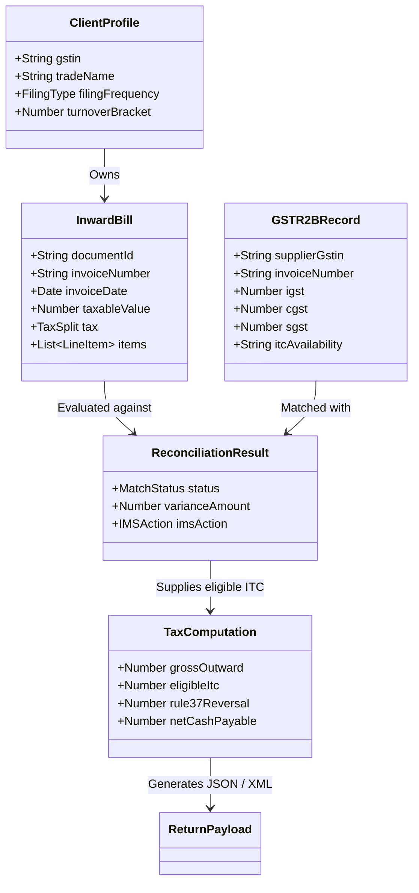

# Master Prompt Plan: GST Saathi Platform

A comprehensive 20-prompt execution roadmap detailing the full evolutionary build sequence of GST Saathi: the Indian GST Compliance, Invoice Digitization, GSTR-2B Reconciliation, and Return Preparation platform.

---

## Evolution Roadmap Summary

```mermaid
flowchart TD
    subgraph Phase 1: Setup & Agent Context
        P01[P01: Foundation & Base Types] --> P02[P02: Landing Page & Role Switcher]
    end

    subgraph Phase 2: Client & Profile Management
        P02 --> P03[P03: Client Store & Storage Layer]
        P03 --> P04[P04: Shop Onboarding & GSTIN Validation]
        P04 --> P05[P05: Accountant Portfolio Cockpit]
    end

    subgraph Phase 3: Document Ingestion Pipeline
        P05 --> P06[P06: Multi-Format Bill Ingestion UI]
        P06 --> P07[P07: Ingestion Queue & Staging Store]
        P07 --> P08[P08: GSTR-2B JSON/Excel Importer]
    end

    subgraph Phase 4: Bill Parsing & OCR Engine
        P08 --> P09[P09: Header OCR & Field Normalizer]
        P09 --> P10[P10: Line Item & HSN Classifier]
        P10 --> P11[P11: Split-Screen Correction Workbench]
    end

    subgraph Phase 5: GSTR-2B Reconciliation Engine
        P11 --> P12[P12: Inward vs 2B Matching Engine]
        P12 --> P13[P13: Discrepancy Classification Buckets]
        P13 --> P14[P14: Reconciliation Workbench & IMS Dispatcher]
    end

    subgraph Phase 6: Tax Computation & Reversals
        P14 --> P15[P15: ITC Reversal Engine: Rule 37 & Sec 17-5]
        P15 --> P16[P16: Tax Liability & ITC Offset Waterfall]
    end

    subgraph Phase 7: Return Draft & Export
        P16 --> P17[P17: Official GSTN JSON Exporters]
        P17 --> P18[P18: Tally Prime XML & Excel Workbook]
    end

    subgraph Phase 8: Verification & Audit Trail
        P18 --> P19[P19: Immutable Audit Hash Engine]
        P19 --> P20[P20: CA Pre-Filing Checklist & Final Sign-Off]
    end
```

---

## Global Build Index

| Prompt # | Phase | Title | Key Objective | Target Owned Files |
|---|---|---|---|---|
| **01** | Phase 1 | Foundation, Theme & Base Types | Design system tokens, global layout shell, domain TypeScript definitions | `src/types/gst.ts`, `src/app/globals.css`, `src/components/layout/Navbar.tsx` |
| **02** | Phase 1 | Landing Page & Persona Switcher | High-converting marketing hero, CA vs Shopkeeper perspective toggle | `src/app/page.tsx`, `src/components/landing/*` |
| **03** | Phase 2 | Client Store & Data Layer | Multi-client state management, local/browser persistence, client schema | `src/context/ClientContext.tsx`, `src/lib/storage/*` |
| **04** | Phase 2 | Shop Onboarding & GSTIN Validator | 15-character GSTIN checksum verification, trade name lookup, filing type selector | `src/components/clients/NewClientModal.tsx`, `src/lib/gstin-validator.ts` |
| **05** | Phase 2 | Accountant Portfolio Cockpit | Multi-client health dashboard, return calendar countdowns, pending action alerts | `src/app/dashboard/page.tsx`, `src/components/dashboard/ClientGrid.tsx` |
| **06** | Phase 3 | Multi-Format Document Ingestion UI | Drag-and-drop bill dropzone, mobile camera bill scanner, batch file receiver | `src/components/upload/DocumentUploader.tsx`, `src/app/upload/page.tsx` |
| **07** | Phase 3 | Ingestion Queue & Staging Store | File staging pipeline, upload progress tracking, file deduplication check | `src/lib/upload-queue.ts`, `src/components/upload/QueueTracker.tsx` |
| **08** | Phase 3 | GSTR-2B JSON & Excel Importer | Parsing official GST portal GSTR-2B JSON/Excel downloads with Zod schemas | `src/lib/gstr2b-parser.ts`, `src/components/upload/GSTR2BImportModal.tsx` |
| **09** | Phase 4 | Bill Header & Tax Extraction Engine | OCR text extraction, regex parsing for GSTIN, invoice number, date, tax breakdown | `src/lib/ocr/extractor.ts`, `src/lib/ocr/field-cleaner.ts` |
| **10** | Phase 4 | Line-Item Parser & HSN Classifier | Parsing line items, unit prices, HSN 4820/4901/9608 stationery rate tagging | `src/lib/ocr/line-item-parser.ts`, `src/lib/hsn-lookup.ts` |
| **11** | Phase 4 | Split-Screen Correction Workbench | Visual verification UI: side-by-side bill image preview and editable data fields | `src/components/workbench/InvoiceReviewScreen.tsx` |
| **12** | Phase 5 | Inward vs 2B Matching Engine | Multi-pass matching algorithm (exact match, invoice normalization, tolerance bands) | `src/lib/reconciliation/matcher.ts`, `src/types/reconciliation.ts` |
| **13** | Phase 5 | Discrepancy Classification Engine | Bucketing invoices into Matched, Missing in 2B, Missing in Books, Value Mismatches | `src/lib/reconciliation/classifier.ts` |
| **14** | Phase 5 | Interactive Reconciliation Workbench & IMS | CA review grid, bulk action filters, IMS action dispatcher (Accept/Reject/Pending) | `src/app/dashboard/reconciliation/page.tsx`, `src/components/reconciliation/*` |
| **15** | Phase 6 | ITC Reversal Engine (Rule 37 & Sec 17-5) | 180-day unpaid invoice aging, interest calculation, blocked credit filtering | `src/lib/tax/itc-reversals.ts`, `src/lib/tax/rule37-tracker.ts` |
| **16** | Phase 6 | Tax Liability & ITC Offset Waterfall | Outward tax calculator, net cash liability, IGST-CGST-SGST statutory offset matrix | `src/lib/tax/offset-waterfall.ts`, `src/components/tax/TaxLiabilityCard.tsx` |
| **17** | Phase 7 | Official GSTN JSON Exporters | Building official GSTR-1 & GSTR-3B schema-compliant JSON payloads for portal upload | `src/lib/export/gstr1-builder.ts`, `src/lib/export/gstr3b-builder.ts` |
| **18** | Phase 7 | Tally Prime XML & Excel Workbook Export | Generating Tally Prime purchase vouchers XML and comprehensive reconciliation Excel | `src/lib/export/tally-xml.ts`, `src/lib/export/reconciliation-excel.ts` |
| **19** | Phase 8 | Immutable Audit Hash & Change Log | SHA-256 fingerprinting of inputs/returns, non-repudiation audit trail logger | `src/lib/audit/audit-logger.ts`, `src/components/audit/AuditTrailView.tsx` |
| **20** | Phase 8 | CA Pre-Filing Checklist & Final Sign-Off | Statutory pre-filing sign-off modal, exception checklist, export package generator | `src/components/signoff/PreFilingModal.tsx`, `src/app/dashboard/signoff/page.tsx` |

---

## Detailed Prompt Specifications (1 to 20)

### Phase 1: Setup, Landing Page, and Agent Context

#### Prompt 01: Foundation, Theme & Base Types
- **Phase**: Phase 1 (Setup)
- **Objective**: Establish the core Next.js 15+ App Router application shell, Tailwind CSS configuration with Indian enterprise fintech styling (navy, slate, emerald, saffron accents in light theme only, strictly no pastels or gradients), and robust TypeScript types for Indian GST data structures.
- **Owned Files**:
  - `src/types/gst.ts`
  - `src/app/globals.css`
  - `src/components/layout/Navbar.tsx`
  - `src/components/layout/Footer.tsx`
- **Inputs & Prerequisites**: Next.js project scaffold, Tailwind setup.
- **Outputs & Deliverables**: Global layout with responsive navigation, theme tokens, and comprehensive TypeScript interfaces for Invoices, Line Items, Clients, GSTR-2B, and Tax Ledgers.
- **Specification & Acceptance Criteria**:

| Criteria ID | Acceptance Criteria | Verification Steps | Edge Cases Handled |
|---|---|---|---|
| **AC-01.1** | Define complete `GSTIN`, `TaxRate`, `HSNCode`, `InvoiceType`, and `FilingFrequency` types. | Inspect `src/types/gst.ts` with strict TypeScript compiler check (`npm run build`). | Handles `B2B`, `B2CL`, `B2CS`, `CDNR`, `EXPORT` invoice classifications. |
| **AC-01.2** | Setup responsive navigation with active link highlighting and role indicator badge. | Render Navbar on mobile, tablet, and desktop breakpoints. | Long firm names and multi-state GSTIN formats do not overflow header. |
| **AC-01.3** | Implement standard GST color tokens (Eligible ITC = emerald, Discrepancy = amber, Ineligible/Reversed = rose) in light mode. | Inspect `tailwind.config.ts` and verify CSS variable contrast ratios. | High-contrast compliance for numerical tax tables without pastels or gradients. |

---

#### Prompt 02: High-Converting Marketing Landing Page & Persona Switcher
- **Phase**: Phase 1 (Landing Page)
- **Objective**: Implement a crisp, trust-inducing landing page tailored for small stationery/retail business owners and practicing Chartered Accountants, featuring an interactive persona switch.
- **Owned Files**:
  - `src/app/page.tsx`
  - `src/components/landing/HeroSection.tsx`
  - `src/components/landing/PersonaToggle.tsx`
  - `src/components/landing/FeaturesSection.tsx`
  - `src/components/landing/TrustSection.tsx`
- **Inputs & Prerequisites**: Completed Prompt 01 (layout and tokens).
- **Outputs & Deliverables**: Interactive landing page with "For Accountants" vs "For Shop Owners" perspective toggles, visual sample workflows, and instant demo access CTA.
- **Specification & Acceptance Criteria**:

| Criteria ID | Acceptance Criteria | Verification Steps | Edge Cases Handled |
|---|---|---|---|
| **AC-02.1** | Toggle switches between "CA Cockpit" and "Shopkeeper Portal" with distinct feature sets and micro-copy. | Click toggle button; verify headline, bullet points, and CTA button text transition smoothly. | Persists selected view preference in local state; zero layout shift during toggle. |
| **AC-02.2** | Showcase real-world stationery/retail compliance stats (HSN 4820 tax savings, 180-day reversal protection). | Verify visual metrics and feature cards render with accessible typography. | Screen readers announce persona change clearly. |
| **AC-02.3** | CTAs route cleanly to `/dashboard` (Accountant view) or `/upload` (Shop bill submission view). | Click "Explore CA Cockpit" and "Submit Bills Now"; verify client routing. | Direct URL hash deep-links (e.g. `/#for-accountants`) pre-select correct persona. |

---

### Phase 2: Client & Shop Profile Management

#### Prompt 03: Multi-Tenant Client State Store & Storage Layer
- **Phase**: Phase 2 (Client Management)
- **Objective**: Build the local-first state management architecture and persistent storage layer for handling multiple client shops, their filing profiles, and inward/outward registers.
- **Owned Files**:
  - `src/context/ClientContext.tsx`
  - `src/lib/storage/client-store.ts`
  - `src/lib/storage/mock-data.ts`
  - `src/types/client.ts`
- **Inputs & Prerequisites**: Types from Prompt 01.
- **Outputs & Deliverables**: React Context and LocalStorage/IndexedDB abstraction supporting client creation, updating, active client switching, and pre-seeded mock stationery shops.
- **Specification & Acceptance Criteria**:

| Criteria ID | Acceptance Criteria | Verification Steps | Edge Cases Handled |
|---|---|---|---|
| **AC-03.1** | Support adding, editing, archiving, and switching active client GSTIN. | Add 3 test clients, switch between them, and ensure active context updates globally. | Prevents duplicate client creation with identical GSTIN. |
| **AC-03.2** | Pre-seed 3 realistic sample retail clients (e.g. "Shree Ganesh Stationery & Xerox", "Vidyarthi Book Depot"). | Open dashboard for the first time; verify realistic sample data hydrates instantly. | Storage quota full or corrupted local storage falls back to clean mock state without crash. |
| **AC-03.3** | Client entity stores turnover bracket, composition/regular flag, QRMP choice, and state code. | Inspect client object in React DevTools; verify all statutory profile attributes exist. | State code correctly derived from the first 2 digits of the GSTIN (e.g. "27" $\rightarrow$ Maharashtra). |

---

#### Prompt 04: Shop Onboarding Modal & GSTIN Checksum Validator
- **Phase**: Phase 2 (Client Management)
- **Objective**: Create the client onboarding modal equipped with real-time statutory 15-character GSTIN format and MOD-36 checksum verification.
- **Owned Files**:
  - `src/components/clients/NewClientModal.tsx`
  - `src/lib/gstin-validator.ts`
  - `src/lib/state-codes.ts`
- **Inputs & Prerequisites**: ClientContext from Prompt 03.
- **Outputs & Deliverables**: Interactive modal with input masking, instant GSTIN checksum feedback, state auto-detection, and trade name configuration.
- **Specification & Acceptance Criteria**:

| Criteria ID | Acceptance Criteria | Verification Steps | Edge Cases Handled |
|---|---|---|---|
| **AC-04.1** | Validate 15-character alphanumeric GSTIN regex: `^[0-9]{2}[A-Z]{5}[0-9]{4}[A-Z]{1}[1-9A-Z]{1}Z[0-9A-Z]{1}$`. | Test with valid GSTINs (`27AABCU9603R1ZM`) and invalid strings; verify error highlights. | Rejects lowercase letters, invalid length, special characters. |
| **AC-04.2** | Implement ISO/IEC 7064 Mod 36, 36 checksum calculation on 15th digit. | Input GSTIN with modified last digit; ensure form rejects with "Invalid Checksum" warning. | Differentiates between syntax error and checksum calculation mismatch. |
| **AC-04.3** | Auto-populate State Name and State Code based on digits 1 and 2. | Enter `27...` $\rightarrow$ shows "Maharashtra (27)"; enter `07...` $\rightarrow$ shows "Delhi (07)". | Handles union territories and newly updated Jammu & Kashmir / Ladakh state codes (01 & 38). |

---

#### Prompt 05: Accountant Portfolio Cockpit & Filing Deadlines
- **Phase**: Phase 2 (Client Management)
- **Objective**: Build the executive multi-client dashboard allowing accountants to monitor all client GSTINs, statutory filing countdowns, reconciliation status, and critical alerts at a glance.
- **Owned Files**:
  - `src/app/dashboard/page.tsx`
  - `src/components/dashboard/ClientGrid.tsx`
  - `src/components/dashboard/FilingCalendarSummary.tsx`
  - `src/components/dashboard/StatCard.tsx`
- **Inputs & Prerequisites**: ClientContext and mock clients from Prompts 03 & 04.
- **Outputs & Deliverables**: High-density grid view with search, filter by filing frequency (Monthly vs QRMP vs Composition), countdown timers to 11th, 13th, 20th, and health score indicators.
- **Specification & Acceptance Criteria**:

| Criteria ID | Acceptance Criteria | Verification Steps | Edge Cases Handled |
|---|---|---|---|
| **AC-05.1** | Calculate days remaining until next statutory deadline based on current date. | Verify GSTR-1 countdown (11th/13th) and GSTR-3B countdown (20th/22nd/24th). | Month rollover on 28th/31st correctly points countdown to next month's statutory dates. |
| **AC-05.2** | Filter clients by "Action Required" (e.g. Unreconciled Bills > 0, Pending IMS Actions). | Click filter chips; verify grid instantly filters client cards. | Empty search query or zero matching filter shows clean, actionable empty state. |
| **AC-05.3** | Client card displays total bills uploaded, reconciled ITC amount, and net cash liability estimate. | Verify summary badges on each client tile match underlying purchase register. | Handles zero bills uploaded without showing NaN or calculation errors. |

---

### Phase 3: Document Upload & Ingestion Pipeline

#### Prompt 06: Multi-Format Document Ingestion UI
- **Phase**: Phase 3 (Ingestion)
- **Objective**: Develop a universal bill submission dropzone supporting drag-and-drop, folder batch selection, mobile camera capture for paper bills, and multi-file staging.
- **Owned Files**:
  - `src/components/upload/DocumentUploader.tsx`
  - `src/components/upload/CameraCaptureModal.tsx`
  - `src/app/upload/page.tsx`
- **Inputs & Prerequisites**: ClientContext (active client context or anonymous shop token).
- **Outputs & Deliverables**: Frictionless uploader supporting PDF, JPEG, PNG, WEBP, and Excel formats with real-time thumbnail generation and mobile camera trigger.
- **Specification & Acceptance Criteria**:

| Criteria ID | Acceptance Criteria | Verification Steps | Edge Cases Handled |
|---|---|---|---|
| **AC-06.1** | Accept multiple files simultaneously via drag-and-drop or file picker up to 25MB each. | Drop a batch of 10 mixed PDFs and images; verify file queue list populates with thumbnails. | Rejects unsupported extensions (.exe, .zip without bills) with clear toast notifications. |
| **AC-06.2** | Provide mobile camera capture stream with guide overlay for receipt framing. | On mobile/touch browser, click "Scan Receipt" and verify native device camera opens. | Handles camera permission denied with helpful browser instruction prompt. |
| **AC-06.3** | Display file size, MIME type, upload timestamp, and thumbnail preview. | Upload a 2-page PDF; verify first page thumbnail renders correctly. | Truncates excessively long filenames cleanly without breaking preview card layout. |

---

#### Prompt 07: Upload Queue Manager & Staging Store
- **Phase**: Phase 3 (Ingestion)
- **Objective**: Implement client-side file staging, deduplication by file hash (MD5/SHA-256), and background processing queue with progress bars.
- **Owned Files**:
  - `src/lib/upload-queue.ts`
  - `src/lib/file-hasher.ts`
  - `src/components/upload/QueueTracker.tsx`
- **Inputs & Prerequisites**: DocumentUploader from Prompt 06.
- **Outputs & Deliverables**: Queue management service that coordinates sequential or chunked processing, handles pause/cancel, and flags duplicate bill submissions.
- **Specification & Acceptance Criteria**:

| Criteria ID | Acceptance Criteria | Verification Steps | Edge Cases Handled |
|---|---|---|---|
| **AC-07.1** | Calculate client-side hash of each uploaded bill before processing. | Upload the identical image twice; verify second file is flagged with "Duplicate File Detected". | Handles re-uploaded bills with altered filenames but identical content hash. |
| **AC-07.2** | Display linear progress bar per file and overall batch completion percentage. | Simulate multi-file upload; watch progress state update from 0% $\rightarrow$ 100%. | Network drop or file read cancellation cleanly resets file status to "Failed/Retry". |
| **AC-07.3** | Store staged documents in IndexedDB storage for offline persistence across page refreshes. | Upload 5 bills, refresh the browser; verify the staged queue restores automatically. | Gracefully handles storage quota limits by warning user and offering batch clearing. |

---

#### Prompt 08: GST Portal GSTR-2B JSON & Excel File Importer
- **Phase**: Phase 3 (Ingestion)
- **Objective**: Build the dedicated ingestion module for official GST portal GSTR-2B offline JSON and Excel downloads, complete with strict Zod schema validation.
- **Owned Files**:
  - `src/lib/gstr2b-parser.ts`
  - `src/lib/schemas/gstr2b-schema.ts`
  - `src/components/upload/GSTR2BImportModal.tsx`
- **Inputs & Prerequisites**: Types from Prompt 01 and ClientContext.
- **Outputs & Deliverables**: Importer modal that accepts GSTR-2B files, validates client GSTIN matching, parses B2B, B2BA, CDNR sections, and stores structured records into the reconciliation cache.
- **Specification & Acceptance Criteria**:

| Criteria ID | Acceptance Criteria | Verification Steps | Edge Cases Handled |
|---|---|---|---|
| **AC-08.1** | Validate GSTR-2B JSON matches official GSTN schema v1.0 and v1.1 using Zod. | Import official sample GSTR-2B JSON; ensure all supplier invoices parse without schema error. | Gracefully surfaces missing nested keys (e.g. `itcavl`, `itcunavl`, `diff_percent`). |
| **AC-08.2** | Cross-check GSTR-2B recipient GSTIN against current active client GSTIN. | Attempt to import Client B's GSTR-2B into Client A's profile; ensure blocking modal alert. | Allows user override with explicit confirmation if managing branches with shared PAN. |
| **AC-08.3** | Extract summary metrics: Total B2B Invoices, Total Taxable Value, CGST, SGST, IGST, Cess. | Check import summary screen; verify totals match GST Portal Table 3 & 4 GSTR-2B header. | Floating point rounding differences handled with standard paise precision (`Math.round`). |

---

### Phase 4: Bill Parsing & OCR Extraction Engine

#### Prompt 09: Bill Header & Tax Extraction Engine
- **Phase**: Phase 4 (OCR & Parsing)
- **Objective**: Build the client-side/edge bill parsing pipeline that extracts core invoice metadata: Supplier GSTIN, Trade Name, Invoice Number, Invoice Date, Total Value, and Tax Breakdown.
- **Owned Files**:
  - `src/lib/ocr/extractor.ts`
  - `src/lib/ocr/field-cleaner.ts`
  - `src/lib/ocr/date-normalizer.ts`
- **Inputs & Prerequisites**: Staged documents from Phase 3.
- **Outputs & Deliverables**: Robust parsing engine with regex heuristics, fuzzy keyword matching for Indian invoice terminology, and date normalization into standard ISO-8601 strings.
- **Specification & Acceptance Criteria**:

| Criteria ID | Acceptance Criteria | Verification Steps | Edge Cases Handled |
|---|---|---|---|
| **AC-09.1** | Extract 15-character Supplier GSTIN using regex and spatial proximity to "GSTIN / TIN / Reg No". | Test against 20 sample bill texts; verify correct supplier GSTIN extraction $\ge 90\%$ accuracy. | Handles GSTINs with optical misreads (e.g. 'O' instead of '0', 'I' instead of '1'). |
| **AC-09.2** | Normalize various Indian date formats (`DD/MM/YYYY`, `DD-MM-YY`, `DD.MM.2026`, `DD-Mon-YYYY`) to `YYYY-MM-DD`. | Test dates like `15/08/2026`, `05-Nov-26`, `31.03.2026`; ensure consistent ISO output. | Detects ambiguous dates (e.g. `04/05/2026`) using context clues or client FY boundaries. |
| **AC-09.3** | Disaggregate CGST, SGST, IGST amounts from bill footers with checksum verification. | Test invoices with intra-state (equal CGST/SGST) and inter-state (IGST only) splits. | Flags mathematical inconsistencies where `Taxable Value + Tax != Invoice Total`. |

---

#### Prompt 10: Line-Item Parser & HSN Classifier
- **Phase**: Phase 4 (OCR & Parsing)
- **Objective**: Implement itemized line-item parsing with specialized HSN classification heuristics for retail and stationery goods (exercise notebooks, registers, pens, books).
- **Owned Files**:
  - `src/lib/ocr/line-item-parser.ts`
  - `src/lib/hsn-lookup.ts`
  - `src/types/inventory.ts`
- **Inputs & Prerequisites**: Raw OCR tokens and text blocks from Prompt 09.
- **Outputs & Deliverables**: Line item tabular extractor that maps item descriptions to likely HSN codes, tax rates (0%, 5%, 12%, 18%), and units of measurement (NOS, PAC, DOZ).
- **Specification & Acceptance Criteria**:

| Criteria ID | Acceptance Criteria | Verification Steps | Edge Cases Handled |
|---|---|---|---|
| **AC-10.1** | Identify line-item tables even with faint borders or misaligned column headers. | Feed messy multi-item stationery bills; verify item description, quantity, rate, amount parse. | Multi-line item descriptions (e.g. "Classmate 180pg Single Line Register Softbound"). |
| **AC-10.2** | Auto-suggest HSN code: "Printed Book" $\rightarrow$ 4901 (0%), "Exercise Notebook" $\rightarrow$ 4820 20 (12%), "Register" $\rightarrow$ 4820 10 (18%), "Pen" $\rightarrow$ 9608 (18%). | Verify keyword tagging engine assigns confidence scores to suggested HSN codes. | Ambiguous descriptions (e.g. "Stationery Kit") prompt the user with a review badge. |
| **AC-10.3** | Calculate line-level tax amounts and sum them up to compare with header tax. | Test bill with 5 line items; check if line item totals equal bill header total within ₹1. | Handles discount lines (e.g. "Special Dealer Discount 10%") distributed across items. |

---

#### Prompt 11: Split-Screen Correction Workbench
- **Phase**: Phase 4 (OCR & Parsing)
- **Objective**: Create a high-speed split-screen review interface enabling accountants to view the original bill scan side-by-side with extracted fields for instantaneous verification and keyboard correction.
- **Owned Files**:
  - `src/components/workbench/InvoiceReviewScreen.tsx`
  - `src/components/workbench/DocumentViewer.tsx`
  - `src/components/workbench/ExtractedFieldsForm.tsx`
  - `src/app/dashboard/review/[documentId]/page.tsx`
- **Inputs & Prerequisites**: Parsed bill data from Prompts 09 & 10.
- **Outputs & Deliverables**: Responsive split-screen UI featuring pan/zoom bill viewer on the left, editable form fields on the right, field confidence highlights, and hotkey navigation.
- **Specification & Acceptance Criteria**:

| Criteria ID | Acceptance Criteria | Verification Steps | Edge Cases Handled |
|---|---|---|---|
| **AC-11.1** | Left pane displays high-res PDF or image with zoom, rotate, and bounding-box highlighting. | Click extracted GSTIN field; verify corresponding region on the receipt zooms/highlights. | Rotated receipts (90/180 degrees) can be manually rotated by user in the viewer. |
| **AC-11.2** | Extracted fields flagged with low confidence ($< 80\%$) highlighted in amber warning border. | Review bill with smudged invoice number; verify amber indicator urges human verification. | User can tab through fields and hit `Ctrl+Enter` to approve bill in under 5 seconds. |
| **AC-11.3** | Saving updates the internal purchase register and transitions status from `PARSED` to `VERIFIED`. | Edit extracted tax amount, click "Confirm & Next"; verify record persists updated numbers. | Unsaved changes confirmation dialog if user attempts to navigate away. |

---

### Phase 5: GSTR-2B Reconciliation & Matching Engine

#### Prompt 12: Inward Purchase Register vs GSTR-2B Matching Engine
- **Phase**: Phase 5 (Reconciliation)
- **Objective**: Implement the multi-pass reconciliation engine that matches inward purchase bills against official GSTR-2B records across multiple fuzzy tolerance algorithms.
- **Owned Files**:
  - `src/lib/reconciliation/matcher.ts`
  - `src/lib/reconciliation/fuzzy-invoice.ts`
  - `src/types/reconciliation.ts`
- **Inputs & Prerequisites**: Verified inward bills from Phase 4 and imported GSTR-2B records from Prompt 08.
- **Outputs & Deliverables**: Algorithmic matching service executing Pass 1 (Exact Match), Pass 2 (Normalized Invoice Number Match), and Pass 3 (Tolerance Band Match: $\pm$ ₹2 or $\pm 30$ days).
- **Specification & Acceptance Criteria**:

| Criteria ID | Acceptance Criteria | Verification Steps | Edge Cases Handled |
|---|---|---|---|
| **AC-12.1** | Pass 1: Exact match on Supplier GSTIN + Invoice Number + Invoice Date + Total Tax. | Run reconciliation with identical datasets; verify 100% exact match classification. | Ignores case sensitivity and leading/trailing whitespace in invoice numbers. |
| **AC-12.2** | Pass 2: Invoice normalization strips prefixes/symbols (e.g. `INV/2026/042` matches `INV-042` or `42`). | Test bills where shop entered `42` but supplier filed `INV/26/042`; verify matched with note. | Leading zeroes in invoice numbers (e.g. `000451` vs `451`). |
| **AC-12.3** | Pass 3: Value tolerance matching allows round-off variances up to $\pm$ ₹2.00. | Test bill with ₹1,250.40 in book vs ₹1,250.00 in 2B; verify matched under "Rounded Match". | Prevents false matches when supplier GSTIN does not match, even if amount matches. |

---

#### Prompt 13: Reconciliation Discrepancy Classification & Buckets
- **Phase**: Phase 5 (Reconciliation)
- **Objective**: Classify every invoice into clear statutory reconciliation buckets with explicit actionable discrepancy tags.
- **Owned Files**:
  - `src/lib/reconciliation/classifier.ts`
  - `src/lib/reconciliation/variance-calculator.ts`
- **Inputs & Prerequisites**: Match results from Prompt 12.
- **Outputs & Deliverables**: Classification engine categorizing items into: `MATCHED`, `MISSING_IN_2B`, `MISSING_IN_BOOKS`, `TAX_MISMATCH`, `DATE_MISMATCH`, and `INELIGIBLE_ITC`.
- **Specification & Acceptance Criteria**:

| Criteria ID | Acceptance Criteria | Verification Steps | Edge Cases Handled |
|---|---|---|---|
| **AC-13.1** | Invoices present in Purchase Register but absent in GSTR-2B tagged as `MISSING_IN_2B` (ITC at risk). | Check bucket totals; verify ITC from unfiled supplier bills is marked as provisional/ineligible. | Distinguishes between recent bills (supplier has time to file) and aged bills ($> 60$ days). |
| **AC-13.2** | Invoices in GSTR-2B absent in Purchase Register tagged as `MISSING_IN_BOOKS` (Unclaimed ITC opportunity). | Verify unclaimed ITC appears with one-click "Add to Purchase Register" action. | Supplier mistyped recipient GSTIN (wrong buyer invoiced). |
| **AC-13.3** | Identify Tax Discrepancies: Book tax $>$ 2B tax tagged as `EXCESS_CLAIM_RISK` with difference calculated. | Input bill with ₹1,800 CGST claimed but ₹1,200 reflected in 2B; verify ₹600 excess flagged. | Multi-rate invoices where total matches but CGST/SGST vs IGST split is reversed. |

---

#### Prompt 14: Interactive Reconciliation Workbench & IMS Dispatcher
- **Phase**: Phase 5 (Reconciliation)
- **Objective**: Build the CA Reconciliation Workbench UI featuring interactive discrepancy tables, quick filter pills, and an Invoice Management System (IMS) action dispatcher.
- **Owned Files**:
  - `src/app/dashboard/reconciliation/page.tsx`
  - `src/components/reconciliation/ReconciliationWorkbench.tsx`
  - `src/components/reconciliation/BucketTabs.tsx`
  - `src/components/reconciliation/IMSActionBar.tsx`
- **Inputs & Prerequisites**: Classification data from Prompt 13.
- **Outputs & Deliverables**: Professional grid UI with tabbed buckets, batch actions, search by supplier name/GSTIN, and IMS selector (Accept / Reject / Pending) for each 2B line item.
- **Specification & Acceptance Criteria**:

| Criteria ID | Acceptance Criteria | Verification Steps | Edge Cases Handled |
|---|---|---|---|
| **AC-14.1** | Tab bar displays real-time count badges and tax values for each discrepancy bucket. | Click between "Matched (45)", "Missing in 2B (8)", "Missing in Books (3)"; check table updates. | Large lists (500+ records) render smoothly with virtualized scrolling or pagination. |
| **AC-14.2** | IMS Action Bar allows setting status: `ACCEPT`, `REJECT`, `PENDING` individually or in bulk. | Select 5 invoices, click "Mark as Pending"; verify state updates and reflects in draft ITC. | Warns user if attempting to Reject an invoice already settled in physical stock. |
| **AC-14.3** | Display advisory warning: "IMS actions taken after 14th require manual Recompute GSTR-2B on portal". | Check advisory banner appearance if current system date is $\ge$ 14th of the month. | Dynamic date badge indicates whether 2B is in pre-14th or post-14th filing window. |

---

### Phase 6: Tax Computation & Reversal Logic

#### Prompt 15: Input Tax Credit (ITC) Reversal Engine (Rule 37 & Section 17(5))
- **Phase**: Phase 6 (Tax Engine)
- **Objective**: Implement statutory ITC qualification and reversal calculations: Rule 37 (180-day unpaid bills), Rule 38, Rule 42/43, and Section 17(5) blocked credits.
- **Owned Files**:
  - `src/lib/tax/itc-reversals.ts`
  - `src/lib/tax/rule37-tracker.ts`
  - `src/lib/tax/blocked-credits.ts`
- **Inputs & Prerequisites**: Reconciled invoice register and payment status ledger.
- **Outputs & Deliverables**: Automated reversal engine tracking invoice payment aging, identifying bills $>180$ days from invoice date, and computing mandatory Table 4(B)(2) reversals with Section 50 interest.
- **Specification & Acceptance Criteria**:

| Criteria ID | Acceptance Criteria | Verification Steps | Edge Cases Handled |
|---|---|---|---|
| **AC-15.1** | Calculate days elapsed from `invoiceDate`; flag unpaid invoices with `ageDays > 180`. | Supply unpaid bill from 7 months ago; verify engine calculates mandatory ITC reversal amount. | Partial payments calculate proportionate reversal only on unpaid balance. |
| **AC-15.2** | Compute interest under Section 50(1) at 18% p.a. from date of original ITC availment to reversal date. | Verify interest formula: $\text{Reversed Tax} \times 0.18 \times (\text{Days} / 365)$. | Leap years calculated accurately with 366-day denominator. |
| **AC-15.3** | Filter Section 17(5) blocked items (e.g. motor vehicles, food & beverages, personal consumption). | Mark invoice category as "Refreshments/Food"; verify ITC automatically routed to Table 4(B)(1). | Composite bills containing both eligible stationery and ineligible personal goods. |

---

#### Prompt 16: Outward Liability, Late-Fee Calculation & ITC Offset Waterfall Matrix
- **Phase**: Phase 6 (Tax Engine)
- **Objective**: Compute gross outward tax liability, late fees, and execute the statutory Input Tax Credit offset waterfall under Section 49, 49A, and 49B of the CGST Act.
- **Owned Files**:
  - `src/lib/tax/offset-waterfall.ts`
  - `src/lib/tax/late-fee.ts`
  - `src/components/tax/TaxLiabilityCard.tsx`
  - `src/types/tax-computation.ts`
- **Inputs & Prerequisites**: Eligible net ITC from Prompt 15 and outward sales register.
- **Outputs & Deliverables**: Interactive tax summary card displaying gross outward tax, eligible ITC, waterfall offset breakdown (IGST credit utilized against IGST $\rightarrow$ CGST $\rightarrow$ SGST), and final net cash payable.
- **Specification & Acceptance Criteria**:

| Criteria ID | Acceptance Criteria | Verification Steps | Edge Cases Handled |
|---|---|---|---|
| **AC-16.1** | Strict statutory waterfall order: IGST credit must be fully exhausted before CGST/SGST credit can be used. | Test case: ₹50,000 IGST credit, ₹30,000 CGST liability; verify IGST offsets CGST first. | Cross-utilization prevention: CGST credit never offsets SGST liability and vice versa. |
| **AC-16.2** | Implement late-fee calculation with statutory turnover caps (₹500 Nil, ₹2,000 $\le$ 1.5Cr, ₹5,000 $\le$ 5Cr). | Calculate late fee for 15 days delay; verify cap matches client turnover tier. | Differentiates between Nil returns and returns with outward taxable liability. |
| **AC-16.3** | Output clear breakdown of cash ledger liability required to be deposited via Form PMT-06 challan. | Verify Net Cash Payable = Gross Tax - Total Allowed Credit Offset. | Zero liability or excess credit carried forward into next tax period displayed accurately. |

---

### Phase 7: Return Draft & Export (JSON / Tally XML)

#### Prompt 17: Official GSTN GSTR-1 & GSTR-3B Offline JSON Payload Generator
- **Phase**: Phase 7 (Export)
- **Objective**: Generate official, schema-compliant GSTR-1 and GSTR-3B offline JSON payloads ready for direct upload onto the government GST portal (`gst.gov.in`).
- **Owned Files**:
  - `src/lib/export/gstr1-builder.ts`
  - `src/lib/export/gstr3b-builder.ts`
  - `src/lib/export/json-validator.ts`
  - `src/components/export/ReturnExportModal.tsx`
- **Inputs & Prerequisites**: Tax computation results from Phase 6 and outward/inward invoice registers.
- **Outputs & Deliverables**: Downloadable `.json` files perfectly matching GSTN Offline Tool Schema v1.0, accompanied by a JSON schema validator that checks every payload prior to download.
- **Specification & Acceptance Criteria**:

| Criteria ID | Acceptance Criteria | Verification Steps | Edge Cases Handled |
|---|---|---|---|
| **AC-17.1** | GSTR-1 JSON formats Table 4A (B2B), Table 7 (B2CS), Table 8 (Nil/Exempt), Table 12 (HSN Summary). | Generate GSTR-1 JSON; validate against official GSTN JSON schema without a single error. | Correctly handles HSN summary with 4-digit, 6-digit, or 8-digit codes. |
| **AC-17.2** | GSTR-3B JSON structures Table 3.1 (Outward Supplies), Table 4 (Eligible & Ineligible ITC), Table 5. | Verify Table 4(A)(5) equals net matched ITC and Table 4(B)(2) contains Rule 37 reversals. | Negative values or invalid data types prevented; all monetary fields formatted as 2-decimal numbers. |
| **AC-17.3** | File naming convention matches GST portal standards: `GSTR1_<GSTIN>_<MMYYYY>.json`. | Download file; verify filename matches pattern expected by portal drag-and-drop uploader. | Warns if user attempts to download return for a period with unresolved blocking errors. |

---

#### Prompt 18: Tally Prime XML & Excel Reconciliation Workbook Export
- **Phase**: Phase 7 (Export)
- **Objective**: Generate Tally Prime compatible Purchase Voucher XML imports and an exhaustive multi-sheet Excel reconciliation workbook for accountants.
- **Owned Files**:
  - `src/lib/export/tally-xml.ts`
  - `src/lib/export/reconciliation-excel.ts`
  - `src/components/export/ExportOptionsCard.tsx`
- **Inputs & Prerequisites**: Reconciled invoice data and inventory line items.
- **Outputs & Deliverables**: Tally Prime import XML with ledger mapping (Purchase Account, CGST Input, SGST Input, IGST Input) and multi-tab Excel file (Summary, Matched, Missing in 2B, Rule 37 Aging).
- **Specification & Acceptance Criteria**:

| Criteria ID | Acceptance Criteria | Verification Steps | Edge Cases Handled |
|---|---|---|---|
| **AC-18.1** | Generate valid Tally XML structure `<ENVELOPE><BODY><IMPORTDATA><TALLYMESSAGE>`. | Import generated XML into Tally Prime; verify purchase vouchers create without ledger errors. | Escapes XML special characters (`&`, `<`, `>`, `"`) in supplier trade names. |
| **AC-18.2** | Excel export contains structured tabs: `Executive Summary`, `Reconciliation Details`, `Unmatched Bills`. | Open generated `.xlsx` in Excel; verify formulas, headers, number formatting, and tab styling. | Large exports ($>2,000$ lines) generate within 3 seconds using stream/blob writers. |
| **AC-18.3** | Supplier ledger mapping allows customizable ledger names (e.g. "Input CGST 9%" vs "CGST Input A/c"). | Configure custom ledger names in client settings; verify reflected in Tally XML tags. | Fallback to standard default ledger names if client has not configured customs. |

---

### Phase 8: Verification, Audit Trail & CA Sign-off

#### Prompt 19: Immutable Audit Hash & Change Log Engine
- **Phase**: Phase 8 (Audit & Sign-Off)
- **Objective**: Build a tamper-evident audit trail that records every reconciliation decision, manual field override, and computes a SHA-256 fingerprint for input registers and final return payloads.
- **Owned Files**:
  - `src/lib/audit/audit-logger.ts`
  - `src/lib/audit/hash-verifier.ts`
  - `src/components/audit/AuditTrailView.tsx`
  - `src/types/audit.ts`
- **Inputs & Prerequisites**: System-wide actions from Phases 3-7.
- **Outputs & Deliverables**: Audit log viewer displaying chronological user events, cryptographic verification badge (SHA-256 hash match), and immutable record export.
- **Specification & Acceptance Criteria**:

| Criteria ID | Acceptance Criteria | Verification Steps | Edge Cases Handled |
|---|---|---|---|
| **AC-19.1** | Log all critical mutations: Document Upload, Field Correction, Match Override, IMS Action, Return Export. | Perform a series of edits; inspect audit trail table to ensure each event is timestamped. | Captures previous value, new value, actor identity, and client GSTIN. |
| **AC-19.2** | Compute cryptographic SHA-256 checksum of source files and generated return JSON. | Modify 1 character in source purchase bill; verify hash verification flags mismatch. | Non-repudiation: Proves return was generated from the exact inspected source documents. |
| **AC-19.3** | Export tamper-evident Audit Summary Report as a printable/downloadable PDF artifact. | Click "Download Audit Trail"; verify formatted report includes cryptographic hashes. | Audit records are append-only; UI provides no option to edit or delete historical audit entries. |

---

#### Prompt 20: CA Pre-Filing Checklist & Final Sign-Off Modal
- **Phase**: Phase 8 (Audit & Sign-Off)
- **Objective**: Create the final compliance gatekeeper: a statutory CA Pre-Filing Checklist, validation blocker, sign-off certificate generator, and readiness cockpit.
- **Owned Files**:
  - `src/components/signoff/PreFilingModal.tsx`
  - `src/components/signoff/ChecklistVerificationItem.tsx`
  - `src/components/signoff/SignOffCertificate.tsx`
  - `src/app/dashboard/signoff/page.tsx`
- **Inputs & Prerequisites**: Entire pipeline output from Prompts 01 through 19.
- **Outputs & Deliverables**: Mandatory sign-off modal requiring CA confirmation of high-risk items (Rule 37 reversals, 17(5) blocked credits, net cash liability), leading to unlocked export packages.
- **Specification & Acceptance Criteria**:

| Criteria ID | Acceptance Criteria | Verification Steps | Edge Cases Handled |
|---|---|---|---|
| **AC-20.1** | Enforce interactive checklist before unlocking final return download: 180-day reversal verified, 2B matched, cash challan confirmed. | Attempt download without checking boxes; verify export button remains disabled with warning tooltip. | High-risk discrepancies ($> ₹10,000$ unmatched) require explicit CA override note. |
| **AC-20.2** | Capture CA Membership Number, review timestamp, and practitioner name for the sign-off record. | Input ICAI number; verify stored with sign-off certificate and rendered in final summary report. | Validates 6-digit ICAI membership number format. |
| **AC-20.3** | Present post-sign-off instructions: Step-by-step guidance on uploading JSON to `gst.gov.in` and DSC/EVC filing. | Complete sign-off; verify modal transitions to clean portal filing instructions screen. | Quick copy buttons for GSTIN, Tax Liability figures, and challan amounts for portal entry. |

---

## Technical Dependencies & Inter-Prompt Hand-Off Matrix

### Build Execution Guidelines for Implementers
1. **Never bypass earlier prompts**: Prompt 12 (Matching) strictly depends on data structures from Prompt 08 (GSTR-2B) and Prompt 11 (Verified Inward Bills).
2. **Strict schema validation**: All GSTN exports in Prompt 17 must pass validation against official schema fixtures before marking accepted.
3. **Keep air-gap intact**: Never implement direct automated submission calls to GSTN portal; all final filing must terminate in offline JSON export (as decided in `DECISIONS.md`).
