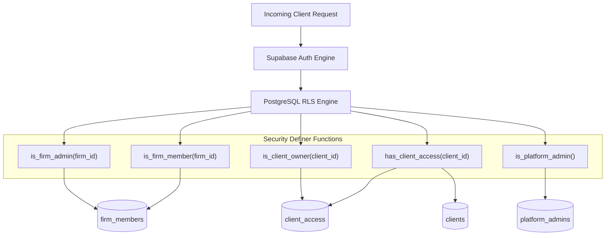
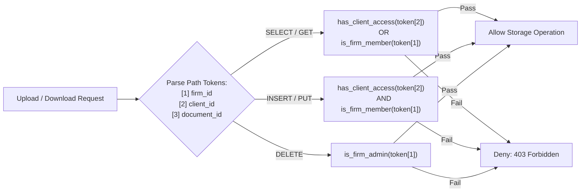

# Row-Level Security (RLS) Policy Matrix & Architecture

This document specifies the Row-Level Security (RLS) architecture, policy matrix, security-definer helper functions, and storage bucket security policies for **GST Saathi**.

---

## 1. Security Architecture & Threat Model

GST Saathi manages sensitive financial, operational, and tax compliance data for Chartered Accountant (CA) firms, tax practitioners, and their SME retail clients. Under the **Digital Personal Data Protection (DPDP) Act, 2023** and **Sections 35 & 36 of the Central Goods and Services Tax (CGST) Act, 2017**, data isolation, tamper-proof record keeping, and granular access control are statutory requirements.

### Defense-in-Depth Principle
Application-layer multi-tenancy (e.g., relying purely on ORM query filters like `where({ firm_id })`) is vulnerable to developer error, missed where-clauses, and accidental data exposure in complex joins or GraphQL/REST endpoints. 

GST Saathi enforces **database engine-level tenant isolation** using PostgreSQL Row-Level Security (RLS) managed via Supabase. Even if an application query omits tenant filters (`SELECT * FROM invoices`), the database kernel enforces row filtering based on the authenticated session (`auth.uid()`), guaranteeing zero cross-tenant leakage.

---

## 2. Roles & Actor Context

The access control model distinguishes between internal firm personnel, external client stakeholders, platform super-admins, and untrusted outsiders:

| Role Identifier | Description | Mapping Source | Typical Permissions |
|---|---|---|---|
| **Firm Admin** | Managing CA, partner, or firm owner with full administrative authority over the firm and all assigned clients. | `firm_members` with `role = 'admin'` | Full CRUD across firm profile, firm team roster, all firm clients, billing, and settings. |
| **Firm Staff** | Articles, junior accountants, and staff accountants employed by the firm. | `firm_members` with `role = 'staff'` | Read/Write access across all clients assigned to the firm. Cannot alter firm-level memberships or firm administrative settings. |
| **Client Owner** | SME business owner, shopkeeper, or primary authorized signatory for a registered GSTIN. | `client_access` with `role = 'owner'` | Read access to their client GSTIN data, return drafts, and summaries. Write access to upload purchase/sales bills and submit sales entries. Zero access to other clients or firm internal audit logs. |
| **Client Staff** | Retail shop staff, billing clerks, or cashiers working for the SME client. | `client_access` with `role = 'staff'` | Restricted ingestion access: upload invoices, drop daily sales entries, view uploaded document statuses. Cannot approve returns or view full financial recon. |
| **Platform Admin** | Platform operations, DevOps, or system engineers managing global GST rules and infrastructure. | `platform_admins` with `user_id = auth.uid()` | Full read/write access to global GST rate rule snapshots and system parameters. Read-only or emergency break-glass access to tenant data. |
| **Authenticated Outsider / Anonymous** | Unauthenticated visitors (`anon`) or authenticated users belonging to a different firm/client. | Unmatched `auth.uid()` or `auth.role() = 'anon'` | **Denied (Deny All)** across all tenant tables (`USING (false)`). Zero access. |

---

## 3. Security-Definer Helper Functions

To avoid recursive RLS query loops, eliminate repetitive join expressions, and guarantee high query performance, access checks are encapsulated inside PostgreSQL `SECURITY DEFINER` functions.

> [!SECURITY]
> **Defending Against Search Path Hijacking**:
> Every security-definer function explicitly executes `SET search_path = ''` to prevent malicious schema injection attacks, ensuring references to tables (`public.firm_members`, `public.client_access`, etc.) are fully schema-qualified and unambiguous.



### Function Specifications

#### 1. `public.is_firm_member(firm uuid) -> boolean`
- **Purpose**: Checks whether the authenticated user (`auth.uid()`) is an active member (`admin` or `staff`) of the specified accounting firm.
- **Implementation**:
  ```sql
  create or replace function public.is_firm_member(firm uuid)
  returns boolean
  language plpgsql
  security definer
  set search_path = ''
  as $$
  begin
    if auth.uid() is null then
      return false;
    end if;
    return exists (
      select 1
      from public.firm_members
      where firm_id = firm
        and user_id = auth.uid()
    );
  end;
  $$;
  ```

#### 2. `public.is_firm_admin(firm uuid) -> boolean`
- **Purpose**: Verifies that the authenticated user possesses administrative privileges within the specified firm.
- **Implementation**:
  ```sql
  create or replace function public.is_firm_admin(firm uuid)
  returns boolean
  language plpgsql
  security definer
  set search_path = ''
  as $$
  begin
    if auth.uid() is null then
      return false;
    end if;
    return exists (
      select 1
      from public.firm_members
      where firm_id = firm
        and user_id = auth.uid()
        and role = 'admin'
    );
  end;
  $$;
  ```

#### 3. `public.has_client_access(client uuid) -> boolean`
- **Purpose**: Dual-path access resolver for client data. Grants access if:
  1. The user has an explicit client-level grant in `public.client_access` (Shop Owner or Client Staff), **OR**
  2. The user belongs to the CA firm that manages the client via `public.clients.firm_id = public.firm_members.firm_id` (Firm Admin or Firm Staff).
- **Implementation**:
  ```sql
  create or replace function public.has_client_access(client uuid)
  returns boolean
  language plpgsql
  security definer
  set search_path = ''
  as $$
  begin
    if auth.uid() is null then
      return false;
    end if;

    -- Path A: Direct client_access grant
    if exists (
      select 1
      from public.client_access
      where client_id = client
        and user_id = auth.uid()
    ) then
      return true;
    end if;

    -- Path B: Accounting firm relationship
    return exists (
      select 1
      from public.clients c
      join public.firm_members fm on fm.firm_id = c.firm_id
      where c.id = client
        and fm.user_id = auth.uid()
    );
  end;
  $$;
  ```

#### 4. `public.is_client_owner(client uuid) -> boolean`
- **Purpose**: Verifies that the user is registered as the primary `owner` in `public.client_access` for that specific client GSTIN.
- **Implementation**:
  ```sql
  create or replace function public.is_client_owner(client uuid)
  returns boolean
  language plpgsql
  security definer
  set search_path = ''
  as $$
  begin
    if auth.uid() is null then
      return false;
    end if;
    return exists (
      select 1
      from public.client_access
      where client_id = client
        and user_id = auth.uid()
        and role = 'owner'
    );
  end;
  $$;
  ```

#### 5. `public.is_platform_admin() -> boolean`
- **Purpose**: Confirms system-level superuser status for platform maintainers.
- **Implementation**:
  ```sql
  create or replace function public.is_platform_admin()
  returns boolean
  language plpgsql
  security definer
  set search_path = ''
  as $$
  begin
    if auth.uid() is null then
      return false;
    end if;
    return exists (
      select 1
      from public.platform_admins
      where user_id = auth.uid()
    );
  end;
  $$;
  ```

---

## 4. Row-Level Security Policy Matrix

All application tables enable Row-Level Security (`ALTER TABLE <name> ENABLE ROW LEVEL SECURITY;`). Default behavior for unhandled actions is implicit **DENY**.

### Policy Summary Table

| Table Name | Tenant Key | Select Policy | Insert Policy | Update Policy | Delete Policy | Notes |
|---|---|---|---|---|---|---|
| **`firms`** | `id` | `is_firm_member(id) OR is_platform_admin()` | Authenticated user (`created_by = auth.uid()`) | `is_firm_admin(id)` | `is_firm_admin(id)` | Firm profile management. Staff can read firm info; only Firm Admin can update/delete. |
| **`firm_members`** | `firm_id` | `is_firm_member(firm_id) OR is_platform_admin()` | `is_firm_admin(firm_id)` | `is_firm_admin(firm_id)` | `is_firm_admin(firm_id)` | Admin can invite/remove staff. Staff can view colleague roster. |
| **`clients`** | `firm_id` | `is_firm_member(firm_id) OR has_client_access(id) OR is_platform_admin()` | `is_firm_member(firm_id)` | `is_firm_member(firm_id) OR is_client_owner(id)` | `is_firm_admin(firm_id)` | Client trade metadata, GSTIN, scheme, and turnover band. |
| **`client_access`** | `firm_id` | `is_firm_member(firm_id) OR user_id = auth.uid() OR is_platform_admin()` | `is_firm_admin(firm_id) OR is_client_owner(client_id)` | `is_firm_admin(firm_id) OR is_client_owner(client_id)` | `is_firm_admin(firm_id)` | Maps client portal users (shopkeeper / cashier). Admin manages grants. |
| **`platform_admins`** | `user_id` | `is_platform_admin()` | `is_platform_admin()` | `is_platform_admin()` | `is_platform_admin()` | System-level admin registry. Deny all non-platform admins. |
| **`documents`** | `firm_id`, `client_id` | `has_client_access(client_id) OR is_firm_member(firm_id)` | `has_client_access(client_id) AND (uploaded_by = auth.uid())` | `is_firm_member(firm_id)` (metadata/status updates) | `is_firm_admin(firm_id)` | Source bills, GSTR-2B JSON, bank statements. Soft deletes via `deleted_at`. |
| **`suppliers`** | `firm_id`, `client_id` | `has_client_access(client_id) OR is_firm_member(firm_id)` | `has_client_access(client_id) OR is_firm_member(firm_id)` | `is_firm_member(firm_id)` | `is_firm_admin(firm_id)` | Master vendor list, filing tracking, and vendor contact info. |
| **`invoices`** | `firm_id`, `client_id` | `has_client_access(client_id) OR is_firm_member(firm_id)` | `has_client_access(client_id) OR is_firm_member(firm_id)` | `is_firm_member(firm_id) OR is_client_owner(client_id)` | `is_firm_admin(firm_id)` | Primary purchase invoice records, taxable values, ITC eligibility flags. |
| **`invoice_lines`** | via `invoice_id` | `EXISTS (SELECT 1 FROM invoices i WHERE i.id = invoice_id AND (has_client_access(i.client_id) OR is_firm_member(i.firm_id)))` | Same as parent invoice access (`is_firm_member` or client role) | `is_firm_member(i.firm_id)` | `is_firm_admin(i.firm_id)` | Line items with HSN codes, tax rates, and rate rule matching status. |
| **`invoice_payments`** | via `invoice_id` | `EXISTS (SELECT 1 FROM invoices i WHERE i.id = invoice_id AND (has_client_access(i.client_id) OR is_firm_member(i.firm_id)))` | `has_client_access(i.client_id) OR is_firm_member(i.firm_id)` | `is_firm_member(i.firm_id)` | `is_firm_admin(i.firm_id)` | 180-day ITC Rule 37 tracking (paid date and mode: Cash/UPI/Bank). |
| **`extraction_fields`** | via `document_id` | `EXISTS (SELECT 1 FROM documents d WHERE d.id = document_id AND (has_client_access(d.client_id) OR is_firm_member(d.firm_id)))` | Automated worker / `is_firm_member(d.firm_id)` | `is_firm_member(d.firm_id)` | `is_firm_admin(d.firm_id)` | OCR/AI extracted line fields, bounding boxes, and CA human overrides. |
| **`gstr2b_imports`** | `client_id` | `has_client_access(client_id) OR EXISTS (SELECT 1 FROM clients c WHERE c.id = client_id AND is_firm_member(c.firm_id))` | `EXISTS (SELECT 1 FROM clients c WHERE c.id = client_id AND is_firm_member(c.firm_id))` | `is_firm_member(c.firm_id)` | `is_firm_admin(c.firm_id)` | Official GSTR-2B portal downloads (JSON/Excel). Ingested by firm staff/admin. |
| **`gstr2b_records`** | via `import_id` | `EXISTS (SELECT 1 FROM gstr2b_imports g JOIN clients c ON c.id = g.client_id WHERE g.id = import_id AND (has_client_access(g.client_id) OR is_firm_member(c.firm_id)))` | Firm member via import | `is_firm_member(c.firm_id)` (IMS action updates) | `is_firm_admin(c.firm_id)` | Itemized B2B, B2BA, CDNR portal lines and IMS action choices. |
| **`reconciliation_runs`** | `client_id` | `has_client_access(client_id) OR EXISTS (SELECT 1 FROM clients c WHERE c.id = client_id AND is_firm_member(c.firm_id))` | Firm member for client | `is_firm_member(c.firm_id)` | `is_firm_admin(c.firm_id)` | Reconciliation execution logs and summary statistics. |
| **`reconciliation_results`**| via `run_id` | Same as `reconciliation_runs` | Firm member running recon | `is_firm_member(c.firm_id)` (human decision overrides) | `is_firm_admin(c.firm_id)` | Match pass results, taxable/tax variances, ITC at risk. |
| **`sales_entries`** | `client_id` | `has_client_access(client_id) OR EXISTS (SELECT 1 FROM clients c WHERE c.id = client_id AND is_firm_member(c.firm_id))` | `has_client_access(client_id) OR is_firm_member(c.firm_id)` | `has_client_access(client_id) OR is_firm_member(c.firm_id)` | `is_firm_admin(c.firm_id) OR is_client_owner(client_id)` | Daily shop sales summaries (cash, UPI, exempt, taxable). |
| **`sales_invoices`** | `client_id` | `has_client_access(client_id) OR EXISTS (SELECT 1 FROM clients c WHERE c.id = client_id AND is_firm_member(c.firm_id))` | `has_client_access(client_id) OR is_firm_member(c.firm_id)` | `is_firm_member(c.firm_id)` | `is_firm_admin(c.firm_id)` | Outward tax invoices for B2B supplies (GSTR-1 Table 4). |
| **`return_periods`** | `client_id` | `has_client_access(client_id) OR EXISTS (SELECT 1 FROM clients c WHERE c.id = client_id AND is_firm_member(c.firm_id))` | `is_firm_member(c.firm_id)` | `is_firm_member(c.firm_id)` | `is_firm_admin(c.firm_id)` | Monthly/Quarterly filing periods, due dates, filing acknowledgement refs. |
| **`return_drafts`** | via `return_period_id` | `has_client_access(client_id) OR is_firm_member(c.firm_id)` | `is_firm_member(c.firm_id)` | `is_firm_admin(c.firm_id)` (approval/sign-off) | `is_firm_admin(c.firm_id)` | GSTR-1, GSTR-3B, CMP-08 pre-computed payloads and CA sign-off hashes. |
| **`rule_snapshots`** | *Global* (No `firm_id`) | Authenticated users (`auth.uid() IS NOT NULL`) | `is_platform_admin()` | **DENY** (`false`) | **DENY** (`false`) | Immutable tax rate rule and algorithm parameter versions. Append-only. |
| **`gst_rate_rules`** | *Global* (No `firm_id`) | Authenticated users (`auth.uid() IS NOT NULL`) | `is_platform_admin()` | `is_platform_admin()` | `is_platform_admin()` | Master HSN tax rate schedules and CBIC notification links. |
| **`rule_params`** | *Global* (No `firm_id`) | Authenticated users (`auth.uid() IS NOT NULL`) | `is_platform_admin()` | `is_platform_admin()` | `is_platform_admin()` | Platform parameters (late fee caps, interest rates, threshold limits). |
| **`audit_events`** | `firm_id`, `client_id` | `is_firm_admin(firm_id) OR is_platform_admin()` | Authenticated users (`actor_id = auth.uid()`) | **STRICTLY FORBIDDEN** (`false`) | **STRICTLY FORBIDDEN** (`false`) | **Statutory Append-Only Ledger**. Zero updates or deletions permitted under any circumstance. |
| **`alerts`** | `firm_id`, `client_id` | `has_client_access(client_id) OR is_firm_member(firm_id)` | `is_firm_member(firm_id) OR is_platform_admin()` | `has_client_access(client_id) OR is_firm_member(firm_id)` | `is_firm_admin(firm_id)` | Deadline warnings, 180-day ITC reversal alerts, threshold triggers. |

---

## 5. Append-Only Audit Table Guarantee (`audit_events`)

Under **Section 35(1) and Rule 56(1) of the CGST Rules**, registered taxable persons and tax practitioners must maintain true, complete, and unalterable accounts of inward and outward supplies. Furthermore, the **DPDP Act, 2023** mandates accountability regarding who accessed or modified personally identifiable business data.

The `audit_events` table stores immutable audit trails:
- `firm_id`: Firm tenancy identifier.
- `client_id`: Specific client context (if applicable).
- `actor_id`: `auth.uid()` of the user executing the change.
- `action`: Operation name (e.g., `invoice.create`, `recon.override`, `return.approve`).
- `entity`: Database table name.
- `entity_id`: Primary key of affected row.
- `before`: JSON snapshot of row state prior to modification.
- `after`: JSON snapshot of row state following modification.
- `created_at`: `timestamptz default clock_timestamp()`.

### Technical Guarantee of Immutability

1. **Row-Level Security Policies**:
   - `SELECT`: Restricted to `is_firm_admin(firm_id)` or `is_platform_admin()`.
   - `INSERT`: Permitted for authenticated sessions logging operations (`WITH CHECK (actor_id = auth.uid())`).
   - `UPDATE`: No policy defined (`USING (false)` / `WITH CHECK (false)`), blocking all UPDATE attempts.
   - `DELETE`: No policy defined (`USING (false)`), blocking all DELETE attempts.

2. **Trigger-Level Database Constraint**:
   Even if a superuser role or future schema migration inadvertently alters RLS, a dedicated database trigger strictly aborts any attempt to modify or delete audit rows:

   ```sql
   create or replace function public.prevent_audit_modification()
   returns trigger
   language plpgsql
   set search_path = ''
   as $$
   begin
     raise exception 'audit_events is an immutable append-only ledger; updates and deletes are prohibited by statutory compliance policy.'
       using errcode = 'integrity_constraint_violation';
   end;
   $$;

   create trigger trg_audit_events_immutable
   before update or delete on public.audit_events
   for each row
   execute function public.prevent_audit_modification();
   ```

---

## 6. Storage Bucket Security Policies

Source tax documents, receipt photos, GSTR-2B JSON files, and Tally export files are stored in Supabase Storage under a private bucket named `documents`.

### Directory Partitioning Standard
To align storage paths directly with database RLS predicates, all storage objects adhere to a standardized hierarchical key:
```
documents/{firm_id}/{client_id}/{document_id}/{filename}
```
Where:
- `{firm_id}`: UUID of the managing CA firm.
- `{client_id}`: UUID of the client business entity.
- `{document_id}`: UUID of the corresponding record in `public.documents`.
- `{filename}`: Sanitized original file name.



### Storage Object Policies (`storage.objects`)

#### 1. Download & Read Access (`SELECT`)
Users can download or preview an object only if they have access to the client entity or are a staff member of the firm:
```sql
create policy "Allow read access to authorized client or firm members"
on storage.objects
for select
using (
  bucket_id = 'documents'
  and auth.uid() is not null
  and (
    -- Path token 2 is client_id
    public.has_client_access((storage.foldername(name))[2]::uuid)
    or
    -- Path token 1 is firm_id
    public.is_firm_member((storage.foldername(name))[1]::uuid)
  )
);
```

#### 2. Upload Access (`INSERT`)
A user may upload a file only if:
1. They have access to the target client (`has_client_access`).
2. The `firm_id` token corresponds to the managing firm.
3. The uploaded path contains valid UUID tokens.
```sql
create policy "Allow insert access to authorized client or firm members"
on storage.objects
for insert
with check (
  bucket_id = 'documents'
  and auth.uid() is not null
  and public.has_client_access((storage.foldername(name))[2]::uuid)
  and public.is_firm_member((storage.foldername(name))[1]::uuid)
);
```

#### 3. Overwrite & Metadata Update (`UPDATE`)
Files in the document vault are considered immutable legal evidence. Direct updates are restricted to Firm Staff/Admin managing status metadata:
```sql
create policy "Allow update access only to firm members"
on storage.objects
for update
using (
  bucket_id = 'documents'
  and public.is_firm_member((storage.foldername(name))[1]::uuid)
);
```

#### 4. File Deletion (`DELETE`)
Permanent deletion of uploaded evidence is restricted solely to the **Firm Admin** (e.g., in cases of erroneous client uploads prior to filing lock):
```sql
create policy "Allow delete access only to firm admins"
on storage.objects
for delete
using (
  bucket_id = 'documents'
  and public.is_firm_admin((storage.foldername(name))[1]::uuid)
);
```

---

## 7. Performance & Indexing Strategy

RLS policies execute on every row examined by a database query. Without proper indexing, helper function evaluations can trigger sequential table scans, degrading UI performance.

### Required Supporting Indexes
To guarantee constant-time ($O(1)$) or logarithmic ($O(\log N)$) RLS evaluation:

1. **`firm_members` Composite Index**:
   ```sql
   create index idx_firm_members_lookup on public.firm_members (firm_id, user_id, role);
   ```
2. **`client_access` Composite Index**:
   ```sql
   create index idx_client_access_lookup on public.client_access (client_id, user_id, role);
   ```
3. **`clients` Firm Link**:
   ```sql
   create index idx_clients_firm_id on public.clients (id, firm_id);
   ```
4. **Denormalized `firm_id` on Transactional Tables**:
   All high-volume tables (`invoices`, `documents`, `suppliers`, `audit_events`, `alerts`) maintain a direct indexed `firm_id` column:
   ```sql
   create index idx_invoices_firm_client on public.invoices (firm_id, client_id);
   create index idx_documents_firm_client on public.documents (firm_id, client_id);
   ```

---

## 8. Verification & pgTAP Automated Testing

To prevent regressions during future schema modifications, all RLS policies must be validated using automated **pgTAP** test suites covering the matrix of all 6 roles:

```sql
-- Sample pgTAP snippet for RLS verification
begin;
select plan(5);

-- 1. Test unauthenticated anonymous access is rejected
set local role anon;
select throws_ok(
  'select * from public.clients',
  'permission denied for table clients'
);

-- 2. Test Firm Staff cannot view clients of another firm
set local role authenticated;
select set_config('request.jwt.claims', '{"sub": "staff-user-firm-a-uuid"}', true);
select is_empty(
  'select * from public.clients where firm_id = ''firm-b-uuid''',
  'Firm Staff from Firm A must receive empty set for Firm B clients'
);

-- 3. Test Client Owner cannot update invoice from another client
select set_config('request.jwt.claims', '{"sub": "client-owner-shop-1-uuid"}', true);
select throws_ok(
  'update public.invoices set taxable_value = 0 where client_id = ''client-shop-2-uuid''',
  'Client Owner cannot update invoices belonging to another shop'
);

-- 4. Test Audit Events cannot be deleted even by Firm Admin
select set_config('request.jwt.claims', '{"sub": "firm-admin-uuid"}', true);
select throws_ok(
  'delete from public.audit_events',
  'audit_events is an immutable append-only ledger%'
);

select * from finish();
rollback;
```
