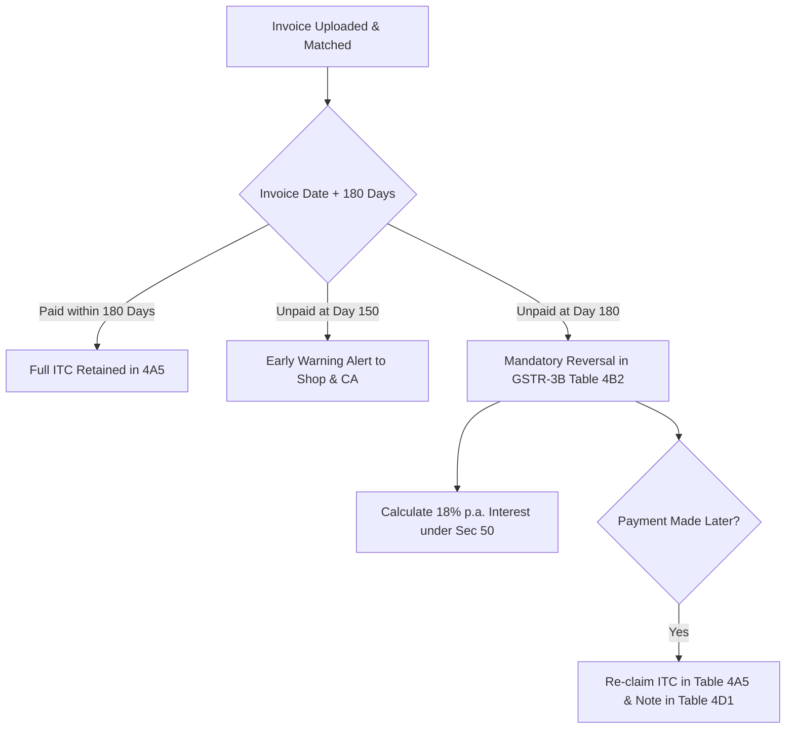
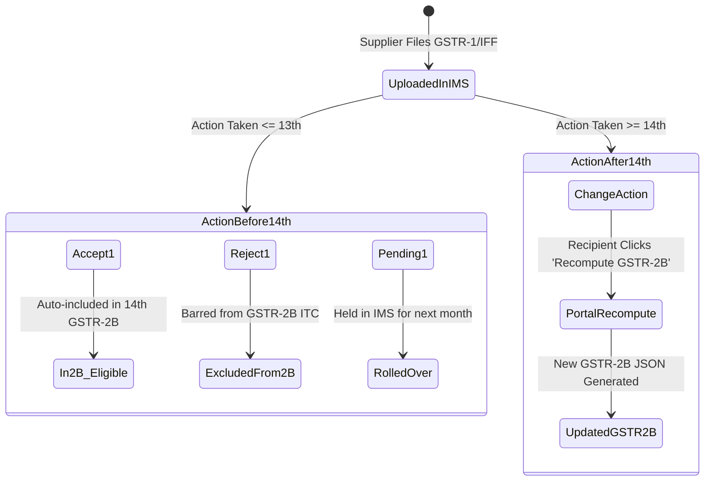

# Statutory GST Rules Verification Checklist for Chartered Accountants

> [!IMPORTANT]
> **MANDATORY LEGAL SIGN-OFF REQUIRED PRIOR TO ENGINE HARDCODING**
> This document details key provisions of the Central Goods and Services Tax (CGST) Act, 2017, Integrated Goods and Services Tax (IGST) Act, 2017, state-specific SGST rules, and CBIC notifications. 
> 
> Because software automation of tax calculation carries regulatory liability under Sections 73, 74, 122, and 132 of the CGST Act, every rule documented herein must be formally reviewed and confirmed by an empanelled Chartered Accountant (CA) or Tax Advocate before the matching algorithms, tax reversal engines, and export payloads are finalized in code.

---

## Document Overview & Verification Matrix

| Rule Reference | GST Domain Area | Governing Section / Notification | Current Code Assumption | CA Verification Status |
|---|---|---|---|---|
| [RULE-01](#rule-01-gst-registration-thresholds) | Registration Thresholds | Section 22 CGST Act; Notif. 10/2019-CT | ₹40L for exclusive goods; ₹20L for mixed/services; ₹10L/₹20L special category | PENDING REVIEW |
| [RULE-02](#rule-02-late-fee-caps--interest-computation) | Late Fees & Interest | Section 47 & 50; Notif. 19/2021 & 20/2021-CT | Tiered late fee caps (₹500 / ₹2,000 / ₹5,000 / ₹10,000); 18% p.a. on net cash liability | PENDING REVIEW |
| [RULE-03](#rule-03-stationery-books--paper-products-tax-rates) | Rates: Books & Stationery | HSN 4901, 4820, 9608; Notif. 01/2017-CT & 47th Council | 4901 is Nil; 4820 exercise books vs account registers (18% vs 12%); pens 18% | PENDING REVIEW |
| [RULE-04](#rule-04-qrmp-scheme--composition-levy-due-dates) | QRMP & Composition | Section 10 & 39; Rule 61A; Form PMT-06 & CMP-08 | PMT-06 by 25th; GSTR-1 quarterly by 13th; GSTR-3B by 22nd/24th; CMP-08 by 18th | PENDING REVIEW |
| [RULE-05](#rule-05-180-day-itc-reversal-rule-rule-37) | 180-Day ITC Reversal | 2nd Proviso to Section 16(2); Rule 37 CGST | Track unpaid supplier bills from invoice date; reverse in Table 4(B)(2) + interest | PENDING REVIEW |
| [RULE-06](#rule-06-e-way-bill-consignment-thresholds) | E-Way Bill Thresholds | Section 68; Rule 138; State SGST Notifications | Inter-state ₹50,000; Maharashtra intra-state ₹1,00,000; city-specific exemptions | PENDING REVIEW |
| [RULE-07](#rule-07-invoice-management-system-ims--gstr-2b-recompute) | IMS & GSTR-2B Cycle | GSTN IMS Advisory (Oct/Nov 2024); Rule 60(7) | Invoices accepted/rejected before 14th reflect in 2B; changes after 14th require manual recompute | PENDING REVIEW |

---

## RULE-01: GST Registration Thresholds

### Statutory Provisions & Legal Context
- **Section 22(1) of CGST Act, 2017**: Every supplier is liable to be registered in the State or Union territory from where they make taxable supply if aggregate turnover in a financial year exceeds the threshold limit.
- **Notification No. 10/2019-Central Tax (dated 07-Mar-2019)**: Exemption from obtaining registration for persons engaged exclusively in the supply of goods up to an aggregate turnover of **₹40 Lakhs**, subject to exclusions (tobacco, pan masala, brick manufacturers, inter-state suppliers, etc.).
- **Special Category States** (Article 279A(4)(g) of the Constitution):
  - **₹10 Lakh Threshold**: Manipur, Mizoram, Nagaland, Tripura.
  - **₹20 Lakh Threshold**: Arunachal Pradesh, Meghalaya, Sikkim, Uttarakhand, Puducherry, Telangana.
  - **Standard States (Goods ₹40L, Services/Mixed ₹20L)**: Maharashtra, Delhi, Gujarat, Karnataka, Uttar Pradesh, Tamil Nadu, West Bengal, Rajasthan, etc.
- **Section 24 of CGST Act**: Mandatory registration irrespective of turnover for persons making inter-state taxable supplies, casual taxable persons, reverse charge liability recipients, and e-commerce operators.

### Proposed Engine Logic & Config Assumption
```typescript
interface RegistrationThresholdConfig {
  stateCode: string;
  isExclusiveGoods: boolean;
  makesInterStateOutwardSupplies: boolean;
  thresholdAmount: number; // 10_00_000 | 20_00_000 | 40_00_000
  mandatoryRegistrationRequired: boolean;
}
```

### Risk & Financial Exposure if Miscalculated
1. **Under-reporting / Failure to Register**: Notice under Section 29/Section 122(1)(xi) with penalty of ₹10,000 or 100% of tax due.
2. **False Threshold Application**: If a shop sells stationery (goods) but also provides photocopying/binding services or earns rental income exceeding nominal limits, the threshold drops immediately from ₹40 Lakhs to ₹20 Lakhs.

### CA Confirmation Checklist & Decisions
- [ ] Confirm whether small auxiliary service revenue (e.g. spiral binding, laminating in a stationery shop) invalidates the ₹40 Lakh goods exemption under Notification 10/2019-CT.
- [ ] Validate whether interest income from bank savings/FDs counts toward aggregate turnover for the ₹40L limit (Ref: CBIC Circular No. 218/12/2024-GST).
- [ ] Confirm rule engine handling for mandatory registration triggers under Section 24 (e.g. sale via Amazon/Flipkart or inter-state consignment).

---

## RULE-02: Late-Fee Caps & Interest Computation

### Statutory Provisions & Legal Context
- **Section 47 of CGST Act, 2017**: Statutory late fee of ₹100/day under CGST + ₹100/day under SGST (total ₹200/day) up to a statutory ceiling of 0.25% of turnover.
- **Relief via Notification No. 19/2021-Central Tax (GSTR-3B) & Notification No. 20/2021-Central Tax (GSTR-1)**:
  - **Nil Tax Liability**: Total late fee capped at **₹500** (₹250 CGST + ₹250 SGST).
  - **Aggregate Turnover $\le$ ₹1.5 Crore**: Total late fee capped at **₹2,000** (₹1,000 CGST + ₹1,000 SGST).
  - **Aggregate Turnover between ₹1.5 Crore and ₹5 Crore**: Total late fee capped at **₹5,000** (₹2,500 CGST + ₹2,500 SGST).
  - **Aggregate Turnover > ₹5 Crore**: Total late fee capped at standard maximum of **₹10,000** (₹5,000 CGST + ₹5,000 SGST) accrued at ₹50/day (₹25 CGST + ₹25 SGST) or ₹20/day for Nil returns.
- **Section 50(1) Proviso (Interest on Net Cash Liability)**:
  - Interest is payable at **18% per annum** on that portion of the tax paid by debiting the electronic cash ledger (not on the gross liability offset via electronic credit ledger), provided the return is filed before or after initiation of Section 73/74 proceedings.

### Proposed Engine Logic & Config Assumption
```typescript
function calculateLateFee(params: {
  delayDays: number;
  hasLiability: boolean;
  precedingYearTurnover: number;
}): { cgstLateFee: number; sgstLateFee: number; totalLateFee: number } {
  const dailyRate = params.hasLiability ? 50 : 20; // 50 total (25+25), 20 total (10+10)
  const rawFee = params.delayDays * dailyRate;

  let maxCap = 10000;
  if (!params.hasLiability) {
    maxCap = 500;
  } else if (params.precedingYearTurnover <= 15000000) {
    maxCap = 2000;
  } else if (params.precedingYearTurnover <= 50000000) {
    maxCap = 5000;
  }

  const cappedFee = Math.min(rawFee, maxCap);
  return {
    cgstLateFee: cappedFee / 2,
    sgstLateFee: cappedFee / 2,
    totalLateFee: cappedFee
  };
}
```

### Risk & Financial Exposure if Miscalculated
- Showing an inflated late-fee estimate causes client panic; showing an under-calculated late fee results in short payment challans and rejection at GSTR-3B submission.

### CA Confirmation Checklist & Decisions
- [ ] Confirm whether current portal implementation automatically calculates late fees in the subsequent tax period’s GSTR-3B Table 5.1 and whether manual overrides are permitted.
- [ ] Confirm that interest under Section 50 is strictly calculated on net cash liability (Table 6.1 cash column) and never on gross tax if ITC is available.

---

## RULE-03: Stationery, Books & Paper Products Tax Rates

### Statutory Provisions & Legal Context
- **Notification No. 01/2017-Central Tax (Rate)** and subsequent rate rationalization amendments (specifically 47th GST Council Meeting recommendations effective 18-July-2022):
  - **HSN 4901**: Printed books, brochures, leaflets, children's picture/drawing/coloring books $\rightarrow$ **Exempt (0% GST)**.
  - **HSN 4820**: 
    - *Sub-heading 4820 20 00*: Exercise books $\rightarrow$ **Previously 12%, rationalized to 12% / 18%** depending on binding/printed specifications.
    - *Sub-heading 4820 10 00*: Registers, account books, note books, order books, receipt books, letter pads, memorandum pads, diaries $\rightarrow$ **18% GST**.
    - *Sub-heading 4820 30 00*: Binders, folders, book covers $\rightarrow$ **18% GST**.
  - **HSN 9608**: Ball point pens, felt tipped and other porous-tipped pens and markers, fountain pens, stylograph pens $\rightarrow$ Rate rationalized from 12% to **18% GST**.
  - **HSN 8214 / 9017**: Pencil sharpeners, geometry boxes, mathematical drawing instruments $\rightarrow$ **18% GST**.
  - **HSN 9609**: Pencils (crayons, pastels, drawing charcoals) $\rightarrow$ **12% GST**.

### Ambiguity / Split-Rate Problem in Retail Invoicing
Small retail shops receive invoices that generically describe line items as "Notebooks", "Register", "Rough Book", or "Student Copy". If an OCR engine auto-assigns 12% instead of 18%, or claims 0% considering it a "book", the merchant faces tax demand notices under Section 73.

### CA Confirmation Checklist & Decisions
- [ ] **HSN 4820 Split**: Specify the exact criteria our OCR classification model must follow when differentiating 4820 20 00 (Exercise Books) from 4820 10 00 (Registers & Note Books).
- [ ] **Mixed / Composite Kits**: When a vendor sells a "Student Kit" containing school bags (18%), notebooks (12%/18%), printed textbooks (0%), and pens (18%) as a single bundled SKU, confirm whether Section 8 composite vs mixed supply principles apply (taxable at the highest rate: 18% or 28%).

---

## RULE-04: QRMP Scheme & Composition Levy Due Dates

### Statutory Provisions & Legal Context
- **QRMP (Quarterly Return Monthly Payment) Scheme** (Circular No. 143/13/2020-GST):
  - **Eligibility**: Registered taxpayers with aggregate turnover up to ₹5 Crore in the preceding financial year.
  - **Monthly Tax Deposit (Form PMT-06)**: Tax must be deposited by the **25th day** of the next month for Month 1 and Month 2 of the quarter.
    - *Fixed Sum Method (FSM)*: 35% of the net tax paid in cash in the preceding quarter's GSTR-3B (or 100% of net tax if previously filed monthly).
    - *Self Assessment Method (SAM)*: Actual tax liability on outward supplies less available ITC.
  - **Invoice Furnishing Facility (IFF)**: Optional facility to upload B2B invoices between the 1st and **13th day** of Month 1 and Month 2 (up to ₹50 Lakhs per month).
  - **Quarterly Returns**:
    - Form GSTR-1: Due on the **13th day** of the month following the quarter.
    - Form GSTR-3B: Staggered due dates on the **22nd day** (Category 1 States: South/West India) or **24th day** (Category 2 States: North/East India) of the month following the quarter.
- **Composition Scheme under Section 10**:
  - Threshold: ₹1.5 Crore aggregate turnover (₹75 Lakhs for Special Category States).
  - Tax Rate: 1% for traders/manufacturers of goods (0.5% CGST + 0.5% SGST).
  - Quarterly Challan **CMP-08**: Due on or before the **18th day** of the month following the quarter.
  - Annual Return **GSTR-4**: Due on the **30th day of April** following the end of the financial year.

### Due Date Reference Schedule

| Scheme | Tax Period | Form / Document | Statutory Due Date | State Category Dependency |
|---|---|---|---|---|
| Regular Monthly | Monthly | GSTR-1 | 11th of succeeding month | No |
| Regular Monthly | Monthly | GSTR-3B | 20th of succeeding month | No |
| QRMP | Month 1 & 2 | IFF (Optional B2B) | 13th of succeeding month | No |
| QRMP | Month 1 & 2 | PMT-06 (Tax Challan) | 25th of succeeding month | No |
| QRMP | Quarter End | GSTR-1 (Quarterly) | 13th of succeeding month | No |
| QRMP (Cat 1 States) | Quarter End | GSTR-3B (Quarterly) | 22nd of succeeding month | Yes (MH, GJ, KA, TN, etc.) |
| QRMP (Cat 2 States) | Quarter End | GSTR-3B (Quarterly) | 24th of succeeding month | Yes (DL, UP, PB, WB, etc.) |
| Composition | Quarter End | CMP-08 | 18th of succeeding month | No |
| Composition | Annual | GSTR-4 | 30th April following FY | No |

### CA Confirmation Checklist & Decisions
- [ ] Confirm list of states belonging to Category 1 (22nd) vs Category 2 (24th) for QRMP GSTR-3B.
- [ ] Confirm default monthly challan payment mode: Recommend Fixed Sum Method (35% auto-calculated) or Self-Assessment Method for micro-retailers.

---

## RULE-05: 180-Day ITC Reversal Rule (Rule 37)

### Statutory Provisions & Legal Context
- **Second Proviso to Section 16(2) of CGST Act, 2017**:
  Where a recipient fails to pay the supplier the amount towards the value of supply along with tax payable thereon within a period of **180 days from the date of issue of invoice**, an amount equal to the input tax credit availed by the recipient shall be paid by him along with interest under Section 50.
- **Rule 37 of CGST Rules, 2017 (Amended vide Notif. 19/2022-CT & Notif. 26/2022-CT)**:
  - The reversal must be reported in **Table 4(B)(2) (Others)** of Form GSTR-3B for the tax period immediately following the expiry of 180 days.
  - **Interest Calculation**: Payable under Section 50(1) at 18% p.a. starting from the date of availing ITC up to the date of reversal.
  - **Re-Availment upon Payment**: When the recipient subsequently makes payment to the supplier, the ITC can be **re-claimed in Table 4(A)(5)** and reported in **Table 4(D)(1)**.
  - **No Time Limit for Re-claim**: The time limit specified under Section 16(4) (30th November following end of FY) does **not** apply to re-availment of credit under Rule 37.
  - **Partial Payments**: If partial payment is made, the reversal is calculated proportionately on the unpaid balance.

### Aging Tracker Engine Specification


### CA Confirmation Checklist & Decisions
- [ ] Confirm whether our ledger aging module should calculate 180 days strictly from `invoiceDate` or from `goodsReceivedDate`. (Statutory wording states *date of issue of invoice*).
- [ ] Confirm handling of credit notes, trade discounts, and retention money agreements between shopkeepers and publishers.

---

## RULE-06: E-Way Bill Consignment Thresholds

### Statutory Provisions & Legal Context
- **Section 68 of CGST Act read with Rule 138 of CGST Rules, 2017**:
  Every registered person who causes movement of goods of consignment value exceeding **₹50,000** must generate an E-Way Bill prior to commencement of movement.
- **Inter-State Movements**: Uniform ₹50,000 consignment value threshold across all of India.
- **Intra-State State-Specific Variations**:
  - **Maharashtra**: Threshold raised to **₹1,00,000** for intra-state movement of all goods (Notification No. P.T.R. 0318/C.R. 29/Taxation-1 dated 29-June-2018).
  - **West Bengal / Bihar / Jharkhand**: Specific commodity exclusions and varying thresholds.
  - **Delhi**: Raised to ₹1,00,000 for intra-state movements (excluding specific items).
- **Consignment Value Definition**: Includes invoice value + CGST + SGST + IGST + Cess, excluding exempt supply value if separate bill of supply is issued.

### CA Confirmation Checklist & Decisions
- [ ] Confirm state-by-state lookup table for intra-state e-way bill exemption limits.
- [ ] Confirm exempt commodity rules for book deliveries (e.g. printed books under HSN 4901 are exempt from E-Way Bill requirements under Annexure to Rule 138(14)).

---

## RULE-07: Invoice Management System (IMS) & GSTR-2B Recompute

### Statutory Provisions & Legal Context
- **GSTN Advisory on Invoice Management System (IMS)** (Rolled out in October/November 2024):
  - IMS is a new facility on the GST Portal enabling recipient taxpayers to review and act upon supplier-uploaded invoices (from GSTR-1, IFF, GSTR-1A).
  - **Three Possible Recipient Actions**:
    1. **Accept**: Invoice moves to eligible ITC stream; populates in GSTR-2B.
    2. **Reject**: Invoice is rejected; no ITC flows into GSTR-2B; supplier is notified to amend via GSTR-1A or next GSTR-1.
    3. **Pending**: Action is deferred; invoice does **not** populate in the current month's GSTR-2B; rolls over to the IMS inbox for subsequent tax periods.
    4. **No Action**: Defaults to deemed "Accept" at the time of GSTR-2B generation.
- **Cut-off Date & Recompute Mechanism**:
  - GSTR-2B is generated automatically on the **14th of every month**.
  - Actions taken in IMS up to the **13th midnight** are directly factored into the auto-generated GSTR-2B.
  - If a taxpayer takes an action in IMS **after the 14th** (e.g., changes an invoice from Pending to Accepted on the 16th), the recipient **must click the "Recompute GSTR-2B" button** on the GST Portal before filing GSTR-3B.

### Reconciliation Workflow Integration


### CA Confirmation Checklist & Decisions
- [ ] Confirm system UX when an accountant imports an outdated GSTR-2B JSON generated on the 14th, but has pending IMS actions taken on the 17th.
- [ ] Confirm warning badge: "IMS actions taken after 14th require manual GSTR-2B recompute on GST Portal before final return filing".

---

## CA Review & Formal Sign-Off Section

Please complete this sign-off section upon reviewing and ratifying the provisions outlined in this document.

| Review Field | Reviewer Entry |
|---|---|
| **Chartered Accountant / Firm Name** | __________________________________________________ |
| **ICAI Membership Number** | __________________________________________________ |
| **Firm Registration Number (FRN)** | __________________________________________________ |
| **Review Date** | ____________________ |
| **Approval Status** | `[  ] APPROVED AS WRITTEN` <br> `[  ] APPROVED WITH ANNOTATIONS` <br> `[  ] REVISIONS REQUESTED` |
| **Specific Exceptions / Annotations** | __________________________________________________ |
| **Signature / Digital Stamp** | __________________________________________________ |
