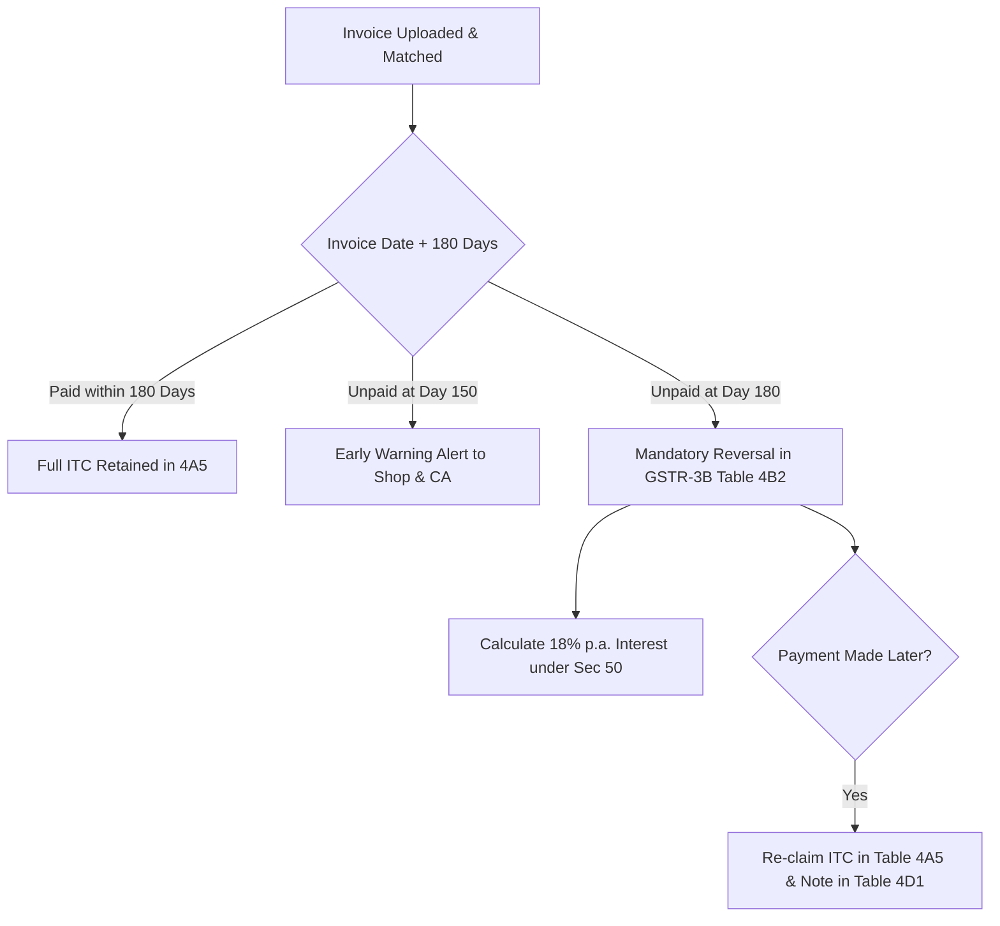
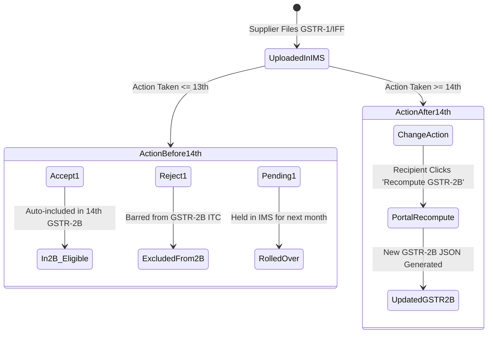
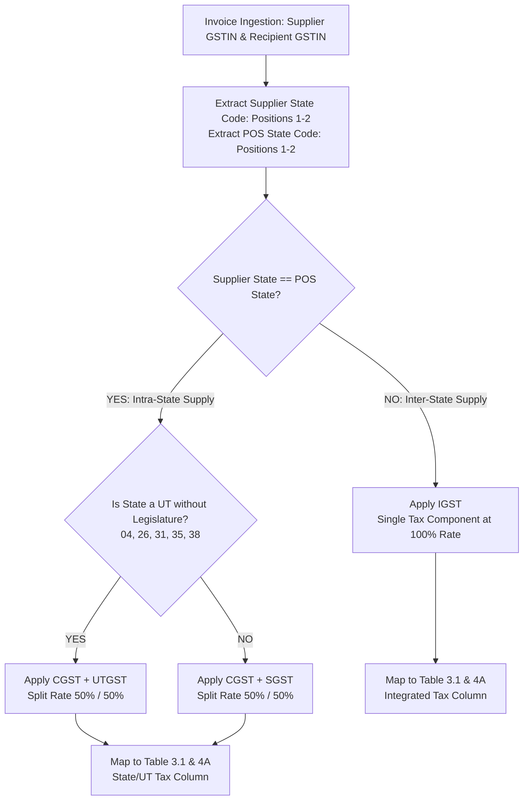

# Statutory GST Rules Verification Checklist for Chartered Accountants

> [!IMPORTANT]
> **MANDATORY LEGAL SIGN-OFF REQUIRED PRIOR TO ENGINE HARDCODING**
> This document details key provisions of the Central Goods and Services Tax (CGST) Act, 2017, Integrated Goods and Services Tax (IGST) Act, 2017, state-specific SGST rules, and CBIC notifications. 
> 
> Because software automation of tax calculation carries regulatory liability under Sections 73, 74, 122, and 132 of the CGST Act, every rule documented herein must be formally reviewed and confirmed by an empanelled Chartered Accountant (CA) or Tax Advocate before the matching algorithms, tax reversal engines, and export payloads are finalized in code.

---

## Document Overview & Verification Matrix

| Rule Reference | GST Domain Area | Governing Section / Notification | Current Code Assumption | CA Verification Status |
|---|---|---|---|---|
| [RULE-01](#rule-01-gst-registration-thresholds) | Registration Thresholds | Section 22 CGST Act; Notif. 10/2019-CT | ₹40L for exclusive goods; ₹20L for mixed/services; ₹10L/₹20L special category | PENDING REVIEW |
| [RULE-02](#rule-02-late-fee-caps--interest-computation) | Late Fees & Interest | Section 47 & 50; Notif. 19/2021 & 20/2021-CT | Tiered late fee caps (₹500 / ₹2,000 / ₹5,000 / ₹10,000); 18% p.a. on net cash liability | PENDING REVIEW |
| [RULE-03](#rule-03-stationery-books--paper-products-tax-rates) | Rates: Books & Stationery | HSN 4901, 4820, 9608; Notif. 01/2017-CT & 47th Council | 4901 is Nil; 4820 exercise books vs account registers (18% vs 12%); pens 18% | PENDING REVIEW |
| [RULE-04](#rule-04-qrmp-scheme--composition-levy-due-dates) | QRMP & Composition | Section 10 & 39; Rule 61A; Form PMT-06 & CMP-08 | PMT-06 by 25th; GSTR-1 quarterly by 13th; GSTR-3B by 22nd/24th; CMP-08 by 18th | PENDING REVIEW |
| [RULE-05](#rule-05-180-day-itc-reversal-rule-rule-37) | 180-Day ITC Reversal | 2nd Proviso to Section 16(2); Rule 37 CGST | Track unpaid supplier bills from invoice date; reverse in Table 4(B)(2) + interest | PENDING REVIEW |
| [RULE-06](#rule-06-e-way-bill-consignment-thresholds) | E-Way Bill Thresholds | Section 68; Rule 138; State SGST Notifications | Inter-state ₹50,000; Maharashtra intra-state ₹1,00,000; city-specific exemptions | PENDING REVIEW |
| [RULE-07](#rule-07-invoice-management-system-ims--gstr-2b-recompute) | IMS & GSTR-2B Cycle | GSTN IMS Advisory (Oct/Nov 2024); Rule 60(7) | Invoices accepted/rejected before 14th reflect in 2B; changes after 14th require manual recompute | PENDING REVIEW |
| [RULE-08](#rule-08-official-gstn-state-codes--qrmp-staggering) | State Codes & Staggering | Section 25; Rule 8; Notif. 82/2020-CT | 37 official 2-digit codes (01-38, 97, 99); QRMP Category 1 (22nd) vs Category 2 (24th) | PENDING REVIEW |
| [RULE-09](#rule-09-annual-aggregate-turnover-aato-bands) | AATO Bands & Thresholds | Section 10, 22, 44; Notif. 10/2019 & 78/2020-CT | 4 bands (<40L, 40L-1.5Cr, 1.5Cr-5Cr, >5Cr); governs e-invoicing, 6-digit HSN, QRMP | PENDING REVIEW |
| [RULE-10](#rule-10-statutory-gst-schemes-regular-vs-qrmp-vs-composition) | GST Taxation Schemes | Section 10, 39; Rule 61A; Circular 143/13/2020 | Regular monthly vs QRMP (IFF + PMT-06) vs Composition (CMP-08 1%, no ITC) | PENDING REVIEW |
| [RULE-11](#rule-11-state-jurisdiction--intra-vs-inter-state-supplies) | Supply Classification | Section 7 & 8 IGST Act; UTGST Act, 2017 | GSTIN prefix = state jurisdiction; intra-state (CGST+SGST/UTGST) vs inter-state (IGST) | PENDING REVIEW |

---

## RULE-01: GST Registration Thresholds

### Statutory Provisions & Legal Context
- **Section 22(1) of CGST Act, 2017**: Every supplier is liable to be registered in the State or Union territory from where they make taxable supply if aggregate turnover in a financial year exceeds the threshold limit.
- **Notification No. 10/2019-Central Tax (dated 07-Mar-2019)**: Exemption from obtaining registration for persons engaged exclusively in the supply of goods up to an aggregate turnover of **₹40 Lakhs**, subject to exclusions (tobacco, pan masala, brick manufacturers, inter-state suppliers, etc.).
- **Special Category States** (Article 279A(4)(g) of the Constitution):
  - **₹10 Lakh Threshold**: Manipur, Mizoram, Nagaland, Tripura.
  - **₹20 Lakh Threshold**: Arunachal Pradesh, Meghalaya, Sikkim, Uttarakhand, Puducherry, Telangana.
  - **Standard States (Goods ₹40L, Services/Mixed ₹20L)**: Maharashtra, Delhi, Gujarat, Karnataka, Uttar Pradesh, Tamil Nadu, West Bengal, Rajasthan, etc.
- **Section 24 of CGST Act**: Mandatory registration irrespective of turnover for persons making inter-state taxable supplies, casual taxable persons, reverse charge liability recipients, and e-commerce operators.

### Proposed Engine Logic & Config Assumption
```typescript
interface RegistrationThresholdConfig {
  stateCode: string;
  isExclusiveGoods: boolean;
  makesInterStateOutwardSupplies: boolean;
  thresholdAmount: number; // 10_00_000 | 20_00_000 | 40_00_000
  mandatoryRegistrationRequired: boolean;
}
```

### Risk & Financial Exposure if Miscalculated
1. **Under-reporting / Failure to Register**: Notice under Section 29/Section 122(1)(xi) with penalty of ₹10,000 or 100% of tax due.
2. **False Threshold Application**: If a shop sells stationery (goods) but also provides photocopying/binding services or earns rental income exceeding nominal limits, the threshold drops immediately from ₹40 Lakhs to ₹20 Lakhs.

### CA Confirmation Checklist & Decisions
- [ ] Confirm whether small auxiliary service revenue (e.g. spiral binding, laminating in a stationery shop) invalidates the ₹40 Lakh goods exemption under Notification 10/2019-CT.
- [ ] Validate whether interest income from bank savings/FDs counts toward aggregate turnover for the ₹40L limit (Ref: CBIC Circular No. 218/12/2024-GST).
- [ ] Confirm rule engine handling for mandatory registration triggers under Section 24 (e.g. sale via Amazon/Flipkart or inter-state consignment).

---

## RULE-02: Late-Fee Caps & Interest Computation

### Statutory Provisions & Legal Context
- **Section 47 of CGST Act, 2017**: Statutory late fee of ₹100/day under CGST + ₹100/day under SGST (total ₹200/day) up to a statutory ceiling of 0.25% of turnover.
- **Relief via Notification No. 19/2021-Central Tax (GSTR-3B) & Notification No. 20/2021-Central Tax (GSTR-1)**:
  - **Nil Tax Liability**: Total late fee capped at **₹500** (₹250 CGST + ₹250 SGST).
  - **Aggregate Turnover $\le$ ₹1.5 Crore**: Total late fee capped at **₹2,000** (₹1,000 CGST + ₹1,000 SGST).
  - **Aggregate Turnover between ₹1.5 Crore and ₹5 Crore**: Total late fee capped at **₹5,000** (₹2,500 CGST + ₹2,500 SGST).
  - **Aggregate Turnover > ₹5 Crore**: Total late fee capped at standard maximum of **₹10,000** (₹5,000 CGST + ₹5,000 SGST) accrued at ₹50/day (₹25 CGST + ₹25 SGST) or ₹20/day for Nil returns.
- **Section 50(1) Proviso (Interest on Net Cash Liability)**:
  - Interest is payable at **18% per annum** on that portion of the tax paid by debiting the electronic cash ledger (not on the gross liability offset via electronic credit ledger), provided the return is filed before or after initiation of Section 73/74 proceedings.

### Proposed Engine Logic & Config Assumption
```typescript
function calculateLateFee(params: {
  delayDays: number;
  hasLiability: boolean;
  precedingYearTurnover: number;
}): { cgstLateFee: number; sgstLateFee: number; totalLateFee: number } {
  const dailyRate = params.hasLiability ? 50 : 20; // 50 total (25+25), 20 total (10+10)
  const rawFee = params.delayDays * dailyRate;

  let maxCap = 10000;
  if (!params.hasLiability) {
    maxCap = 500;
  } else if (params.precedingYearTurnover <= 15000000) {
    maxCap = 2000;
  } else if (params.precedingYearTurnover <= 50000000) {
    maxCap = 5000;
  }

  const cappedFee = Math.min(rawFee, maxCap);
  return {
    cgstLateFee: cappedFee / 2,
    sgstLateFee: cappedFee / 2,
    totalLateFee: cappedFee
  };
}
```

### Risk & Financial Exposure if Miscalculated
- Showing an inflated late-fee estimate causes client panic; showing an under-calculated late fee results in short payment challans and rejection at GSTR-3B submission.

### CA Confirmation Checklist & Decisions
- [ ] Confirm whether current portal implementation automatically calculates late fees in the subsequent tax period’s GSTR-3B Table 5.1 and whether manual overrides are permitted.
- [ ] Confirm that interest under Section 50 is strictly calculated on net cash liability (Table 6.1 cash column) and never on gross tax if ITC is available.

---

## RULE-03: Stationery, Books & Paper Products Tax Rates

### Statutory Provisions & Legal Context
- **Notification No. 01/2017-Central Tax (Rate)** and subsequent rate rationalization amendments (specifically 47th GST Council Meeting recommendations effective 18-July-2022):
  - **HSN 4901**: Printed books, brochures, leaflets, children's picture/drawing/coloring books $\rightarrow$ **Exempt (0% GST)**.
  - **HSN 4820**: 
    - *Sub-heading 4820 20 00*: Exercise books $\rightarrow$ **Previously 12%, rationalized to 12% / 18%** depending on binding/printed specifications.
    - *Sub-heading 4820 10 00*: Registers, account books, note books, order books, receipt books, letter pads, memorandum pads, diaries $\rightarrow$ **18% GST**.
    - *Sub-heading 4820 30 00*: Binders, folders, book covers $\rightarrow$ **18% GST**.
  - **HSN 9608**: Ball point pens, felt tipped and other porous-tipped pens and markers, fountain pens, stylograph pens $\rightarrow$ Rate rationalized from 12% to **18% GST**.
  - **HSN 8214 / 9017**: Pencil sharpeners, geometry boxes, mathematical drawing instruments $\rightarrow$ **18% GST**.
  - **HSN 9609**: Pencils (crayons, pastels, drawing charcoals) $\rightarrow$ **12% GST**.

### Ambiguity / Split-Rate Problem in Retail Invoicing
Small retail shops receive invoices that generically describe line items as "Notebooks", "Register", "Rough Book", or "Student Copy". If an OCR engine auto-assigns 12% instead of 18%, or claims 0% considering it a "book", the merchant faces tax demand notices under Section 73.

### CA Confirmation Checklist & Decisions
- [ ] **HSN 4820 Split**: Specify the exact criteria our OCR classification model must follow when differentiating 4820 20 00 (Exercise Books) from 4820 10 00 (Registers & Note Books).
- [ ] **Mixed / Composite Kits**: When a vendor sells a "Student Kit" containing school bags (18%), notebooks (12%/18%), printed textbooks (0%), and pens (18%) as a single bundled SKU, confirm whether Section 8 composite vs mixed supply principles apply (taxable at the highest rate: 18% or 28%).

---

## RULE-04: QRMP Scheme & Composition Levy Due Dates

### Statutory Provisions & Legal Context
- **QRMP (Quarterly Return Monthly Payment) Scheme** (Circular No. 143/13/2020-GST):
  - **Eligibility**: Registered taxpayers with aggregate turnover up to ₹5 Crore in the preceding financial year.
  - **Monthly Tax Deposit (Form PMT-06)**: Tax must be deposited by the **25th day** of the next month for Month 1 and Month 2 of the quarter.
    - *Fixed Sum Method (FSM)*: 35% of the net tax paid in cash in the preceding quarter's GSTR-3B (or 100% of net tax if previously filed monthly).
    - *Self Assessment Method (SAM)*: Actual tax liability on outward supplies less available ITC.
  - **Invoice Furnishing Facility (IFF)**: Optional facility to upload B2B invoices between the 1st and **13th day** of Month 1 and Month 2 (up to ₹50 Lakhs per month).
  - **Quarterly Returns**:
    - Form GSTR-1: Due on the **13th day** of the month following the quarter.
    - Form GSTR-3B: Staggered due dates on the **22nd day** (Category 1 States: South/West India) or **24th day** (Category 2 States: North/East India) of the month following the quarter.
- **Composition Scheme under Section 10**:
  - Threshold: ₹1.5 Crore aggregate turnover (₹75 Lakhs for Special Category States).
  - Tax Rate: 1% for traders/manufacturers of goods (0.5% CGST + 0.5% SGST).
  - Quarterly Challan **CMP-08**: Due on or before the **18th day** of the month following the quarter.
  - Annual Return **GSTR-4**: Due on the **30th day of April** following the end of the financial year.

### Due Date Reference Schedule

| Scheme | Tax Period | Form / Document | Statutory Due Date | State Category Dependency |
|---|---|---|---|---|
| Regular Monthly | Monthly | GSTR-1 | 11th of succeeding month | No |
| Regular Monthly | Monthly | GSTR-3B | 20th of succeeding month | No |
| QRMP | Month 1 & 2 | IFF (Optional B2B) | 13th of succeeding month | No |
| QRMP | Month 1 & 2 | PMT-06 (Tax Challan) | 25th of succeeding month | No |
| QRMP | Quarter End | GSTR-1 (Quarterly) | 13th of succeeding month | No |
| QRMP (Cat 1 States) | Quarter End | GSTR-3B (Quarterly) | 22nd of succeeding month | Yes (MH, GJ, KA, TN, etc.) |
| QRMP (Cat 2 States) | Quarter End | GSTR-3B (Quarterly) | 24th of succeeding month | Yes (DL, UP, PB, WB, etc.) |
| Composition | Quarter End | CMP-08 | 18th of succeeding month | No |
| Composition | Annual | GSTR-4 | 30th April following FY | No |

### CA Confirmation Checklist & Decisions
- [ ] Confirm list of states belonging to Category 1 (22nd) vs Category 2 (24th) for QRMP GSTR-3B.
- [ ] Confirm default monthly challan payment mode: Recommend Fixed Sum Method (35% auto-calculated) or Self-Assessment Method for micro-retailers.

---

## RULE-05: 180-Day ITC Reversal Rule (Rule 37)

### Statutory Provisions & Legal Context
- **Second Proviso to Section 16(2) of CGST Act, 2017**:
  Where a recipient fails to pay the supplier the amount towards the value of supply along with tax payable thereon within a period of **180 days from the date of issue of invoice**, an amount equal to the input tax credit availed by the recipient shall be paid by him along with interest under Section 50.
- **Rule 37 of CGST Rules, 2017 (Amended vide Notif. 19/2022-CT & Notif. 26/2022-CT)**:
  - The reversal must be reported in **Table 4(B)(2) (Others)** of Form GSTR-3B for the tax period immediately following the expiry of 180 days.
  - **Interest Calculation**: Payable under Section 50(1) at 18% p.a. starting from the date of availing ITC up to the date of reversal.
  - **Re-Availment upon Payment**: When the recipient subsequently makes payment to the supplier, the ITC can be **re-claimed in Table 4(A)(5)** and reported in **Table 4(D)(1)**.
  - **No Time Limit for Re-claim**: The time limit specified under Section 16(4) (30th November following end of FY) does **not** apply to re-availment of credit under Rule 37.
  - **Partial Payments**: If partial payment is made, the reversal is calculated proportionately on the unpaid balance.

### Aging Tracker Engine Specification


### CA Confirmation Checklist & Decisions
- [ ] Confirm whether our ledger aging module should calculate 180 days strictly from `invoiceDate` or from `goodsReceivedDate`. (Statutory wording states *date of issue of invoice*).
- [ ] Confirm handling of credit notes, trade discounts, and retention money agreements between shopkeepers and publishers.

---

## RULE-06: E-Way Bill Consignment Thresholds

### Statutory Provisions & Legal Context
- **Section 68 of CGST Act read with Rule 138 of CGST Rules, 2017**:
  Every registered person who causes movement of goods of consignment value exceeding **₹50,000** must generate an E-Way Bill prior to commencement of movement.
- **Inter-State Movements**: Uniform ₹50,000 consignment value threshold across all of India.
- **Intra-State State-Specific Variations**:
  - **Maharashtra**: Threshold raised to **₹1,00,000** for intra-state movement of all goods (Notification No. P.T.R. 0318/C.R. 29/Taxation-1 dated 29-June-2018).
  - **West Bengal / Bihar / Jharkhand**: Specific commodity exclusions and varying thresholds.
  - **Delhi**: Raised to ₹1,00,000 for intra-state movements (excluding specific items).
- **Consignment Value Definition**: Includes invoice value + CGST + SGST + IGST + Cess, excluding exempt supply value if separate bill of supply is issued.

### CA Confirmation Checklist & Decisions
- [ ] Confirm state-by-state lookup table for intra-state e-way bill exemption limits.
- [ ] Confirm exempt commodity rules for book deliveries (e.g. printed books under HSN 4901 are exempt from E-Way Bill requirements under Annexure to Rule 138(14)).

---

## RULE-07: Invoice Management System (IMS) & GSTR-2B Recompute

### Statutory Provisions & Legal Context
- **GSTN Advisory on Invoice Management System (IMS)** (Rolled out in October/November 2024):
  - IMS is a new facility on the GST Portal enabling recipient taxpayers to review and act upon supplier-uploaded invoices (from GSTR-1, IFF, GSTR-1A).
  - **Three Possible Recipient Actions**:
    1. **Accept**: Invoice moves to eligible ITC stream; populates in GSTR-2B.
    2. **Reject**: Invoice is rejected; no ITC flows into GSTR-2B; supplier is notified to amend via GSTR-1A or next GSTR-1.
    3. **Pending**: Action is deferred; invoice does **not** populate in the current month's GSTR-2B; rolls over to the IMS inbox for subsequent tax periods.
    4. **No Action**: Defaults to deemed "Accept" at the time of GSTR-2B generation.
- **Cut-off Date & Recompute Mechanism**:
  - GSTR-2B is generated automatically on the **14th of every month**.
  - Actions taken in IMS up to the **13th midnight** are directly factored into the auto-generated GSTR-2B.
  - If a taxpayer takes an action in IMS **after the 14th** (e.g., changes an invoice from Pending to Accepted on the 16th), the recipient **must click the "Recompute GSTR-2B" button** on the GST Portal before filing GSTR-3B.

### Reconciliation Workflow Integration


### CA Confirmation Checklist & Decisions
- [ ] Confirm system UX when an accountant imports an outdated GSTR-2B JSON generated on the 14th, but has pending IMS actions taken on the 17th.
- [ ] Confirm warning badge: "IMS actions taken after 14th require manual GSTR-2B recompute on GST Portal before final return filing".

---

## RULE-08: Official GSTN State Codes & QRMP Staggering

### Statutory Provisions & Legal Context
- **Section 25 of CGST Act read with Rule 8 of CGST Rules, 2017**: The first 2 digits of every statutory 15-character GSTIN represent the taxpayer's registered State or Union Territory code as established by the Goods and Services Tax Network (GSTN).
- **Notification No. 82/2020-Central Tax (dated 10-Nov-2020)**: Implemented staggered quarterly GSTR-3B due dates for taxpayers opting into the QRMP scheme:
  - **Category 1 States & UTs (Due Date: 22nd of succeeding month)**: States of Chhattisgarh, Madhya Pradesh, Gujarat, Maharashtra, Karnataka, Goa, Kerala, Tamil Nadu, Telangana, Andhra Pradesh, and Union Territories of Daman and Diu, Dadra and Nagar Haveli, Puducherry, Andaman and Nicobar Islands, and Lakshadweep.
  - **Category 2 States & UTs (Due Date: 24th of succeeding month)**: States of Himachal Pradesh, Punjab, Uttarakhand, Haryana, Rajasthan, Uttar Pradesh, Bihar, Sikkim, Arunachal Pradesh, Nagaland, Manipur, Mizoram, Tripura, Meghalaya, Assam, West Bengal, Jharkhand, Odisha, and Union Territories of Jammu and Kashmir, Ladakh, Chandigarh, and Delhi.
- **Dadra and Nagar Haveli and Daman and Diu Merger (effective 26-Jan-2020)**: Assigned unified State Code `26`. Legacy Code `25` (Daman and Diu) is preserved strictly for historical invoices and legacy record reconciliation.
- **State Code 28 (Andhra Pradesh Old)**: Retained for pre-bifurcation transactions prior to the creation of Telangana (Code `36`) and re-assigned Andhra Pradesh (Code `37`).

### Official GSTN State Codes Master Table

| Code | State / Union Territory Name | Entity Type | QRMP Category | GSTR-3B Due Date (QRMP) | Article 279A(4)(g) Exemption Threshold |
|---|---|---|---|---|---|
| `01` | Jammu and Kashmir | UT with Legislature | Category 2 | 24th of following month | Standard (₹40L Goods / ₹20L Services) |
| `02` | Himachal Pradesh | State | Category 2 | 24th of following month | Standard (₹40L Goods / ₹20L Services) |
| `03` | Punjab | State | Category 2 | 24th of following month | Standard (₹40L Goods / ₹20L Services) |
| `04` | Chandigarh | UT without Legislature | Category 2 | 24th of following month | Standard (₹40L Goods / ₹20L Services) |
| `05` | Uttarakhand | State | Category 2 | 24th of following month | Special Category (₹20L Goods / ₹20L Services) |
| `06` | Haryana | State | Category 2 | 24th of following month | Standard (₹40L Goods / ₹20L Services) |
| `07` | Delhi | UT with Legislature | Category 2 | 24th of following month | Standard (₹40L Goods / ₹20L Services) |
| `08` | Rajasthan | State | Category 2 | 24th of following month | Standard (₹40L Goods / ₹20L Services) |
| `09` | Uttar Pradesh | State | Category 2 | 24th of following month | Standard (₹40L Goods / ₹20L Services) |
| `10` | Bihar | State | Category 2 | 24th of following month | Standard (₹40L Goods / ₹20L Services) |
| `11` | Sikkim | State | Category 2 | 24th of following month | Special Category (₹20L Goods / ₹20L Services) |
| `12` | Arunachal Pradesh | State | Category 2 | 24th of following month | Special Category (₹20L Goods / ₹20L Services) |
| `13` | Nagaland | State | Category 2 | 24th of following month | Special Category (₹10L Goods / ₹10L Services) |
| `14` | Manipur | State | Category 2 | 24th of following month | Special Category (₹10L Goods / ₹10L Services) |
| `15` | Mizoram | State | Category 2 | 24th of following month | Special Category (₹10L Goods / ₹10L Services) |
| `16` | Tripura | State | Category 2 | 24th of following month | Special Category (₹10L Goods / ₹10L Services) |
| `17` | Meghalaya | State | Category 2 | 24th of following month | Special Category (₹20L Goods / ₹20L Services) |
| `18` | Assam | State | Category 2 | 24th of following month | Standard (₹40L Goods / ₹20L Services) |
| `19` | West Bengal | State | Category 2 | 24th of following month | Standard (₹40L Goods / ₹20L Services) |
| `20` | Jharkhand | State | Category 2 | 24th of following month | Standard (₹40L Goods / ₹20L Services) |
| `21` | Odisha | State | Category 2 | 24th of following month | Standard (₹40L Goods / ₹20L Services) |
| `22` | Chhattisgarh | State | Category 1 | 22nd of following month | Standard (₹40L Goods / ₹20L Services) |
| `23` | Madhya Pradesh | State | Category 1 | 22nd of following month | Standard (₹40L Goods / ₹20L Services) |
| `24` | Gujarat | State | Category 1 | 22nd of following month | Standard (₹40L Goods / ₹20L Services) |
| `25` | Daman and Diu *(Legacy)* | Merged UT | Category 1 | 22nd of following month | Merged into Code 26 |
| `26` | Dadra and Nagar Haveli and Daman and Diu | UT without Legislature | Category 1 | 22nd of following month | Standard (₹40L Goods / ₹20L Services) |
| `27` | Maharashtra | State | Category 1 | 22nd of following month | Standard (₹40L Goods / ₹20L Services) |
| `28` | Andhra Pradesh (Old) *(Legacy)* | Historical State | Category 1 | 22nd of following month | Replaced by 36 and 37 |
| `29` | Karnataka | State | Category 1 | 22nd of following month | Standard (₹40L Goods / ₹20L Services) |
| `30` | Goa | State | Category 1 | 22nd of following month | Standard (₹40L Goods / ₹20L Services) |
| `31` | Lakshadweep | UT without Legislature | Category 1 | 22nd of following month | Standard (₹40L Goods / ₹20L Services) |
| `32` | Kerala | State | Category 1 | 22nd of following month | Standard (₹40L Goods / ₹20L Services) |
| `33` | Tamil Nadu | State | Category 1 | 22nd of following month | Standard (₹40L Goods / ₹20L Services) |
| `34` | Puducherry | UT with Legislature | Category 1 | 22nd of following month | Special Category (₹20L Goods / ₹20L Services) |
| `35` | Andaman and Nicobar Islands | UT without Legislature | Category 1 | 22nd of following month | Standard (₹40L Goods / ₹20L Services) |
| `36` | Telangana | State | Category 1 | 22nd of following month | Special Category (₹20L Goods / ₹20L Services) |
| `37` | Andhra Pradesh | State | Category 1 | 22nd of following month | Standard (₹40L Goods / ₹20L Services) |
| `38` | Ladakh | UT without Legislature | Category 2 | 24th of following month | Standard (₹40L Goods / ₹20L Services) |
| `97` | Other Territory | Continental Shelf / EEZ | N/A | N/A | Governed by Section 7(5)(a) IGST Act |
| `99` | Centre Jurisdiction | Special / Non-Resident | N/A | N/A | Governed by CBIC Central Jurisdiction |

### CA Confirmation Checklist & Decisions
- [ ] Confirm that clients registered under merged UT Code `26` can reconcile supplier invoices carrying legacy Code `25`.
- [ ] Validate that calendar deadlines for QRMP quarterly GSTR-3B automatically dynamically resolve to the 22nd (Category 1) or 24th (Category 2) based strictly on the client's GSTIN state prefix.
- [ ] Confirm system handling for Special Category states where the goods registration threshold is ₹20 Lakhs (e.g. Uttarakhand, Sikkim) or ₹10 Lakhs (e.g. Nagaland, Manipur) rather than ₹40 Lakhs.

---

## RULE-09: Annual Aggregate Turnover (AATO) Bands & Compliance Thresholds

### Statutory Provisions & Legal Context
- **Section 2(6) of CGST Act, 2017**: "Aggregate turnover" means the aggregate value of all taxable supplies, exempt supplies, exports of goods or services, and inter-state supplies of persons having the same PAN, computed on an all-India basis, excluding inward supplies liable under reverse charge.
- **Section 10(1) & 10(2) of CGST Act**: Composition scheme cap of ₹1.5 Crore for manufacturers and traders of goods (₹75 Lakhs for Special Category States).
- **Notification No. 10/2019-Central Tax**: Exemption threshold of ₹40 Lakhs for exclusive suppliers of goods in standard states.
- **Proviso to Section 39(1) & Rule 61A**: Taxpayers with aggregate turnover up to ₹5 Crore in preceding FY can opt into the QRMP scheme.
- **Notification No. 78/2020-Central Tax (dated 15-Oct-2020)**: HSN digit declaration rules:
  - Turnover $\le$ ₹5 Crore: 4-digit HSN mandatory for B2B supplies (optional for B2C).
  - Turnover > ₹5 Crore: 6-digit HSN mandatory for all outward supplies (both B2B and B2C).
- **Rule 48(4) & Notification No. 10/2023-Central Tax (effective 01-Aug-2023)**: Mandatory electronic invoicing (e-invoicing) for registered persons whose aggregate turnover exceeds **₹5 Crore in any preceding financial year** from 2017-18 onwards.
- **Section 44 Proviso & Notification No. 32/2023-Central Tax**: Annual Return Form GSTR-9 exempted for taxpayers with aggregate turnover up to ₹2 Crore. GSTR-9C reconciliation statement mandatory only for turnover exceeding ₹5 Crore.

### Statutory AATO Band Specifications

```mermaid
flowchart TD
    Band1["Band 1: below_40l<br/>Turnover < ₹40 Lakhs"]
    Band2["Band 2: 40l_to_1_5cr<br/>Turnover ₹40 Lakhs to ₹1.5 Crores"]
    Band3["Band 3: 1_5cr_to_5cr<br/>Turnover ₹1.5 Crores to ₹5 Crores"]
    Band4["Band 4: above_5cr<br/>Turnover > ₹5 Crores"]

    Band1 -->|Voluntary Registration| EligibleComposition1[Composition Eligible]
    Band1 -->|Exclusive Goods| RegistrationExempt[Exemption from Mandatory Registration]
    Band1 --> GSTR9Exempt1[GSTR-9 Exempted]

    Band2 --> MandatoryReg1[Mandatory Registration]
    Band2 --> EligibleComposition2[Composition Ceiling: ₹1.5 Cr]
    Band2 --> EligibleQRMP1[Eligible for QRMP Scheme]
    Band2 --> HSN4Digit1[4-Digit HSN for B2B]

    Band3 --> IneligibleComposition1[Composition Strictly Ineligible]
    Band3 --> EligibleQRMP2[QRMP Scheme Ceiling: ₹5 Cr]
    Band3 --> HSN4Digit2[4-Digit HSN for B2B]
    Band3 --> GSTR9Mandatory1[Mandatory GSTR-9 Annual Return]

    Band4 --> IneligibleQRMP1[QRMP Ineligible: Mandatory Monthly Filing]
    Band4 --> MandatoryEInv[Mandatory E-Invoicing: Rule 48-4]
    Band4 --> HSN6Digit[Mandatory 6-Digit HSN for All Supplies]
    Band4 --> GSTR9C[Mandatory GSTR-9 & GSTR-9C Reconciliation]
```



### AATO Band Matrix & Engine Rules

| AATO Band Code | Annual Turnover Range | Permitted Schemes | HSN Digits Required | E-Invoicing Applicable? | Annual Return Obligation |
|---|---|---|---|---|---|
| `below_40l` | Below ₹40,00,000 | Regular, QRMP, Composition, Unregistered | 4 Digits (Optional B2C) | No | Exempt (Section 44 Proviso) |
| `40l_to_1_5cr` | ₹40,00,000 to ₹1,50,00,000 | Regular, QRMP, Composition | 4 Digits (B2B Mandatory) | No | Exempt if $\le$ ₹2 Cr (Notif. 32/2023-CT) |
| `1_5cr_to_5cr` | ₹1,50,00,001 to ₹5,00,00,000 | Regular, QRMP | 4 Digits (B2B Mandatory) | No | GSTR-9 Mandatory; GSTR-9C Exempt |
| `above_5cr` | Above ₹5,00,00,000 | Regular Only | 6 Digits (B2B & B2C Mandatory) | **Yes (Mandatory)** | GSTR-9 & GSTR-9C Mandatory |

### CA Confirmation Checklist & Decisions
- [ ] Confirm that selecting `above_5cr` during client onboarding permanently hides or disables the "Composition" and "QRMP" options in the scheme selector.
- [ ] Confirm validation rule: For clients with `above_5cr`, outward invoice entries missing valid 6-digit HSN codes must trigger a high-severity compliance warning.
- [ ] Confirm whether aggregate turnover calculation includes exempt supplies (e.g. sale of printed books under HSN 4901) when checking eligibility for the ₹1.5 Crore composition cap.

---

## RULE-10: Statutory GST Schemes (Regular vs QRMP vs Composition)

### Statutory Provisions & Legal Context
- **Regular Scheme**: Governed by Sections 37, 38, and 39 of CGST Act. Monthly filing of GSTR-1 by 11th and GSTR-3B by 20th. Full input tax credit available subject to Section 16, 17, and GSTR-2B matching.
- **QRMP (Quarterly Return Monthly Payment) Scheme**: Governed by Section 39(1) Proviso and Rule 61A. Designed to alleviate compliance overhead for SME taxpayers with turnover up to ₹5 Crore:
  - Inward credit available via quarterly GSTR-2B.
  - Optional Invoice Furnishing Facility (IFF) for Month 1 and Month 2 to pass ITC to B2B buyers.
  - Monthly cash deposit via Form PMT-06 by the 25th using Fixed Sum Method (35%) or Self Assessment Method (SAM).
  - Quarterly GSTR-1 by 13th and quarterly GSTR-3B by 22nd or 24th.
- **Composition Levy Scheme**: Governed by Section 10 of CGST Act. Simplified tax framework for small local retailers and traders:
  - Low fixed tax rate: 1% of turnover (0.5% CGST + 0.5% SGST) for traders and manufacturers of goods.
  - **Zero Input Tax Credit**: Section 10(2)(d) strictly prohibits availing any ITC.
  - **No Tax Collection**: The taxpayer cannot issue a Tax Invoice or collect tax from customers. Must issue a "Bill of Supply" with mandatory caption: *"composition taxable person, not eligible to collect tax on supplies"*.
  - **Prohibition on Inter-State Outward Supplies**: Section 10(2)(a) prohibits making inter-state outward supplies of goods.
  - Simple quarterly tax payment challan **CMP-08** by the 18th of the month following each quarter; annual return Form **GSTR-4** by 30th April.

### Scheme Comparison Matrix

| Statutory Characteristic | Regular Scheme | QRMP Scheme | Composition Scheme (Section 10) | Unregistered Merchant |
|---|---|---|---|---|
| **Turnover Ceiling** | No upper limit | Preceding FY $\le$ ₹5 Crore | Preceding FY $\le$ ₹1.5 Crore (₹75L Special) | Preceding FY < Registration Threshold |
| **Outward Document Issued** | Tax Invoice (Sec 31) | Tax Invoice (Sec 31) | Bill of Supply (Sec 31(3)(c)) | Retail / Cash Memo |
| **Tax Charged to Customer?** | Yes (Item GST Rates) | Yes (Item GST Rates) | **No** (Cannot collect tax) | No |
| **Input Tax Credit (ITC)** | Yes (Full via GSTR-2B) | Yes (Full via GSTR-2B) | **No** (Zero ITC allowed) | No |
| **Monthly Upload / Return** | GSTR-1 (11th) | Optional IFF B2B (13th) | None | None |
| **Monthly Tax Payment** | GSTR-3B Cash (20th) | PMT-06 Challan (25th) | None | None |
| **Quarterly Return** | None (pure monthly) | GSTR-1 (13th) & GSTR-3B (22nd/24th) | Form CMP-08 (18th) | None |
| **Annual Return** | GSTR-9 / 9C | GSTR-9 / 9C | Form GSTR-4 (30th April) | None |
| **Inter-State Outward Sales** | Permitted without restriction | Permitted without restriction | **Strictly Prohibited** (Sec 10(2)(a)) | Exempt within thresholds |
| **Inter-State Inward Purchases** | Permitted (IGST claimed) | Permitted (IGST claimed) | Permitted (IGST costed to expense) | Permitted |

### CA Confirmation Checklist & Decisions
- [ ] Confirm that if an invoice with inter-state Place of Supply (POS $\neq$ Client State) is entered for a client on the "Composition" scheme, the system generates an immediate error blocking return preparation.
- [ ] Confirm handling of PMT-06 Fixed Sum Method: Verify whether the 35% calculation applies to total tax paid in cash in the preceding quarter's GSTR-3B, or 100% of net tax if the preceding period was filed monthly.
- [ ] Confirm that for Composition clients, all purchase bill input tax amounts are automatically categorized as cost of goods rather than entering the electronic credit ledger.

---

## RULE-11: State Jurisdiction Determination & Intra-State vs Inter-State Supply Classification

### Statutory Provisions & Legal Context
- **Sections 7 and 8 of the Integrated Goods and Services Tax (IGST) Act, 2017**:
  - **Intra-State Supply (Section 8)**: A supply of goods or services where the **location of the supplier** and the **place of supply (POS)** are in the same State or same Union Territory.
    $$\text{Tax Levied} = \text{CGST} + \text{SGST} \quad (\text{or } \text{CGST} + \text{UTGST})$$
  - **Inter-State Supply (Section 7)**: A supply of goods or services where the **location of the supplier** and the **place of supply (POS)** are in:
    1. Two different States;
    2. Two different Union Territories; or
    3. A State and a Union Territory.
    $$\text{Tax Levied} = \text{IGST}$$
- **State Jurisdiction Extraction**:
  - The first two digits of a supplier's GSTIN unambiguously define their primary State Tax Jurisdiction.
  - Inward purchase supply classification is determined by comparing `supplierGstin.slice(0, 2)` against `clientGstin.slice(0, 2)` (or the designated delivery Place of Supply).
- **Union Territory Goods and Services Tax Act, 2017 (UTGST Act)**:
  - Applies exclusively to Union Territories without a legislature: Chandigarh (`04`), Dadra and Nagar Haveli and Daman and Diu (`26`), Lakshadweep (`31`), Andaman and Nicobar Islands (`35`), and Ladakh (`38`).
  - UTs with their own legislative assemblies (Delhi `07`, Puducherry `34`, Jammu and Kashmir `01`) are governed by their respective State GST (SGST) Acts.
- **Reporting Unification in GSTR-3B**:
  - On the official GST Portal, Form GSTR-3B Table 3.1 combines State Tax and Union Territory Tax into a unified column labeled **"State / UT Tax"**.

### Classification Decision Flowchart



### Risk & Financial Exposure if Misclassified
1. **Wrong Tax Type Deposited (Section 77 CGST Act & Section 19 IGST Act)**:
   - If an intra-state supply is wrongly reported and paid as IGST (or vice versa), the taxpayer must pay the correct tax (CGST + SGST) and claim a refund for the wrongly paid IGST.
   - While Section 77(2) waives interest on the correct tax in such cases, the refund cycle locks working capital for months.
2. **Ineligible ITC Availment**: If a retail shop in Maharashtra (27) pays CGST + SGST on an invoice issued by a supplier in Gujarat (24) showing Gujarat CGST/SGST, the Maharashtra buyer cannot avail that credit. The credit is legally invalid and must be reversed with interest.

### CA Confirmation Checklist & Decisions
- [ ] Confirm that invoice OCR extraction flags any invoice where `Supplier State != Recipient State` but the invoice footer calculates CGST + SGST instead of IGST.
- [ ] Confirm that UTGST transactions are stored internally with a distinct `tax_type: 'utgst'` flag for ledger precision, but mapped to the `"state_ut_tax"` column in GSTR-1 and GSTR-3B offline JSON exports.
- [ ] Confirm place of supply determination for over-the-counter (OTC) retail cash sales where recipient GSTIN is absent (defaults to supplier's state under Section 10(1)(c) of IGST Act).

---

Please complete this sign-off section upon reviewing and ratifying the provisions outlined in this document.

| Review Field | Reviewer Entry |
|---|---|
| **Chartered Accountant / Firm Name** | __________________________________________________ |
| **ICAI Membership Number** | __________________________________________________ |
| **Firm Registration Number (FRN)** | __________________________________________________ |
| **Review Date** | ____________________ |
| **Approval Status** | `[  ] APPROVED AS WRITTEN` <br> `[  ] APPROVED WITH ANNOTATIONS` <br> `[  ] REVISIONS REQUESTED` |
| **Specific Exceptions / Annotations** | __________________________________________________ |
| **Signature / Digital Stamp** | __________________________________________________ |
