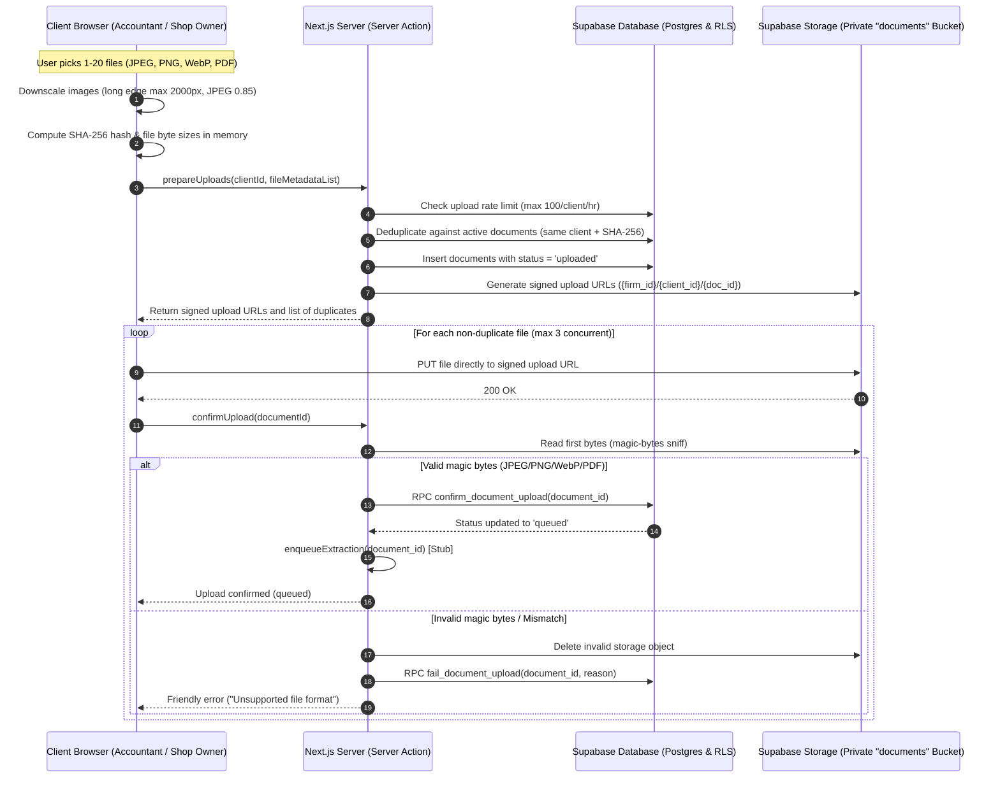

# Uploads Architecture & Specification: Purchase-Bill Upload & Listing

This document defines the direct-to-storage architecture, database contracts, browser-side downscaling engine, and route map for uploading and listing purchase bills in GST Saathi.

---

## 1. Upload Flow

---

## 2. Route Map

| User Role | Route | Description |
|---|---|---|
| **Accountant** | `/app/clients/[id]/bills` | Client Bills dashboard: upload bills directly, list/filter documents (status, month), preview/download signed URLs (5-minute expiry), delete bills. |
| **Shop Owner** | `/portal/bills` | Shop owner bill upload portal: simple month selection, multi-file camera & gallery upload, progress feedback, and recent bill status. |

---

## 3. Storage Architecture & Privacy Rules

1. **Private Bucket**: Stored in Supabase private bucket `'documents'` with public access disabled (`public = false`).
2. **Object Path Convention**: `{firm_id}/{client_id}/{document_id}`.
3. **No Direct Public URLs**: File previews and downloads strictly use short-lived signed URLs (`expiresIn = 300` seconds / 5 minutes).
4. **Direct Browser Uploads**: Files never pass through server memory on upload; browsers upload directly to S3/Supabase storage via signed URLs created by `prepareUploads`.
5. **No Service-Role Key in App Runtime**: User-facing code uses authenticated user sessions via `createServerClient()` ensuring strict RLS enforcement.

---

## 4. Guardrails & Limits

- **Max File Size**: 10 MB per file (`10 * 1024 * 1024` bytes).
- **Max Batch Size**: 20 files per upload batch.
- **Rate Limit**: Maximum 100 uploads per client per hour (enforced by `check_upload_quota` DB function).
- **Allowed MIME Types**: `image/jpeg`, `image/png`, `image/webp`, `application/pdf`.
- **Server-Side Sniffing**: First bytes checked on confirmation (magic bytes) to prevent extension spoofing.
- **Client-Side Downscaling**: High-resolution mobile phone camera photos downscaled in browser before upload (max long edge 2000px, JPEG quality 0.85).
- **Stale Upload Cleanup**: Rows in `uploaded` status older than 1 hour are cleaned up automatically.
