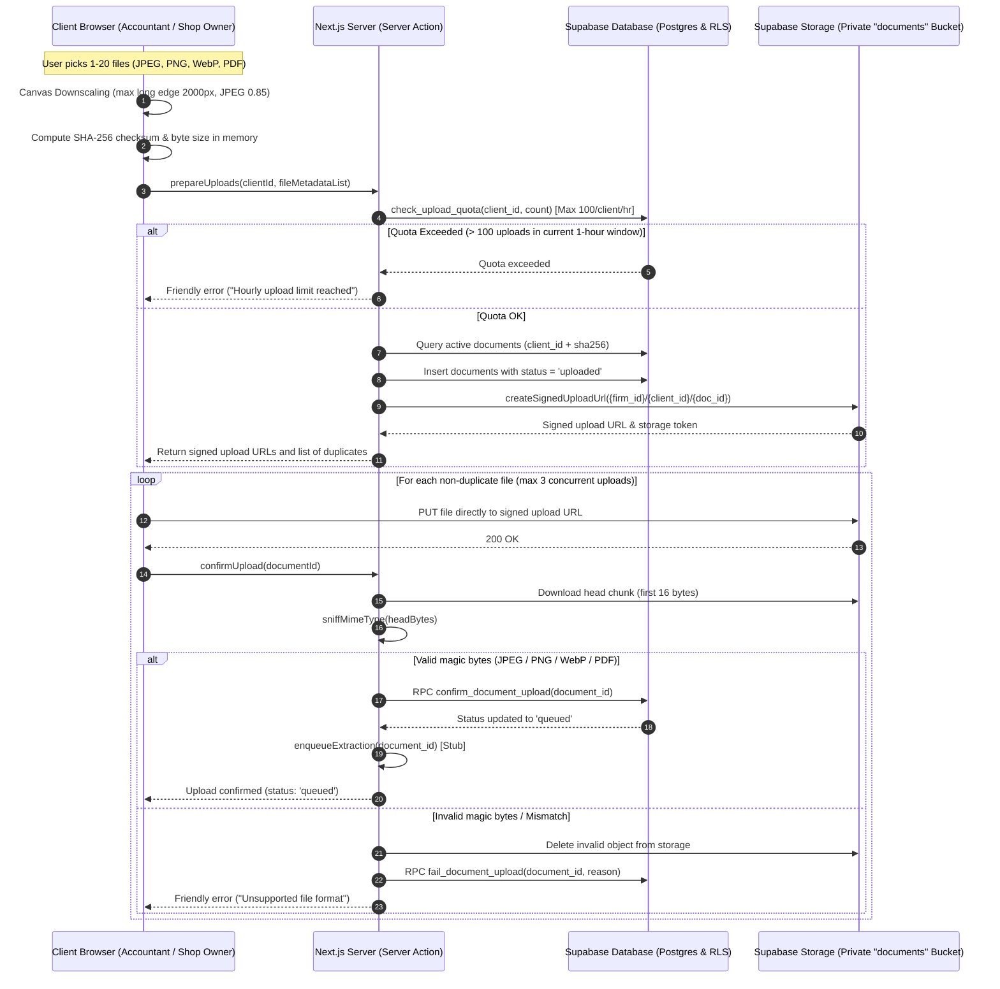
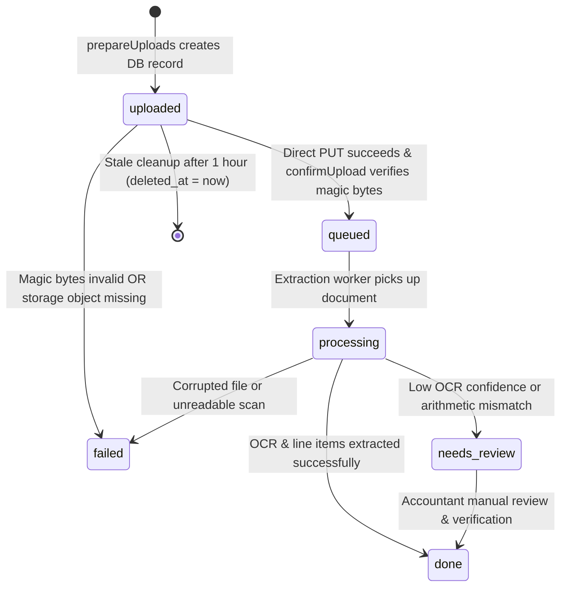

# Purchase Bill Uploads & Document Storage Architecture: GST Saathi

A comprehensive, production-grade technical specification defining the direct-to-storage architecture, browser-side downscaling engine, file validation and magic-byte sniffing, cryptographic deduplication, quota guardrails, database contracts, and route map for uploading and listing purchase bills in GST Saathi.

---

## 1. System Overview & Architecture

In Indian SME retail (kirana stores, stationery dealers, hardware shops, pharmacies), purchase bills are physical paper receipts, thermal printouts, or computer-generated tax invoices. Shop owners capture photos using smartphones, frequently resulting in large 5–25 MB image files with high pixel dimensions (48MP–108MP cameras).

Passing high-resolution photos through Next.js serverless runtimes or Node.js server memory introduces severe memory pressure, payload limit errors (`413 Payload Too Large`), and denial-of-service (DDoS) risks. Furthermore, strict multi-tenant isolation under Section 36 of the Central Goods and Services Tax (CGST) Act requires tamper-evident tracking and absolute data segregation between accounting firms and their SME clients.

To resolve these challenges, GST Saathi employs a **Direct-to-Storage Signed Upload Architecture with Client-Side Downscaling and Server-Side Magic-Byte Sniffing**:

```
+----------------------------------------------------------------------------------------------------+
|                                         CLIENT BROWSER                                             |
|  [Select Files] -> [Canvas Downscale (2000px/0.85)] -> [SHA-256 Hash] -> [Direct Storage PUT]     |
+---------------------------------------------------+-----------------------------------+------------+
                                                    | (1) prepareUploads                | (3) Direct PUT
                                                    v                                   v
+---------------------------------------------------+---------+  +----------------------+------------+
|                       NEXT.JS SERVER                        |  |          SUPABASE STORAGE         |
|  - Rate Limit Check (max 100/client/hr)                     |  |  - Private 'documents' bucket     |
|  - Deduplication Check (active client SHA-256)              |  |  - Path: {firm}/{client}/{doc}    |
|  - Generate Signed Upload URL                               |  |  - RLS Isolation Policies         |
|  - Sniff Magic Bytes & Verify on confirmUpload              |  +-----------------------------------+
|  - Transition Status to 'queued'                            |                         ^
+---------------------------------------------------+---------+                         |
                                                    | (4) confirm_document_upload RPC   | Verify Object
                                                    v                                   | Exists
+---------------------------------------------------------------------------------------+------------+
|                                    SUPABASE POSTGRESQL DATABASE                                    |
|  - Table: public.documents (RLS enabled)                                                           |
|  - Partial Unique Index: uq_documents_client_sha256_active (WHERE deleted_at IS NULL)              |
|  - RPCs: check_upload_quota, confirm_document_upload, fail_document_upload, cleanup_stale_uploads  |
+----------------------------------------------------------------------------------------------------+
```

### Core Architecture Principles
1. **Zero Server Memory Overhead**: File binary bodies never pass through the Next.js server application memory during uploads. The browser transmits bytes directly to private cloud object storage.
2. **Deterministic Multi-Tenant Path Isolation**: Every file is addressed as `{firm_id}/{client_id}/{document_id}` inside the private `'documents'` bucket.
3. **Bandwidth & Storage Optimization**: Client-side HTML5 Canvas resizing downscales 15 MB raw camera images to ~500 KB JPEGs in browser memory before network transmission, without sacrificing OCR legibility for 15-character GSTINs, invoice numbers, dates, or tax totals.
4. **Zero Trust File Validation**: The server never trusts client-reported MIME types or file extensions. On confirmation, the server sniffs the first bytes directly from storage using signature magic numbers (JPEG, PNG, WebP, PDF).
5. **Cryptographic Deduplication**: Fast client-side SHA-256 fingerprinting prevents re-uploading identical bills, backed by a PostgreSQL partial unique index.
6. **Statutory Non-Repudiation**: Documents maintain cryptographic hashes, original metadata, and immutable audit associations for statutory compliance under Section 36 of the CGST Act.

---

## 2. End-to-End Upload Flow & Sequence Diagram

The upload lifecycle follows a 5-stage protocol: Preprocessing $\rightarrow$ Preparation $\rightarrow$ Direct Storage Transfer $\rightarrow$ Server-Side Verification $\rightarrow$ Extraction Enqueue.



---

## 3. Direct-to-Storage Signed Upload Architecture

### 3.1 Storage Bucket Configuration
- **Bucket ID**: `'documents'`
- **Public Visibility**: `false` (Private bucket; direct public access is prohibited)
- **Allowed MIME Types**: `image/jpeg`, `image/png`, `image/webp`, `application/pdf`
- **File Size Limit**: 10 MB (`10 * 1024 * 1024` bytes)

### 3.2 Canonical Storage Path Convention
Every stored object uses a 3-segment UUID path structure:
```
{firm_id}/{client_id}/{document_id}
```
Example: `e5b7c891-2345-4a67-89ab-cdef01234567/a1b2c3d4-e5f6-7a8b-9c0d-1e2f3a4b5c6d/f81d4fae-7dec-11d0-a765-00a0c91e6bf6`

Path validation rules enforced by [`isValidUuid`](file:///c:/Users/Mohit/Documents/antigravity/mysterious-bose/src/lib/uploads/paths.ts) and [`parseDocumentStoragePath`](file:///c:/Users/Mohit/Documents/antigravity/mysterious-bose/src/lib/uploads/paths.ts):
- Exactly 3 segments separated by `/`.
- Each segment must strictly validate against the RFC 4122 UUID pattern (`/^[0-9a-f]{8}-[0-9a-f]{4}-[0-9a-f]{4}-[0-9a-f]{4}-[0-9a-f]{12}$/i`).
- Any attempt at directory traversal (`..`, `//`, special characters) fails validation immediately.

### 3.3 Storage Row-Level Security (RLS) Policies
Supabase Storage enforces multi-tenant boundary checks on `storage.objects`:

```sql
-- Read Access: Firm members or verified client owner
create policy "documents_storage_select"
  on storage.objects for select
  using (
    bucket_id = 'documents'
    and (
      public.is_platform_admin()
      or (
        name ~ '^[0-9a-fA-F-]{36}/[0-9a-fA-F-]{36}/'
        and (
          public.is_firm_member((storage.foldername(name))[1]::uuid)
          or (
            public.is_client_owner((storage.foldername(name))[2]::uuid)
            and exists (
              select 1 from public.clients c
              where c.id = (storage.foldername(name))[2]::uuid
                and c.firm_id = (storage.foldername(name))[1]::uuid
            )
          )
        )
      )
    )
  );

-- Upload Access: Firm members or client owners for their own firm & client folder
create policy "documents_storage_insert"
  on storage.objects for insert
  with check (
    bucket_id = 'documents'
    and (
      public.is_platform_admin()
      or (
        name ~ '^[0-9a-fA-F-]{36}/[0-9a-fA-F-]{36}/'
        and (
          public.is_firm_member((storage.foldername(name))[1]::uuid)
          or (
            public.is_client_owner((storage.foldername(name))[2]::uuid)
            and exists (
              select 1 from public.clients c
              where c.id = (storage.foldername(name))[2]::uuid
                and c.firm_id = (storage.foldername(name))[1]::uuid
            )
          )
        )
      )
    )
  );

-- Delete Access: Restricted to firm admins and platform admins
create policy "documents_storage_delete"
  on storage.objects for delete
  using (
    bucket_id = 'documents'
    and (
      public.is_platform_admin()
      or (
        name ~ '^[0-9a-fA-F-]{36}/'
        and public.is_firm_admin((storage.foldername(name))[1]::uuid)
      )
    )
  );
```

### 3.4 Temporary Signed URLs
- **Upload URLs**: Created during `prepareUploads` via `supabase.storage.from('documents').createSignedUploadUrl(storagePath)`. The URL allows a single `PUT` request directly from the browser.
- **Preview & Download URLs**: Ephemeral signed URLs generated with `expiresIn = 300` (5 minutes) via `supabase.storage.from('documents').createSignedUrl(storagePath, 300)`. Stored documents are never exposed over permanent public URLs.

---

## 4. Client-Side Image Preprocessing & Canvas Downscaling

### 4.1 The High-Resolution Problem
Modern budget smartphones used by Indian shopkeepers feature camera sensors capturing at 48MP, 64MP, or 108MP (e.g. $8000 \times 6000$ pixels), producing raw JPEG/HEIC files of 8 MB to 25 MB.
- Transferring these uncompressed files over 3G/4G cellular connections causes slow uploads and frequent dropouts.
- Server-side image resizing consumes immense memory in Node.js/Vercel serverless functions, easily hitting memory limits (1024MB RAM).
- Downscaling in the browser before upload slashes bandwidth consumption by **85%–95%** while retaining crisp text fidelity for OCR extraction.

### 4.2 Downscaling Specifications
Enforced by [`src/lib/uploads/limits.ts`](file:///c:/Users/Mohit/Documents/antigravity/mysterious-bose/src/lib/uploads/limits.ts):
- **Max Long Edge**: `2000` pixels (`IMAGE_DOWNSCALE_MAX_EDGE`).
- **Target Format**: `image/jpeg`.
- **Compression Quality**: `0.85` (`IMAGE_DOWNSCALE_QUALITY`).
- **PDF Bypass**: PDF documents bypass downscaling and are transmitted as-is, subject to the 10 MB max size limit.

### 4.3 Canvas Downscaling Algorithm
```typescript
/**
 * Downscales an image in the browser using HTML5 Canvas.
 * Constrains the longest edge to maxEdge (2000px) and encodes as JPEG (0.85 quality).
 */
export async function downscaleImage(
  file: File,
  maxEdge: number = 2000,
  quality: number = 0.85
): Promise<{ blob: Blob; width: number; height: number; downscaled: boolean }> {
  // PDFs bypass canvas processing
  if (file.type === 'application/pdf') {
    return { blob: file, width: 0, height: 0, downscaled: false };
  }

  return new Promise((resolve, reject) => {
    const img = new Image();
    const objectUrl = URL.createObjectURL(file);

    img.onload = () => {
      URL.revokeObjectURL(objectUrl);
      let { width, height } = img;

      // Only resize if larger than maximum long edge
      if (width <= maxEdge && height <= maxEdge) {
        resolve({ blob: file, width, height, downscaled: false });
        return;
      }

      if (width > height) {
        height = Math.round((height * maxEdge) / width);
        width = maxEdge;
      } else {
        width = Math.round((width * maxEdge) / height);
        height = maxEdge;
      }

      const canvas = document.createElement('canvas');
      canvas.width = width;
      canvas.height = height;

      const ctx = canvas.getContext('2d');
      if (!ctx) {
        reject(new Error('Failed to create canvas 2D context'));
        return;
      }

      ctx.imageSmoothingEnabled = true;
      ctx.imageSmoothingQuality = 'high';
      ctx.drawImage(img, 0, 0, width, height);

      canvas.toBlob(
        (blob) => {
          if (!blob) {
            reject(new Error('Canvas blob generation failed'));
            return;
          }
          resolve({ blob, width, height, downscaled: true });
        },
        'image/jpeg',
        quality
      );
    };

    img.onerror = () => {
      URL.revokeObjectURL(objectUrl);
      reject(new Error('Failed to load image for downscaling'));
    };

    img.src = objectUrl;
  });
}
```

### 4.4 Mobile Phone HEIC / HEIF Handling
- On modern iOS and Android mobile browsers, specifying `<input type="file" accept="image/*,application/pdf" capture="environment">` invokes the operating system's native photo picker.
- Mobile OS pickers automatically transcode camera HEIC/HEIF images into standard JPEG format before handing the `File` object to the web application.
- If an unconverted `.heic` file is provided on desktop, the server-side magic byte sniffer rejects it gracefully, presenting the user with an actionable plain-English prompt to provide standard JPEG, PNG, or PDF formats.

---

## 5. File Validation & Server-Side Magic-Byte Sniffing

Client-reported MIME types (`file.type`) and file extensions (e.g. `.jpg`, `.pdf`) are untrusted metadata that can be easily manipulated or spoofed. GST Saathi enforces strict **server-side magic-byte sniffing** directly against the uploaded storage object during `confirmUpload`.

### 5.1 Supported Formats & Magic Byte Signatures
Implemented in [`src/lib/uploads/sniff.ts`](file:///c:/Users/Mohit/Documents/antigravity/mysterious-bose/src/lib/uploads/sniff.ts):

| MIME Type | Extension | Magic Bytes (Hexadecimal) | Offset | ASCII Representation |
|---|---|---|---|---|
| `image/jpeg` | `.jpg`, `.jpeg` | `FF D8 FF` | 0 | `ÿØÿ` |
| `image/png` | `.png` | `89 50 4E 47 0D 0A 1A 0A` | 0 | `\x89PNG\r\n\x1a\n` |
| `application/pdf` | `.pdf` | `25 50 44 46 2D` | 0 | `%PDF-` |
| `image/webp` | `.webp` | `52 49 46 46` ... `57 45 42 50` | 0 (RIFF), 8 (WEBP) | `RIFF....WEBP` |

### 5.2 Magic-Byte Sniffer Implementation
```typescript
export function sniffMimeType(
  bytes: Uint8Array | ArrayBuffer | Buffer
): AllowedMimeType | null {
  const u8 = toUint8Array(bytes);
  if (!u8 || u8.length < 3) return null;

  // 1. JPEG: FF D8 FF
  if (u8.length >= 3 && u8[0] === 0xff && u8[1] === 0xd8 && u8[2] === 0xff) {
    return 'image/jpeg';
  }

  // 2. PNG: 89 50 4E 47 0D 0A 1A 0A (8 bytes)
  if (
    u8.length >= 8 &&
    u8[0] === 0x89 && u8[1] === 0x50 && u8[2] === 0x4e && u8[3] === 0x47 &&
    u8[4] === 0x0d && u8[5] === 0x0a && u8[6] === 0x1a && u8[7] === 0x0a
  ) {
    return 'image/png';
  }

  // 3. PDF: %PDF- (bytes 0-4: 25 50 44 46 2D)
  if (
    u8.length >= 5 &&
    u8[0] === 0x25 && u8[1] === 0x50 && u8[2] === 0x44 && u8[3] === 0x46 && u8[4] === 0x2d
  ) {
    return 'application/pdf';
  }

  // 4. WebP: RIFF (bytes 0-3: 52 49 46 46) + WEBP (bytes 8-11: 57 45 42 50)
  if (
    u8.length >= 12 &&
    u8[0] === 0x52 && u8[1] === 0x49 && u8[2] === 0x46 && u8[3] === 0x46 &&
    u8[8] === 0x57 && u8[9] === 0x45 && u8[10] === 0x42 && u8[11] === 0x50
  ) {
    return 'image/webp';
  }

  return null;
}
```

### 5.3 Quarantine & Immediate Eviction
If `sniffMimeType` fails during `confirmUpload`:
1. The server immediately issues a delete command to Supabase Storage: `supabase.storage.from('documents').remove([storagePath])`.
2. Invokes PostgreSQL RPC `fail_document_upload(document_id, 'Invalid file signature: magic bytes do not match permitted document types')`.
3. Returns a friendly, non-technical error to the client: *"We can only accept photo bills (JPEG, PNG, WebP) or PDF documents. Please take a clear photo or pick a PDF."*

---

## 6. Duplicate Prevention & Cryptographic Checksums

### 6.1 Browser-Side SHA-256 Hashing
Before requesting an upload slot, the browser digests the (downscaled) file bytes using the W3C Web Cryptography API ([`computeSha256Subtle`](file:///c:/Users/Mohit/Documents/antigravity/mysterious-bose/src/lib/uploads/hash.ts)), falling back to Node `crypto` in test environments:

```typescript
export async function computeSha256(data: ArrayBuffer | Uint8Array | Buffer): Promise<string> {
  if (typeof globalThis !== 'undefined' && globalThis.crypto?.subtle) {
    const hashBuffer = await globalThis.crypto.subtle.digest('SHA-256', data);
    return Array.from(new Uint8Array(hashBuffer))
      .map((b) => b.toString(16).padStart(2, '0'))
      .join('')
      .toLowerCase();
  }
  // Fallback for Node.js environments
  const { createHash } = await import('crypto');
  return createHash('sha256').update(data).digest('hex').toLowerCase();
}
```

### 6.2 Pre-Flight Deduplication Check
In `prepareUploads`, the server inspects existing active documents for the client:
```typescript
const { data: existingDocs } = await supabase
  .from('documents')
  .select('id, original_name, sha256')
  .eq('client_id', clientId)
  .in('sha256', hashes)
  .is('deleted_at', null);
```
- Matched files are omitted from the prepared uploads list.
- Returned under `duplicates: DuplicateFileNotice[]` with user-facing message: *"You already sent this bill"*.
- Saves cellular bandwidth by bypassing the direct storage transfer completely.

### 6.3 Database-Enforced Partial Unique Index
To guard against race conditions (e.g. double-tapping upload on two mobile devices simultaneously), PostgreSQL enforces a partial unique index on active client documents:

```sql
CREATE UNIQUE INDEX uq_documents_client_sha256_active
  ON public.documents (client_id, sha256)
  WHERE deleted_at IS NULL;
```
If an identical hash is submitted concurrently, the database blocks insertion, preserving index integrity without corrupting historical records.

---

## 7. Rate Limiting & Stale Upload Cleanup

### 7.1 Hourly Client Quota (100 Files / Hour)
To protect CA firms and platform storage from abuse, unintentional script looping, or bulk spam, uploads are restricted to a maximum of **100 files per client per rolling hour**.

Enforced in PostgreSQL via `public.check_upload_quota`:
```sql
CREATE OR REPLACE FUNCTION public.check_upload_quota(
  client_id_param uuid,
  n int default 1
)
RETURNS boolean
LANGUAGE plpgsql
SECURITY DEFINER
SET search_path = ''
AS $$
DECLARE
  current_count integer;
BEGIN
  SELECT count(*)
  INTO current_count
  FROM public.documents
  WHERE client_id = client_id_param
    AND created_at >= clock_timestamp() - interval '1 hour'
    AND deleted_at IS NULL;

  IF (current_count + coalesce(n, 1)) > 100 THEN
    RETURN false;
  END IF;

  RETURN true;
END;
$$;
```

### 7.2 Stale Upload Cleanup (1-Hour Window)
When a user selects files and initiates `prepareUploads`, document records are created with `status = 'uploaded'`. If the user closes their browser, experiences network disruption, or abandons the transfer before `confirmUpload`, the records become stale.

PostgreSQL RPC `public.cleanup_stale_uploads` soft-deletes unconfirmed records older than 1 hour:
```sql
CREATE OR REPLACE FUNCTION public.cleanup_stale_uploads(client_id_param uuid)
RETURNS integer
LANGUAGE plpgsql
SECURITY DEFINER
SET search_path = ''
AS $$
DECLARE
  cleaned_count integer := 0;
BEGIN
  WITH stale AS (
    UPDATE public.documents
    SET deleted_at = clock_timestamp(),
        updated_at = clock_timestamp()
    WHERE client_id = client_id_param
      AND status = 'uploaded'
      AND created_at < clock_timestamp() - interval '1 hour'
      AND deleted_at IS NULL
    RETURNING id
  )
  SELECT count(*) INTO cleaned_count FROM stale;

  RETURN cleaned_count;
END;
$$;
```
This cleanup executes automatically during `prepareUploads` runs or scheduled cron maintenance.

---

## 8. Document Lifecycle & Accessibility Badges

### 8.1 Status State Machine
A document transitions through 6 discrete states:



### 8.2 Dual-Persona Status Terminology
Small shop owners and professional accountants require different communication styles:
- **Accountants**: Action-oriented, technical terminology.
- **Shop Owners**: Empathetic, simple, reassuring plain-English copy.

Implemented in [`src/lib/uploads/status-labels.ts`](file:///c:/Users/Mohit/Documents/antigravity/mysterious-bose/src/lib/uploads/status-labels.ts):

| Status Enum | Accountant Label | Owner (Client) Label | Meaning & Purpose |
|---|---|---|---|
| `uploaded` | Uploaded | Received | File staged in storage; awaiting confirmation |
| `queued` | Queued | Received | Verified and waiting for background extraction |
| `processing` | Reading | Being read | OCR text and line item extraction in progress |
| `needs_review` | Needs review | Needs a look | Flagged for accountant verification (e.g. illegible digit) |
| `done` | Done | Checked | Fully verified, extracted, and reconciled |
| `failed` | Failed | Could not read, please take the photo again | Unreadable scan or invalid format |

### 8.3 WCAG 2.2 Level AA Accessible Badges (Non-Color Reliance)
To comply with WCAG 2.2 Success Criterion 1.4.1 (Use of Color), document status badges **never rely solely on color**. Each status features a distinct CSS border pattern and full screen-reader descriptions:

```typescript
export const STATUS_BADGE_STYLES: Record<DocStatus, StatusBadgeStyle> = {
  uploaded: {
    borderStyle: 'dotted',
    text: 'Uploaded',
    description: 'Uploaded - awaiting queue (dotted border)',
  },
  queued: {
    borderStyle: 'dashed',
    text: 'Queued',
    description: 'Queued - in line to be read (dashed border)',
  },
  processing: {
    borderStyle: 'double',
    text: 'Reading',
    description: 'Reading - currently extracting data (double border)',
  },
  needs_review: {
    borderStyle: 'groove',
    text: 'Needs review',
    description: 'Needs review - manual check required (groove border)',
  },
  done: {
    borderStyle: 'solid',
    text: 'Done',
    description: 'Done - checked and verified (solid border)',
  },
  failed: {
    borderStyle: 'ridge',
    text: 'Failed',
    description: 'Failed - could not read (ridge border)',
  },
};
```

---

## 9. Route Map & User Workflows

| User Role | Route | Key Purpose | Responsive Layout & Behavior |
|---|---|---|---|
| **Accountant** | `/app/clients/[id]/bills` | Comprehensive client bill management: bulk upload, status filtering, month selection, signed preview/download, soft-deletion. | **Desktop**: Filter bar (Month `period_fp`, Status chips), statistics header (Uploaded, Reading, Needs review, Done), multi-column document table with thumbnail preview.<br>**Mobile**: Stacked bill cards with quick actions. |
| **Shop Owner** | `/portal/bills` | Streamlined bill submission: simple month selector, camera snap button, gallery picker, linear progress queue, recent submission cards. | **Mobile-First (375px–768px)**: Large touch targets ($\ge 48\text{px}$), camera shortcut `<input capture="environment">`, clear status cards, zero accounting jargon. |

### 9.1 Accountant Workflow (`/app/clients/[id]/bills`)
1. **Context Navigation**: Accountant selects client from portfolio $\rightarrow$ clicks **Bills** tab.
2. **Batch Upload**: Drags up to 20 files into dropzone or clicks "Add bills".
3. **Queue Processing**: Browser downscales images $\rightarrow$ uploads to signed URLs (max 3 concurrent) $\rightarrow$ updates live progress bar.
4. **List & Filter**: View bills for selected GST filing period (e.g. `102026`). Filter by status (`all`, `needs_review`, `failed`, `done`).
5. **Inspect & Download**: Click "View" to open short-lived signed URL (300s) in lightbox/new tab.
6. **Soft Delete**: Remove duplicate or invalid bills (`deleted_at = now()`).

### 9.2 Shop Owner Workflow (`/portal/bills`)
1. **Mobile Access**: Shopkeeper logs in with phone/email OTP and taps "Send bills".
2. **Month Selection**: Simple dropdown (e.g. *"October 2026 bills"*).
3. **Take Photo or Pick Files**: Taps camera icon to photograph physical invoice directly on the shop counter.
4. **Instant Feedback**: Browser downscales photo immediately; shows "Sending..." $\rightarrow$ "Received".
5. **Bill History**: Recent uploads card list displays status: *"Being read"*, *"Checked"*, or *"Could not read, please take the photo again"*.

---

## 10. API Contracts & TypeScript Interfaces

Defined in [`src/lib/uploads/types.ts`](file:///c:/Users/Mohit/Documents/antigravity/mysterious-bose/src/lib/uploads/types.ts):

### 10.1 Prepare Uploads Contract
```typescript
/** Input metadata provided by browser */
export interface PrepareUploadFile {
  originalName: string;
  sizeBytes: number;
  mimeType: AllowedMimeType | string;
  sha256: string;
  periodFp?: string | null;
}

/** Information returned to browser for direct-to-storage PUT */
export interface PreparedUpload {
  documentId: string;
  originalName: string;
  storagePath: string;
  signedUploadUrl: string;
  token?: string;
}

/** Notice for existing duplicate file */
export interface DuplicateFileNotice {
  originalName: string;
  sha256: string;
  existingDocumentId: string;
  message: string;
}

/** Output of prepareUploads action */
export interface PrepareUploadsResult {
  prepared: PreparedUpload[];
  duplicates: DuplicateFileNotice[];
  rejected: Array<{ originalName: string; reason: string }>;
}
```

### 10.2 Server Action Contracts
```typescript
/**
 * Negotiates upload slots, validates quotas, deduplicates files,
 * and generates signed upload URLs.
 */
export async function prepareUploads(
  clientId: string,
  files: PrepareUploadFile[]
): Promise<PrepareUploadsResult>;

/**
 * Validates uploaded storage object, sniffs magic bytes,
 * and transitions document status to 'queued'.
 */
export async function confirmUpload(
  documentId: string
): Promise<{ ok: boolean; documentId: string; status: DocStatus; error?: string }>;

/**
 * Generates temporary 5-minute signed URL for preview or download.
 */
export async function getDocumentPreviewUrl(
  documentId: string
): Promise<{ signedUrl: string; expiresIn: number }>;

/**
 * Soft-deletes a document (deleted_at = now()).
 */
export async function deleteDocument(
  documentId: string
): Promise<{ ok: boolean }>;
```

### 10.3 Database RPC Signatures
```sql
-- Check rolling hourly quota
public.check_upload_quota(client_id_param uuid, n int default 1) -> boolean

-- Confirm upload and advance to queued
public.confirm_document_upload(document_id_param uuid) -> jsonb

-- Record upload verification failure
public.fail_document_upload(document_id_param uuid, reason text default '') -> jsonb

-- Clean up unconfirmed uploads older than 1 hour
public.cleanup_stale_uploads(client_id_param uuid) -> integer
```

---

## 11. User-Facing Messaging & Error Matrix

All user notifications use non-technical, empathetic plain-English copy defined in [`src/lib/uploads/messages.ts`](file:///c:/Users/Mohit/Documents/antigravity/mysterious-bose/src/lib/uploads/messages.ts):

| Error Condition | Technical Cause | Plain-English User Message | Actionable Guidance |
|---|---|---|---|
| **Duplicate Bill** | `uq_documents_client_sha256_active` collision | *"You already sent this bill"* | No upload needed; bill is already in the list. |
| **Unsupported Format** | Magic bytes do not match JPEG, PNG, WebP, PDF | *"We can only accept photo bills (JPEG, PNG, WebP) or PDF documents. Please take a clear photo or pick a PDF."* | Pick a photo or PDF file. |
| **File Too Large** | Size $> 10\text{ MB}$ after downscaling | *"This file is larger than 10 MB. Please send a smaller photo or document."* | Retake photo with fewer pages or lower resolution. |
| **Batch Too Large** | Files count $> 20$ in single batch | *"You can send up to 20 bills at a time. Please select fewer bills and try again."* | Split selection into multiple batches. |
| **Hourly Quota Reached** | $> 100$ files uploaded for client in 1 hour | *"You have reached the upload limit for this hour (100 files). Please wait a while before sending more bills."* | Wait for the 1-hour window to refresh. |
| **Network Disconnected** | `navigator.onLine === false` or fetch fails | *"You are currently offline. Sending will resume as soon as you are reconnected."* | Reconnect to Wi-Fi or cellular data. |
| **Verification Failed** | Storage object missing or zero bytes | *"The file could not be verified. Please check the file and try again."* | Re-select file and tap Retry. |
| **Delete Confirmation** | User initiates soft-delete | *"Hide this bill? It will be removed from this client's list."* | Confirms soft-delete without technical jargon. |
