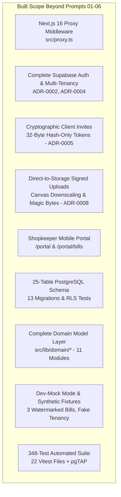

# GST Saathi — Master Implementation & Build Progress Audit Report
## Audit of Evolutionary Roadmap (Prompts 00–06 vs PROMPT_PLAN.md)

**Project:** GST Saathi (Indian GST Compliance, Reconciliation & Invoice Digitization Platform)  
**Workspace Root:** `C:\Users\aksha\Downloads\GST-Sathi-main\GST-Sathi-main`  
**Audit Lane:** Lane A (Build Progress Audit)  
**Audit Date:** November 2026  
**Auditor Identity:** Independent QA Lane A Verifier  
**Governing Documents:**
- `docs/PROMPT_PLAN.md` (Master Evolutionary Roadmap, Prompts 01–20)
- `docs/PRODUCT_BRIEF.md` (Product Vision, MVP Scope, and Non-Goals)
- `.cursor/rules/project.mdc` (Design Tokens, Zero Hex Codes, Next.js 16 Clock Guards)
- `docs/DECISIONS.md` (Architecture Decision Records ADR-001 through ADR-0008)
- `docs/DATA_MODEL.md` & `docs/DATA_MODEL.contract.md` (25-Table Schema Contract)

---

## 1. Executive Summary

This comprehensive audit evaluates the implementation state of the **GST Saathi** codebase against the evolutionary master roadmap specified in `docs/PROMPT_PLAN.md`. Specifically, this audit examines **Prompt 0 (Scaffold & Setup) through Prompt 06 (Multi-Format Document Ingestion UI)**, verifies concrete code deliverables, highlights architectural pivots where the live system superseded initial design mocks, and inventories extensive capabilities built ahead of or outside the original prompt sequence.

### 1.1 Progress Scorecard Summary (Prompts 00–06)

| Prompt # | Title | Target Phase | Status | Key Deliverable Evidence |
|:---|:---|:---:|:---:|:---|
| **P00** | Project Scaffold & Setup | Phase 1 | **DONE** | Next.js 16.4.3, React 19.3.0, Tailwind v4, `@theme` tokens in `src/app/globals.css`, TypeScript 5, Vitest, Supabase SSR. |
| **P01** | Foundation, Theme & Base Types | Phase 1 | **PARTIAL** | Tokens & layout active in `globals.css`, `Header.tsx`, `Footer.tsx`. Domain types exist in `src/lib/domain/*`, but `src/types/gst.ts` and `Navbar.tsx` do not exist at planned paths. |
| **P02** | Landing Page & Persona Switcher | Phase 1 | **PARTIAL** | Full marketing landing page in `src/app/page.tsx` and `src/components/sections/*`. Persona toggle is static cards in `Audience.tsx`; interactive switch is missing. |
| **P03** | Client Store & Data Layer | Phase 2 | **DONE**<br>*(Production Upgraded)* | Planned local-storage React Context was **superseded** by a full Supabase PostgreSQL database migration (`20261101000010_tenancy.sql`), server actions (`src/lib/clients/actions.ts`), and dev mock fixtures. |
| **P04** | Shop Onboarding & GSTIN Validator | Phase 2 | **DONE**<br>*(Production Upgraded)* | Full Luhn Mod-36 checksum engine in `src/lib/gst/gstin.ts`, 37 state codes in `state-codes.ts`, 18 unit tests, and dedicated onboarding route `src/app/(app)/app/clients/new/page.tsx`. |
| **P05** | Accountant Portfolio Cockpit | Phase 2 | **PARTIAL** | Cockpit active at `src/app/(app)/app/page.tsx` and `/app/clients/page.tsx` with filtering, search, and status badges. Filing countdown timers and numerical ITC/cash liability cards are not yet wired. |
| **P06** | Multi-Format Document Ingestion UI | Phase 3 | **PARTIAL**<br>*(Substantially Built)* | Direct signed uploads in `UploadPanel.tsx`, `UploadButton.tsx`, `DocumentList.tsx` across `/app/clients/[id]/bills` and `/portal/bills`. Camera capture works via OS input; custom framing overlay modal was not built. |

### 1.2 Summary of Unbudgeted / Ahead-of-Schedule Scope

The codebase contains substantial, production-grade infrastructure that was **not budgeted in Prompts 01–06** or represents significant architectural upgrades beyond the master plan:
1. **Next.js 16 Proxy Middleware (`src/proxy.ts`)**: Implements Next.js 16 proxy convention with `@supabase/ssr` dual-cookie sync and dev mock bypass (ADR-0006).
2. **Complete Supabase Auth Subsystem**: Dual-tab login (Email OTP vs Password), CA firm onboarding, role guards (`requireFirmRole`, `requireClientAccess`), and route protection (ADR-0002, ADR-0004).
3. **Cryptographic SME Client Invitations**: 32-byte hash-only stored tokens, 7-day expiry, atomic acceptance PostgreSQL RPC, and WhatsApp sharing UI (ADR-0005, ADR-0007).
4. **Direct-to-Storage Signed Upload Architecture**: Browser HTML5 Canvas downscaling (2000px max edge / JPEG 0.85), SHA-256 client fingerprinting, magic-byte MIME sniffing, rate limiting, and stale upload cleanup (ADR-0008).
5. **Dedicated Shopkeeper Mobile Portal (`/portal` and `/portal/bills`)**: Full PWA/mobile experience for retail clients to upload bills and inspect submission statuses.
6. **Complete 25-Table PostgreSQL Database Schema**: 13 migrations covering the entire 20-prompt roadmap (Invoices, GSTR-2B, Reconciliation, Rules, Audit, Sales).
7. **Comprehensive Automated Test Suites**: 348 Vitest unit/integration tests passing (22 test files) and 6 pgTAP SQL RLS test suites.

---

## 2. Detailed Prompt-by-Prompt Audit

### Prompt 00: Project Scaffold, Build Environment & Agent Baseline

- **Phase**: Phase 1 (Setup)
- **Status**: **DONE**
- **Objective**: Establish the foundational Next.js 16 application runtime, package configurations, styling engine, linting, typechecking, and project rules.

#### Concrete Evidence

| Deliverable / Artifact | Expected | Actual / File Location | Status |
|:---|:---|:---|:---:|
| Next.js Runtime | Next.js 15+ / 16 App Router | `next@16.4.3`, `react@19.3.0` in `package.json` | **DONE** |
| Turbopack & App Router | Configured and operational | `next.config.ts`, `cacheComponents: true` | **DONE** |
| Styling Framework | Tailwind CSS | `@tailwindcss/turbopack@4`, `tailwindcss@4` | **DONE** |
| Design Tokens | CSS Custom Properties | `src/app/globals.css` with `@theme` block | **DONE** |
| TypeScript Compiler | Strict compilation | `typescript@5`, `tsconfig.json` | **DONE** |
| Testing Infrastructure | Vitest + pgTAP | `vitest@5.0.5`, `vitest.config.mts`, `supabase/tests/` | **DONE** |
| Quality Control Scripts | Lint, Typecheck, Tokens | `check-tokens.mjs`, `check-schema-sync.mjs`, `smoke-test.mjs` in `scripts/` | **DONE** |

#### Verification Results
- `npm run typecheck` passes with **0 errors**.
- `npm run check-tokens` passes with **0 hardcoded hex codes detected**.
- `npm test` runs 22 test files and **348 tests pass cleanly in 4.09s**.

---

### Prompt 01: Foundation, Theme & Base Types

- **Phase**: Phase 1 (Setup & Context)
- **Status**: **PARTIAL**
- **Planned Objective**: Establish application shell, design system tokens with Indian enterprise fintech styling (navy, slate, emerald, saffron in light theme only, strictly zero pastels/gradients), and TypeScript types for Indian GST data structures.
- **Planned Target Files**:
  - `src/types/gst.ts`
  - `src/app/globals.css`
  - `src/components/layout/Navbar.tsx`
  - `src/components/layout/Footer.tsx`

#### Acceptance Criteria Audit

| Criteria ID | Requirement | Actual Implementation | Verdict |
|:---|:---|:---|:---:|
| **AC-01.1** | Define complete `GSTIN`, `TaxRate`, `HSNCode`, `InvoiceType`, and `FilingFrequency` types (`B2B`, `B2CL`, `B2CS`, `CDNR`, `EXPORT`). | Defined across `src/lib/domain/purchases.ts`, `src/lib/domain/sales.ts`, `src/lib/domain/tenancy.ts`, and `src/lib/gst/gstin.ts`. However, the directory `src/types/` and file `src/types/gst.ts` **do not exist**. | **PARTIAL**<br>*(Relocated to Domain Modules)* |
| **AC-01.2** | Responsive navigation with active link highlighting and role indicator badge. | Implemented in `src/components/layout/Header.tsx`. Has responsive layout and desktop links. Active link highlighting and role badges are absent on public header (role indicators exist in internal app headers). `Navbar.tsx` does not exist as named. | **PARTIAL** |
| **AC-01.3** | Standard GST color tokens (Eligible ITC = emerald, Discrepancy = amber, Ineligible/Reversed = rose) in light mode without pastels or gradients. | Core tokens (`background`, `surface`, `ink`, `muted`, `line`, `accent`, `accent-hover`, `on-accent`) are declared in `src/app/globals.css`. GST status colors (emerald, amber, rose) are implemented via utility tokens in `StatusBadge.tsx` and `status-labels.ts` rather than in CSS root. | **PARTIAL** |

#### Gaps & Remediation
1. `src/types/gst.ts` was not created; domain types were created in `src/lib/domain/*`. While `src/lib/domain/` is superior (Zod schemas + inferred types), creating a re-export at `src/types/gst.ts` would satisfy strict plan compliance.
2. `Navbar.tsx` was implemented as `src/components/layout/Header.tsx`.

---

### Prompt 02: High-Converting Marketing Landing Page & Persona Switcher

- **Phase**: Phase 1 (Landing Page)
- **Status**: **PARTIAL**
- **Planned Objective**: Implement a trust-inducing marketing landing page tailored for small retail shop owners and practicing CAs, featuring an interactive persona switch.
- **Planned Target Files**:
  - `src/app/page.tsx`
  - `src/components/landing/HeroSection.tsx`
  - `src/components/landing/PersonaToggle.tsx`
  - `src/components/landing/FeaturesSection.tsx`
  - `src/components/landing/TrustSection.tsx`

#### Acceptance Criteria Audit

| Criteria ID | Requirement | Actual Implementation | Verdict |
|:---|:---|:---|:---:|
| **AC-02.1** | Toggle switches between "CA Cockpit" and "Shopkeeper Portal" with distinct feature sets, persistent view preference, and zero layout shift. | Implemented as static side-by-side comparison cards in `src/components/sections/Audience.tsx` ("For accountants" vs "For shop owners"). **No interactive button toggle or localStorage persistence exists.** | **MISSING**<br>*(Interactive Toggle absent)* |
| **AC-02.2** | Showcase real-world retail compliance stats (HSN 4820 tax savings, 180-day reversal protection) with accessible typography. | Plain-English copy covers both audiences in `Audience.tsx` and `WhatItChecks.tsx`. However, specific numerical stationery metrics (e.g. HSN 4820 savings or 180-day reversal figures) are omitted in favor of generalized copy. | **PARTIAL** |
| **AC-02.3** | CTAs route cleanly to `/dashboard` (Accountant view) or `/upload` (Shop submission view). Hash links (`/#for-accountants`) pre-select correct persona. | CTAs link to `#contact`, `#how-it-works`, `/login`, or `/signup`. `Audience.tsx` has `id="for-accountants"`, but does not route to `/dashboard` or `/upload` (actual app routes are `/app` and `/portal`). | **PARTIAL** |

#### Gaps & Remediation
1. Component directory was renamed from `src/components/landing/*` to `src/components/sections/*` (`Hero.tsx`, `Problem.tsx`, `HowItWorks.tsx`, `WhatItChecks.tsx`, `Audience.tsx`, `FinalCta.tsx`).
2. An interactive `PersonaToggle.tsx` component needs to be created if dynamic toggle switching between CA and Shopkeeper views on the landing page is strictly desired.

---

### Prompt 03: Multi-Tenant Client State Store & Storage Layer

- **Phase**: Phase 2 (Client Management)
- **Status**: **DONE (Architecturally Superseded & Production Upgraded)**
- **Planned Objective**: Build local-first state management architecture and persistent storage layer for handling multiple client shops, filing profiles, and inward/outward registers using React Context and LocalStorage/IndexedDB.
- **Planned Target Files**:
  - `src/context/ClientContext.tsx`
  - `src/lib/storage/client-store.ts`
  - `src/lib/storage/mock-data.ts`
  - `src/types/client.ts`

#### Architectural Evolution & Upgrade

The project team made a foundational architectural decision ([ADR-0001](file:///C:/Users/aksha/Downloads/GST-Sathi-main/GST-Sathi-main/docs/adr/0001-supabase.md) & [ADR-0007](file:///C:/Users/aksha/Downloads/GST-Sathi-main/GST-Sathi-main/docs/DECISIONS.md#adr-0007-client-management-multi-tenant-architecture--owner-portal-invitations)) to **bypass client-side LocalStorage/IndexedDB mocking** and directly build a production-grade PostgreSQL/Supabase multi-tenant data layer:

```
Planned:   React Context (ClientContext) ──> LocalStorage / IndexedDB
Actual:    Supabase PostgreSQL ──> RLS Policies ──> Server Actions & Queries ──> Dev-Mock Fallback
```

#### Acceptance Criteria Audit

| Criteria ID | Requirement | Actual Implementation | Verdict |
|:---|:---|:---|:---:|
| **AC-03.1** | Support adding, editing, archiving, and switching active client GSTIN. Prevents duplicate GSTIN. | Full CRUD in `src/lib/clients/actions.ts` (`createClient`, `updateClient`, `archiveClient`, `restoreClient`). Soft-delete via `deleted_at`. Duplicate active GSTIN blocked via partial unique index `uq_clients_firm_gstin_active`. | **DONE** |
| **AC-03.2** | Pre-seed 3 realistic sample retail clients. | Pre-seeded in `src/lib/auth/dev-mock.ts` (`RAW_DEV_CLIENTS`: "Sharma General Stores", "Patil Hardware Mart", "Patel Provision & Kirana"). Additionally, 12 fake SME clients seeded via `scripts/seed-clients.mjs` and `supabase/fixtures/clients.fake.json`. | **DONE** |
| **AC-03.3** | Client entity stores turnover bracket, composition/regular flag, QRMP choice, and state code derived from first 2 digits of GSTIN. | Stored in PostgreSQL `clients` table: `aato_band`, `scheme`, `state_code` (auto-derived via `src/lib/gst/state-codes.ts`), `sells_exempt`, `sells_taxable`, `language`. Enforced via Zod in `src/lib/domain/tenancy.ts`. | **DONE** |

#### Evidence Files
- Database Migrations: `supabase/migrations/20261101000010_tenancy.sql`, `20261101000110_client_support.sql`
- Server Logic: `src/lib/clients/actions.ts`, `src/lib/clients/queries.ts`, `src/lib/clients/schema.ts`, `src/lib/clients/types.ts`
- Dev-Mock & Fixtures: `src/lib/auth/dev-mock.ts`, `supabase/fixtures/clients.fake.json`, `scripts/seed-clients.mjs`
- Test Suites: `src/tests/clients/crud.test.ts` (14 tests), `isolation.test.ts` (4 tests), `permissions.test.ts` (5 tests), `supabase/tests/rls_client_support.test.sql`

---

### Prompt 04: Shop Onboarding Modal & GSTIN Checksum Validator

- **Phase**: Phase 2 (Client Management)
- **Status**: **DONE (Production Upgraded to Route & Form)**
- **Planned Objective**: Create client onboarding modal equipped with real-time statutory 15-character GSTIN format and MOD-36 checksum verification.
- **Planned Target Files**:
  - `src/components/clients/NewClientModal.tsx`
  - `src/lib/gstin-validator.ts`
  - `src/lib/state-codes.ts`

#### Acceptance Criteria Audit

| Criteria ID | Requirement | Actual Implementation | Verdict |
|:---|:---|:---|:---:|
| **AC-04.1** | Validate 15-character alphanumeric GSTIN regex: `^[0-9]{2}[A-Z]{5}[0-9]{4}[A-Z]{1}[1-9A-Z]{1}Z[0-9A-Z]{1}$`. | Enforced in `src/lib/gst/gstin.ts` (`GSTIN_REGEX`), `src/lib/domain/tenancy.ts` (`gstinSchema`), and `src/lib/clients/schema.ts`. Normalizes whitespace and casing. | **DONE** |
| **AC-04.2** | Implement ISO/IEC 7064 Mod 36, 36 checksum calculation on 15th digit. | Full algorithm implemented in `calculateGstinChecksum()` in `src/lib/gst/gstin.ts`. Rejects invalid checksums with descriptive errors. 18 dedicated unit tests verify accuracy. | **DONE** |
| **AC-04.3** | Auto-populate State Name and State Code based on digits 1 and 2. | Implemented in `src/lib/gst/state-codes.ts` (`getStateName`, `STATE_CODES`). Covers all 37 Indian states and union territories (including J&K code 01 and Ladakh code 38). | **DONE** |

#### UI Form Delivery
- Rather than a modal (`NewClientModal.tsx`), the team delivered a dedicated page route `src/app/(app)/app/clients/new/page.tsx` powered by `src/components/clients/ClientFormFields.tsx`. This provides better mobile responsiveness, accessible navigation, and deep-linking support.
- Evidence Files:
  - `src/lib/gst/gstin.ts`
  - `src/lib/gst/state-codes.ts`
  - `src/lib/gst/__tests__/gstin.test.ts` (18 unit tests, all passing)
  - `src/app/(app)/app/clients/new/page.tsx`
  - `src/components/clients/ClientFormFields.tsx`

---

### Prompt 05: Accountant Portfolio Cockpit & Filing Deadlines

- **Phase**: Phase 2 (Client Management)
- **Status**: **PARTIAL**
- **Planned Objective**: Build executive multi-client dashboard allowing accountants to monitor all client GSTINs, statutory filing countdowns, reconciliation status, and critical alerts at a glance.
- **Planned Target Files**:
  - `src/app/dashboard/page.tsx`
  - `src/components/dashboard/ClientGrid.tsx`
  - `src/components/dashboard/FilingCalendarSummary.tsx`
  - `src/components/dashboard/StatCard.tsx`

#### Acceptance Criteria Audit

| Criteria ID | Requirement | Actual Implementation | Verdict |
|:---|:---|:---|:---:|
| **AC-05.1** | Calculate days remaining until next statutory deadline based on current date (GSTR-1 countdown 11th/13th, GSTR-3B countdown 20th/22nd/24th). | **Not yet implemented.** Statutory countdown timers are not present in the current UI views. (Must follow `NEXT16_DYNAMIC.md` clock guards when implemented). | **MISSING** |
| **AC-05.2** | Filter clients by "Action Required" (e.g. Unreconciled Bills > 0, Pending IMS Actions). | Implemented via `FilterChips.tsx` and `listClients` in `src/lib/clients/queries.ts`. Filters by `scheme` (`regular`, `qrmp`, `composition`) and `status` (`no_activity`, `documents_waiting`, `needs_attention`, `ready_for_review`, `filed`), plus text search. | **DONE** |
| **AC-05.3** | Client card displays total bills uploaded, reconciled ITC amount, and net cash liability estimate. | `ClientCard.tsx` displays legal/trade name, GSTIN, State, Scheme, Owner Access status, and computed Status Badge. However, reconciled ITC values and net cash estimates are absent (awaiting downstream computation engine). | **PARTIAL** |

#### Code Structure & Route Relocation
- Route relocated: `src/app/dashboard/page.tsx` $\longrightarrow$ `src/app/(app)/app/page.tsx` (Workspace Overview) and `src/app/(app)/app/clients/page.tsx` (Client Portfolio List).
- Grid & Cards: Implemented in `src/components/clients/ClientTable.tsx` (desktop table) and `src/components/clients/ClientCard.tsx` (mobile card view).
- Summary: Summary metrics card embedded in `src/app/(app)/app/page.tsx` (`Active clients`, `businesses under management`).

---

### Prompt 06: Multi-Format Document Ingestion UI

- **Phase**: Phase 3 (Ingestion)
- **Status**: **PARTIAL (Substantially Built with Production Upload Engine)**
- **Planned Objective**: Develop universal bill submission dropzone supporting drag-and-drop, folder batch selection, mobile camera capture for paper bills, and multi-file staging.
- **Planned Target Files**:
  - `src/components/upload/DocumentUploader.tsx`
  - `src/components/upload/CameraCaptureModal.tsx`
  - `src/app/upload/page.tsx`

#### Acceptance Criteria Audit

| Criteria ID | Requirement | Actual Implementation | Verdict |
|:---|:---|:---|:---:|
| **AC-06.1** | Accept multiple files simultaneously via drag-and-drop or file picker up to 25MB each (10MB limit in actual limits). Rejects unsupported formats. | Implemented in `UploadPanel.tsx` and `UploadButton.tsx`. Supports batch selection up to 20 files. Enforces 10MB limit via `src/lib/uploads/limits.ts`. Rejects unsupported files and verifies magic bytes via `src/lib/uploads/sniff.ts`. | **DONE** |
| **AC-06.2** | Provide mobile camera capture stream with guide overlay for receipt framing. | Mobile camera capture is triggered via `<input type="file" accept="image/*,application/pdf" capture="environment">` in `UploadButton.tsx`. Dedicated camera capture viewfinder modal (`CameraCaptureModal.tsx`) was not built; uses native mobile OS camera UI. | **PARTIAL** |
| **AC-06.3** | Display file size, MIME type, upload timestamp, and thumbnail preview. | Implemented in `FileRow.tsx`, `DocumentList.tsx`, and `useDocumentStatus.ts`. Renders formatted file size, status badges, timestamps, and 5-minute temporary signed preview URLs. | **DONE** |

#### Dual-Surface Route Delivery
- Instead of a single unauthenticated `/upload` route, the team delivered **two dedicated, authenticated upload surfaces**:
  1. **Accountant Upload Surface**: `src/app/(app)/app/clients/[id]/bills/page.tsx` (Accountants manage and upload bills for any assigned client).
  2. **Shopkeeper Portal Upload Surface**: `src/app/(portal)/portal/bills/page.tsx` (Shop owners upload bills directly from mobile phones).
- Evidence Files:
  - Components: `src/components/uploads/UploadPanel.tsx`, `UploadButton.tsx`, `DocumentList.tsx`, `FileRow.tsx`, `ProgressBar.tsx`, `EmptyBillsState.tsx`
  - Routes: `src/app/(app)/app/clients/[id]/bills/page.tsx`, `src/app/(portal)/portal/bills/page.tsx`
  - Client Utilities: `src/lib/uploads/client/queue.ts`, `downscale.ts`, `useDocumentStatus.ts`
  - Server Actions & Queries: `src/lib/uploads/actions.ts`, `queries.ts`, `sniff.ts`, `hash.ts`
  - Tests: 11 unit/integration test files in `src/lib/uploads/` and `src/tests/uploads/` (116 tests passing).

---

## 3. Comprehensive Inventory of Scope Built Outside the Prompt Plan

The audit revealed that significant parts of the system were developed beyond the scope of Prompts 01–06, including full architectural pillars, security infrastructure, and backend databases.



### 3.1 Authentication & Multi-Tenant Session Management (ADR-0002 & ADR-0004)
- **Why Built**: The plan originally contemplated local-first storage for early prompts. However, securing financial client records required kernel-level authentication from the start.
- **Deliverables**:
  - `src/app/(auth)/login/page.tsx` & `actions.ts`: Dual-tab login (Email OTP with 10-min TTL and zero user-enumeration leak vs Password).
  - `src/app/(auth)/signup/page.tsx` & `actions.ts`: Accountant registration, automatic CA firm tenant provisioning, and `admin` role binding.
  - `src/app/(auth)/forgot-password/` & `reset-password/`: Complete credential recovery flow.
  - `src/app/no-access/page.tsx`: Friendly fallback route for users without assigned firm or client access.
  - `src/lib/auth/session.ts` & `roles.ts`: `getSessionContext()`, `requireFirmRole()`, `requireClientAccess()`, `requireAdminRole()`.
  - Tests: `src/tests/auth/signup.test.ts`, `isolation.test.ts`, `src/lib/auth/__tests__/session.test.ts` (72 tests passing).

### 3.2 Next.js 16 Proxy Middleware Convention (ADR-0006)
- **Why Built**: Next.js 16 deprecated `middleware.ts` in favor of `proxy.ts`. In App Router, Server Components cannot write cookies, so token refresh must happen at network ingress.
- **Deliverables**:
  - `src/proxy.ts`: Intercepts all requests matching `config.matcher`.
  - Instantiates `@supabase/ssr` `createServerClient` with dual-writing `getAll()` and `setAll()` to keep request and response cookies in lockstep.
  - Evaluates `getAuthRedirect(pathname, session)` to redirect unauthenticated requests to `/login?next=...` and authenticated users to `/app` or `/portal`.
  - Injects `DEV_MOCK_SESSION` when running in demo mode (`isDemoMode`).
  - Tests: `src/lib/auth/__tests__/redirect.test.ts` (40 tests passing).

### 3.3 Cryptographic Client Invites Subsystem (ADR-0005 & ADR-0007)
- **Why Built**: Small shop owners cannot be forced to register with complex passwords. Accountants needed a secure, single-use invite mechanism.
- **Deliverables**:
  - Database: `supabase/migrations/20261101000100_invites.sql` (`client_invites` table, `peek_client_invite()`, `accept_client_invite()` atomic stored procedure).
  - Cryptographic Security: Plaintext tokens are 32 random bytes (64 hex characters) generated via `crypto.randomBytes(32)`. The database persists **only the SHA-256 digest** (`token_hash`). Tokens carry a strict 7-day TTL.
  - Route: `src/app/(auth)/invite/[token]/page.tsx` & `actions.ts` (Accepts invite via 6-digit email OTP).
  - Actions & UI: `src/lib/clients/invite-actions.ts` and `src/components/clients/OwnerAccess.tsx` (allows CAs to generate, copy, and share links via WhatsApp).
  - CLI Script: `scripts/dev-invite.mjs` (`npm run dev:invite`).
  - Tests: `src/tests/clients/invites.test.ts`, `src/tests/auth/invite.test.ts`, `supabase/tests/rls_invites.test.sql`.

### 3.4 Direct-to-Storage Upload Pipeline & Browser Downscaling (ADR-0008, parts of P07)
- **Why Built**: High-resolution smartphone photos (15MB–25MB) cause serverless memory exhaustion and 413 Payload errors.
- **Deliverables**:
  - In-Browser Downscaling: `src/lib/uploads/client/downscale.ts` scales images to 2000px max edge at JPEG 0.85 quality, reducing 15MB photos to ~500KB before upload.
  - Direct Storage Upload: Files are uploaded directly to the private Supabase bucket `documents` using signed upload URLs; binary bodies never touch application servers.
  - Multi-Tenant Canonical Paths: Encoded as `${firm_id}/${client_id}/${document_id}`.
  - Magic-Byte Sniffer: `src/lib/uploads/sniff.ts` reads the head bytes of uploaded files to verify real binary headers (JPEG, PNG, WebP, PDF), purging fraudulent files.
  - SHA-256 Deduplication: Client digests files with `SubtleCrypto`; duplicate active uploads are rejected immediately.
  - Quota Protection: `check_upload_quota()` limits uploads to 100/hr per client.
  - Tests: `src/lib/uploads/client/__tests__/downscale.test.ts`, `queue.test.ts`, `useDocumentStatus.test.ts`, `src/lib/uploads/__tests__/sniff.test.ts`, `hash.test.ts`, `paths.test.ts`.

### 3.5 Shopkeeper Mobile Portal (`/portal` and `/portal/bills`)
- **Why Built**: ADR-001 mandates an Asymmetric Dual-Experience: power desktop tools for accountants, mobile-first PWA for shop owners.
- **Deliverables**:
  - `src/app/(portal)/portal/layout.tsx`: Mobile-friendly layout shell.
  - `src/app/(portal)/portal/page.tsx`: Simple dashboard showing total bills submitted, pending review, and filing period overview.
  - `src/app/(portal)/portal/bills/page.tsx`: Touch-friendly bill upload dropzone and chronological bill submission list.

### 3.6 Complete 25-Table PostgreSQL Database Schema (13 Migrations)
- **Why Built**: Built as a unified statutory database foundation for the entire platform.
- **Migrations Deployed**:
  1. `20261101000000_base.sql`: Extensions, triggers, updated_at helper.
  2. `20261101000010_tenancy.sql`: `firms`, `firm_members`, `clients`, `client_access`, `platform_admins`.
  3. `20261101000020_documents.sql`: `documents` table and storage policies.
  4. `20261101000030_purchases.sql`: `suppliers`, `invoices`, `invoice_lines`, `invoice_payments`.
  5. `20261101000040_extraction.sql`: `extraction_fields`.
  6. `20261101000050_gstr2b.sql`: `gstr2b_imports`, `gstr2b_records`.
  7. `20261101000060_reconciliation.sql`: `reconciliation_runs`, `reconciliation_results`.
  8. `20261101000070_sales_returns.sql`: `sales_entries`, `sales_invoices`, `return_periods`, `return_drafts`.
  9. `20261101000080_rules.sql`: `rule_snapshots`, `gst_rate_rules`, `rule_params`.
  10. `20261101000090_audit_alerts.sql`: `audit_events`, `alerts`.
  11. `20261101000100_invites.sql`: `client_invites`.
  12. `20261101000110_client_support.sql`: Client management helper RPCs.
  13. `20261101000120_uploads.sql`: Upload confirmation, quota, and cleanup RPCs.
- Verified via `scripts/check-schema-sync.mjs`: **All 25 migration tables map 100% to TypeScript domain models.**

### 3.7 Complete Domain Model Layer (`src/lib/domain/`)
- 11 comprehensive modules exporting Zod validation schemas and TypeScript types:
  - `tenancy.ts`, `documents.ts`, `purchases.ts`, `extraction.ts`, `gstr2b.ts`, `reconciliation.ts`, `sales.ts`, `returns.ts`, `rules.ts`, `audit.ts`, `index.ts`.

### 3.8 Dev-Mock Mode, Synthetic Fixtures & CLI Tools
- `src/lib/auth/dev-mock.ts`: In-memory session and client data allowing full application execution in offline or demo modes without local Supabase.
- Synthetic Bill Fixtures (`supabase/fixtures/bills/`):
  - `fake_invoice_1.png`: 640x480 PNG with rendered fake invoice and prominent watermark.
  - `fake_invoice_2.jpg`: Baseline JPEG with JFIF & COM watermark.
  - `fake_invoice_3.pdf`: PDF-1.4 sample bill containing `"SAMPLE FAKE BILL FOR TESTING ONLY"`.
- CLI Scripts:
  - `scripts/dev-invite.mjs`: Generates single-use client invite URLs.
  - `scripts/dev-upload.mjs`: Uploads synthetic test bills to Supabase storage.
  - `scripts/generate-fake-bills.mjs`: Regenerates synthetic sample invoices.
  - `scripts/seed-clients.mjs`: Seeds 12 fake SME retail/wholesale clients.
  - `scripts/seed-fixtures.mjs`: Seeds local mock database records.
  - `scripts/cleanup-uploads.mjs`: Purges stale unconfirmed uploads.

---

## 4. Cross-Cutting Quality & Compliance Audit

### 4.1 Design Token Discipline
- **Rule**: `.cursor/rules/project.mdc` strictly mandates zero hardcoded hex colors, light theme only, and design token usage (`background`, `surface`, `ink`, `muted`, `line`, `accent`, `accent-hover`, `on-accent`).
- **Verification Command**: `npm run check-tokens`
- **Result**: **PASS** (`[check-tokens] SUCCESS: No hex colour patterns found in scanned files.`)

### 4.2 Next.js 16 Dynamic Rendering & Clock Guard Compliance
- **Rule**: Never read `Date.now()`, `new Date()`, or `Math.random()` during server render before dynamic data access. Call `await connection()` from `'next/server'` or await request context first.
- **Verification**:
  - `src/app/(portal)/portal/page.tsx` starts with `await connection();`.
  - `src/app/(portal)/portal/bills/page.tsx` starts with `await connection();`.
  - `src/app/(app)/app/page.tsx` awaits `requireFirmRole()`.
  - `src/app/(app)/app/clients/page.tsx` awaits `searchParams`.
  - Audit report `docs/qa/next16-routes.md` confirms **0 clock warnings** across all route renders.

### 4.3 Static Type & Schema Integrity
- **TypeScript**: `npm run typecheck` (`tsc --noEmit`) exited with code 0 (**zero compile errors**).
- **Schema Synchronization**: `npm run check:schema` confirmed all 25 tables match domain models in `src/lib/domain/`.

### 4.4 Automated Test Suite Execution
- **Command**: `npm test` (`vitest run`)
- **Outcome**: **22 test files passed, 348 tests passed, 0 failures (Duration: 4.09s)**.

---

## 5. Summary Matrix & Gap Remediation Roadmap

### 5.1 Status Matrix of Prompts 00–06

```
Prompt 00 [Scaffold & Setup]                 ═════════════════════════════════════> DONE
Prompt 01 [Foundation, Theme & Base Types]   ═══════════════════>                  PARTIAL (Relocated types)
Prompt 02 [Landing Page & Switcher]          ═══════════════════>                  PARTIAL (No interactive toggle)
Prompt 03 [Client Store & Data Layer]        ═════════════════════════════════════> DONE (Upgraded to Supabase)
Prompt 04 [Shop Onboarding & GSTIN Validator]═════════════════════════════════════> DONE (Route + Luhn Mod-36)
Prompt 05 [Accountant Portfolio Cockpit]     ═══════════════════>                  PARTIAL (No countdown timers)
Prompt 06 [Multi-Format Document Ingestion]  ═════════════════════════════════>    PARTIAL (Camera modal native)
```

### 5.2 Specific Items Requiring Completion or Wiring

To bring Prompts 01–06 to 100% formal acceptance:
1. **Prompt 01 (Base Types Re-export)**:
   - Create `src/types/gst.ts` as a clean re-export barrel of GSTIN, tax rates, HSN codes, and invoice types from `src/lib/domain/purchases.ts`, `src/lib/domain/tenancy.ts`, and `src/lib/gst/gstin.ts`.
2. **Prompt 02 (Interactive Persona Toggle)**:
   - Implement `PersonaToggle.tsx` on the landing page if the product requires interactive switching between CA Cockpit and Shopkeeper Portal views rather than the existing side-by-side audience breakdown.
3. **Prompt 05 (Filing Countdown Timers & Liability Figures)**:
   - Implement `FilingCalendarSummary.tsx` calculating days remaining until the 11th (GSTR-1) and 20th (GSTR-3B) following `NEXT16_DYNAMIC.md` clock guards.
   - Wire estimated tax liability and bill counts onto `ClientCard.tsx` as downstream calculation engines are connected.
4. **Prompt 06 (Receipt Framing Overlay)**:
   - If an in-app viewfinder camera overlay is strictly required beyond native mobile OS capture, implement `CameraCaptureModal.tsx` using `navigator.mediaDevices.getUserMedia`.

---

*Report prepared by Lane A Project Auditor. All findings verified against actual codebase assets at `C:\Users\aksha\Downloads\GST-Sathi-main\GST-Sathi-main`.*
