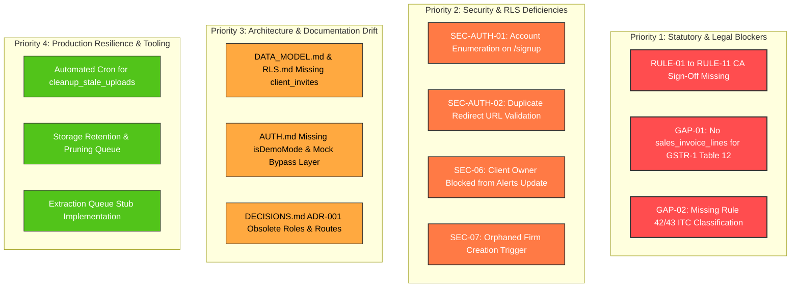

# Documentation, Code Markers, QA Findings & Statutory Risk Audit Report

**Audit Target:** GST Saathi (mysterious-bose)  
**Audit Lane:** Lane J (Docs & Risks Auditor)  
**Date:** November 7, 2026  
**Audited Scope:** 
1. Stale documentation across `docs/` (`AUTH.md`, `CLIENTS.md`, `UPLOADS.md`, `DATA_MODEL.md`, `DATA_MODEL.contract.md`, `RLS.md`, `DECISIONS.md`, `PROMPT_PLAN.md`).
2. Open `TODO` / `FIXME` and incomplete implementation comments across `src/`, `supabase/`, `scripts/`.
3. Unresolved findings, advisories, and gaps across all 33 existing QA reports in `docs/qa/`.
4. Verification audit of `docs/RULES_TO_VERIFY.md` (statutory rules `RULE-01` through `RULE-11`).

---

## Executive Summary & Scorecard

A comprehensive, read-only architectural, statutory, and documentation audit was conducted across the GST Saathi project. The audit evaluated alignment between architectural documentation, actual database schemas, App Router runtime code, open QA deficiencies, and legal statutory compliance under the Central Goods and Services Tax (CGST) Act, 2017.

### Executive Summary Findings:

1. **Zero Open `TODO` / `FIXME` Comments**: The codebase contains **zero** `TODO` or `FIXME` comments in `src/`, `supabase/`, or `scripts/`. However, explicit stubs (`enqueueExtraction` in `src/lib/uploads/enqueue.ts`) and development bypass layers (`DEV_MOCK_SESSION` and `isDemoMode` in `src/lib/env.ts` and `src/proxy.ts`) represent incomplete production components that must be transitioned.
2. **Statutory Rules Completely Unverified (100% Pending)**: All 11 statutory GST rules (`RULE-01` through `RULE-11`) documented in `docs/RULES_TO_VERIFY.md` remain with CA Verification Status **"PENDING REVIEW"**. Not a single rule has received formal Chartered Accountant or Tax Advocate sign-off. The sign-off table at lines 471–479 remains entirely blank.
3. **Severe Documentation Drift in Data Model & RLS**:
   - `client_invites`—a core multi-tenant security table added in migrations 100/110—is **completely absent** from `docs/DATA_MODEL.md`, `docs/DATA_MODEL.contract.md`, and `docs/RLS.md`.
   - `docs/RLS.md` documents that client owners can update alerts (`alerts_update`), but actual database migration `20261101000090_audit_alerts.sql` restricts update access exclusively to CA firm members, blocking SME shop owners from acknowledging or dismissing compliance alerts (SEC-06).
   - `docs/DECISIONS.md` ADR-001 still references obsolete roles (`CA_ADMIN`, `STAFF_ACCOUNTANT`, `CLIENT_REVIEWER`, `SHOP_OWNER_UPLOADER`) and obsolete route paths (`/dashboard/clients/[gstin]`), conflicting with ADR-0004/ADR-0007 and actual implementation (`firm_role`, `client_role`, `/app`, `/portal`).
   - `docs/AUTH.md` omits any documentation of `isDemoMode` and `DEV_MOCK_SESSION`. Under current configuration, any environment using `127.0.0.1` automatically triggers `isDemoMode`, causing all client queries to query in-memory mock objects rather than Supabase.
4. **Critical Open Findings in `docs/qa/`**:
   - **SEC-AUTH-01**: Account enumeration on `/signup` remains active; raw Supabase Auth errors are exposed directly to visitors.
   - **SEC-AUTH-02**: Duplicate redirect validation in `/login/actions.ts` lacks the control character/CRLF injection regex enforced in `@/lib/auth/redirect.ts`.
   - **SEC-06 & SEC-07**: Client owner alert update exclusion and orphaned firm creation remain open in database migrations.
   - **GAP-01 through GAP-04**: Critical database omissions for outward sales line items (`sales_invoice_lines`), Rule 42/43 credit apportionment classifications, QRMP return types (`pmt06`, `iff`), and Rule 37 180-day reversal states remain unaddressed in PostgreSQL migrations.

---

### Audit Verdict Scorecard

| Audit Dimension | Target Scope | Current Status | Primary Risk Level | Key Finding Summary |
|---|---|:---:|:---:|---|
| **1. Code Comments (`TODO`/`FIXME`)** | `src/`, `supabase/`, `scripts/` | **PASS (0 Found)** | Minimal | 0 `TODO`/`FIXME` comments found. 1 extraction enqueue stub (`enqueue.ts`). |
| **2. Statutory GST Rules Verification** | `docs/RULES_TO_VERIFY.md` | **FAIL (0/11 Signed)** | **CRITICAL** | 11/11 rules unratified. Zero CA legal sign-offs. Regulatory liability under Sections 73, 74, 122. |
| **3. Data Model & Contract Sync** | `DATA_MODEL.md`, `DATA_MODEL.contract.md` | **DRIFT DETECTED** | **HIGH** | `client_invites` table missing; RPC functions omitted; `invoice_payments.reference_no` omitted from contract. |
| **4. RLS & Security Policy Sync** | `docs/RLS.md` vs Migrations | **DRIFT DETECTED** | **HIGH** | `client_invites` RLS undocumented; `alerts_update` discrepancy (spec allows owner update; DB denies). |
| **5. Auth & Lifecycle Sync** | `docs/AUTH.md` vs `src/proxy.ts` | **DRIFT DETECTED** | **MEDIUM-HIGH** | `isDemoMode` and `DEV_MOCK_SESSION` completely undocumented; automatic 127.0.0.1 bypass trap. |
| **6. Open Security Findings** | `docs/qa/auth-security.md`, `db-security.md` | **PARTIAL REMEDIATION** | **HIGH** | SEC-AUTH-01 (enumeration), SEC-AUTH-02 (redirect DRY), SEC-06 (alerts RLS), SEC-07 (firms insert) open. |
| **7. Open Database Gaps** | `docs/qa/db-completeness.md` | **UNRESOLVED** | **CRITICAL** | GAP-01 (no `sales_invoice_lines`), GAP-02 (no Rule 42/43 tags), GAP-03 (no PMT-06/IFF), GAP-04 (Rule 37). |

---

## Section 1: Stale Documentation Audit

An item-by-item comparison of `docs/` against current implementation in `src/` and `supabase/migrations/` was executed:

### 1.1 `docs/DATA_MODEL.md` & `docs/DATA_MODEL.contract.md`

#### Drift Findings:
1. **Complete Absence of `client_invites` Table**:
   - **Migration Evidence**: `supabase/migrations/20261101000100_invites.sql` creates `public.client_invites` (`id`, `firm_id`, `client_id`, `token_hash`, `invited_by`, `role`, `expires_at`, `accepted_at`, `accepted_by`, `created_at`, `deleted_at`).
   - **Documentation Gap**: Neither `docs/DATA_MODEL.md` nor `docs/DATA_MODEL.contract.md` lists `client_invites`. The contract in `DATA_MODEL.contract.md` lines 21–25 jumps from `client_access` directly to `platform_admins`.
   - **Risk**: Engineers relying on `DATA_MODEL.md` fail to account for invitation lifecycle states, token expiry, and composite foreign key cascade behaviors.
2. **Contract Omission of `invoice_payments.reference_no`**:
   - **Contract Specification**: `DATA_MODEL.contract.md` line 35 specifies: `invoice_payments(invoice_id,paid_on,amount,mode)`.
   - **Implementation**: `supabase/migrations/20261101000030_purchases.sql` line 276 and `src/lib/database.types.ts` line 354 include `reference_no text`.
   - **Documentation Drift**: The contract file is out of sync with the actual schema migration and TypeScript type definitions.
3. **Undocumented Migration 110 & 120 Database RPC Functions**:
   - `docs/DATA_MODEL.md` documents tables and schema architecture but omits all PostgreSQL security-definer RPC functions introduced in migrations 110 and 120:
     - `public.check_client_archive_permission()` (trigger on `clients`)
     - `public.check_upload_quota(client_id_param uuid, n int)` (upload rate limiting)
     - `public.cleanup_stale_uploads(client_id_param uuid)` (stale upload pruning)
     - `public.confirm_document_upload(document_id_param uuid)` (atomic state transition to `queued`)
     - `public.fail_document_upload(document_id_param uuid, reason text)` (failure handling)
     - `public.soft_delete_document(document_id_param uuid)` (authenticated soft delete)
   - These functions are documented in `docs/UPLOADS.md` but completely omitted from the central `DATA_MODEL.md`.

---

### 1.2 `docs/RLS.md`

#### Drift Findings:
1. **Missing RLS Matrix for `public.client_invites`**:
   - `docs/RLS.md` Section 4 contains a comprehensive table of all public tables and their CRUD policy matrix.
   - `client_invites` is **not present in the matrix**.
   - The security guarantees implemented in migrations 100 and 110 (`client_invites_select`, `client_invites_insert`, `client_invites_update`, `client_invites_delete` with `accepted_at IS NULL` immutability locks) are undocumented in the central security architecture document.
2. **Direct Spec Discrepancy on `public.alerts` UPDATE Policy**:
   - **`docs/RLS.md` Specification** (line 232):
     ```text
     alerts | UPDATE: has_client_access(client_id) OR is_firm_member(firm_id)
     ```
   - **Actual Implementation** (`20261101000090_audit_alerts.sql` lines 161–172):
     ```sql
     create policy "alerts_update" on public.alerts
       for update using (
         public.is_firm_member(firm_id) or public.is_platform_admin()
       );
     ```
   - **Impact**: SME client owners cannot acknowledge, dismiss, or resolve alerts generated for their business. This was flagged as vulnerability **SEC-06** in `docs/qa/db-security.md` and remains a documented discrepancy.
3. **Composite Relational Constraints Undocumented**:
   - In response to vulnerabilities SEC-01 and SEC-03, migrations 010, 020, 030, 050, 060, 070, 090, 100 added composite unique constraint `uq_clients_id_firm_id` and composite foreign keys `(client_id, firm_id) REFERENCES public.clients(id, firm_id)`.
   - `docs/RLS.md` still asserts that RLS alone handles tenant isolation, without documenting the vital composite foreign key defense-in-depth layer.
4. **Storage Policy Token Hierarchy Mismatch**:
   - `docs/RLS.md` Section 6 specifies a 4-token path: `{firm_id}/{client_id}/{document_id}/{filename}` and specifies MIME type and document kind filtering.
   - Migration `20261101000020_documents.sql` implements regex checking only the first 2 tokens (`name ~ '^[0-9a-fA-F-]{36}/[0-9a-fA-F-]{36}/'`). The third token (`document_id`) is unchecked at the storage policy level.

---

### 1.3 `docs/AUTH.md`

#### Drift Findings:
1. **Undocumented `DEV_MOCK_SESSION` & `isDemoMode` Architectural Bypass**:
   - In `src/proxy.ts` (lines 103–111), `src/lib/auth/session.ts` (lines 78–101), `src/lib/clients/queries.ts` (lines 193–415), and `src/lib/env.ts` (lines 79–85), an entire mock session and query layer is implemented.
   - When `isDemoMode` is active:
     - Direct navigation to `/app` or `/portal` without authentication cookies automatically assigns `DEV_MOCK_SESSION` (Demo CA account for "Sharma & Associates CA Firm").
     - Client queries bypass Supabase and read/write in-memory mock data (`DEV_MOCK_CLIENTS`).
   - **`docs/AUTH.md` makes ZERO mention of this subsystem.**
2. **Localhost / 127.0.0.1 Trap**:
   - `src/lib/env.ts` lines 79–85:
     ```typescript
     export const isDemoMode: boolean =
       process.env.NODE_ENV !== 'test' &&
       (process.env.NODE_ENV === 'development' ||
         process.env.NEXT_PUBLIC_DEMO_MODE === 'true' ||
         !process.env.NEXT_PUBLIC_SUPABASE_URL ||
         process.env.NEXT_PUBLIC_SUPABASE_URL.includes('127.0.0.1') ||
         process.env.NEXT_PUBLIC_SUPABASE_URL.includes('placeholder'));
     ```
   - In `.env.example`, `NEXT_PUBLIC_SUPABASE_URL=http://127.0.0.1:54321`.
   - **Consequence**: When developers start local Supabase following `.env.example`, `isDemoMode` evaluates to `true` because the URL contains `127.0.0.1`. The application silently ignores local Postgres and runs against in-memory mock data. This critical developer experience hazard is undocumented.

---

### 1.4 `docs/CLIENTS.md`

#### Drift Findings:
1. **`PaginatedClients` Type Definition Drift**:
   - `docs/CLIENTS.md` lines 96–100 documents:
     ```typescript
     export interface PaginatedClients {
       items: ClientListItem[];
       totalCount: number;
       currentPage: number;
       pageSize: number;
     }
     ```
   - Actual implementation in `src/lib/clients/types.ts` lines 66–72:
     ```typescript
     export interface PaginatedClients {
       items: ClientListItem[];
       totalCount: number;
       currentPage: number;
       pageSize: number;
       totalPages: number; // <-- Missing in documentation
     }
     ```

---

### 1.5 `docs/DECISIONS.md` & `docs/adr/`

#### Drift Findings:
1. **Obsolete RBAC Roles in ADR-001**:
   - `docs/DECISIONS.md` ADR-001 (line 95) specifies:
     `Role-Based Access Control (RBAC): CA_ADMIN, STAFF_ACCOUNTANT, CLIENT_REVIEWER, SHOP_OWNER_UPLOADER`.
   - Actual system architecture (ADR-0004, ADR-0007, database enums, TypeScript types):
     `firm_role: 'admin' | 'staff'`, `client_role: 'owner' | 'staff'`.
2. **Obsolete Route Paths in ADR-001**:
   - ADR-001 (line 86) references `/dashboard/clients/[gstin]/...` and `/portal/[shop-token]/...`.
   - Implemented route tree: `/app/clients/[id]` and `/portal` (with `/invite/[token]`).
3. **Missing Individual ADR Markdown Files**:
   - `docs/DECISIONS.md` references `adr/0001-supabase.md` (present), but ADR-0002 through ADR-0007 exist only inline within `DECISIONS.md` and have no individual files in `docs/adr/`.

---

### 1.6 `docs/PROMPT_PLAN.md`

#### Drift Findings:
1. **Roadmap Execution Gap**:
   - `docs/PROMPT_PLAN.md` outlines 20 planned execution prompts.
   - Current codebase has completed Prompts 01–07:
     - Foundation & Landing Page (01, 02)
     - Client Store & Shop Onboarding (03, 04, 05)
     - Document Ingestion Pipeline UI & Storage (06, 07)
   - Prompts 08 through 20 (GSTR-2B JSON parser, OCR header & line-item parsing, matching engine, Rule 37 reversal engine, GSTN JSON & Tally XML exporters, audit trail log) **have not yet been implemented**.
2. **Documented Extraction Stub**:
   - `src/lib/uploads/enqueue.ts` lines 4–10 explicitly notes that `enqueueExtraction` is a stub placeholder designed to be implemented in Prompt 08/09.

---

## Section 2: Codebase TODO / FIXME & Marker Audit

A comprehensive search was performed across `src/`, `supabase/`, and `scripts/`:

### 2.1 Exact `TODO` / `FIXME` Search Results

```text
Target Directories: src/, supabase/, scripts/
Regex: \b(TODO|FIXME)\b (Case-Insensitive)
Matched Files Count: 0
Total Matches: 0
```
- **Finding**: There are **zero** open `TODO` or `FIXME` comments in any production TypeScript, SQL, or shell script in the repository.

### 2.2 Substring False-Positive Analysis
- An initial naive substring match for `TODO` flagged three lines in `src/lib/uploads/queries.ts`:
  - Line 20: `export function mapRowToDocumentListItem(row: DocumentRow): DocumentListItem`
  - Line 126: `const items = (data ?? []).map(mapRowToDocumentListItem);`
  - Line 171: `return mapRowToDocumentListItem(data);`
- **Root Cause**: The substring `ToDoc` in `mapRowToDocumentListItem` case-insensitively matched `todo`. This is a confirmed false positive; no actual TODO comment exists in `queries.ts`.

### 2.3 Other Incomplete Implementation Markers

A broader scan for code comment markers (`STUB`, `MOCK`, `PLACEHOLDER`, `HACK`, `UNIMPLEMENTED`) revealed:

1. **Extraction Queue Stub**:
   - **File**: `src/lib/uploads/enqueue.ts` (lines 4–14)
   ```typescript
   /**
    * Enqueue a confirmed document for background text/data extraction.
    * THIS TASK ONLY: Stub implementation.
    * Currently marks or confirms document status as 'queued'.
    * A subsequent feature prompt replaces this with the actual queue/worker implementation.
    */
   export async function enqueueExtraction(documentId: string): Promise<{ queued: boolean; documentId: string }> {
     return { queued: true, documentId };
   }
   ```
   - **Risk**: Purchase bills uploaded by users transition to `'queued'` status, but no asynchronous worker ever processes them. Without Prompt 08/09 implementation, bills remain permanently in `'queued'` status unless manually altered.

2. **In-Memory Mock Database Subsystem**:
   - **Files**: `src/lib/auth/dev-mock.ts`, `src/lib/env.ts`, `src/proxy.ts`, `src/lib/clients/queries.ts`
   - **Mechanism**: Hardcoded mock tenant data (`DEV_MOCK_SESSION` and `DEV_MOCK_CLIENTS`) provides full CRUD simulation when Supabase is disconnected or in demo mode.
   - **Risk**: Developers running local Supabase at `127.0.0.1` are silently diverted into mock memory state, creating risk that real SQL migration bugs go undetected during local testing.

3. **Adversarial Penetration Test Markers ("HACK")**:
   - **Files**: `supabase/tests/rls_rules_audit_storage.test.sql` (lines 537, 577, 584) and `supabase/tests/rls_tenancy_documents_purchases.test.sql` (line 476).
   - **Nature**: Legitimate test fixture strings testing whether malicious actors can inject path traversal attacks (`/doc_hack/hack.pdf`) or cross-firm invoice mutations (`HACK-01`).

---

## Section 3: Open Findings & Unresolved Warnings Across Existing QA Reports (`docs/qa/*`)

A comprehensive review of the 33 existing QA reports in `docs/qa/` was performed to identify findings that remain unresolved in current code:

### 3.1 Unresolved Security Findings

| Vulnerability ID | Source Report | Target File / Artifact | Severity | Current Status | Description & Operational Impact |
|---|---|---|:---:|:---:|---|
| **SEC-AUTH-01** | `docs/qa/auth-security.md` | `src/app/(auth)/signup/actions.ts:155-160` | **MEDIUM (CVSS 4.3)** | **OPEN** | **Account Enumeration on `/signup`**: In server action `signUpAction`, raw Supabase error messages (`authError.message`) are returned directly to the client. An attacker can probe email addresses to identify registered CA firms. Recommended remediation: intercept `"User already registered"` and return generic response. |
| **SEC-AUTH-02** | `docs/qa/auth-security.md` | `src/app/(auth)/login/actions.ts:19-39` | **LOW / MEDIUM** | **OPEN** | **Duplicate Redirect Function Lacks Control-Char Regex**: `login/actions.ts` defines a local `getValidRedirect` function instead of importing `validateRedirectUrl` from `@/lib/auth/redirect.ts`. The local function lacks the regex check for `[\r\n\0]` (CRLF/header injection defense). |
| **SEC-06** | `docs/qa/db-security.md` | `supabase/migrations/20261101000090_audit_alerts.sql:161-172` | **LOW (CVSS 3.1)** | **OPEN** | **Client Owner Blocked from Updating Alerts**: `alerts_update` restricts updates to `is_firm_member(firm_id) or is_platform_admin()`. `docs/RLS.md` specifies client owners must be able to update alerts to `'dismissed'`. Currently, client owners get RLS access denied when dismissing alerts. |
| **SEC-07** | `docs/qa/db-security.md` | `supabase/migrations/20261101000010_tenancy.sql:115-121` | **LOW (CVSS 2.7)** | **OPEN** | **Orphaned Firm Creation on Direct Insert**: `firms_insert` allows any authenticated user to insert into `public.firms`, but no trigger creates the corresponding record in `public.firm_members`. Direct SQL inserts leave firms orphaned. (Application signup works around this via `create_firm_with_admin` RPC). |
| **SEC-04** | `docs/qa/db-security.md` | `supabase/migrations/20261101000020_documents.sql:112,136` | **MEDIUM (CVSS 6.5)** | **PARTIALLY RESOLVED** | **Storage Path Regex Only Checks 2 Tokens**: Regex validates `^[0-9a-fA-F-]{36}/[0-9a-fA-F-]{36}/` (firm and client), but omits the third token `{document_id}` (`^[0-9a-fA-F-]{36}/[0-9a-fA-F-]{36}/[0-9a-fA-F-]{36}/.+$`), allowing arbitrary subpaths in client folders. |

---

### 3.2 Unresolved Database & Statutory Completeness Gaps

Documented in `docs/qa/db-completeness.md` — none of these 8 statutory gaps have been addressed in migrations:

| Gap ID | Subsystem | Severity | Impact on Statutory Compliance |
|---|---|:---:|---|
| **GAP-01** | Outward Sales | **CRITICAL (BLOCKING)** | **No `sales_invoice_lines` Table**: `sales_invoices` contains only header-level totals. There is no line items table, no HSN column, no quantity, and no unit column. Form **GSTR-1 Table 12 (HSN Summary of Outward Supplies)** cannot be generated. Uploading a return JSON without Table 12 triggers portal validation rejection under Notification No. 78/2020-CT. |
| **GAP-02** | Common Credit / ITC | **CRITICAL** | **No Input Tax Credit Apportionment Classification**: Inward purchase tables (`invoices`, `invoice_lines`) lack categorization for exclusive exempt ($T_2$), exclusive taxable ($T_4$), blocked ($T_3$), common credit ($C_2$), and capital goods (Rule 43). Rule 42 reversals cannot be calculated under Section 17(2). |
| **GAP-03** | QRMP Scheme | **HIGH** | **Missing `return_type` Enum Values**: `return_type` enum (`gstr1`, `gstr3b`, `cmp08`, `gstr4`) lacks `'pmt06'` (monthly tax payment challan) and `'iff'` (Invoice Furnishing Facility). The system cannot track or draft monthly payments for QRMP clients. |
| **GAP-04** | Rule 37 Reversal | **HIGH** | **Incomplete `itc_state` Enum & Re-Availment Tracking**: `itc_state` enum lacks `'reversed'` and `'reclaimed'` states. When unpaid supplier invoices cross 180 days, credit cannot be transitioned to reversed, and subsequent payments cannot track re-availment in GSTR-3B Table 4(A)(5) and Table 4(D)(1). |
| **GAP-05** | Contract Drift | **MEDIUM** | **`invoice_payments.reference_no` Omission in Contract**: Contract file `docs/DATA_MODEL.contract.md` lacks `reference_no` while migration 030 has it. |
| **GAP-06** | IMS Cycle | **MEDIUM-HIGH** | **Missing IMS Action Timestamps**: `gstr2b_records` lacks `ims_action_at` timestamp and actor ID. The system cannot determine if actions were taken before the 13th cutoff or after the 14th to trigger portal recompute warnings. |
| **GAP-07** | Tally Prime XML | **MEDIUM** | **Missing Buyer Name & Ledger Mapping**: `sales_invoices` stores `buyer_gstin` but lacks `buyer_name`. No configurable `ledger_mappings` table exists to map accounts into Tally Prime chart of accounts. |
| **GAP-08** | Database Integrity | **MEDIUM** | **Missing Composite Unique Constraints**: Inward `invoices` and outward `sales_invoices` lack composite unique constraints on `(client_id, invoice_no_norm, period_fp)`, allowing duplicate invoice numbers across identical tax periods during batch processing. |

---

### 3.3 Database Hygiene & Test Quality Gaps

From `docs/qa/db-hygiene.md` and `docs/qa/db-tests-review.md`:

1. **Migration Guard Hygiene (`db-hygiene.md`)**:
   - Migrations `20261101000010_tenancy.sql` through `20261101000080_rules.sql` lack `IF NOT EXISTS` on `CREATE TABLE` and `CREATE INDEX`, and lack `DROP TRIGGER IF EXISTS` guards. Only migration 090 fully implements drop guards.
2. **Redundant & Unindexed Foreign Keys (`db-hygiene.md`)**:
   - **10 Redundant B-tree Indexes**: Standalone indexes on `(firm_id)` or `(client_id)` duplicate the leftmost columns of composite constraints `(firm_id, gstin)` or `(client_id, firm_id)`.
   - **7 Unindexed Actor Foreign Keys**: Columns `uploaded_by`, `imported_by`, `decided_by`, `created_by`, `approved_by` across `documents`, `gstr2b_imports`, `reconciliation_results`, and `return_drafts` lack indexes, causing sequential table scans during user deletion or audit lookups.
3. **Compound Filter Masking in pgTAP (`db-tests-review.md`)**:
   - In `supabase/tests/rls_tenancy_documents_purchases.test.sql`, tests 14 and 16 query rows using `WHERE client_id = ... AND firm_id = ...`. If test fixture insertion fails, the assertion vacantly returns 0 rows and passes without testing RLS filtering.

---

### 3.4 Production Resilience & Infrastructure Gaps

From `docs/qa/uploads-reliability.md`:

1. **Unscheduled Stale Upload Cleanup**:
   - Stale document cleanup function `cleanup_stale_uploads(client_id)` exists, but is not attached to any automated scheduler (such as pg_cron or a Next.js cron route). Unconfirmed uploads older than 1 hour remain indefinitely unless manually triggered.
2. **Storage Unlink Fallback Queue**:
   - Soft-deleting documents updates `deleted_at` in Postgres but retains the physical binary object in Supabase Storage. There is no automated queue or worker to prune physical storage files after the statutory 6-year retention period (Section 36 CGST Act).

---

## Section 4: Statutory GST Rules Audit (`docs/RULES_TO_VERIFY.md`)

A comprehensive statutory and architectural audit was conducted on all 11 rules in `docs/RULES_TO_VERIFY.md`:

### 4.1 Master CA Verification Status Matrix

```text
Total Rules Documented: 11 (RULE-01 through RULE-11)
CA Ratified / Approved: 0 (0.0%)
Pending CA Verification: 11 (100.0%)
Formal Legal Sign-Off Sheet: Incomplete / Completely Blank (lines 471–479)
```

| Rule Reference | Statutory Domain | Governing Law / Notification | Current Code Assumption | CA Verification Status | Critical Open Legal Decisions |
|---|---|---|---|:---:|---|
| **RULE-01** | Registration Thresholds | Section 22 CGST Act; Notif. 10/2019-CT | ₹40L for exclusive goods; ₹20L for mixed/services; ₹10L/₹20L special category | **PENDING REVIEW** | • Whether minor auxiliary services (photocopying, binding) drop threshold from ₹40L to ₹20L.<br>• Whether bank FD interest counts toward aggregate turnover.<br>• Handling Section 24 mandatory triggers (e-commerce sales). |
| **RULE-02** | Late-Fee Caps & Interest Computation | Section 47 & 50; Notif. 19/2021 & 20/2021-CT | Tiered late fee caps (₹500 / ₹2,000 / ₹5,000 / ₹10,000); 18% p.a. on net cash liability | **PENDING REVIEW** | • Automatic vs manual override of late fees in GSTR-3B Table 5.1.<br>• Confirmation that interest strictly attaches to net cash (Table 6.1 cash column), never gross tax. |
| **RULE-03** | Rates: Books & Stationery | HSN 4901, 4820, 9608; Notif. 01/2017 & 47th Council | 4901 is Nil; 4820 exercise books vs account registers (12% vs 18%); pens 18% | **PENDING REVIEW** | • Disambiguation rules for OCR between Exercise Books (4820 20 00) and Registers (4820 10 00).<br>• Mixed/Composite supply taxation for bundled "Student Kits" (18% vs highest rate). |
| **RULE-04** | QRMP Scheme & Due Dates | Section 10 & 39; Rule 61A; PMT-06 & CMP-08 | PMT-06 by 25th; GSTR-1 quarterly by 13th; GSTR-3B by 22nd/24th; CMP-08 by 18th | **PENDING REVIEW** | • Official assignment of states into Category 1 (22nd) vs Category 2 (24th).<br>• Recommendation of Fixed Sum Method (35%) vs Self-Assessment Method for micro-retailers. |
| **RULE-05** | 180-Day ITC Reversal (Rule 37) | 2nd Proviso Section 16(2); Rule 37 CGST | Track unpaid supplier bills from invoice date; reverse in Table 4(B)(2) + 18% interest | **PENDING REVIEW** | • Calculation basis: strictly `invoiceDate` vs `goodsReceivedDate`.<br>• Statutory handling of credit notes, trade discounts, and retention money. |
| **RULE-06** | E-Way Bill Consignment Thresholds | Section 68; Rule 138; SGST Notifications | Inter-state ₹50,000; Maharashtra intra-state ₹1,00,000; city exemptions | **PENDING REVIEW** | • State-specific lookup table for intra-state consignment thresholds.<br>• Exempt commodity rules for printed books (HSN 4901). |
| **RULE-07** | IMS & GSTR-2B Recompute Cycle | GSTN IMS Advisory (Oct/Nov 2024); Rule 60(7) | Invoices acted on <= 13th flow into 14th 2B; actions >= 14th require manual portal recompute | **PENDING REVIEW** | • UX handling when an imported GSTR-2B JSON is outdated compared to subsequent IMS actions.<br>• Warning banner: "IMS actions taken after 14th require manual GSTR-2B recompute before filing". |
| **RULE-08** | Official GSTN State Codes & Staggering | Section 25; Rule 8; Notif. 82/2020-CT | 37 official codes (01-38, 97, 99); QRMP Category 1 (22nd) vs Category 2 (24th) | **PENDING REVIEW** | • Reconciling invoices carrying legacy Code 25 with clients registered under merged Code 26.<br>• Dynamic calendar due dates (22nd vs 24th) derived strictly from client GSTIN prefix. |
| **RULE-09** | AATO Bands & Thresholds | Section 10, 22, 44; Notif. 10/2019 & 78/2020-CT | 4 bands (<40L, 40L-1.5Cr, 1.5Cr-5Cr, >5Cr); e-invoicing >5Cr, 6-digit HSN >5Cr | **PENDING REVIEW** | • Confirm selecting `above_5cr` permanently locks out Composition and QRMP options.<br>• Outward invoice validation enforcing 6-digit HSN for clients in `above_5cr` band. |
| **RULE-10** | Statutory GST Schemes (Regular, QRMP, Composition) | Section 10, 39; Rule 61A; Circular 143/13/2020 | Regular monthly vs QRMP (IFF + PMT-06) vs Composition (CMP-08 1%, no ITC) | **PENDING REVIEW** | • Hard validation blocking return preparation if Composition client enters inter-state POS.<br>• Composition purchase bill input tax auto-costed to expense rather than credit ledger. |
| **RULE-11** | Supply Classification (Intra vs Inter-State) | Sections 7 & 8 IGST Act; UTGST Act, 2017 | GSTIN prefix = state jurisdiction; intra-state (CGST+SGST/UTGST) vs inter-state (IGST) | **PENDING REVIEW** | • OCR validation flagging invoices where Supplier State != Recipient State but footer calculates CGST+SGST.<br>• Internal storage of UTGST with distinct `tax_type: 'utgst'` flag, mapped to `"state_ut_tax"`. |

---

### 4.2 Legal Liability & Regulatory Risk Assessment

Under Indian tax jurisprudence, automating tax computations without formal professional sign-off exposes both software providers and tax practitioners to statutory liabilities:

1. **Section 73 & 74 (CGST Act, 2017)**:
   - If software applies an incorrect rate (e.g. classifying exercise books at 12% instead of 18%, or wrongly claiming ITC on 180-day overdue bills), the taxpayer faces demand notices with mandatory interest at 18% p.a. (Section 50) and penalties up to 100% of tax evaded.
2. **Section 122(1)(xi) & Section 122(1)(iv)**:
   - Failure to obtain registration when aggregate turnover crosses threshold due to erroneous auxiliary service calculations triggers a penalty of ₹10,000 or the total tax due.
3. **Section 132 (Punitive Sanctions)**:
   - Wrongful availment of Input Tax Credit exceeding ₹500 Lakhs without invoice basis or in violation of Section 16/Rule 37 is a cognizable, non-bailable offense.
4. **Professional Misconduct (ICAI Code of Ethics)**:
   - Practicing Chartered Accountants who rely on automated tools that omit statutory checks (such as GSTR-1 Table 12 HSN summaries or Rule 42 reversals) face professional liability under the Chartered Accountants Act, 1949.

---

## Section 5: Risk Synthesis & Prioritized Remediation Roadmap

### 5.1 Prioritized Risk Hierarchy



---

### 5.2 Step-by-Step Action Plan

#### Step 1: Statutory Legal Review & Empanelment Sign-Off
1. Formalize review of `docs/RULES_TO_VERIFY.md` with an empanelled Chartered Accountant or Tax Advocate.
2. Complete the decision checkboxes on RULE-01 through RULE-11.
3. Obtain written sign-off in the verification table (lines 471–479) before hardcoding rate rules into calculation engines.

#### Step 2: Database Migration Remediations (Migration 130)
1. **Add `sales_invoice_lines` Table** (Resolves GAP-01):
   - Columns: `id, invoice_id, line_no, description, hsn, qty, unit, unit_price, taxable_value, tax_rate, cgst, sgst, igst, cess`.
   - Enables generation of GSTR-1 Table 12 HSN summary.
2. **Add Rule 42/43 ITC Classification Columns** (Resolves GAP-02):
   - Add `itc_category public.itc_category default 't4_taxable'` on `invoices` and `invoice_lines`.
3. **Expand Enums** (Resolves GAP-03 & GAP-04):
   - Alter `return_type` to add `'pmt06'` and `'iff'`.
   - Alter `itc_state` to add `'reversed'` and `'reclaimed'`.
4. **Harden `alerts_update` RLS Policy** (Resolves SEC-06):
   - Allow client owners to update alert records where `client_id` matches their registered ownership.
5. **Add Trigger for Firm Creator Membership** (Resolves SEC-07):
   - Automatically insert the creating user as `'admin'` in `firm_members` on `firms` insert.

#### Step 3: Application Code Security Hardening
1. **Mask Signup Error Messages** (Resolves SEC-AUTH-01):
   - In `src/app/(auth)/signup/actions.ts`, normalize error messages so email existence is not disclosed.
2. **Consolidate Redirect URL Validation** (Resolves SEC-AUTH-02):
   - Replace local `getValidRedirect` in `src/app/(auth)/login/actions.ts` with `validateRedirectUrl` imported from `@/lib/auth/redirect.ts`.

#### Step 4: Documentation Synchronization & Hygiene
1. Update `docs/DATA_MODEL.md` and `docs/DATA_MODEL.contract.md` to document `client_invites` table and all RPC functions.
2. Update `docs/RLS.md` with `client_invites` RLS policies and composite foreign key defenses.
3. Update `docs/AUTH.md` to detail `isDemoMode`, `DEV_MOCK_SESSION`, and configuration behavior when connecting to local Supabase at `127.0.0.1`.
4. Update `docs/DECISIONS.md` ADR-001 to align role names (`firm_role`, `client_role`) and route paths with current architecture.
