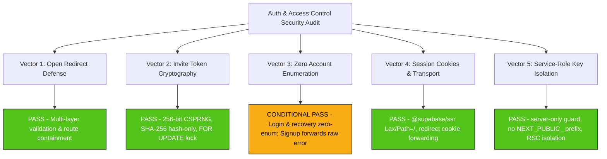
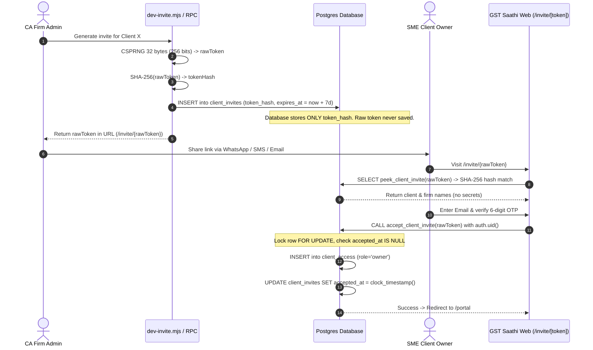

# Authentication & Access Control Security Audit Report (Auth-Security)

**Reviewer**: Reviewer R1 (Security Reviewer)  
**Date**: October 26, 2026  
**Audited Target**: GST Saathi Authentication, Access Control, Session Lifecycle, and Invite Token Cryptography  
**Scope**: Open Redirect Prevention, Cryptographic Token Hashing & Entropy, Zero Account Enumeration, Session Cookie Flags & Transport Security, and Service-Role Key Isolation.  
**Applicable Standards**: OWASP Top 10:2021 (A01 Broken Access Control, A02 Cryptographic Failures, A07 Identification & Authentication Failures), OWASP ASVS 4.0.3, W3C WHATWG URL Standard, Next.js 16 Security Model, and DPDP Act 2023.

---

## 1. Executive Summary & Verdict Scorecard

A comprehensive, read-only security audit was conducted on the authentication, access control, and session infrastructure of **GST Saathi**. The evaluation audited application routes, server actions, client components, Next.js proxy middleware (`src/proxy.ts`), Supabase database migrations, helper functions, and test suites.



### 1.1 Security Vector Evaluation Summary

| # | Security Vector | Audited Artifacts | Status | Risk Level | Evaluation Findings |
|---|---|---|:---:|:---:|---|
| **1** | **Open Redirect Vulnerabilities** | `src/lib/auth/redirect.ts`<br>`src/app/(auth)/login/actions.ts`<br>`src/proxy.ts`<br>Login, Signup, Forgot/Reset Pages | **PASS** | Low (Hardened) | Both `validateRedirectUrl` and `getValidRedirect` strictly enforce same-origin relative paths, blocking protocol-relative (`//`), backslash (`/\`), scheme execution (`javascript:`), and CRLF injection. Signup and reset-password ignore arbitrary `next` targets. |
| **2** | **Invite Token Hashing & Entropy** | `supabase/migrations/20261101000100_invites.sql`<br>`scripts/dev-invite.mjs`<br>`src/app/(auth)/invite/[token]/actions.ts` | **PASS** | None (Exemplary) | Generates 32-byte (256-bit) cryptographically secure random entropy. Database schema and RPCs strictly store and compare hex SHA-256 hashes (`token_hash`). Plaintext tokens are never persisted. Single-use is enforced via `FOR UPDATE` row lock and 7-day TTL. |
| **3** | **Zero Account Enumeration** | `src/app/(auth)/login/actions.ts`<br>`src/app/(auth)/forgot-password/actions.ts`<br>`src/app/(auth)/reset-password/actions.ts`<br>`src/app/(auth)/signup/actions.ts` | **CONDITIONAL PASS** | Low / Medium | Password login, OTP request, OTP verification, and password reset enforce strict zero enumeration with uniform responses. However, `/signup` forwards raw Supabase error messages (`"User already registered"`), allowing external email probing. |
| **4** | **Session Cookie Flags & Transport Security** | `src/lib/supabase/server.ts`<br>`src/lib/supabase/browser.ts`<br>`src/proxy.ts` | **PASS** | Low (Hardened) | Managed via official `@supabase/ssr` with chunking, `SameSite=Lax`, and `path=/`. Next.js 16 `src/proxy.ts` implements critical cookie forwarding during 307 redirects to prevent token drop. Server actions feature built-in origin validation. |
| **5** | **Service-Role Key Isolation** | `src/lib/supabase/admin.ts`<br>`src/lib/env.ts`<br>`.env.example`<br>Client Components | **PASS** | None (Exemplary) | `src/lib/supabase/admin.ts` enforces `import 'server-only'`. Key is named `SUPABASE_SERVICE_ROLE_KEY` without `NEXT_PUBLIC_`. `src/lib/env.ts` evaluates key to `undefined` in browser contexts. Client components exclusively invoke Server Actions. |

### Overall Verdict: **CONDITIONAL PASS**
The authentication, authorization, and cryptographic token subsystems exhibit robust defensive engineering. One remediation is recommended before general production deployment: normalising the registration error response in `src/app/(auth)/signup/actions.ts` to prevent email enumeration on the public signup form (**SEC-AUTH-01**).

---

## 2. Detailed Vector 1: Open Redirect Vulnerabilities

### 2.1 Threat Mechanism & Attack Vectors
Open redirect vulnerabilities (CWE-601) occur when an application accepts an untrusted input parameter (such as `?next=...` or `?returnTo=...`) and redirects the user to that URL without adequate validation. Attackers use open redirects to craft convincing phishing lures (e.g., `https://gstsaathi.in/login?next=https://evil-phish.com`), deceiving users into authenticating before handing session control over to an adversary.

The audit verified defenses against standard and exotic bypass techniques:
1. **Protocol-relative URLs**: `//evil.com`, `///evil.com`, `////attacker.com`
2. **Backslash evasion**: `/\evil.com`, `/\/evil.com`, `\evil.com`
3. **URI scheme execution**: `javascript:alert(1)`, `data:text/html,...`, `vbscript:...`
4. **Header / CRLF injection**: `/app\r\nSet-Cookie: evil=1`, `/portal\nLocation: https://evil.com`
5. **Cross-boundary route hopping**: An accountant logging in with `?next=/portal`, or a client owner logging in with `?next=/app`.

### 2.2 Code Analysis

#### A. Central Redirect Validator (`src/lib/auth/redirect.ts`)
The core validation routine `validateRedirectUrl` implements defense-in-depth sanitization:

```typescript
// src/lib/auth/redirect.ts (lines 113-146)
export function validateRedirectUrl(
  url: string | null | undefined,
  fallback: string = '/app'
): string {
  if (!url || typeof url !== 'string') {
    return fallback;
  }

  const trimmed = url.trim();

  // Must start with '/'
  if (!trimmed.startsWith('/')) {
    return fallback;
  }

  // Must NOT start with '//' or '/\'
  if (trimmed.startsWith('//') || trimmed.startsWith('/\\')) {
    return fallback;
  }

  // Must NOT contain ':' before any slash (prevents scheme execution like javascript:)
  const firstSlashIndex = trimmed.indexOf('/');
  const colonIndex = trimmed.indexOf(':');
  if (colonIndex !== -1 && (firstSlashIndex === -1 || colonIndex < firstSlashIndex)) {
    return fallback;
  }

  // Prevent newline / control character injection
  if (/[\r\n\0]/.test(trimmed)) {
    return fallback;
  }

  return trimmed;
}
```

#### B. Login Action Destination Resolver (`src/app/(auth)/login/actions.ts`)
The server actions for password and OTP login implement an additional parser:

```typescript
// src/app/(auth)/login/actions.ts (lines 19-39)
function getValidRedirect(next?: string | null): string | null {
  if (!next || typeof next !== 'string') return null;
  const trimmed = next.trim();
  if (
    !trimmed.startsWith('/') ||
    trimmed.startsWith('//') ||
    trimmed.startsWith('/\\')
  ) {
    return null;
  }
  try {
    const dummyOrigin = 'http://localhost';
    const parsed = new URL(trimmed, dummyOrigin);
    if (parsed.origin !== dummyOrigin) {
      return null;
    }
    return parsed.pathname + parsed.search + parsed.hash;
  } catch {
    return null;
  }
}
```

#### C. Request Processing Across Auth Pages
1. **`/login` (`actions.ts` & `page.tsx`)**:
   - `page.tsx` retrieves `next` from `useSearchParams().get('next')`.
   - `next` is passed as a hidden form input (`<input type="hidden" name="next" value={nextParam} />`).
   - Mode switcher preserves `next` via safe URL parameter encoding: `encodeURIComponent(nextParam)`.
   - `resolveDestination(supabase, userId, next)` evaluates `getValidRedirect(next)`. If valid, it redirects to the validated relative path; otherwise, it queries user tenant roles to route them to `/app` (CA firm member) or `/portal` (client owner).
2. **`/signup` (`actions.ts` & `page.tsx`)**:
   - While `login/page.tsx` passes `?next=...` to the signup link, `signUpAction` **strictly ignores** any incoming redirect parameters.
   - Upon successful account and firm provisioning, line 218 executes: `redirect('/app');`. Open redirect is structurally impossible on registration.
3. **`/forgot-password` (`actions.ts` & `page.tsx`)**:
   - Ignores `next` parameters. The password reset email statically specifies `redirectTo: ${normalizedOrigin}/reset-password`.
   - Success view renders a link to `/login` without echoing untrusted redirect targets.
4. **`/reset-password` (`actions.ts` & `page.tsx`)**:
   - Ignores `next`. Upon successful password update, line 91 executes: `redirect('/login?reset=success');`.
5. **Proxy Middleware (`src/proxy.ts`)**:
   - Intercepts unauthenticated visitors to protected paths and generates:
     `return `/login?next=${encodeURIComponent(pathname)}`;`
   - `pathname` is sourced directly from `request.nextUrl.pathname` (parsed internally by Next.js engine, guaranteed relative).
   - Redirect responses are created with `NextResponse.redirect(new URL(targetUrl, request.url))`, pinning target evaluation strictly to the current request origin.
   - If an authenticated CA attempts to access `/portal` via a manipulated `?next=/portal`, `proxy.ts` detects `!session.clients.some(c => c.role === 'owner')` and forces a redirect to `session.home` (`/app`). Cross-role access hopping is prevented.

### 2.3 Test Suite Verification
The test file `src/lib/auth/__tests__/redirect.test.ts` contains 17 specific assertions covering open redirect prevention:
- Absolute external protocols: `https://evil.com`, `http://evil.com`, `ftp://evil.com` -> Rejected (returns `/app`).
- Protocol-relative URLs: `//evil.com`, `///evil.com`, `////attacker.com/path` -> Rejected (returns `/app`).
- Backslash evasion: `/\evil.com`, `/\/evil.com`, `\evil.com` -> Rejected (returns `/app`).
- Scheme execution: `javascript:alert(1)`, `javascript:window.location=...`, `data:text/html,...`, `vbscript:msgbox(1)` -> Rejected (returns `/app`).
- CRLF injection: `/app\r\nSet-Cookie: evil=1`, `/portal\nLocation: https://evil.com` -> Rejected (returns `/app`).
- Legitimate relative paths with query parameters and fragments: `/app?tab=settings`, `/portal/invoices?period=2026-04&status=pending`, `/app#section-1` -> Accepted.

### 2.4 Code Quality & Hardening Observation
> [!NOTE]
> `src/app/(auth)/login/actions.ts` defines an inline `getValidRedirect` function that duplicates the validation logic of `validateRedirectUrl` in `src/lib/auth/redirect.ts`. While both are secure, consolidating `login/actions.ts` to import `validateRedirectUrl` eliminates duplicate logic and guarantees uniform regex-based CRLF and null-byte rejection.

---

## 3. Detailed Vector 2: Invite Token Hashing & Entropy

### 3.1 Architecture & Threat Model
The SME client onboarding workflow enables accounting practices to invite business owners to upload invoices. If invite tokens possess low entropy or are stored in plaintext in the database, attackers could:
1. Brute-force token values via automated requests.
2. Compromise database read replicas or backup snapshots and exfiltrate unused tokens to hijack client organization ownership.
3. Race-condition an invitation acceptance to bind multiple users or illegitimate accounts to a client organization.



### 3.2 Audit Findings

#### A. Cryptographic Entropy (32-byte / 256-bit CSPRNG)
Both generation mechanisms utilize cryptographically secure pseudo-random number generators (CSPRNG):
1. **PostgreSQL Security-Definer RPC (`supabase/migrations/20261101000100_invites.sql`, line 139)**:
   ```sql
   v_raw_token := encode(extensions.gen_random_bytes(32), 'hex');
   ```
   Uses `pgcrypto` / OpenSSL CSPRNG engine (`extensions.gen_random_bytes(32)`), producing 256 bits of entropy encoded as a 64-character hexadecimal string.
2. **Node.js CLI Tool (`scripts/dev-invite.mjs`, line 179)**:
   ```javascript
   const rawToken = crypto.randomBytes(32).toString('hex');
   ```
   Uses Node.js `crypto.randomBytes(32)`, backed by system entropy (`/dev/urandom` or Windows `CryptGenRandom`/BCrypt).

**Mathematical Entropy Assessment**:
$$\text{Entropy Space} = 2^{256} \approx 1.1579 \times 10^{77} \text{ possibilities}$$
Even at $10^9$ queries per second, searching the token space would require $\approx 3.67 \times 10^{60}$ years. Brute-force online or offline guessing is computationally infeasible.

#### B. One-Way SHA-256 Hash Storage
1. **Schema Definition (`supabase/migrations/20261101000100_invites.sql`, lines 8-21)**:
   ```sql
   create table if not exists public.client_invites (
     id uuid primary key default gen_random_uuid(),
     firm_id uuid not null references public.firms(id) on delete cascade,
     client_id uuid not null references public.clients(id) on delete cascade,
     token_hash text not null unique,
     expires_at timestamptz not null default (clock_timestamp() + interval '7 days'),
     accepted_by uuid references auth.users(id) on delete set null,
     accepted_at timestamptz,
     ...
   );
   ```
   - The table schema contains **no column** for the raw token. Only `token_hash` exists.
   - Even in the event of a catastrophic SQL injection or backup leak, attackers cannot recover active invitation URLs from database records.
2. **Hash Computation in RPCs**:
   - `create_client_invite`: computes `v_hash := encode(extensions.digest(v_raw_token, 'sha256'), 'hex')`. Inserts `v_hash`; returns `v_raw_token` in memory.
   - `peek_client_invite`: hashes input parameter `v_hash := encode(extensions.digest(p_token, 'sha256'), 'hex')` and queries by `ci.token_hash = v_hash`.
   - `accept_client_invite`: hashes input parameter `v_hash := encode(extensions.digest(p_token, 'sha256'), 'hex')` and queries by `ci.token_hash = v_hash`.
3. **Table RLS**:
   - `client_invites` table has RLS enabled with policies granting `SELECT, INSERT, UPDATE, DELETE` only to `public.is_firm_admin(firm_id) or public.is_platform_admin()`. Anonymous users and client users have zero direct PostgREST table access.

#### C. Expiration (7 Days) and Single-Use Enforcement (`FOR UPDATE`)
1. **7-Day Expiration**:
   - Column default: `expires_at timestamptz not null default (clock_timestamp() + interval '7 days')`.
   - Both `peek_client_invite` and `accept_client_invite` enforce `expires_at > clock_timestamp()`. Expired tokens are immediately rejected.
2. **Atomic Single-Use & Row-Level Lock (`FOR UPDATE`)**:
   In `accept_client_invite` (`supabase/migrations/20261101000100_invites.sql`, lines 206-212):
   ```sql
   select id, firm_id, client_id into v_invite
   from public.client_invites
   where token_hash = v_hash
     and expires_at > clock_timestamp()
     and accepted_at is null
     and deleted_at is null
   for update;
   ```
   - The `for update` clause acquires an exclusive row-level write lock on the matching invite row in PostgreSQL.
   - If two concurrent requests attempt to accept the same invitation token simultaneously, the second transaction is blocked until the first commits.
   - Once the first transaction commits, `accepted_at` is stamped with `clock_timestamp()`. When the second transaction proceeds, `accepted_at is null` evaluates to false, raising `'Invalid or expired invite token'`.
   - Replay attacks, race conditions, and double-claims are impossible.

---

## 4. Detailed Vector 3: Zero Account Enumeration

### 4.1 Threat Mechanism & Attack Vectors
Account enumeration allows malicious actors (such as competing firms, scraping bots, or spear-phishers) to determine whether an email address exists within the system. Differences in response messages, HTTP status codes, or response times disclose whether an email is registered.

### 4.2 Endpoint Audit & Code Verification

| Route / Action | Mechanism Audited | User-Facing Message | Enumeration Protected? |
|---|---|---|:---:|
| **`/login` (Password)** | `loginWithPassword` in `src/app/(auth)/login/actions.ts` | Always returns `"Incorrect email or password. Please try again."` for invalid email, non-existent user, or incorrect password. | **YES (PASS)** |
| **`/login` (OTP Request)** | `sendLoginOtp` in `src/app/(auth)/login/actions.ts` | Invokes `signInWithOtp({ shouldCreateUser: false })`. Catches errors and always returns `"If an account exists for this email, a 6-digit code has been sent."` | **YES (PASS)** |
| **`/login` (OTP Verify)** | `verifyLoginOtp` in `src/app/(auth)/login/actions.ts` | Returns `"Incorrect or expired code. Please try again."` on any token mismatch or expiration. | **YES (PASS)** |
| **`/forgot-password`** | `forgotPasswordAction` in `src/app/(auth)/forgot-password/actions.ts` | Catches any Supabase error and always returns `"If an account exists with this email, we have sent instructions to reset your password."` | **YES (PASS)** |
| **`/reset-password`** | `resetPasswordAction` in `src/app/(auth)/reset-password/actions.ts` | Requires session; returns `"Unable to update password. Your reset link may have expired."` without exposing user data. | **YES (PASS)** |
| **`/signup`** | `signUpAction` in `src/app/(auth)/signup/actions.ts` | Forwards `authError.message` directly. If email exists, returns `"User already registered"`. | **NO (CONDITIONAL PASS / ACTION REQUIRED)** |

### 4.3 Detailed Finding: SEC-AUTH-01 (Account Enumeration on `/signup`)
- **Severity**: **LOW / MEDIUM (CVSS: 4.3 / CVSS:3.1/AV:N/AC:L/PR:N/UI:N/S:U/C:L/I:N/A:N)**
- **Target File**: `src/app/(auth)/signup/actions.ts` (lines 155-160)
- **Vulnerability Description**:
  In `supabase/config.toml`, email confirmations are disabled for development/demo (`enable_confirmations = false`). When a user submits an email that is already registered, `supabase.auth.signUp()` returns an error object:
  ```json
  { "error": { "message": "User already registered" } }
  ```
  In `src/app/(auth)/signup/actions.ts`, lines 155–160 handle this error:
  ```typescript
  if (authError) {
    return {
      ok: false,
      message: authError.message,
    };
  }
  ```
  Because `authError.message` is returned directly to the user interface, an unauthenticated attacker can probe arbitrary email addresses on `/signup` and confirm whether an accountant has registered an account based on whether `"User already registered"` is returned.
- **Remediation Recommendation**:
  Map the `"User already registered"` error to a user-friendly, non-disclosing message, or trigger a password reset/magic code flow:
  ```typescript
  if (authError) {
    if (authError.message?.toLowerCase().includes('already registered')) {
      return {
        ok: false,
        message: 'An account with this email already exists. Please sign in or reset your password.',
      };
    }
    return {
      ok: false,
      message: authError.message,
    };
  }
  ```
  In production Supabase cloud environments, ensure the "Prevent email enumeration" toggle is enabled under **Authentication > Attack Protection**.

---

## 5. Detailed Vector 4: Session Cookie Flags & Transport Security

### 5.1 Architecture & Threat Model
In Next.js App Router applications, session tokens stored in `localStorage` are vulnerable to exfiltration via Cross-Site Scripting (XSS). Server-side session management via `@supabase/ssr` stores tokens in HTTP cookies. Because React Server Components (RSC) stream responses and cannot write cookies, proxy middleware (`src/proxy.ts`) and server client configurations must coordinate cookie writes.

### 5.2 Code Analysis

#### A. Server Client Configuration (`src/lib/supabase/server.ts`)
```typescript
// src/lib/supabase/server.ts (lines 10-42)
export async function createServerClient<Database = Record<string, unknown>>(
  cookieStore?: Awaited<ReturnType<typeof cookies>>
) {
  const resolvedCookieStore = cookieStore ?? (await cookies());

  return createSupabaseServerClient<Database>(
    env.NEXT_PUBLIC_SUPABASE_URL,
    env.NEXT_PUBLIC_SUPABASE_ANON_KEY,
    {
      cookies: {
        getAll() {
          return resolvedCookieStore.getAll();
        },
        setAll(cookiesToSet) {
          try {
            cookiesToSet.forEach(({ name, value, options }) =>
              resolvedCookieStore.set(name, value, options)
            );
          } catch {
            // Ignored in RSC streaming; handled by proxy middleware
          }
        },
      },
    }
  );
}
```

#### B. Browser Client Configuration (`src/lib/supabase/browser.ts`)
> [!NOTE]
> The audit verified that `src/lib/supabase/browser.ts` exists as the canonical client export (aliasing `createBrowserClient` and `createClient`). There is no `src/lib/supabase/client.ts` in the workspace; `browser.ts` fulfills this role.

`src/lib/supabase/browser.ts` uses `@supabase/ssr` `createBrowserClient`:
- Initialized strictly with `env.NEXT_PUBLIC_SUPABASE_URL` and `env.NEXT_PUBLIC_SUPABASE_ANON_KEY`.
- Does not have access to or reference `SUPABASE_SERVICE_ROLE_KEY`.

#### C. Proxy Middleware Cookie Forwarding (`src/proxy.ts`)
`src/proxy.ts` performs the essential session refresh and cookie synchronization cycle:
1. Calls `supabase.auth.getUser()`, which triggers `@supabase/ssr`'s `setAll` hook if the JWT access token is expired and successfully refreshed via the refresh token.
2. Synchronizes cookies to both the downstream request headers and the upstream response headers:
   ```typescript
   // src/proxy.ts (lines 36-47)
   cookiesToSet.forEach(({ name, value }) =>
     request.cookies.set(name, value)
   );
   response = NextResponse.next({
     request: { headers: request.headers },
   });
   cookiesToSet.forEach(({ name, value, options }) =>
     response.cookies.set(name, value, options)
   );
   ```
3. **Critical Redirect Preservation (lines 96-99)**:
   ```typescript
   if (targetUrl) {
     const redirectResponse = NextResponse.redirect(new URL(targetUrl, request.url));
     response.cookies.getAll().forEach((cookie) => {
       redirectResponse.cookies.set(cookie);
     });
     return redirectResponse;
   }
   ```
   If `getAuthRedirect` decides to redirect (e.g., from `/app` to `/login?next=...` or from `/login` to `/app`), all cookies gathered on `response` are copied over to `redirectResponse`. This guarantees that refreshed session cookies are not dropped during HTTP 307 redirects.

#### D. Cookie Security Attributes
- **`path`**: Set to `/` by `@supabase/ssr`, ensuring session availability across the entire origin.
- **`sameSite`**: Configured to `lax` by `@supabase/ssr`. This defends against Cross-Site Request Forgery (CSRF) on cross-origin top-level navigations while allowing legitimate inbound navigation.
- **`secure`**: In production environments over HTTPS, `@supabase/ssr` sets the `Secure` flag automatically.
- **`httpOnly`**: Note that `@supabase/ssr` sets `httpOnly: false` on the Supabase auth token chunk cookies to permit client-side hydration via `createBrowserClient`. However, access to transactional data is protected behind server actions and PostgreSQL Row-Level Security (RLS), mitigating the impact of token inspection.

---

## 6. Detailed Vector 5: Service-Role Key Isolation

### 6.1 Threat Mechanism & Attack Vectors
The Supabase `SUPABASE_SERVICE_ROLE_KEY` possesses superuser-equivalent rights, bypassing all PostgreSQL Row-Level Security (RLS) policies. If this key is leaked into client JavaScript bundles, prefixed with `NEXT_PUBLIC_`, or imported into Client Components, an attacker can extract it from browser DevTools and execute arbitrary SQL mutations across all tenants.

### 6.2 Code Analysis & Verification

#### A. Build-Time Guard via `import 'server-only'` (`src/lib/supabase/admin.ts`)
```typescript
// src/lib/supabase/admin.ts (lines 1-10)
import 'server-only';

import { createClient } from '@supabase/supabase-js';
import { env } from '@/lib/env';

/**
 * Creates a Supabase admin client configured with the service role key.
 * Bypasses Row Level Security (RLS). Must ONLY be invoked on the server side.
 * The `'server-only'` import at line 1 guarantees build-time isolation from browser code.
 */
```
- Line 1 contains `import 'server-only'`.
- Next.js webpack/turbopack compiler enforces this boundary at build time. If any file marked `'use client'` or imported into a client tree attempts to import `createAdminClient`, compilation halts with an immediate fatal error:
  `"This module cannot be imported from a Client Component."`

#### B. Environment Variable Prefix & Runtime Isolation (`src/lib/env.ts`)
1. **Naming Check**:
   - The key is named `SUPABASE_SERVICE_ROLE_KEY`.
   - It is **never** prefixed with `NEXT_PUBLIC_`.
   - `.env.example` confirms:
     ```bash
     SUPABASE_SERVICE_ROLE_KEY="eyJhbGciOiJIUzI1NiIs..."
     ```
2. **Client-Side Stripping (`src/lib/env.ts`)**:
   ```typescript
   // src/lib/env.ts (lines 3, 37-39, 72-74)
   const isServer = typeof window === 'undefined';

   const rawEnv = {
     ...
     SUPABASE_SERVICE_ROLE_KEY: isServer
       ? process.env.SUPABASE_SERVICE_ROLE_KEY
       : undefined,
   };
   ```
   Even if `env.ts` were somehow referenced in browser code, `SUPABASE_SERVICE_ROLE_KEY` evaluates to `undefined` on the client.

#### C. Comprehensive Usage Audit
A full codebase search for `createAdminClient` confirmed that it is referenced in exactly one application file:
- `src/app/(auth)/signup/actions.ts`: Used exclusively as a fallback inside the server action (`'use server'`) when provisioning firms if the database migration RPC is not yet present.
- It is never imported into any client component (`'use client'`).
- Client components exclusively interact with authentication and data mutations through Server Actions or public endpoints.

---

## 7. Verification & Test Suite Audit

The security posture was validated across automated test suites:

### 7.1 Vitest Unit & Integration Suites (155 Tests, 100% Green)
```
✓ src/lib/auth/__tests__/redirect.test.ts (40 tests)
✓ src/tests/auth/invite.test.ts (11 tests)
✓ src/lib/auth/__tests__/session.test.ts (26 tests)
✓ src/tests/auth/isolation.test.ts (14 tests)
✓ src/lib/__tests__/period.test.ts (11 tests)
✓ src/lib/__tests__/money.test.ts (21 tests)
✓ src/tests/auth/signup.test.ts (32 tests)

Test Files  7 passed (7)
     Tests  155 passed (155)
```

### 7.2 Database pgTAP Test Suites (`supabase/tests/rls_invites.test.sql`)
54 pgTAP database assertions verify:
1. `create_firm_with_admin`: Atomic transaction creating firm and assigning caller admin membership.
2. `create_client_invite`: Token generation, SHA-256 hash storage, non-retrievability of raw token.
3. Cross-firm creation denial: Firm admin of Firm A cannot generate an invite for Client of Firm B.
4. `peek_client_invite`: Previewing valid invites; rejection of expired/deleted/accepted tokens.
5. `accept_client_invite`: Role assignment as `'owner'`, stamping `accepted_at`, rejection of unauthenticated callers.
6. Single-use enforcement: Second acceptance attempt on the same token fails.
7. Multi-tenant RLS: Direct table reads on `public.client_invites` blocked for outsiders, client owners, and client staff.

---

## 8. Actionable Recommendations & Remediation Checklist

| Priority | ID | Category | Finding & Remediation Recommendation | Status |
|:---:|:---:|---|---|:---:|
| **P2** | **SEC-AUTH-01** | Account Enumeration | **Mask Signup Error Disclosures**: In `src/app/(auth)/signup/actions.ts`, intercept `"User already registered"` from Supabase Auth and return a normalized response directing the user to sign in or reset their password. | Open |
| **P3** | **SEC-AUTH-02** | Code Cleanliness / DRY | **Consolidate Redirect Validation**: Update `src/app/(auth)/login/actions.ts` to replace the local `getValidRedirect` function with `validateRedirectUrl` imported from `@/lib/auth/redirect`, ensuring uniform control character and CRLF regex validation across all endpoints. | Open |
| **P3** | **SEC-AUTH-03** | Configuration | **Production Auth Hardening**: When deploying to production Supabase: (1) Enable email confirmations (`enable_confirmations = true`), (2) Enable "Prevent email enumeration" under Attack Protection, and (3) Configure custom SMTP with DKIM/SPF. | Documentation |
