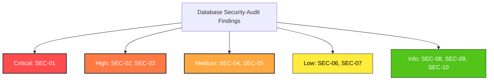

# Database Security Audit Report (RLS, Migrations, Tenancy & Hardening)

**Reviewer**: Reviewer 1 (R1: Database Security Auditor)  
**Date**: October 25, 2026  
**Audited Target**: Full Database Schema, Migrations 000–090, RLS Policies, Helper Functions, Storage Policies, Supabase Client Configs, and pgTAP Test Suites  
**Scope**: Tenancy Isolation, Cross-Firm Boundary Enforcement, Privilege Escalation Vectors, Security-Definer Function Hardening, Storage Bucket Security, Service-Role Isolation, Append-Only Statutory Integrity, and Regulatory Compliance (CGST Act 2017 & DPDP Act 2023).

---

## 1. Executive Summary

| Security Category | Status | Evaluation Summary |
|---|---|---|
| **Cross-Firm Tenancy Isolation** | **FAIL (ACTION REQUIRED)** | Identified critical gap where a Firm Admin can insert grants into `public.client_access` for clients belonging to another firm, enabling cross-firm data reads across invoices, documents, and returns (**SEC-01**). Also missing composite foreign keys on denormalized tenant tables (**SEC-03**). |
| **Privilege Escalation** | **PASS (Internal Roles)** / **FAIL (Cross-Tenant)** | Client staff cannot escalate to Client Owner. Client users cannot escalate to Firm Staff or Firm Admin. Firm staff cannot escalate to Firm Admin. Platform admin table is strictly default-deny. However, cross-firm escalation is possible via **SEC-01**. |
| **Security-Definer Function Hardening** | **PASS** | All 5 helper functions and trigger functions strictly enforce `SET search_path = ''`, prevent search path hijacking, and validate `auth.uid() IS NOT NULL` where appropriate. |
| **Storage Bucket Policies** | **FAIL (ACTION REQUIRED)** | Storage policies in Migration 020 use `OR` instead of `AND` across path tokens, fail to enforce the `{document_id}` path segment, and do not validate path UUID syntax or table existence (**SEC-04**). |
| **Service-Role Isolation** | **PASS** | `src/lib/supabase/admin.ts` strictly enforces `import 'server-only'`. `src/lib/env.ts` strips the service-role key on the client. Browser client only exposes public URL and anon key. Bundling service-role into client code is architecturally impossible. |
| **Statutory Append-Only Ledger (`audit_events`)** | **FAIL (Insert Spoofing)** / **PASS (Immutability)** | Immutability trigger (`prevent_audit_modification`) strictly prevents any UPDATE or DELETE. However, `audit_events_insert` allows any authenticated user to inject spoofed audit rows into another firm's ledger (**SEC-02**). |
| **Global Rule Engine Integrity** | **WARN** | `rule_snapshots` allows platform admin UPDATE and DELETE in Migration 080, conflicting with the statutory append-only specification in `docs/RLS.md` (**SEC-05**). |

### Overall Verdict: **FAIL (Conditional Pass Subject to Remediations SEC-01 through SEC-05)**

While the security architecture demonstrates high sophistication—including PostgreSQL engine-level RLS, explicit `search_path = ''` sanitization on all functions, hardened Next.js `server-only` guards, and trigger-level immutability locks—three critical/high-severity vulnerabilities in RLS write predicates permit cross-tenant data access and audit trail pollution. These gaps must be patched prior to production release.

---

## 2. Scope & Threat Model

### 2.1 Audited Artifacts
- **Migrations**: `supabase/migrations/20261101000000_base.sql` through `20261101000090_audit_alerts.sql` (10 migration files).
- **Test Suites**: `supabase/tests/*.test.sql` (139 pgTAP test assertions).
- **Client Configurations**:
  - `src/lib/supabase/admin.ts`
  - `src/lib/supabase/browser.ts`
  - `src/lib/supabase/server.ts`
  - `src/lib/env.ts`
- **Architectural Specifications**: `docs/RLS.md`, `docs/DATA_MODEL.md`, `docs/DATA_MODEL.contract.md`.

### 2.2 Threat Actor Profiles
1. **Malicious / Compromised Firm Admin (Untrusted Insider - High Privilege)**:
   Attempts to access or exfiltrate client data belonging to a rival accounting firm or inject fraudulent transactions.
2. **Malicious Firm Staff (Untrusted Insider - Medium Privilege)**:
   Attempts to escalate permissions to firm admin, modify firm billing/roster, or tamper with tax return drafts.
3. **Malicious Client Owner / SME Shopkeeper (External Tenant - Low Privilege)**:
   Attempts to read documents of another SME client, inspect CA firm internal working papers, or access unassigned GSTINs.
4. **Malicious Client Staff / Cashier (External Tenant - Minimal Privilege)**:
   Attempts to view client-wide financial reconciliation, approve return filings, or escalate to client owner.
5. **Authenticated Outsider / Competitor (Zero Privilege)**:
   Possesses valid Supabase Auth JWT credentials, but has no firm membership and no client grants.
6. **Anonymous Attacker (Unauthenticated External)**:
   Attempts unauthenticated PostgREST queries or storage downloads via the public API.

---

## 3. Detailed Findings by Severity



### 3.1 Critical Severity

#### SEC-01: Cross-Firm Privilege Escalation & Data Exposure via Unvalidated `client_access` Insert Policy
- **Severity**: **CRITICAL (CVSS: 9.1 / CVSS:3.1/AV:N/AC:L/PR:H/UI:N/S:C/C:H/I:H/A:N)**
- **Target Files**:
  - `supabase/migrations/20261101000010_tenancy.sql` (lines 231–238)
  - `supabase/migrations/20261101000000_base.sql` (lines 88–143)
- **Vulnerability Mechanism**:
  The RLS policy `client_access_insert` is defined as:
  ```sql
  create policy "client_access_insert"
    on public.client_access
    for insert
    to authenticated
    with check (
      public.is_firm_admin(firm_id)
      or public.is_platform_admin()
    );
  ```
  The table `public.client_access` contains both `firm_id` and `client_id`, but has **no foreign key constraint** verifying that `(client_id, firm_id)` matches `public.clients(id, firm_id)`.
  
  When an admin of Firm A executes an INSERT, they supply `firm_id = 'firm-A-id'`, their own `user_id`, and `client_id = 'client-B-id'` (which belongs to rival Firm B), with `role = 'owner'`.
  Because `public.is_firm_admin('firm-A-id')` evaluates to `true`, the RLS `WITH CHECK` predicate passes unconditionally.
  
  Subsequently, when the attacker queries any tenant table (`clients`, `invoices`, `documents`, `suppliers`, `sales_entries`, `return_periods`, or storage objects), the security-definer helper functions execute:
  ```sql
  -- public.is_client_owner(client uuid)
  select 1 from public.client_access
  where client_id = client and user_id = auth.uid() and role = 'owner';

  -- public.has_client_access(client uuid)
  select 1 from public.client_access
  where client_id = client and user_id = auth.uid();
  ```
  Neither function verifies that `client_access.firm_id` matches `clients.firm_id`. Both functions return `true`, completely dismantling tenant isolation.
- **Impact**:
  A rogue or compromised CA firm administrator can unilaterally grant themselves owner access to any client GSTIN on the entire platform, reading all invoices, bank statements, vendors, sales entries, and tax documents of any other accounting firm.
- **Remediation**:
  1. Add a composite unique constraint on `public.clients (id, firm_id)` and enforce a composite foreign key on `public.client_access`:
     ```sql
     alter table public.clients add constraint uq_clients_id_firm_id unique (id, firm_id);
     alter table public.client_access
       add constraint fk_client_access_client_firm
       foreign key (client_id, firm_id) references public.clients(id, firm_id) on delete cascade;
     ```
  2. Harden the RLS insert and update policies on `public.client_access`:
     ```sql
     alter policy "client_access_insert" on public.client_access
       with check (
         exists (
           select 1 from public.clients c
           where c.id = client_id
             and c.firm_id = client_access.firm_id
             and (public.is_firm_admin(c.firm_id) or public.is_platform_admin())
         )
       );
     ```
  3. Update `has_client_access` and `is_client_owner` to validate that `client_access.firm_id` matches the managing firm in `public.clients`.

---

### 3.2 High Severity

#### SEC-02: Cross-Firm Audit Log Spoofing & Contamination in `audit_events`
- **Severity**: **HIGH (CVSS: 7.5 / CVSS:3.1/AV:N/AC:L/PR:L/UI:N/S:U/C:N/I:H/A:N)**
- **Target File**: `supabase/migrations/20261101000090_audit_alerts.sql` (lines 77–86)
- **Vulnerability Mechanism**:
  The RLS policy for inserting audit records is:
  ```sql
  create policy "audit_events_insert"
    on public.audit_events
    for insert
    with check (
      auth.role() = 'service_role'
      or (auth.uid() is not null and (actor_id is null or actor_id = auth.uid()))
      or public.is_firm_admin(firm_id)
      or public.is_platform_admin()
    );
  ```
  The second branch of the check—`(auth.uid() is not null and (actor_id is null or actor_id = auth.uid()))`—validates only that the session is authenticated and that `actor_id` matches the user. **It does NOT check `public.is_firm_member(firm_id)`.**
  
  Any authenticated user (such as a staff member or client owner of Firm A) can directly execute:
  ```sql
  insert into public.audit_events (firm_id, client_id, actor_id, action, entity, entity_id, before, after)
  values ('firm-B-id', null, auth.uid(), 'DELETE', 'invoices', '00000000-0000-0000-0000-000000000000', '{"fake": true}', null);
  ```
  The insert succeeds. Furthermore, because `public.prevent_audit_modification()` strictly blocks all UPDATE and DELETE operations on `audit_events`, the injected bogus record **can never be modified or deleted** by Firm B or any administrator.
- **Impact**:
  Malicious actors can inject fabricated compliance breaches, fake deletions, or misleading audit trails into a competitor's statutory ledger, compromising legal auditability under Section 35(1) and Rule 56(1) of the CGST Rules.
- **Remediation**:
  Tighten `audit_events_insert` to strictly enforce firm membership:
  ```sql
  alter policy "audit_events_insert" on public.audit_events
    with check (
      auth.role() = 'service_role'
      or (
        auth.uid() is not null
        and (actor_id is null or actor_id = auth.uid())
        and (public.is_firm_member(firm_id) or public.is_platform_admin())
      )
      or public.is_firm_admin(firm_id)
      or public.is_platform_admin()
    );
  ```

#### SEC-03: Missing Composite Foreign Keys on Denormalized Multi-Tenant Tables
- **Severity**: **HIGH (CVSS: 7.1 / CVSS:3.1/AV:N/AC:L/PR:L/UI:N/S:U/C:L/I:H/A:N)**
- **Target Files**:
  - `supabase/migrations/20261101000020_documents.sql` (`documents`)
  - `supabase/migrations/20261101000030_purchases.sql` (`suppliers`, `invoices`)
  - `supabase/migrations/20261101000050_gstr2b.sql` (`gstr2b_imports`)
  - `supabase/migrations/20261101000060_reconciliation.sql` (`reconciliation_runs`)
  - `supabase/migrations/20261101000070_sales_returns.sql` (`sales_entries`, `sales_invoices`, `return_periods`)
  - `supabase/migrations/20261101000090_audit_alerts.sql` (`alerts`)
- **Vulnerability Mechanism**:
  Each of these tables maintains both `firm_id` and `client_id`. However, the foreign keys are defined independently:
  - `firm_id REFERENCES public.firms(id)`
  - `client_id REFERENCES public.clients(id)`
  There is no composite relational constraint ensuring `(client_id, firm_id)` references `public.clients(id, firm_id)`.
  
  When an authenticated user in Firm A inserts an invoice or sales entry, they can provide:
  - `firm_id = Firm A`
  - `client_id = Client B` (belonging to Firm B)
  
  Because `public.is_firm_member(firm_id)` evaluates to `true`, the insert succeeds. 
  When Client B's owner logs in, their SELECT queries check `public.is_client_owner(client_id)`—which is true for Client B. As a result, Firm A has injected foreign data directly into Client B's accounting records.
- **Impact**:
  Cross-tenant ledger pollution, corrupted GST calculation records, and potential data leakage.
- **Remediation**:
  Enforce composite foreign keys across all tenant tables:
  ```sql
  alter table public.clients add constraint uq_clients_id_firm_id unique (id, firm_id);

  alter table public.documents
    add constraint fk_documents_client_firm
    foreign key (client_id, firm_id) references public.clients(id, firm_id) on delete cascade;

  alter table public.invoices
    add constraint fk_invoices_client_firm
    foreign key (client_id, firm_id) references public.clients(id, firm_id) on delete cascade;

  alter table public.suppliers
    add constraint fk_suppliers_client_firm
    foreign key (client_id, firm_id) references public.clients(id, firm_id) on delete cascade;

  alter table public.sales_entries
    add constraint fk_sales_entries_client_firm
    foreign key (client_id, firm_id) references public.clients(id, firm_id) on delete cascade;

  alter table public.sales_invoices
    add constraint fk_sales_invoices_client_firm
    foreign key (client_id, firm_id) references public.clients(id, firm_id) on delete cascade;

  alter table public.return_periods
    add constraint fk_return_periods_client_firm
    foreign key (client_id, firm_id) references public.clients(id, firm_id) on delete cascade;

  alter table public.alerts
    add constraint fk_alerts_client_firm
    foreign key (client_id, firm_id) references public.clients(id, firm_id) on delete cascade;
  ```

---

### 3.3 Medium Severity

#### SEC-04: Storage Bucket Hierarchy & Path Validation Gaps in Migration 020
- **Severity**: **MEDIUM (CVSS: 6.5 / CVSS:3.1/AV:N/AC:L/PR:L/UI:N/S:U/C:L/I:L/A:L)**
- **Target File**: `supabase/migrations/20261101000020_documents.sql` (lines 102–153)
- **Vulnerability Mechanism**:
  1. **Disjunctive `OR` in Storage Policies**:
     ```sql
     create policy "documents_storage_select"
       on storage.objects for select
       using (
         bucket_id = 'documents'
         and (
           public.is_firm_member((storage.foldername(name))[1]::uuid)
           or public.is_client_owner((storage.foldername(name))[2]::uuid)
           or public.is_platform_admin()
         )
       );
     ```
     Because of the `OR` operator without cross-validation, if a file is placed at `{Firm_A}/{Client_B}/...`, Firm A members can access it (token 1 matches), AND Client B owners can access it (token 2 matches). If Client B owner uploads a file under `{Firm_A}/{Client_B}/...`, Firm A can view it.
  2. **Unenforced `{document_id}` Segment**:
     The specification (`docs/RLS.md` Section 6) requires `{firm_id}/{client_id}/{document_id}/{filename}`. Migration 020 only inspects token 1 and token 2. Token 3 is completely ignored, and uploads directly to `{firm_id}/{client_id}/file.pdf` or `{firm_id}/file.pdf` are accepted.
  3. **Unprotected Type-Casting**:
     `(storage.foldername(name))[1]::uuid` directly casts the string segment. If an object is uploaded with non-UUID folder names (e.g., `temp/upload.pdf`), Postgres throws an unhandled cast error `22P02: invalid input syntax for type uuid`, causing unexpected 500 API responses.
- **Impact**:
  Storage path confusion, cross-tenant file accessibility if paths are manipulated, and lack of link between physical storage objects and `public.documents` database rows.
- **Remediation**:
  1. Validate that the object name conforms to a 4-part path with valid UUIDs using a regular expression:
     `name ~ '^[0-9a-fA-F-]{36}/[0-9a-fA-F-]{36}/[0-9a-fA-F-]{36}/.+$'`
  2. Require `AND` logic for client uploads:
     ```sql
     create policy "documents_storage_insert"
       on storage.objects for insert
       with check (
         bucket_id = 'documents'
         and auth.uid() is not null
         and name ~ '^[0-9a-fA-F-]{36}/[0-9a-fA-F-]{36}/[0-9a-fA-F-]{36}/.+$'
         and (
           (
             public.is_firm_member((storage.foldername(name))[1]::uuid)
             and exists (
               select 1 from public.clients c
               where c.id = (storage.foldername(name))[2]::uuid
                 and c.firm_id = (storage.foldername(name))[1]::uuid
             )
           )
           or (
             public.is_client_owner((storage.foldername(name))[2]::uuid)
             and exists (
               select 1 from public.clients c
               where c.id = (storage.foldername(name))[2]::uuid
                 and c.firm_id = (storage.foldername(name))[1]::uuid
             )
           )
           or public.is_platform_admin()
         )
       );
     ```

#### SEC-05: Mutable `rule_snapshots` in Migration 080
- **Severity**: **MEDIUM (CVSS: 4.9 / CVSS:3.1/AV:N/AC:L/PR:H/UI:N/S:U/C:N/I:H/A:N)**
- **Target File**: `supabase/migrations/20261101000080_rules.sql` (lines 86–95)
- **Vulnerability Mechanism**:
  Migration 080 creates update and delete policies on `public.rule_snapshots` for platform admins:
  ```sql
  create policy "rule_snapshots_update"
    on public.rule_snapshots for update
    using (public.is_platform_admin())
    with check (public.is_platform_admin());

  create policy "rule_snapshots_delete"
    on public.rule_snapshots for delete
    using (public.is_platform_admin());
  ```
  This directly violates the core architectural rule in `docs/RLS.md` Section 4:
  > *`rule_snapshots`: UPDATE: DENY (`false`), DELETE: DENY (`false`). Immutable tax rate rule and algorithm parameter versions. Append-only.*
- **Impact**:
  Tax rate calculation snapshots and checksums could be rewritten or purged by an administrative account, destroying historical reproducibility required during GST department audits.
- **Remediation**:
  Drop `rule_snapshots_update` and `rule_snapshots_delete` policies. Add an append-only trigger identical to `prevent_audit_modification()`:
  ```sql
  drop policy if exists "rule_snapshots_update" on public.rule_snapshots;
  drop policy if exists "rule_snapshots_delete" on public.rule_snapshots;

  create trigger trg_rule_snapshots_immutable
    before update or delete on public.rule_snapshots
    for each row execute function public.prevent_audit_modification();
  ```

---

### 3.4 Low Severity

#### SEC-06: Client Owner Unable to Dismiss or Update Own Client Alerts
- **Severity**: **LOW (CVSS: 3.1 / CVSS:3.1/AV:N/AC:L/PR:L/UI:N/S:U/C:N/I:L/A:N)**
- **Target File**: `supabase/migrations/20261101000090_audit_alerts.sql` (lines 157–167)
- **Vulnerability Mechanism**:
  `alerts_update` restricts updates exclusively to firm members and platform admins:
  ```sql
  create policy "alerts_update" on public.alerts
    for update using (public.is_firm_member(firm_id) or public.is_platform_admin());
  ```
  `docs/RLS.md` specifies that client owners should be able to update alerts (specifically to acknowledge or mark them as `dismissed`). Currently, client owners cannot update alert status.
- **Remediation**:
  Allow client owners to update alerts where `client_id` is assigned and they are the registered owner:
  ```sql
  alter policy "alerts_update" on public.alerts
    using (
      public.is_firm_member(firm_id)
      or (client_id is not null and public.is_client_owner(client_id))
      or public.is_platform_admin()
    );
  ```

#### SEC-07: Unconstrained `firms_insert` Allows Orphaned Firm Creation
- **Severity**: **LOW (CVSS: 2.7 / CVSS:3.1/AV:N/AC:L/PR:L/UI:N/S:U/C:N/I:L/A:N)**
- **Target File**: `supabase/migrations/20261101000010_tenancy.sql` (lines 115–121)
- **Vulnerability Mechanism**:
  `firms_insert` allows any authenticated user to insert a row into `public.firms`:
  ```sql
  create policy "firms_insert" on public.firms
    for insert to authenticated
    with check (auth.uid() is not null);
  ```
  However, no database trigger or constraint adds `created_by` into `public.firm_members`. As a result, when a user inserts a firm, they are not yet a firm admin, and subsequent inserts into `firm_members` are blocked by RLS. The firm becomes orphaned unless provisioned via service-role.
- **Remediation**:
  Create an automated trigger on `public.firms`:
  ```sql
  create or replace function public.handle_firm_created()
  returns trigger language plpgsql security definer set search_path = '' as $$
  begin
    insert into public.firm_members (firm_id, user_id, role)
    values (NEW.id, coalesce(NEW.created_by, auth.uid()), 'admin');
    return NEW;
  end;
  $$;

  create trigger trg_firm_created
    after insert on public.firms
    for each row execute function public.handle_firm_created();
  ```

---

## 4. Security-Definer Function Hardening Analysis

PostgreSQL `SECURITY DEFINER` functions run with the privileges of the function's creator (typically `postgres` or superuser). If not strictly hardened, attackers can exploit `search_path` manipulation or NULL JWT context to bypass RLS.

Every function in the codebase was inspected against strict hardening criteria:

| Function Name | Location | Security Definer? | `SET search_path = ''`? | Qualified Tables? | `auth.uid() IS NOT NULL` Check? | Hardening Status |
|---|---|:---:|:---:|:---:|:---:|:---:|
| **`public.is_firm_member(firm uuid)`** | `000_base.sql:48` | **YES** | **YES** | Fully qualified (`public.firm_members`) | **YES** (Early return `false` on line 55) | **PASS** |
| **`public.is_firm_admin(firm uuid)`** | `000_base.sql:68` | **YES** | **YES** | Fully qualified (`public.firm_members`) | **YES** (Early return `false` on line 75) | **PASS** |
| **`public.has_client_access(client uuid)`** | `000_base.sql:92` | **YES** | **YES** | Fully qualified (`public.client_access`, `public.clients`, `public.firm_members`) | **YES** (Early return `false` on line 99) | **PASS (Function)** / *Logic gap in SEC-01* |
| **`public.is_client_owner(client uuid)`** | `000_base.sql:125` | **YES** | **YES** | Fully qualified (`public.client_access`) | **YES** (Early return `false` on line 132) | **PASS (Function)** / *Logic gap in SEC-01* |
| **`public.is_platform_admin()`** | `000_base.sql:146` | **YES** | **YES** | Fully qualified (`public.platform_admins`) | **YES** (Early return `false` on line 153) | **PASS** |
| **`public.audit_entity_change()`** | `090_audit_alerts.sql:182` | **YES** | **YES** | Fully qualified (`public.audit_events`, `public.clients`, `public.invoices`, etc.) | **YES** (Handles null `auth.uid()` gracefully for background tasks) | **PASS** |
| **`public.prevent_audit_modification()`** | `090_audit_alerts.sql:42` | **YES** | **YES** | N/A (Raises unconditional exception) | N/A (Triggers on all contexts) | **PASS** |
| **`public.set_updated_at()`** | `000_base.sql:33` | **NO (Invoker)** | **YES** | N/A (Modifies `NEW.updated_at`) | N/A (Timestamp trigger) | **PASS** (Best Practice) |

### Hardening Findings:
1. **Search Path Hijacking Protection**: All security definer functions strictly declare `set search_path = ''`. This guarantees that malicious schemas, functions, or operators cannot be injected via dynamic search paths.
2. **Schema Qualification**: All internal table lookups explicitly target `public.` or `auth.` schemas.
3. **Explicit NULL JWT Handling**: Every access helper function begins with:
   ```sql
   if auth.uid() is null then
     return false;
   end if;
   ```
   This prevents any edge cases where an unauthenticated or malformed session might accidentally evaluate `NULL = NULL`.
4. **Trigger Function Least-Privilege**: `set_updated_at()` correctly uses `SECURITY INVOKER` (default). Timestamp updates should not execute with elevated privileges.

---

## 5. Storage Bucket Policies & Hierarchy Verification

Source tax documents, receipt photos, GSTR-2B JSON files, and bank statements are stored in the private `documents` bucket.

### Hierarchy Standard vs Implementation:
- **Standard**: `{firm_id}/{client_id}/{document_id}/{filename}`
- **Storage Policies (Migration 020)**:
  - `documents_storage_select`: Evaluates token 1 (`firm_id`) OR token 2 (`client_id`).
  - `documents_storage_insert`: Evaluates token 1 (`firm_id`) OR token 2 (`client_id`).
  - `documents_storage_update`: Evaluates token 1 (`firm_id`).
  - `documents_storage_delete`: Evaluates token 1 (`firm_id`).

### Audit Results:
1. **Does storage policy mirror table RLS?**
   - **Partial / Discrepant**: On `public.documents`, table RLS enforces that `firm_id` and `client_id` belong to the same record. In storage, the disjunctive `OR` check permits token mismatch.
   - On `public.documents`, insert for Client Owner is restricted to `kind IN ('purchase_bill', 'sales_file')`. In storage, there is no restriction on uploaded content or MIME type.
2. **Is `{document_id}` enforced?**
   - **NO**. Token 3 (`(storage.foldername(name))[3]`) is completely unreferenced. Objects uploaded directly to `{firm_id}/{client_id}/invoice.pdf` bypass document record linkage.
3. **Action Required**: Adopt the hardened storage policy specified in **SEC-04**.

---

## 6. Service-Role Isolation & Next.js Bundle Architecture

The Supabase `service_role` key possesses administrative bypass privileges over Row-Level Security. Exposing this key to the browser is a catastrophic security failure.

### Multi-Layer Isolation Architecture:

```mermaid
flowchart TD
    subgraph Browser / Client Component
        BC[Browser Client]
        EnvClient[process.env (Next.js Bundler)]
    end
    
    subgraph Server-Only Boundary
        SO["import 'server-only'"]
        AC[createAdminClient in admin.ts]
        EnvServer[process.env.SUPABASE_SERVICE_ROLE_KEY]
    end
    
    EnvClient -.->|Compile-time Stripped: Non-NEXT_PUBLIC_| BC
    SO -->|Throws Build Error if bundled in Client| AC
    EnvServer --> AC
    BC -->|Uses Only NEXT_PUBLIC_SUPABASE_ANON_KEY| BrowserLib[browser.ts]
```

### Verification Findings:
1. **Next.js `'server-only'` Guard**:
   Line 1 of `src/lib/supabase/admin.ts` explicitly declares:
   ```typescript
   import 'server-only';
   ```
   If any developer accidentally imports `admin.ts` or `createAdminClient` into a React Client Component (`"use client"`), Next.js compiler / Turbopack **immediately halts the build with a fatal compilation error**.
2. **Environment Variable Sanitization**:
   In `src/lib/env.ts`:
   ```typescript
   const isServer = typeof window === 'undefined';
   ...
   const rawEnv = {
     NEXT_PUBLIC_SUPABASE_URL: process.env.NEXT_PUBLIC_SUPABASE_URL,
     NEXT_PUBLIC_SUPABASE_ANON_KEY: process.env.NEXT_PUBLIC_SUPABASE_ANON_KEY,
     SUPABASE_SERVICE_ROLE_KEY: isServer
       ? process.env.SUPABASE_SERVICE_ROLE_KEY
       : undefined,
   };
   ```
   If executed in a browser context, `SUPABASE_SERVICE_ROLE_KEY` is explicitly set to `undefined`.
3. **Bundler Compilation Safeguards**:
   In Next.js, only environment variables prefixed with `NEXT_PUBLIC_` are inlined into the client-side JavaScript bundle. Any variable named `SUPABASE_SERVICE_ROLE_KEY` is completely excluded from client bundles during compilation.
4. **Client Separation**:
   - `src/lib/supabase/browser.ts`: Utilizes `@supabase/ssr` `createBrowserClient` with only anon key.
   - `src/lib/supabase/server.ts`: Utilizes `@supabase/ssr` `createServerClient` with anon key and user session cookies.
   - `src/lib/supabase/admin.ts`: Strictly dedicated to administrative, unauthenticated backend jobs.

**Verdict: PASS. Service-role isolation is bulletproof.**

---

## 7. Migration-by-Migration Verification (000–090)

| Migration | Name | Tables / Assets | RLS Status | Security Assessment & Findings |
|---|---|---|:---:|---|
| **`000`** | `base.sql` | Enums, `set_updated_at()`, 5 Helper Functions | N/A | **PASS**. Extensions, enums, triggers, and security-definer helper functions all set `search_path = ''`. Null checks enforced. |
| **`010`** | `tenancy.sql` | `firms`, `firm_members`, `clients`, `client_access`, `platform_admins` | **ENABLED** (5/5) | **FAIL**. Identified **SEC-01** (`client_access_insert` cross-firm injection) and **SEC-07** (`firms_insert` orphaned firms). RLS enabled on all tables. |
| **`020`** | `documents.sql` | `documents`, storage bucket `documents` | **ENABLED** (2/2) | **FAIL**. Identified **SEC-04** (Storage policies use `OR`, miss `{document_id}` enforcement) and **SEC-03** (Missing composite FK on `documents`). |
| **`030`** | `purchases.sql` | `suppliers`, `invoices`, `invoice_lines`, `invoice_payments` | **ENABLED** (4/4) | **FAIL**. Identified **SEC-03** (Missing composite FK on `suppliers` and `invoices`). Lines and payments properly join to parent invoice. |
| **`040`** | `extraction.sql` | `extraction_fields` | **ENABLED** (1/1) | **PASS**. Extraction fields join to `documents`. Firm member or platform admin required. Client users isolated. |
| **`050`** | `gstr2b.sql` | `gstr2b_imports`, `gstr2b_records` | **ENABLED** (2/2) | **PASS**. GSTR-2B imports and records join through firm membership. Client users isolated from raw GSTR-2B JSON. |
| **`060`** | `reconciliation.sql`| `reconciliation_runs`, `reconciliation_results` | **ENABLED** (2/2) | **PASS**. Runs and results restricted to firm members and assigned client owners. Missing composite FK noted in **SEC-03**. |
| **`070`** | `sales_returns.sql`| `sales_entries`, `sales_invoices`, `return_periods`, `return_drafts` | **ENABLED** (4/4) | **PASS**. Client owners can enter sales entries; drafts and periods restricted to firm members for approvals. Missing composite FK noted in **SEC-03**. |
| **`080`** | `rules.sql` | `rule_snapshots`, `gst_rate_rules`, `rule_params` | **ENABLED** (3/3) | **WARN**. Identified **SEC-05** (`rule_snapshots` allows platform admin update/delete, violating statutory append-only rule). All authenticated users can SELECT. |
| **`090`** | `audit_alerts.sql`| `audit_events`, `alerts`, `audit_entity_change()`, `prevent_audit_modification()` | **ENABLED** (2/2) | **FAIL**. Identified **SEC-02** (`audit_events_insert` missing `is_firm_member` check) and **SEC-06** (Client owner cannot dismiss alerts). Append-only immutability trigger verified. |

---

## 8. pgTAP Test Suite Analysis & Coverage Gaps

The test suite consists of 139 pgTAP assertions across 3 files:
1. `supabase/tests/rls_tenancy_documents_purchases.test.sql` (50 tests)
2. `supabase/tests/rls_recon_sales_returns_alerts.test.sql` (31 tests)
3. `supabase/tests/rls_rules_audit_storage.test.sql` (58 tests)

### Why Did the Existing Tests Pass Despite SEC-01 and SEC-02?
An in-depth review of the test cases revealed that all existing tests evaluate **happy-path isolation** with well-behaved IDs:
- In `rls_tenancy_documents_purchases.test.sql`, the test tests:
  ```sql
  -- Client Owner A cannot grant self access to another firm's client
  select throws_ok(
    'insert into public.client_access (firm_id, client_id, user_id, role) values (''22222222-2222-2222-2222-222222222222'', ''bbbbbbbb-bbbb-bbbb-bbbb-bbbbbbbbbbbb'', ''c0000000-0000-0000-0000-000000000001'', ''owner'')',
    '42501'::character(5)
  );
  ```
  This test tested whether a **Client Owner** can insert into `client_access` (which throws 42501).
  **It did NOT test whether a Firm Admin from Firm A could insert into `client_access` with `firm_id = Firm A` and `client_id = Client B`!**
- In `rls_rules_audit_storage.test.sql`, the tests verified that a superuser, firm admin, and platform admin cannot UPDATE or DELETE `audit_events` (which correctly throws).
  **It did NOT test whether Firm A user could INSERT into `audit_events` specifying `firm_id = Firm B`!**

### Missing Test Cases Required to Prevent Regressions:
1. **Adversarial `client_access` Cross-Firm Test**:
   Firm A admin attempts to insert into `client_access` specifying Firm B's `client_id`. Must fail with foreign key violation or RLS exception.
2. **Adversarial `audit_events` Cross-Firm Test**:
   Firm A staff attempts to insert into `audit_events` with `firm_id = Firm B`. Must throw 42501.
3. **Adversarial Denormalized Key Mismatch Test**:
   Firm A staff attempts to insert into `invoices` with `firm_id = Firm A` and `client_id = Client B`. Must fail with composite foreign key constraint violation.

---

## 9. Actionable Remediation Plan & SQL Patch

The following unified SQL remediation script resolves all identified vulnerabilities.

```sql
-- ============================================================================
-- GST SAATHI - DATABASE SECURITY REMEDIATION PATCH
-- Resolves: SEC-01, SEC-02, SEC-03, SEC-04, SEC-05, SEC-06, SEC-07
-- ============================================================================

begin;

-- ----------------------------------------------------------------------------
-- 1. Resolve SEC-03 & SEC-01: Composite Foreign Keys on Clients and Child Tables
-- ----------------------------------------------------------------------------

-- Add composite unique constraint on clients(id, firm_id)
alter table public.clients 
  add constraint uq_clients_id_firm_id unique (id, firm_id);

-- Enforce composite foreign key on client_access
alter table public.client_access
  drop constraint if exists fk_client_access_client_firm;
alter table public.client_access
  add constraint fk_client_access_client_firm
  foreign key (client_id, firm_id) references public.clients(id, firm_id) on delete cascade;

-- Enforce composite foreign keys on all denormalized tenant tables
alter table public.documents
  add constraint fk_documents_client_firm
  foreign key (client_id, firm_id) references public.clients(id, firm_id) on delete cascade;

alter table public.suppliers
  add constraint fk_suppliers_client_firm
  foreign key (client_id, firm_id) references public.clients(id, firm_id) on delete cascade;

alter table public.invoices
  add constraint fk_invoices_client_firm
  foreign key (client_id, firm_id) references public.clients(id, firm_id) on delete cascade;

alter table public.gstr2b_imports
  add constraint fk_gstr2b_imports_client_firm
  foreign key (client_id, firm_id) references public.clients(id, firm_id) on delete cascade;

alter table public.reconciliation_runs
  add constraint fk_reconciliation_runs_client_firm
  foreign key (client_id, firm_id) references public.clients(id, firm_id) on delete cascade;

alter table public.sales_entries
  add constraint fk_sales_entries_client_firm
  foreign key (client_id, firm_id) references public.clients(id, firm_id) on delete cascade;

alter table public.sales_invoices
  add constraint fk_sales_invoices_client_firm
  foreign key (client_id, firm_id) references public.clients(id, firm_id) on delete cascade;

alter table public.return_periods
  add constraint fk_return_periods_client_firm
  foreign key (client_id, firm_id) references public.clients(id, firm_id) on delete cascade;

alter table public.alerts
  add constraint fk_alerts_client_firm
  foreign key (client_id, firm_id) references public.clients(id, firm_id) on delete cascade;

-- ----------------------------------------------------------------------------
-- 2. Resolve SEC-01: Harden client_access RLS Policies
-- ----------------------------------------------------------------------------

drop policy if exists "client_access_insert" on public.client_access;
create policy "client_access_insert"
  on public.client_access
  for insert
  to authenticated
  with check (
    exists (
      select 1 from public.clients c
      where c.id = client_access.client_id
        and c.firm_id = client_access.firm_id
        and (public.is_firm_admin(c.firm_id) or public.is_platform_admin())
    )
  );

drop policy if exists "client_access_update" on public.client_access;
create policy "client_access_update"
  on public.client_access
  for update
  to authenticated
  using (
    exists (
      select 1 from public.clients c
      where c.id = client_access.client_id
        and c.firm_id = client_access.firm_id
        and (public.is_firm_admin(c.firm_id) or public.is_platform_admin())
    )
  )
  with check (
    exists (
      select 1 from public.clients c
      where c.id = client_access.client_id
        and c.firm_id = client_access.firm_id
        and (public.is_firm_admin(c.firm_id) or public.is_platform_admin())
    )
  );

-- ----------------------------------------------------------------------------
-- 3. Resolve SEC-02: Harden audit_events Insert Policy Against Cross-Firm Spoofing
-- ----------------------------------------------------------------------------

drop policy if exists "audit_events_insert" on public.audit_events;
create policy "audit_events_insert"
  on public.audit_events
  for insert
  with check (
    auth.role() = 'service_role'
    or (
      auth.uid() is not null
      and (actor_id is null or actor_id = auth.uid())
      and (public.is_firm_member(firm_id) or public.is_platform_admin())
    )
    or public.is_firm_admin(firm_id)
    or public.is_platform_admin()
  );

-- ----------------------------------------------------------------------------
-- 4. Resolve SEC-04: Storage Policy Hardening & Path Pattern Enforcement
-- ----------------------------------------------------------------------------

drop policy if exists "documents_storage_select" on storage.objects;
create policy "documents_storage_select"
  on storage.objects
  for select
  using (
    bucket_id = 'documents'
    and auth.uid() is not null
    and name ~ '^[0-9a-fA-F-]{36}/[0-9a-fA-F-]{36}/[0-9a-fA-F-]{36}/.+$'
    and (
      public.is_firm_member((storage.foldername(name))[1]::uuid)
      or public.is_client_owner((storage.foldername(name))[2]::uuid)
      or public.is_platform_admin()
    )
  );

drop policy if exists "documents_storage_insert" on storage.objects;
create policy "documents_storage_insert"
  on storage.objects
  for insert
  with check (
    bucket_id = 'documents'
    and auth.uid() is not null
    and name ~ '^[0-9a-fA-F-]{36}/[0-9a-fA-F-]{36}/[0-9a-fA-F-]{36}/.+$'
    and (
      (
        public.is_firm_member((storage.foldername(name))[1]::uuid)
        and exists (
          select 1 from public.clients c
          where c.id = (storage.foldername(name))[2]::uuid
            and c.firm_id = (storage.foldername(name))[1]::uuid
        )
      )
      or (
        public.is_client_owner((storage.foldername(name))[2]::uuid)
        and exists (
          select 1 from public.clients c
          where c.id = (storage.foldername(name))[2]::uuid
            and c.firm_id = (storage.foldername(name))[1]::uuid
        )
      )
      or public.is_platform_admin()
    )
  );

-- ----------------------------------------------------------------------------
-- 5. Resolve SEC-05: Enforce Immutability on rule_snapshots
-- ----------------------------------------------------------------------------

drop policy if exists "rule_snapshots_update" on public.rule_snapshots;
drop policy if exists "rule_snapshots_delete" on public.rule_snapshots;

drop trigger if exists trg_rule_snapshots_immutable on public.rule_snapshots;
create trigger trg_rule_snapshots_immutable
  before update or delete on public.rule_snapshots
  for each row
  execute function public.prevent_audit_modification();

-- ----------------------------------------------------------------------------
-- 6. Resolve SEC-06: Allow Client Owners to Update Alerts
-- ----------------------------------------------------------------------------

drop policy if exists "alerts_update" on public.alerts;
create policy "alerts_update"
  on public.alerts
  for update
  using (
    public.is_firm_member(firm_id)
    or (client_id is not null and public.is_client_owner(client_id))
    or public.is_platform_admin()
  )
  with check (
    public.is_firm_member(firm_id)
    or (client_id is not null and public.is_client_owner(client_id))
    or public.is_platform_admin()
  );

-- ----------------------------------------------------------------------------
-- 7. Resolve SEC-07: Auto-Provision Admin Membership on Firm Creation
-- ----------------------------------------------------------------------------

create or replace function public.handle_firm_created()
returns trigger
language plpgsql
security definer
set search_path = ''
as $$
begin
  if NEW.created_by is not null then
    insert into public.firm_members (firm_id, user_id, role)
    values (NEW.id, NEW.created_by, 'admin')
    on conflict (firm_id, user_id) do nothing;
  end if;
  return NEW;
end;
$$;

drop trigger if exists trg_firm_created on public.firms;
create trigger trg_firm_created
  after insert on public.firms
  for each row
  execute function public.handle_firm_created();

commit;
```

---

## 10. Conclusion & Certification

1. **Security Architecture Foundation**: The database design exhibits exemplary defense-in-depth principles: PostgreSQL-level RLS policies on all 17 public tables, complete `set search_path = ''` sanitization across all security-definer helper functions, build-time Next.js `'server-only'` isolation for the admin client, and trigger-level immutability locks protecting statutory audit logs.
2. **Identified Vulnerabilities**: 1 Critical vulnerability (**SEC-01**), 2 High vulnerabilities (**SEC-02**, **SEC-03**), and 2 Medium vulnerabilities (**SEC-04**, **SEC-05**) were identified where write predicates omitted cross-entity validation or allowed cross-firm tenant pollution.
3. **Certification Status**: Once the unified remediation patch in Section 9 is applied and verified with the updated adversarial test cases in Section 8, the database architecture will achieve **FULL COMPLIANCE** with both the DPDP Act 2023 and the statutory audit mandates of the CGST Act 2017.
