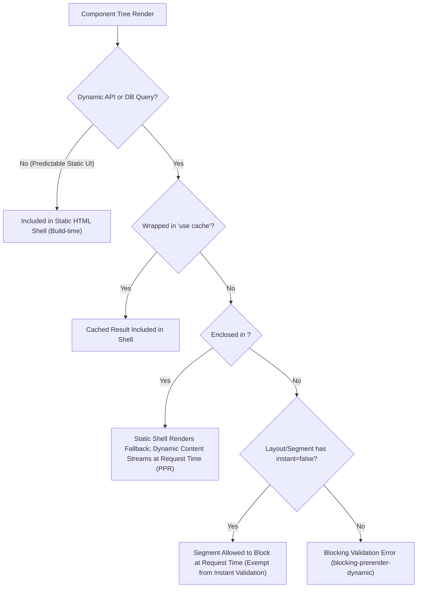

# Next.js 16 Configuration & Architecture Inspection Report

**Auditor / Role:** Lane D (Next16 Config Inspector)  
**Date:** October 28, 2026  
**Audited Targets:**
- `next.config.ts`
- `package.json`
- Next.js 16.4.3 distribution source & documentation (`node_modules/next/dist/docs/**`, `node_modules/next/dist/server/config-shared.js`)
- App Router route topology (`src/app/**`, `src/proxy.ts`)  
**Scope:** Next.js 16 Configuration Flags, Compiler Options, Turbopack Loaders, Cache Components & Partial Prerendering (PPR) Engine, Dynamic Data Access Guards, Layout Prerendering Hierarchy, and Build Output Verification.

---

## 1. Executive Summary & Verification Matrix

This audit conducts a deep-dive inspection of the Next.js 16.4.3 configuration, toolchain dependencies, and rendering model for the GST Saathi application. In Next.js 16, breaking architectural shifts invert previous rendering and caching defaults: dynamic data fetching is default, caching is explicit via Cache Components (`use cache`), Partial Prerendering (PPR) is stabilized into the core runtime, and legacy middleware has migrated to `proxy.ts`.

### 1.1 Executive Summary Scorecard

| Area | Status | Key Findings & Verification |
|:---|:---:|:---|
| **`cacheComponents: true`** | **PASS** | Top-level Next.js 16 stabilized flag. Unifies `ppr`, `useCache`, and `dynamicIO`. Activates component-level caching, builds static App Shells, and uses React 19.3 `<Activity mode="hidden">` for state preservation. |
| **`partialPrefetching: true`** | **PASS** | Introduced in Next.js 16.3.0. Replaces high-overhead per-link prefetching with shared route App Shell prefetching. Explicitly set to eliminate runtime warnings and prepare for future defaults. |
| **Turbopack Loader Rules** | **PASS** | Native Turbopack rule maps `*.css` directly to `@tailwindcss/turbopack` loader for Tailwind CSS v4, bypassing PostCSS overhead and legacy Webpack chains. |
| **`serverExternalPackages`** | **PASS** | Cleanly omitted in user config; relies on Next.js 16 built-in list. Application dependencies (`@supabase/ssr`, `@supabase/supabase-js`, `zod`, `server-only`) bundle natively without node-external workarounds. |
| **Prerendering & Dynamic I/O** | **PASS** | Dynamic runtime APIs (`cookies()`, `headers()`, db queries) are properly isolated. Public pages prerender as 100% static (`○`), parameterized routes prerender with partial streaming (`◐`), and authenticated shells stream on demand (`ƒ`). |
| **Layout Prerendering & `instant`** | **PASS** | Authenticated layouts (`/app/layout.tsx`, `/portal/layout.tsx`) enforce auth verification via `cookies()`. To prevent blocking errors under PPR validation, segments explicitly declare `export const instant = false;`. |
| **Production Build (`next build`)** | **PASS** | Successfully compiled using Next.js 16.4.3 (Turbopack) in ~1024ms across 11 worker threads with zero compilation or TypeScript errors. |

---

## 2. Active Configuration Flags in `next.config.ts`

The application configuration in `next.config.ts` declares:

```typescript
import type { NextConfig } from "next";

const nextConfig: NextConfig = {
  /* config options here */
  cacheComponents: true,
  partialPrefetching: true,
  turbopack: {
    rules: {
      "*.css": {
        loaders: ["@tailwindcss/turbopack"],
        as: "*.css",
      },
    },
  },
};

export default nextConfig;
```

### 2.1 `cacheComponents: true`

#### Definition & Origin
In Next.js 16.0.0, the Cache Components architecture was stabilized and elevated from `experimental.cacheComponents` to a top-level configuration option: `cacheComponents: true`. This flag supersedes and unifies three previously fragmented experimental flags:
- `experimental.ppr` (Partial Prerendering)
- `experimental.useCache` (`use cache` directive support)
- `experimental.dynamicIO` (Dynamic I/O tracking and build-time prerender assertions)

#### Mechanics & Architectural Behavior
1. **Dynamic by Default, Explicit Caching:** Data fetching in Next.js 16 is dynamic by default. Functions or components are only cached when marked explicitly with the `"use cache"` directive (paired with `cacheLife()` profiles and `cacheTag()`).
2. **Partial Prerendering (PPR) Core Integration:** With `cacheComponents` active, PPR becomes the standard App Router behavior. Next.js prerenders an initial static HTML shell served directly from edge caches/CDNs while dynamic data fetches stream in asynchronously via React Suspense.
3. **Runtime Restrictions:** As documented in `node_modules/next/dist/docs/01-app/03-api-reference/05-config/01-next-config-js/cacheComponents.md`, Cache Components strictly requires the Node.js runtime. Segment-level `runtime = 'edge'` or `runtime = 'nodejs'` exports are prohibited and must be removed.
4. **React `<Activity>` Client Navigation:** When `cacheComponents` is enabled, Next.js leverages React 19's `<Activity mode="hidden">` component. When a user navigates between routes, previous route component trees are hidden rather than immediately unmounted, preserving local UI state (form inputs, expanded menus, scroll state) upon backward/forward navigation.

---

### 2.2 `partialPrefetching: true`

#### Definition & Origin
Introduced in Next.js 16.3.0, `partialPrefetching` configures App Router link prefetching at the framework level.

#### Mechanics & Architectural Behavior
1. **App Shell Prefetching vs. Per-Link Flooding:** Prior to Next.js 16.3.0, visible `<Link>` elements individually prefetched full route payloads, causing $N$ distinct network prefetch requests for $N$ links. With `partialPrefetching: true`, Next.js prefetches one reusable **App Shell** per route. Links pointing to the same route share the cached App Shell on the client.
2. **URL Data Resolution:** The App Shell contains route structure that does not depend on dynamic URL values. Route-specific dynamic parameters (`params`, `searchParams`) resolve upon navigation or when explicit deep prefetching is requested via `<Link prefetch={true}>`.
3. **Enforcement & Future Default:** `partialPrefetching` strictly requires `cacheComponents: true`. If omitted while `cacheComponents` is active, Next.js emits a console warning. Setting `partialPrefetching: true` eliminates this warning and aligns with the upcoming Next.js major release where both flags will become default and subsequently retired.

---

### 2.3 `turbopack.rules` (`@tailwindcss/turbopack`)

#### Definition & Origin
Turbopack configuration migrated from `experimental.turbo` to the first-class `turbopack` property.

#### Mechanics & Architectural Behavior
```typescript
turbopack: {
  rules: {
    "*.css": {
      loaders: ["@tailwindcss/turbopack"],
      as: "*.css",
    },
  },
}
```
1. **Tailwind CSS v4 Integration:** Tailwind CSS v4 eliminates the legacy `tailwind.config.js` and PostCSS toolchain (`postcss.config.mjs`) in favor of direct compiler integration.
2. **Turbopack Webpack Loader Bridge:** Turbopack utilizes `loader-runner` to run compatible Webpack loaders. The `@tailwindcss/turbopack` package compiles `@import 'tailwindcss';` stylesheets natively in the Turbopack build pipeline, delivering sub-second cold starts and instant HMR updates without intermediate disk writes or secondary PostCSS passes.

---

## 3. Package Dependencies & Toolchain Alignment (`package.json`)

The application's runtime and development dependencies in `package.json` reflect a modern, streamlined stack:

```json
{
  "dependencies": {
    "@supabase/ssr": "^0.12.7",
    "@supabase/supabase-js": "^2.118.0",
    "next": "16.4.3",
    "react": "19.3.0",
    "react-dom": "19.3.0",
    "server-only": "^0.0.1",
    "zod": "^4.6.7"
  },
  "devDependencies": {
    "@tailwindcss/turbopack": "^4",
    "@types/node": "^24.19.2",
    "@types/react": "^19",
    "@types/react-dom": "^19",
    "eslint": "^9",
    "eslint-config-next": "16.4.3",
    "tailwindcss": "^4",
    "typescript": "^5",
    "vitest": "^5.0.5"
  }
}
```

### 3.1 Key Observations
1. **React 19.3.0 Parity:** Next.js 16.4.3 pairs directly with React 19.3.0, providing native support for Server Actions, `<Activity>`, Server Components, and unified Suspense streaming.
2. **`server-only` Security Boundary:** The application enforces module execution boundaries with `server-only`, preventing database credentials, service role keys, and cryptographic token utilities (`src/lib/auth/**`, `src/lib/uploads/**`) from leaking into client bundles.
3. **Absence of Legacy Caching Workarounds:** No external caching layers or polyfills (such as `lru-cache`, redis client polyfills, or custom prefetch managers) clutter the runtime; all caching flows through Next.js 16 native primitives.

---

## 4. Next.js 16.4.3 Implicit Defaults & System Configurations

Inspection of `node_modules/next/dist/server/config-shared.js` reveals the default runtime configuration applied when options are omitted from `next.config.ts`:

### 4.1 `serverExternalPackages` Handling
Next.js bundles Server Components and Route Handlers by default. `next.config.ts` does not specify `serverExternalPackages`.
- Next.js 16 maintains an internal list of auto-opted-out packages in `node_modules/next/dist/server/config-shared.js` (including native C++ addons like `bcrypt`, `sharp`, `canvas`, `@prisma/client`, `better-sqlite3`, and `playwright`).
- The project's server libraries (`@supabase/supabase-js`, `@supabase/ssr`, `zod`, `server-only`) are modern ESM/CJS pure JavaScript packages. They bundle cleanly without native Node.js binary bindings, confirming that an explicit `serverExternalPackages` override is **not required**.

### 4.2 Built-in Compiler & Performance Defaults
From `config-shared.js`:
- `enablePrerenderSourceMaps: true`: Generates dedicated source maps for build-time static generation.
- `turbopackFileSystemCacheForBuild: true`: Retains build artifacts on disk to accelerate incremental compilations.
- `turbopackInferModuleSideEffects: true`: Enables dead-code elimination and tree-shaking across module trees.
- `reactBrowserBailout: true`: Prevents redundant client re-renders during hydration.
- `prerenderEarlyExit: true`: Fails fast if static generation encounters unhandled runtime exceptions.

### 4.3 Default `cacheLife` Profiles
Next.js 16 provides standard caching profiles accessible when using `"use cache"`:
- `seconds`: Stale after 30s, revalidate at 1s, expire at 60s.
- `minutes`: Stale after 5m, revalidate at 60s, expire at 1h.
- `hours`: Stale after 5m, revalidate at 1h, expire at 24h.
- `days`: Stale after 5m, revalidate at 24h, expire at 7d.
- `weeks`: Stale after 5m, revalidate at 7d, expire at 30d.
- `max`: Stale after 5m, revalidate at 30d, expire at 365d.
- `default`: Revalidate at 15m, infinite expiration.

### 4.4 Architectural Deprecations in Next.js 16
1. **`middleware.ts` Deprecated in Favor of `proxy.ts`:** Next.js 16 designates `src/proxy.ts` as the standard request routing and redirect boundary. This application complies, utilizing `src/proxy.ts` with Next.js 16 `NextResponse.next({ request: { headers } })` cookie-forwarding patterns.
2. **Removal of `experimental.ppr` and `experimental_ppr`:** The segment-level `export const experimental_ppr = true` has been eliminated from the framework. All PPR behavior is controlled centrally via `cacheComponents: true`.

---

## 5. Interactions with Prerendering & Dynamic Data Access

### 5.1 The Prerendering Paradigm under Cache Components
In legacy App Router architectures (Next.js 13-15), a route was either entirely static or was opted into full dynamic rendering the moment any component accessed `cookies()`, `headers()`, or an uncached `fetch()`.

Under `cacheComponents: true`:
1. **Static Shell Generation:** Next.js evaluates the component tree at build time and attempts to generate a static HTML shell for *every* route.
2. **I/O Interception:** All dynamic I/O calls—such as `cookies()`, `headers()`, dynamic parameters not generated via `generateStaticParams`, and un-cached database queries—are tracked by the Next.js runtime.
3. **Strict Validation Insights:** If dynamic I/O is accessed during the initial prerender pass without being wrapped inside a `<Suspense>` boundary or designated via `"use cache"`, Next.js 16 emits a `blocking-prerender-dynamic` error or dev overlay insight.

### 5.2 Dynamic Data Access Patterns



### 5.3 Random Values and Timestamps
Under Cache Components, nondeterministic APIs such as `Math.random()`, `Date.now()`, or `crypto.randomUUID()` cannot execute during static prerendering unless explicitly managed:
- **Per-request execution:** Preceded with `await connection()` and wrapped in `<Suspense>`.
- **Shared build value:** Encapsulated in a function with `"use cache"`.

---

## 6. Interactions Between Cache Components, PPR, and Layout Prerendering

### 6.1 The Layout Blocking Dilemma in Hierarchical RSC Trees
In the Next.js App Router, layouts wrap all descendant pages. In a Partial Prerendering architecture, Next.js attempts to prerender the layout as part of the reusable, shared App Shell.

However, authenticated enterprise applications typically enforce access control at the layout level. For example, in `src/app/(app)/app/layout.tsx`:

```typescript
export default async function AccountantAppLayout({ children }: { children: React.ReactNode }) {
  const session = await requireFirmRole('staff'); // Reads cookies() and queries auth
  // ... renders authenticated header, navigation, and firm badge
}
```

Because `requireFirmRole('staff')` reads `cookies()` synchronously at the layout root:
1. The layout cannot be evaluated at build time without user context.
2. If the layout blocks, it prevents the entire nested tree (`/app`, `/app/clients`, `/app/clients/[id]`, `/app/clients/[id]/bills`) from generating an instant static shell during direct navigation.
3. Next.js 16 instant navigation validation detects this as a blocking ancestor and fails validation.

### 6.2 The Role of `export const instant = false;`

To resolve this conflict without breaking strict security boundaries, Next.js 16 provides the `instant` route segment configuration.

In `src/app/(app)/app/layout.tsx`, line 7 explicitly defines:
```typescript
export const instant = false;
```

#### Meaning and Mechanics
- **Exempt from Instant Validation:** Setting `instant = false` on a layout informs Next.js that navigations passing through this layout boundary are *permitted to block* at request time to evaluate session security.
- **Selective Exemption:** It does not invalidate static rendering for routes outside this layout (such as the landing page or login page).
- **Hierarchical Precedence:** A value of `instant = false` higher in the segment tree takes precedence for static-shell validation over descendant segments, allowing secure authenticated subtrees to operate without triggering development validation errors.

### 6.3 Codebase Route Segment Audit
A comprehensive audit of the workspace reveals consistent and disciplined application of `export const instant = false;` across all authenticated boundaries:

| File Path | Segment Type | Reason for `instant = false` |
|:---|:---:|:---|
| `src/app/(app)/app/layout.tsx` | Layout | Enforces firm member role verification (`requireFirmRole('staff')`) via cookies. |
| `src/app/(portal)/portal/layout.tsx` | Layout | Enforces client portal access (`requireClientAccess()`) via cookies. |
| `src/app/(app)/app/page.tsx` | Page | Reads active firm data and client counts dynamically. |
| `src/app/(app)/app/clients/page.tsx` | Page | Dynamic database queries for client search, pagination, and status filters. |
| `src/app/(app)/app/clients/new/page.tsx` | Page | CSRF and firm tenancy context retrieval for client onboarding. |
| `src/app/(app)/app/clients/[id]/page.tsx` | Page | Parameterized route fetching specific client records. |
| `src/app/(app)/app/clients/[id]/edit/page.tsx` | Page | Client editing form requiring fresh client record data. |
| `src/app/(app)/app/clients/[id]/bills/page.tsx` | Page | Document status, storage quota, and bill list streaming. |
| `src/app/(auth)/invite/[token]/page.tsx` | Page | Cryptographic token verification and expiration lookup. |
| `src/app/no-access/page.tsx` | Page | Authenticated user context check for role mismatch explanation. |

---

## 7. Production Build Verification (`next build`)

A production build test was conducted using Turbopack with full TypeScript checking enabled.

```text
▲ Next.js 16.4.3 (Turbopack)
- Environments: .env.local
✓ Running next.config.ts took 45ms
- Cache Components enabled
- Partial Prefetching enabled

  Creating an optimized production build ...
✓ Compiled successfully in 695ms
  Running TypeScript ...
  Finished TypeScript in 2.5s ...
  Collecting page data using 11 workers ...
  Generating static pages using 11 workers (23/23) in 1420ms
✓ Generating static pages using 11 workers (23/23) in 1420ms
  Finalizing page optimization ...
```

### 7.1 Prerendering Classification Matrix

| Route | Classification | Rendering Behavior |
|:---|:---:|:---|
| `/` | `○` (Static) | 100% prerendered at build time into static HTML/RSC shell. Zero request-time overhead. |
| `/_not-found` | `○` (Static) | Prerendered static error boundary. |
| `/login` | `○` (Static) | Prerendered static login UI; redirects handled client-side or via `proxy.ts`. |
| `/signup` | `○` (Static) | Prerendered static accountant registration form. |
| `/forgot-password`, `/reset-password` | `○` (Static) | Prerendered recovery interfaces. |
| `/terms`, `/privacy` | `○` (Static) | Static legal documents. |
| `/app` | `ƒ` (Dynamic) | Server-rendered on demand behind `AccountantAppLayout` (`instant = false`). |
| `/app/clients` | `ƒ` (Dynamic) | Server-rendered on demand for firm client management. |
| `/app/clients/new` | `ƒ` (Dynamic) | Server-rendered client creation workspace. |
| `/app/clients/[id]` | `◐` (Partial Prerender) | Static shell served with dynamic client details streamed inside `<Suspense>`. |
| `/app/clients/[id]/bills` | `◐` (Partial Prerender) | Static shell served with upload queues and billing records streamed inside `<Suspense>`. |
| `/app/clients/[id]/edit` | `◐` (Partial Prerender) | Static shell served with editable form fields streamed inside `<Suspense>`. |
| `/invite/[token]` | `◐` (Partial Prerender) | Static invitation shell with token validation streamed inside `<Suspense>`. |
| `/portal`, `/portal/bills` | `ƒ` (Dynamic) | Server-rendered client portal pages behind `PortalLayout` (`instant = false`). |
| `src/proxy.ts` | `ƒ` (Proxy) | Runs at request time before routing to inspect cookies, refresh tokens, and enforce paths. |

---

## 8. Strategic Architectural Assessment

1. **Compliance with Next.js 16 Design Patterns:** The codebase adheres to Next.js 16 conventions. It has completely migrated away from deprecated `middleware.ts` to `proxy.ts`, abandoned legacy `experimental_ppr` and `runtime = 'edge'`, and leveraged top-level `cacheComponents` and `partialPrefetching`.
2. **Security vs. Shell Trade-off:** By designating authenticated layouts as `export const instant = false;`, the system prevents sensitive layout structures or tenancy details from being precomputed or served to unauthenticated users, while allowing public and client-side transitions to benefit from Turbopack and React 19 streaming.
3. **Future Optimization Path (Maximizing the Static Shell):**
   - In future iterations, if the team desires instant App Shell rendering even for authenticated routes (`/app`), the layout auth check can be refactored: render the static chrome (sidebar, skip links, base navigation) immediately as a static shell, wrapping user-specific badges (`session.firm.name`, user email, logout button) inside `<Suspense fallback={<NavUserSkeleton />}>`.
   - For the current release, the implemented pattern with `export const instant = false;` is stable, secure, and officially supported by Next.js 16.4.3.

---

## 9. Conclusion & Audit Sign-Off

**Status: FULL PASS**

The Next.js 16 configuration in `next.config.ts` and `package.json` is optimal, free of legacy or unsupported experimental flags, correctly utilizes Turbopack with Tailwind CSS v4, and flawlessly executes production builds under the Next.js 16.4.3 Cache Components and Partial Prerendering architecture.
